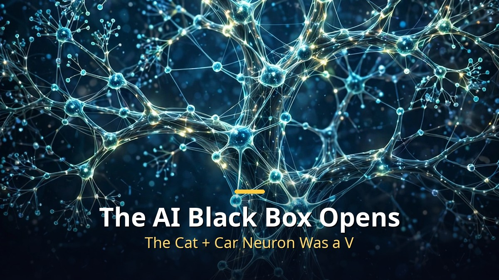
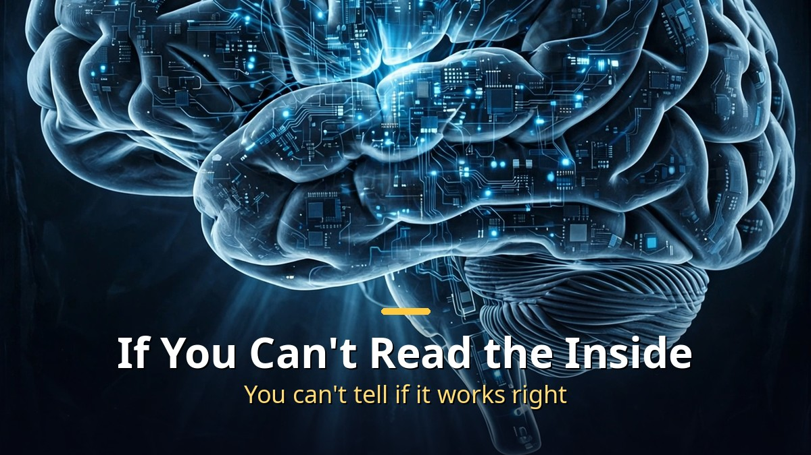
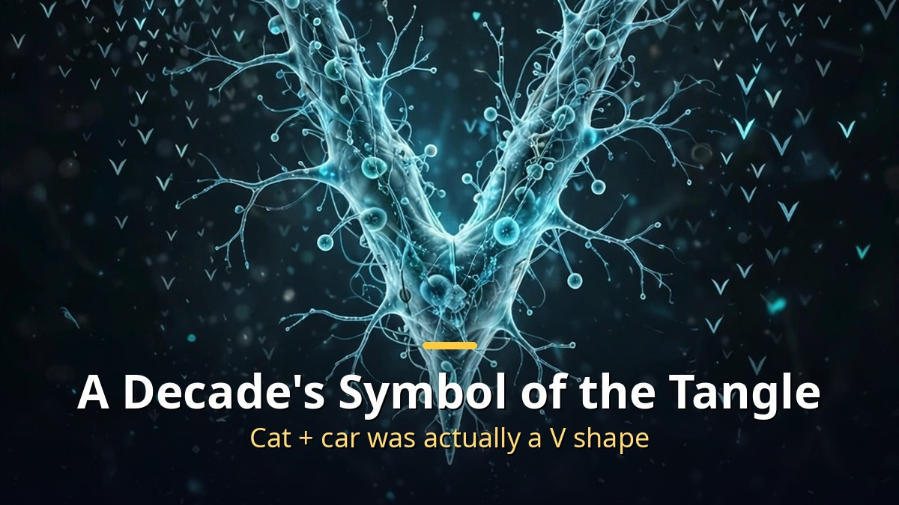
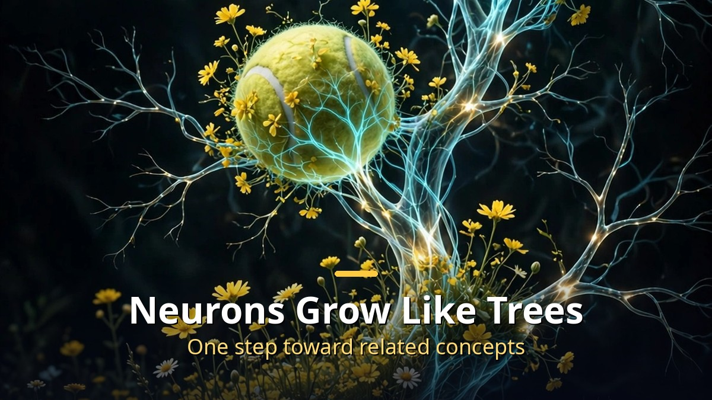

<!-- 본문 시작 -->

Nobody, not even the company that built it, knows exactly why an AI gives a particular answer.
That is the famous "black box" problem.
For years, one belief ruled this field: the inside of an AI is a hopeless tangle.
A former OpenAI interpretability researcher has overturned that belief with a new discovery.
AI neurons are not random — they grow like tree branches, reaching out toward related concepts.

> **Key takeaways**
>
> AI neurons were not a mess after all. The famous neuron known for a decade as "cat + car" turned out to detect a V shape, and neurons widen their territory one step at a time toward related concepts during training. This discovery, called "recursive generalization," opens hope that the inside of AI can be read. The researcher himself draws a line, though: it is a working hypothesis he holds at 85% confidence.

---

## Why is the AI "black box" a problem?

If you cannot read the inside of an AI, you cannot tell whether it is working properly.

Models like ChatGPT run on neural networks of millions to billions of neurons.
Nobody programmed what each neuron should do. The AI taught itself by reading vast amounts of text and predicting what comes next.
It is like discovering a brain that grew on its own — with no labels on any part.

A large model has billions of settings, so examining all of them would take hundreds of years.
Worse, each setting is just a number, so staring at it does not help.
The hard part is not finding a neuron — it is figuring out what that neuron means.

As AI writes code, solves math problems, and helps with decisions, this problem has become more urgent.
If you cannot look inside, you cannot tell whether it works correctly, gives honest answers, or has picked up dangerous habits.
The field trying to solve this is called "interpretability."

---

## How did the "cat + car" neuron become a V?

For a decade, this neuron was the symbol of the hopeless tangle.

When researchers first looked inside neurons, many seemed to do several unrelated jobs at once.
The famous case: one neuron in the image-recognition model Inception V1 reacted to both cat faces and car fronts.
Such neurons were called "polysemantic neurons."

Then came "superposition" theory: AI crams more concepts into limited neurons than they can hold.
It was compared to stuffing things into a drawer. Cat and car ended up in the same neuron not because they are related, but because they rarely appear together, so they do not interfere.
If that theory were right, looking at neurons alone would tell us almost nothing.

Researchers tried to decode the first AI by training a second AI, a "sparse autoencoder."
In one 2023 study, ordinary neurons in a small language model scored 0 out of 14, and an OpenAI project could explain only about 1.7% of all neurons.
For years, "AI is an unsolvable knot" was the dominant story.

But re-examining that famous "cat + car" neuron showed it detected neither cats nor cars — it detected a V shape.
A cat face's pointed shape and a car front's angle both form a V.
The experiment widened to V-shaped flames, V-shaped water jets from a fireboat, and a V-shaped fox face — all woke the same neuron.
Pushing the neuron in the opposite direction made it react to the round "O" shape at the point of the V. Exactly what a V detector should do.

Ironically, translator models like sparse autoencoders had split the V into cat pieces and car pieces, making it look more complicated.
A famous circuit example from 2020 superposition theory also turned out, on re-examination, to be a camera-angle issue rather than a "car" concept hidden inside a dog neuron.
One of superposition theory's key pieces of evidence may have been a mistake.

---

## What does it mean that neurons "grow like trees"?

Neurons widen their territory toward related concepts as training progresses.

The researcher watched individual neurons change during AI training.
One neuron first reacted to yellow rapeseed fields and dogs sitting in fields.
As training progressed, it widened to related concepts like tennis balls, green apples, and broccoli.

A finished neuron looks like a mess, but each step follows logically from the previous one.
This is the "recursive generalization" process, where a neuron reaches out one step at a time toward related concepts.
If concepts grow out of one another, every strange-looking combination is a clue to how AI connects ideas.

Much of the confusion was a tool problem, not an AI problem.
The tools that visualize what a neuron wants to see were not tuned properly.
Asking for the image that activates a neuron most let the model cheat with easy shortcuts, and explanation scores measured whether activation timing could be predicted — not whether the neuron was telling the truth.

In models with modern designs, neurons focused on their intended concepts, and 99–100% of neurons in a layer were easy to understand.
With fewer neurons, each handled a broad concept; adding neurons split broad concepts into specific ones.
More evidence that neurons grow like trees.

In the language model Qwen-32B, about 90% of all neurons performed one main function, about 7% performed two related functions, and only 2–4% remained unaccounted for.
Compared with OpenAI's 1.7%, that is a leap.
A neuron that reacted to "IY" grew to "DIY," and later to the whole phrase "do-it-yourself."
A "Titanic" neuron fired when the next word was likely to be "boat," and a neuron thought to react only to commas turned out to be a "Colorado" neuron tracking whether the sentence's context was Colorado.

| Area | Old belief | New discovery |
|---|---|---|
| Neuron understanding | Only about 1.7% explainable | About 90% of Qwen-32B neurons perform a single function |
| Polysemantic neurons | Several unrelated jobs | Detecting one abstract concept (V shape, etc.) |
| Interpretability | Hopeless tangle | Tree-like order — it can be read |
| Bigger models | Harder to understand as they grow | May actually become more organized as they grow |

The "cat + car neuron was actually a V" part made me laugh.
What researchers called a "tangle" for ten years turned out to be something we just did not know how to look at.
Of course, the researcher himself says he is 85% confident, and the largest models with trillions of parameters are still a long way off.
Still, one thing is clear: we have started learning how to "read" the inside of AI.
It brings to mind medicine before X-rays existed.

## Frequently asked questions

**Q. Does this discovery completely solve the AI black box?**

A. No. The researcher himself calls it a working hypothesis, not a finished paper, and says the biggest models with trillions of parameters still have a long way to go. What matters is that the direction has changed.

**Q. What does interpretability have to do with AI safety?**

A. If you can read the inside, you can check whether an AI is deceiving you or has picked up dangerous habits. In one case, finding and strengthening a specific part actually changed the model's behavior. Knowing what AI does is connected to making it do what you want.

**Q. Will ordinary people feel any change right away?**

A. Not yet. This is still research-stage news. But once AI can explain why it gave a particular answer, we will be one step closer to AI we can trust.

<!-- 본문 끝 -->

## 작업용 출처·이미지 정보 (업로드 제외)

- 자료 출처: AI '블랙박스'가 열리기 시작했다 (2026-10-18-001 한국어본)
- 이미지: images/01-hero-en.jpg ~ 04-img3-en.jpg / 직접 제작 (AI 생성 + 영어 오버레이) / 사용권: 자작

## 발행 기록 (업로드 제외)

- 사용자 요청: GitHub 저장소를 통한 Codex 발행 (영어 백로그 #7)
