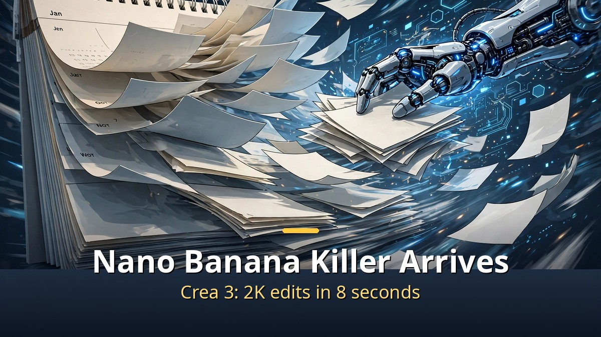
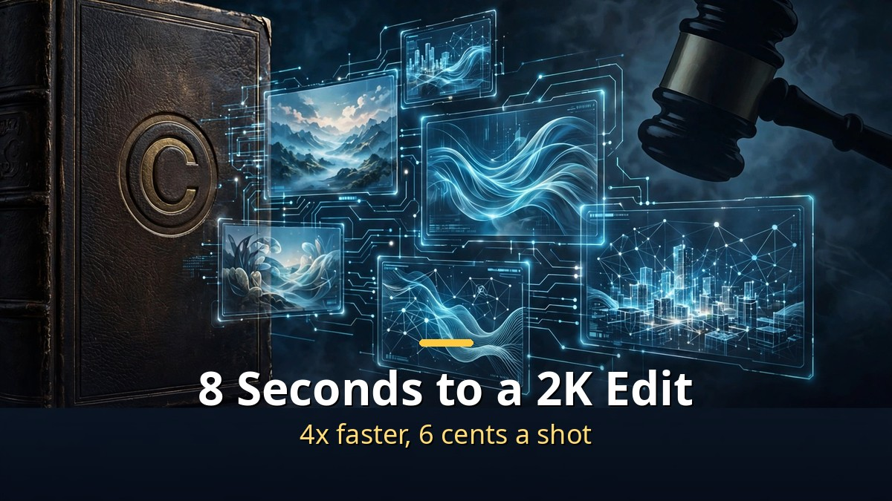
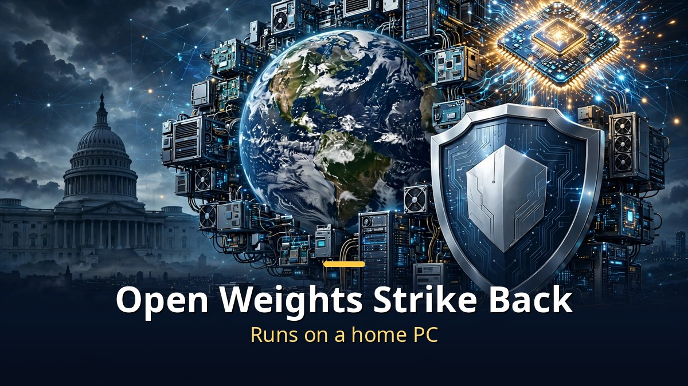

<!-- 본문 시작 -->

This week's AI news star is the image-editing model Crea 3.
It finishes a 2K-quality edit in just 8 seconds, with quality said to rival Google's Nano Banana Pro.
The price: 6 cents per image. The speed: 4 times faster.
The image AI war has moved to editing speed.

> **Key takeaways**
>
> Crea 3 opened beta on October 15. A 2K edit in 8 seconds, bounding boxes to change only the area you want, and LoRA training to lock in a specific product or person. The open-weight camp fought back too. FLUX 3 Image Klein runs on a home PC with 5.6B parameters, and the 816-billion-parameter Muse Spark Open went public. In the big-tech matchup, Gemini 4 Argon faced Meta's Muse Wonder.

---

## Nano Banana killer Crea 3 — what is different?

Crea 3 edits an image in 8 seconds at 2K quality.

Crea 3 specializes in "editing."
Pick part of a photo and change the background, clothes, or lighting — the rest stays untouched.
Change only the scene while leaving a product photo's label and logo alone, for example.

Speed is its weapon.
A 2K edit finishes within 8 seconds.
According to Crea's own comparison, that is 4 times faster than Nano Banana Pro (33 seconds) and more than 10 times faster than GPT Image 2 (90 seconds).
The price is 3 cents per 1K image and 6 cents per 2K image.

Precision is covered too.
Bounding boxes let you point to exactly where a new element should go, and up to 6 reference images can be used at once.
It is the first editing model to support LoRA training, so a specific product or character's look can be fixed.
For a team shooting shopping-mall product shots, keeping the same product identical in the next photo is the whole point.

---

## How did the open-weight camp fight back?

Open-weight models that run on a home PC strike back.

On the same day, Black Forest Labs released FLUX 3 Image Klein.
It is a 5.6-billion-parameter open-weight model that handles text generation and image editing in a single model.
The INT8 version runs on an 8GB VRAM graphics card — an ordinary PC at RTX 4070 level.
You can try it free in a Hugging Face demo.

Alibaba's Qwen Image 2.1 Turbo is the speed type.
It trades away some quality to generate fast.
It is also available to try on Hugging Face.

The biggest one is Muse Spark Open.
816 billion parameters, a 1-million-token context, open weights.
Meta and Apple reportedly optimized it to run on an M5 Ultra Mac Studio.
On benchmarks it was strongest among open-weight models, rather than against the latest closed models.

Add Nvidia's Nemotron 3.5 Super VL (120 billion parameters, speed-focused) and Microsoft's MAI-Base-2 (80 billion active parameters, no independent tests yet).
That is six notable new models in a single week.
A low-cost model called Ultramarine 1 Flash also appeared, but it was not on OpenRouter yet, so it could not be tested.

| Model | Type | Key specs |
|---|---|---|
| Crea 3 | Image editing | 2K in 8 seconds, $0.06 per image, LoRA training |
| FLUX 3 Image Klein | Open-weight image | 5.6B, runs on 8GB VRAM |
| Qwen Image 2.1 Turbo | Open-weight image | Fast version, some quality traded away |
| Muse Spark Open | Open-weight LLM | 816B parameters, 1M tokens |
| Nemotron 3.5 Super VL | Open-weight multimodal | 120B parameters, speed-focused |
| MAI-Base-2 | Microsoft model | 80B active parameters |

---

## Big-tech model showdown — who came out ahead?

Argon vs Muse Wonder, the big-tech head-to-head.

Google's Gemini 4 Argon scored competitively with the leaders on several benchmarks.
Its price is lower than some rival models.
The presenter tested it directly with coding and game-making: it succeeded in turning a photo into a 3D-printable bust, but game screens came out unpolished.

Meta's Muse Wonder scored 79% on a coding benchmark.
But the presenter's hands-on tests were mixed.
The requested game features were there, but the screens were weak, and it ranked 14th on an image-generation leaderboard.
Its price is said to be Claude Opus-level.

OpenAI's "28 days of releases" drew a lukewarm review this time.
Next-prompt prediction, tapping a point on your phone to hand off a task, and more context for Codex and Work were announced, but the presenter called them "minor changes rather than major new features."

On the audio side, Grok Voice 3.0 released a voice-agent sandbox, and ElevenLabs unveiled Instant Soundtracks, which automatically adds sound effects to video.

---

The real news this week is that the image AI race has moved from "draws well" to "edits fast."
Drawing well is now the default, and what makes money in real work is editing speed.
Now that Crea 3 has hit 8 seconds, the next contender will show up with 5.
It feels like just yesterday I waited 90 seconds for a blog thumbnail — soon 8 seconds will feel slow.
The winner of the speed race is, in the end, the person using the tools.

## Frequently asked questions

**Q. Can I use Crea 3 for free?**

A. During the beta period you can use it on the Crea website. The official prices are 3 cents per 1K image and 6 cents per 2K image.

**Q. Does FLUX 3 Image Klein really run on a home computer?**

A. With the INT8 version, it runs on an Nvidia graphics card with 8GB of VRAM or more. On an RTX 4070, one image takes under 9 seconds, according to reports.

**Q. Can I run the 816-billion-parameter Muse Spark Open at home?**

A. Not on an ordinary PC. Meta and Apple reportedly optimized it for M5 Ultra Mac Studio-class machines.

<!-- 본문 끝 -->

## 작업용 출처·이미지 정보 (업로드 제외)

- 자료 출처: 이번 주 AI 신모델 6종 총정리 (네이버 224444416786 한국어본)
- 이미지: images/01-hero-en.jpg ~ 04-img3-en.jpg / 직접 제작 (AI 생성 + 영어 오버레이) / 사용권: 자작

## 발행 기록 (업로드 제외)

- 사용자 요청: GitHub 저장소를 통한 Codex 발행 (영어 백로그 #8)
