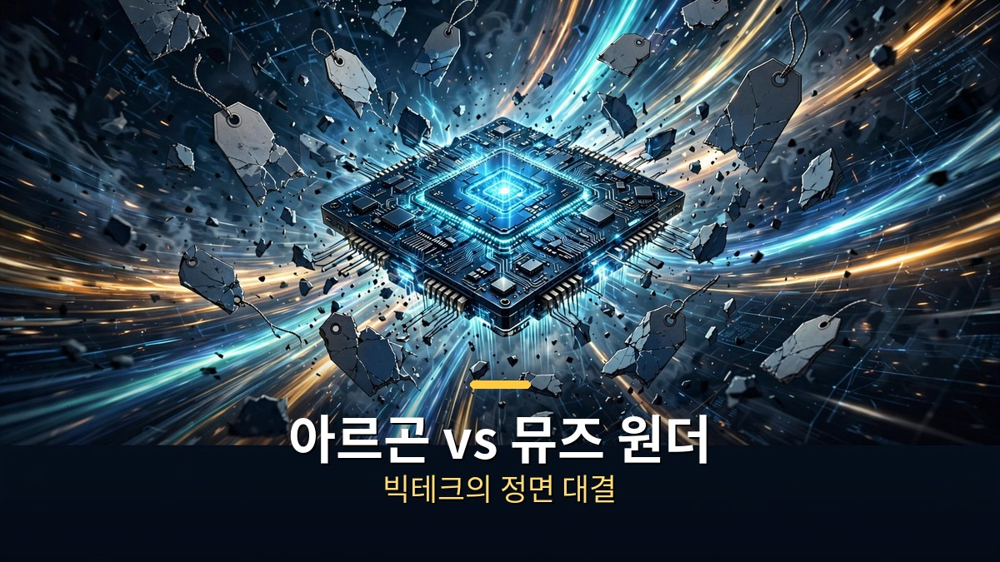

<!-- 본문 시작 -->

이번 주 AI 뉴스의 주인공은 이미지 편집 모델 크레아 3입니다.
2K 화질 편집을 8초 만에 끝내는데, 품질은 구글 이미지 모델 나노 바나나 프로급이라고 합니다.
가격은 장당 6센트, 속도는 4배.
이미지 AI 전쟁이 편집 속도로 번졌습니다.

> **핵심 정리: 크레아 3가 10월 15일 베타를 열었습니다. 2K 편집 8초, 바운딩 박스로 원하는 영역만 고치고, LoRA로 특정 제품·인물 학습까지 됩니다. 오픈 웨이트 진영도 반격했습니다. FLUX 3 Image Klein은 5.6B 파라미터로 집 PC에서 돌아가고, 8160억 파라미터짜리 Muse Spark Open도 공개됐습니다. 빅테크 대결에서는 제미나이 4 아르곤과 메타 뮤즈 원더가 맞붙었습니다.**

---

## 나노 바나나 킬러 크레아 3, 뭐가 다른가?

크레아 3는 "편집"에 특화된 모델입니다.
사진 일부를 골라 배경, 옷, 조명을 바꾸면 나머지 부분은 그대로 둡니다.
제품 사진의 라벨과 로고는 건드리지 않고 장면만 바꾸는 식입니다.

속도가 무기입니다.
2K 편집이 끝까지 8초 안에 끝납니다.
크레아 측 비교에 따르면 나노 바나나 프로(33초)의 4배, GPT Image 2(90초)의 10배가 넘는 속도입니다.
가격은 1K 장당 3센트, 2K 장당 6센트입니다.

정밀도도 챙겼습니다.
바운딩 박스로 새 요소가 들어갈 위치를 직접 지정할 수 있고 한 번에 최대 6장의 참조 이미지를 씁니다.
편집 모델 중 처음으로 LoRA 학습을 지원해서, 특정 제품이나 캐릭터의 생김새를 고정시킬 수 있습니다.
쇼핑몰 상세컷을 찍는 팀이라면 한 번 쓴 제품이 다음 사진에서도 똑같이 나오는 게 핵심일 겁니다.

크레아 3, 8초 만에 끝내는 2K 이미지 편집

## 오픈 웨이트 진영의 반격은?

같은 날 블랙포레스트랩스도 FLUX 3 Image Klein을 내놨습니다.
56억 파라미터짜리 오픈 웨이트 모델인데, 텍스트 생성과 이미지 편집을 하나의 모델로 처리합니다.
INT8 버전은 VRAM 8GB짜리 그래픽카드, 그러니까 RTX 4070급 일반 PC에서도 돌아갑니다.
허깅페이스 데모에서 무료로 만져볼 수 있습니다.

알리바바의 Qwen Image 2.1 Turbo는 속도형입니다.
품질을 일부 포기하는 대신 빠르게 뽑아내는 고속 버전입니다.
역시 허깅페이스에서 체험할 수 있습니다.

가장 큰 건 Muse Spark Open입니다.
8160억 파라미터, 100만 토큰 컨텍스트의 오픈 웨이트 모델입니다.
메타와 애플이 M5 울트라 맥 스튜디오에서 돌리도록 최적화했다고 전해집니다.
벤치마크에서는 최신 클로즈드 모델보다는 다른 오픈 웨이트 모델들과 견줘 가장 강했습니다.

집 PC에서 돌아가는 오픈 웨이트 모델들의 반격

여기에 엔비디아의 Nemotron 3.5 Super VL(1200억 파라미터, 속도가 강점), 마이크로소프트의 MAI-Base-2(800억 액티브 파라미터, 아직 독립 테스트 불가)까지.
이번 주에만 이름난 신모델이 여섯 종입니다.
울트라마린 1 플래시라는 저비용 모델도 나왔지만 아직 OpenRouter에 없어 테스트가 안 됐습니다.

---

| 모델 | 종류 | 핵심 스펙 |
|---|---|---|
| 크레아 3 | 이미지 편집 | 2K 8초, 장당 $0.06, LoRA 학습 |
| FLUX 3 Image Klein | 오픈 웨이트 이미지 | 5.6B, 8GB VRAM 구동 |
| Qwen Image 2.1 Turbo | 오픈 웨이트 이미지 | 고속 버전, 품질 일부 포기 |
| Muse Spark Open | 오픈 웨이트 LLM | 8160억 파라미터, 100만 토큰 |
| Nemotron 3.5 Super VL | 오픈 웨이트 멀티모달 | 1200억 파라미터, 속도 강점 |
| MAI-Base-2 | MS 모델 | 800억 액티브 파라미터 |

---

## 빅테크 모델 대결, 누가 앞섰나?

구글의 제미나이 4 아르곤은 여러 벤치마크에서 선두권과 경쟁할 만한 점수를 받았습니다.
가격은 일부 경쟁 모델보다 저렴합니다.
발표자는 코딩과 게임 만들기로 직접 테스트했는데, 사진으로 3D 프린팅용 흉상을 뽑아내는 데는 성공했지만 게임 화면은 세련되지 못했다고 평가했습니다.

메타의 뮤즈 원더는 코딩 벤치마크에서 79%를 기록했습니다.
다만 발표자의 직접 테스트는 엇갈렸습니다.
요청한 게임 기능은 들어갔지만 화면이 약했고, 이미지 생성 리더보드에서는 14위였습니다.
가격은 클로드 오퍼스급이라고 합니다.

아르곤 vs 뮤즈 원더, 빅테크의 정면 대결

오픈AI의 "28일간의 릴리스"는 이번에 아쉬웠다는 평가입니다.
다음 프롬프트 예측, 휴대폰에서 점을 찍어 작업을 맡기는 기능, Codex와 Work의 컨텍스트 증가 같은 업데이트가 있었지만, 발표자는 "주요 신기능이라기보다 소소한 변경"이라고 잘랐습니다.

음성 쪽에서는 Grok Voice 3.0이 음성 에이전트 샌드박스를 내놨고, ElevenLabs는 영상에 효과음을 자동 입히는 Instant Soundtracks를 공개했습니다.

---

이미지 AI 경쟁이 "잘 그리는" 단계에서 "빨리 고치는" 단계로 넘어온 게 이번 주의 진짜 소식 같습니다.
잘 그리는 건 이제 기본값이 됐고, 실무에서 돈을 버는 건 편집 속도니까요.
크레아 3가 8초를 찍은 이상, 다음 주자는 5초를 들고 나올 겁니다.
저도 블로그 썸네일 만들 때 90초씩 기다리던 게 엊그제 같은데, 이젠 8초가 느리게 느껴질 날이 오겠죠.
속도 경쟁의 수혜자는 결국 쓰는 사람입니다.

## 자주 묻는 질문

**Q. 크레아 3는 무료로 쓸 수 있나요?**
A. 베타 기간에는 크레아 웹사이트에서 쓸 수 있습니다. 정식 가격은 1K 장당 3센트, 2K 장당 6센트입니다.

**Q. FLUX 3 Image Klein은 집 컴퓨터에서 정말 돌아가나요?**
A. INT8 버전을 쓰면 VRAM 8GB 이상의 엔비디아 그래픽카드에서 구동됩니다. RTX 4070에서 한 장 만드는 데 9초 이내라고 합니다.

**Q. Muse Spark Open 8160억 파라미터를 집에서 돌릴 수 있나요?**
A. 일반 PC로는 어렵습니다. 메타와 애플이 M5 울트라 맥 스튜디오급에서 구동되도록 최적화했다고 전해집니다.

<!-- 본문 끝 -->

## 작업용 출처·이미지 정보 (업로드 제외)

- 복원 출처: 네이버 공개 글 224444416786 (로컬 초안 draft_newmodels_mtnb.md 기준 복원, 윤문 없음)
- 이미지: images/01-hero.jpg ~ 04-img3.jpg / 직접 제작 (AI 생성 + 한글 오버레이) / 사용권: 자작
