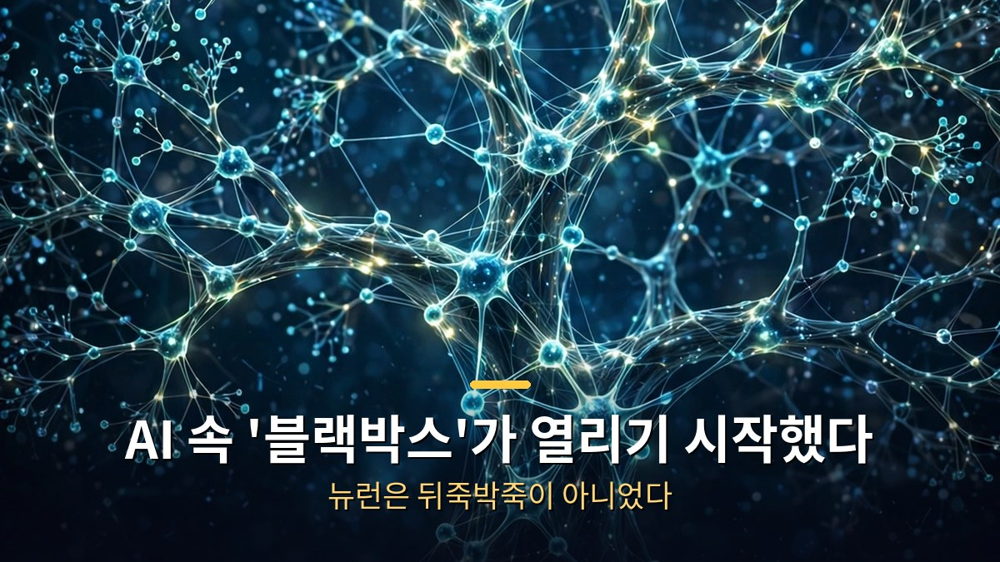
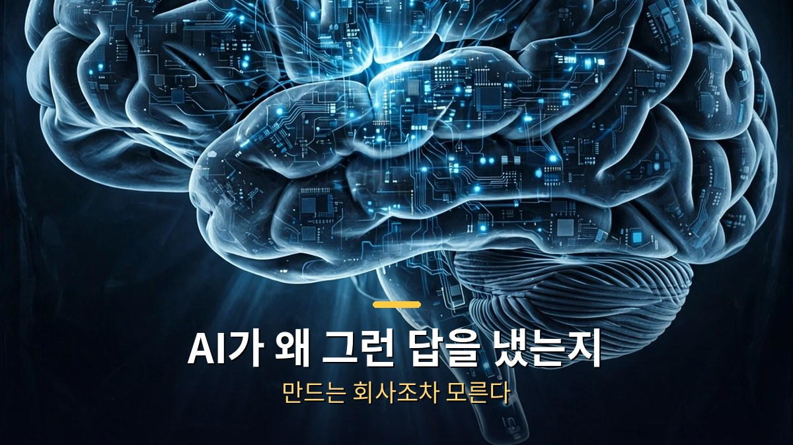
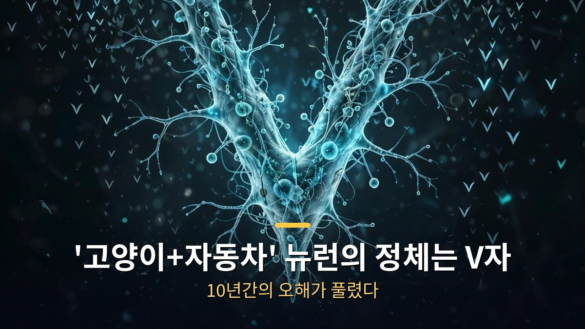
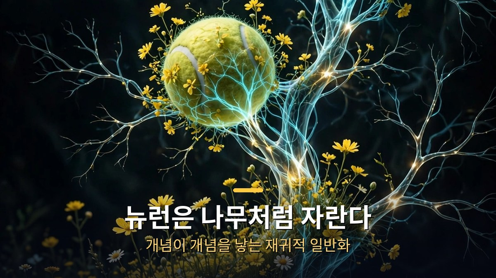

<!-- 본문 시작 -->

AI가 왜 그런 답을 내놨는지, 만드는 회사조차 정확히 모른다.
이른바 '블랙박스' 문제다.
수년간 이 분야를 지배한 믿음이 있었다. AI 내부는 가망 없는 뒤죽박죽이라는 것.
전 OpenAI 해석 가능성 연구원이 그 믿음을 뒤집는 발견을 내놨다.
AI 뉴런은 무작위가 아니라, 나무 가지처럼 개념을 뻗으며 자란다.

> **핵심 정리**
>
> AI 뉴런은 뒤죽박죽이 아니었다. 10년간 '고양이+자동차'로 알려졌던 유명 뉴런의 정체는 V자 형태였고, 뉴런은 학습 과정에서 관련 개념으로 한 걸음씩 영역을 넓혀간다. '재귀적 일반화'라 불리는 이 발견은 AI 내부를 읽을 수 있다는 희망을 열었다. 다만 연구자 본인도 85% 확신의 '작업 가설'이라고 선을 그었다.

---

## AI '블랙박스'는 왜 문제인가?

ChatGPT 같은 모델은 수백만에서 수십억 개에 이르는 뉴런의 신경망으로 작동한다.
각 뉴런의 역할을 프로그래밍한 사람은 아무도 없다. AI는 방대한 텍스트를 읽고 다음 내용을 예측하며 스스로 배웠다.
스스로 자라난 뇌를 발견한 셈인데, 각 부분에 이름표가 없는 상태다.

큰 모델은 수십억 개의 설정 값이 있어서, 전부 살펴보는 데 수백 년이 걸린다.
게다가 각 값은 숫자일 뿐이라 들여다봐도 도움이 되지 않는다.
어려운 건 뉴런을 찾는 게 아니라, 그 뉴런이 무엇을 의미하는지 파악하는 것이다.

AI가 코드를 짜고, 수학 문제를 풀고, 의사결정을 돕는 시대가 되면서 이 문제는 더 급해졌다.
내부를 들여다볼 수 없으면 제대로 작동하는지, 정직한 답을 내는지, 위험한 습관을 배웠는지 알 길이 없다.
이 문제를 풀려는 분야가 바로 '해석 가능성'이다.

## '고양이+자동차' 뉴런은 어떻게 V자가 되었나?

뉴런을 처음 들여다봤을 때, 많은 뉴런이 서로 상관없는 여러 역할을 하는 것처럼 보였다.
유명한 사례가 있다. 이미지 인식 모델 Inception V1의 한 뉴런은 고양이 얼굴과 자동차 앞부분에 모두 반응했다.
이런 뉴런을 '다의적 뉴런'이라 불렀다.

여기에 '중첩' 이론이 등장했다. AI가 제한된 뉴런에 더 많은 개념을 쑤셔 넣는다는 설명이다.
서랍에 물건을 쑤셔 넣는 것에 비유됐다. 고양이와 자동차가 같은 뉴런에 들어간 건 관련이 있어서가 아니라, 동시에 나타나는 경우가 드물어 방해가 되지 않기 때문이라는 것이다.
이 이론이 맞다면 뉴런을 들여다보는 것만으로는 거의 아무것도 알 수 없다는 뜻이다.

연구자들은 '희소 오토 인코더'라는 두 번째 AI를 훈련시켜 첫 번째 AI를 해독하려 했다.
2023년 한 연구에서는 소규모 언어 모델의 일반 뉴런에 14점 만점에 0점을 줬고, OpenAI의 프로젝트에서는 전체 뉴런 중 약 1.7%만 설명할 수 있었다.
수년간 "AI는 풀기 어려운 매듭"이라는 이야기가 지배적이었다.

그런데 그 유명한 '고양이+자동차' 뉴런을 다시 살펴본 결과, 고양이도 자동차도 아닌 'V자 형태'를 인식하는 뉴런이었다.
고양이 얼굴의 뾰족한 형태와 자동차 앞부분의 각도가 모두 V자를 이룬다.
실험 대상은 V자 모양의 불꽃, 소방선에서 뿜어져 나오는 V자 물줄기, V자 여우 얼굴로 넓혀갔고, 모두 같은 뉴런을 깨웠다.
뉴런을 반대 방향으로 밀어냈을 때는 V자가 가리키는 지점의 둥근 'O' 형태에 반응했다. V자 탐지기라면 당연한 결과다.

아이러니한 건, 희소 오토 인코더 같은 번역기 모델이 오히려 V자를 고양이 조각과 자동차 조각으로 분리해 더 복잡하게 보이게 만들었다는 점이다.
2020년에 발표된 중첩 이론의 유명 회로 사례도 다시 보니, '자동차' 개념이 개 뉴런 속에 숨겨진 게 아니라 카메라를 향한 자세의 문제였다.
중첩 이론의 핵심 증거 중 하나가 실수였을 가능성이 제기된 셈이다.

## 뉴런이 '나무처럼 자란다'는 건 무슨 뜻인가?

연구자는 AI 학습 과정에서 개별 뉴런의 변화를 관찰하는 실험을 했다.
한 뉴런은 학습 초기에 노란 유채꽃밭이나 들판에 앉은 개에 반응했다.
학습이 진행되자 테니스공, 청사과, 브로콜리 같은 관련 개념으로 영역을 넓혀갔다.

완성된 뉴런만 보면 뒤죽박죽 같지만, 각 단계는 이전 단계와 논리적으로 이어진다.
뉴런이 한 걸음씩 관련 개념으로 뻗어나가는 '재귀적 일반화' 과정이다.
개념들이 서로에게서 자라난 것이라면, 이상해 보이는 조합 하나하나가 AI가 개념을 어떻게 연결하는지 알려주는 단서가 된다.

상당한 혼란은 AI의 잘못이 아니라 도구의 문제였다.
뉴런이 무엇을 보고 싶어 하는지 시각화하는 도구들이 제대로 조정되지 않았다.
뉴런을 가장 활성화하는 이미지를 만들라는 요청은 모델이 쉬운 길을 택하는 속임수를 썼고, 설명 평가 방식도 뉴런이 진실인지가 아니라 활성화 시점을 예측할 수 있는지를 기준으로 매겨졌다.

현대적 설계를 쓴 모델에서는 뉴런이 원래 의도에 집중했고, 해당 계층 뉴런의 99~100%를 쉽게 이해할 수 있었다.
뉴런 수가 적으면 각 뉴런이 넓은 개념을 다뤘고, 뉴런 수를 늘리자 넓은 개념이 구체적인 것들로 나뉘었다.
뉴런이 나무처럼 자란다는 증거다.

언어 모델 Qwen-32B에서는 전체 뉴런의 약 90%가 하나의 주요 기능을 수행했고, 약 7%는 두 가지 연관된 기능을 수행했으며, 아직 파악되지 않은 건 2~4%에 불과했다.
OpenAI 프로젝트의 1.7%와 비교하면 비약적인 발전이다.
'IY'에 반응하던 뉴런이 'DIY'에, 나중에는 'do-it-yourself' 전체 구문에 반응하며 단어로 다시 자라나는 모습도 포착됐다.
'타이타닉' 뉴런은 다음 단어가 'boat'일 확률이 높은 순간에 반응했고, 쉼표에만 반응하는 줄 알았던 '쉼표 뉴런'은 사실 문장의 문맥이 콜로라도인지 추적하는 '콜로라도' 뉴런이었다.

| 구분 | 기존 믿음 | 새 발견 |
|---|---|---|
| 뉴런 이해도 | 전체의 약 1.7%만 설명 가능 | Qwen-32B의 약 90%가 단일 기능 수행 |
| 다의적 뉴런 | 서로 무관한 여러 역할 수행 | 하나의 추상 개념(V자 등) 인식 |
| 해석 가능성 | 가망 없는 뒤죽박죽 | 나무처럼 자라는 질서, 읽을 수 있다 |
| 큰 모델 | 클수록 이해 불가능 | 클수록 오히려 더 조직적일 수 있음 |

"고양이+자동차 뉴런이 사실은 V자였다"는 대목에서 피식했다.
10년간 AI 연구자들이 '뒤죽박죽'이라 부르던 게, 알고 보니 우리가 보는 법을 몰랐던 거였다니.
물론 연구자 본인도 85% 확신이라 밝혔고, 수조 개짜리 거대 모델은 아직 멀었다고 했다.
그래도 AI 내부를 '읽는 법'을 배우기 시작했다는 사실 하나는 분명해 보인다.
엑스레이가 없던 시절의 의학을 떠올리게 된다.

## 자주 묻는 질문

**Q. 이 발견으로 AI 블랙박스가 완전히 풀린 건가요?**

A. 아니다. 연구자 본인도 완성된 논문이 아닌 '작업 가설'이라 했고, 수조 개 매개변수를 가진 가장 큰 모델들은 아직 갈 길이 멀다고 밝혔다. 다만 방향이 바뀌었다는 게 중요하다.

**Q. 해석 가능성이 AI 안전과 무슨 상관인가요?**

A. 내부를 읽을 수 있으면 AI가 기만하는지, 위험한 습관을 배웠는지 확인할 수 있다. 실제로 특정 부분을 찾아 강화하자 모델의 행동이 바뀐 사례도 있다. AI가 무엇을 하는지 아는 것과, 원하는 대로 하게 만드는 것은 연결된 문제다.

**Q. 일반인이 당장 체감할 변화가 있나요?**

A. 당장은 없다. 아직 연구 단계의 이야기다. 하지만 AI가 왜 그런 답을 내놨는지 설명할 수 있게 되면, 믿고 쓸 수 있는 AI에 한 걸음 다가간다.

<!-- 본문 끝 -->

## 작업용 출처·이미지 정보 (업로드 제외)

- 이미지: images/01-hero.jpg ~ 04-img3.jpg / 직접 제작 (AI 생성 + 한글 오버레이) / 사용권: 자작

## 발행 기록 (업로드 제외)

- 사용자 요청: GitHub 저장소를 통한 Codex 발행
- 처리 결과:
- 확인한 게시글 URL 또는 임시저장 식별 정보:
- 오류·미완료 항목:
