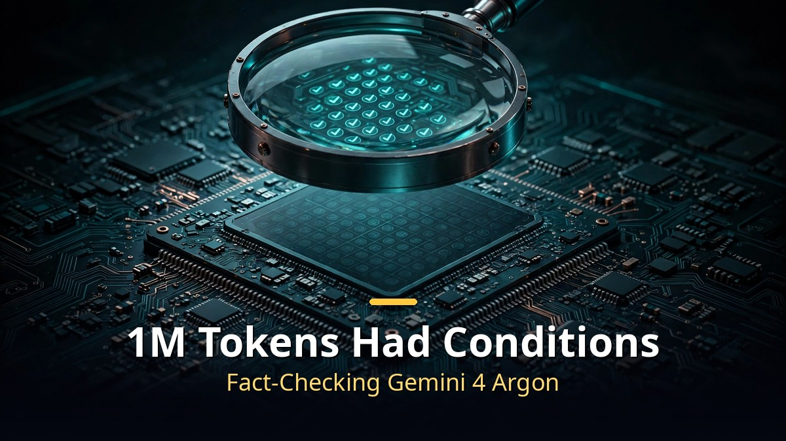
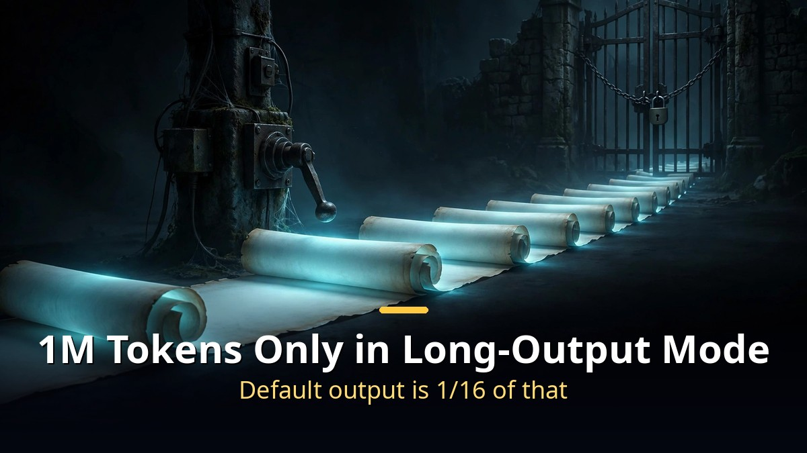
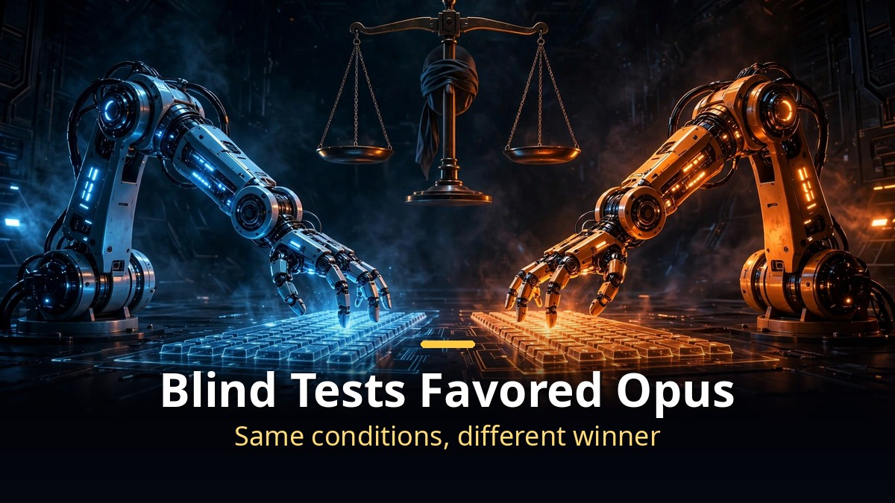

<!-- 본문 시작 -->

Gemini 4 Argon set YouTube and social media on fire with "insane" reviews.
Writing and explanation quality clearly improved, the reviews said.
But when you pull apart claims like "best at coding," "1M token output," and "taking back number one," the story changes.
I gathered multiple reviews and data points and kept only the facts.

> **Key takeaways**
>
> Writing and explanation genuinely got stronger. But 1M token output only works with long-output mode switched on, Opus won head-to-head blind coding matchups under identical conditions, and the price doubles in December. Check the fine print behind the "insane" label before you commit.

---

## Is 1M token output really available to everyone?

According to Google's official docs, default output is roughly one-sixteenth of 1M tokens.
The full 1M tokens (about 750,000 words) is only available in the developer API with "long output mode" explicitly enabled.
Korean reviewers who actually used the API received far less, and hit errors mid-task.
Plenty of videos hyped the 1M number while skipping that detail.

## Is "best at coding, crushed Opus" actually true?

In the benchmark Google cited for its coding number-one claim, an outside research group found at least 23 scoring errors out of 113 problems.
Given the Argon–Opus gap was only 3.7 points, those errors could easily have swung the result.
Google's comparison chart also reused other companies' published numbers as-is.
In a terminal-style coding test it listed Opus at 66 points; an independent measurement put it at 60.
Some tests even gave Argon six times the time budget.

Reviewers' direct comparisons were clearer.
In blind matchups where judges didn't know which model made what, Opus won every task.
Six tasks with identical prompts — Opus won all six.
In a code-repository test, Opus passed 5 of 5 while Argon passed 4.
On a security check, Argon missed a permission vulnerability and took the longest.

To be fair, Argon won some experiments too. It scored higher on real code-fix accuracy, and beat Opus on game-like tasks.
But results flipped by task, and under identical conditions Opus usually came out ahead.

3D and motion graphics need the same scrutiny.
Google's 3D demo was the product of the AI iterating thousands of times over hours — not a single prompt.
For photorealistic output, Opus was stronger.
In a blind comparison, Argon ranked 4th on a drink-bottle task: glass looked painted, the drink looked fake, and a faucet floated in mid-air.
Argon's motion-graphics code came out in 1 minute 40 seconds — far faster and cheaper — but Opus won on finished video quality.

## Is it really half the price of Opus?

The current price is a discount valid through November 30.
On December 1 the price doubles to match Opus.
"Half the price of Opus" only applies during the discount window.

Real-world cost per task can be higher.
Argon uses more than twice the tokens of other models for the same job.
One independent calculation still found Argon cheaper, but a 20-run real coding experiment came out at 2.5× the cost of Opus at December pricing.
After December, measure your own workload before deciding.

The low hallucination rate needs interpretation too.
Independent evaluation found Argon had the lowest hallucination rate among top models.
But that's largely because it ducks questions it can't answer. Its correct-answer rate was actually lower than GPT-6 Astra's.
Low hallucination doesn't mean high accuracy.

Usage limits can also run out faster than expected.
Multiple paid-plan users reported hitting the wall after just a few uses.
Google hasn't published Argon's dedicated limit numbers.

| Claim | Fact |
|---|---|
| 1M token output | Long-output mode only. Default is about 1/16 of that |
| Best at coding, crushed Opus | Opus won under identical blind conditions. Google's cited test had 23 scoring errors |
| Hallucination problem solved | Lowest hallucination rate, but from dodging unknowns. Correct-answer rate below GPT-6 Astra |
| Half the price of Opus | Discount until Nov 30. Same price from December, with 2×+ token usage |

"Insane" isn't wrong. For writing, explanation, and research summaries, it's genuinely useful.
But most reviews were glamorous demos from channels with early access, with almost no same-condition comparisons.
The most accurate review is running your own tasks through both models side by side.
With the December price hike approaching, measure before it hits.

## Frequently asked questions

**Q. Is Gemini 4 Argon worth trying now?**

A. For writing, explanation, and research summaries, yes. For coding or screen design, Opus still wins many same-condition comparisons.

**Q. When can I use the 1M tokens?**

A. Only in the developer API with long-output mode enabled. Default settings give about one-sixteenth of that.

**Q. What if the post-December price is too much?**

A. After the discount ends it costs the same as Opus. Token usage can exceed 2×, so measure your per-task cost before deciding.

<!-- 본문 끝 -->

## 작업용 출처·이미지 정보 (업로드 제외)

- 자료 출처: 제미나이 4 아르곤 리뷰·벤치마크 종합 팩트체크 (2026-10-18)
- 이미지: images/01-hero-en.jpg ~ 04-img3-en.jpg / 직접 제작 (AI 생성 + 영어 오버레이) / 사용권: 자작

## 발행 기록 (업로드 제외)

- 사용자 요청: GitHub 저장소를 통한 Codex 발행 (영어 백로그 #6)
- 처리 결과:
- 확인한 게시글 URL 또는 임시저장 식별 정보:
- 오류·미완료 항목:
