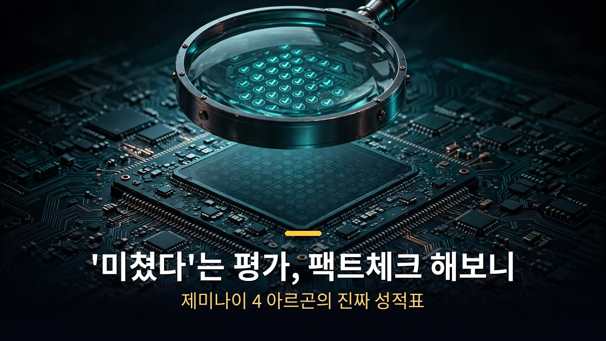
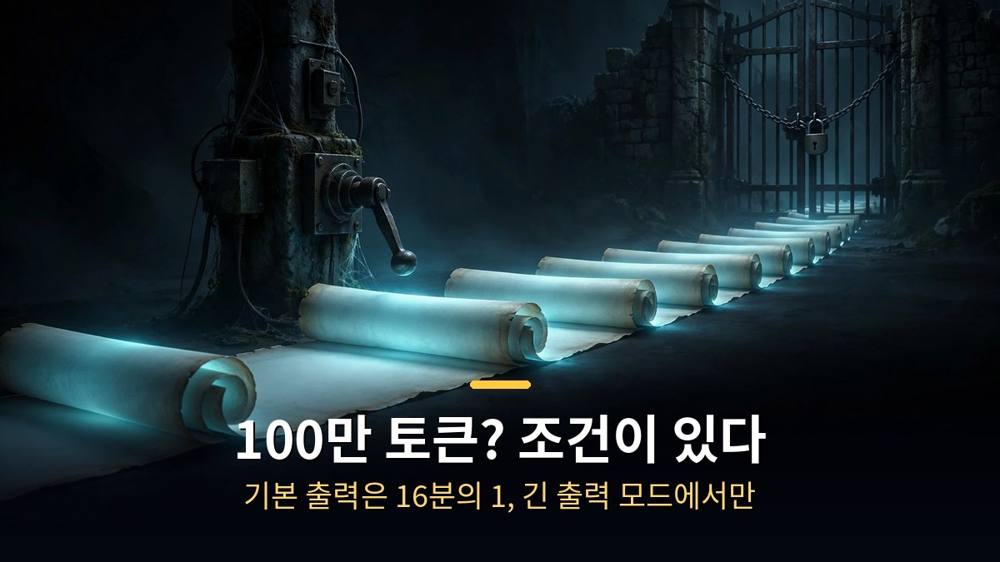
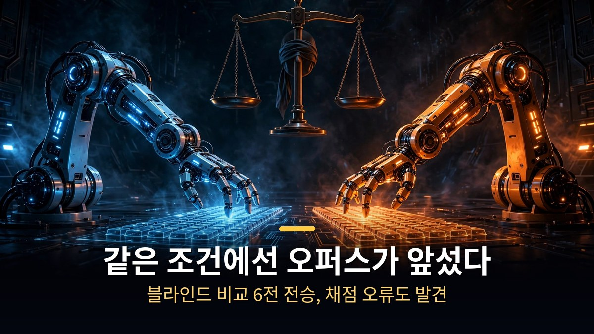

<!-- 본문 시작 -->

제미나이 4 아르곤이 '미쳤다'는 평가와 함께 유튜브와 SNS를 달궜다.
글쓰기와 설명 능력이 확실히 좋아졌다는 후기가 줄을 이었다.
그런데 '코딩 최강', '100만 토큰 출력', '1등 탈환' 같은 주장을 하나씩 뜯어보면 이야기가 달라진다.
여러 리뷰와 데이터를 모아 팩트만 남겨봤다.

> **핵심 정리**
>
> 글쓰기와 설명은 확실히 강해졌다. 하지만 100만 토큰 출력은 긴 출력 모드를 켰을 때만 가능하고, 같은 조건의 코딩 블라인드 대결에서는 오퍼스 모델이 앞섰으며, 가격은 12월부터 두 배로 오른다. '미쳤다'는 평가 뒤에 붙은 조건들을 확인하고 쓰는 게 낫다.

---

## 100만 토큰 출력, 정말 누구나 쓸 수 있나?

구글 공식 문서에 따르면 기본 출력량은 100만 토큰의 약 16분의 1 수준이다.
100만 토큰(약 75만 단어) 출력은 개발자용 API에서 '긴 출력 모드'를 별도로 활성화했을 때만 가능하다.
실제로 API를 사용한 국내 리뷰에서는 이보다 적은 숫자를 받았고, 작업 중 오류가 발생하기도 했다.
이 단서를 빼고 100만 토큰만 강조한 영상이 다수 있었다.

## '코딩 최강, 오퍼스 박살'은 사실인가?

구글이 코딩 1위의 근거로 제시한 시험에서, 외부 연구 기관은 113문제 중 최소 23개의 채점 오류를 발견했다.
아르곤과 오퍼스의 점수 차이가 3.7점에 불과한 걸 감안하면, 채점 오류가 결과에 영향을 미쳤을 가능성이 있다.
구글의 비교표는 다른 회사의 발표 수치를 그대로 가져온 것이기도 했다.
터미널형 코딩 시험에서는 오퍼스 점수를 66점으로 표기했지만, 독립 기관의 실제 측정 결과는 60점이었다.
일부 시험에서는 아르곤에게만 6배의 시간을 주기도 했다.

리뷰어들의 직접 비교 결과는 더 명확하다.
누가 만들었는지 가리고 채점한 블라인드 비교에서 오퍼스가 모든 과제에서 이겼다.
같은 프롬프트로 6가지 과제를 비교했을 때도 6가지 과제 모두 오퍼스의 승리였다.
코드 저장소 테스트에서는 오퍼스가 5개 중 5개를 통과한 반면 아르곤은 4개만 통과했다.
보안 점검에서는 아르곤이 권한 취약점을 놓쳤고, 가장 오래 걸렸다.

물론 아르곤이 앞선 실험도 있다. 실제 코드 수정 정답률 실험에서는 아르곤이 더 높았고, 게임 같은 과제에서는 아르곤이 이기기도 했다.
하지만 과제마다 결과가 엇갈렸고, 같은 조건에서는 대부분 오퍼스가 앞섰다.

3D와 모션 그래픽도 따져볼 게 있다.
구글이 보여준 3D 데모는 AI가 수천 번 수정하고 몇 시간을 돌린 결과물이다. 한 번의 프롬프트로 나온 결과물이 아니다.
실사 같은 결과물에서는 오퍼스가 더 앞섰다.
누가 만들었는지 가린 비교에서 아르곤은 음료병 만들기 과제에서 4등을 기록했다. 유리가 그림처럼 보이고 음료가 가짜 같았으며, 수도꼭지가 허공에 뜨는 등 완성도가 떨어졌다.
모션 그래픽 코드는 아르곤이 1분 40초 만에 만들며 훨씬 빠르고 저렴했지만, 영상의 완성도 측면에서는 오퍼스가 더 뛰어났다.

## 가격은 정말 오퍼스의 반값인가?

현재 가격은 11월 30일까지 적용되는 할인가다.
12월 1일부터는 가격이 두 배로 오르며, 오퍼스 모델과 동일한 가격이 된다.
'오퍼스 반값'이라는 말은 할인 기간에만 해당된다.

실제 사용량 대비 가격은 비쌀 수 있다.
같은 과제를 풀 때 아르곤은 다른 모델보다 두 배 이상의 토큰을 사용한다.
독립 기관 계산으로는 아르곤이 더 저렴하지만, 실제 코드 작업 20번 실험에서는 12월 가격 기준으로 오퍼스의 2.5배가 나왔다.
12월부터는 직접 작업량을 재봐야 정확한 비용을 알 수 있다.

환각 비율이 낮다는 것도 해석이 필요하다.
독립 평가에서 아르곤의 환각률은 상위 모델 중 가장 낮았다.
하지만 이는 모를 때 답을 피하는 경향이 강하기 때문이다. 정답을 맞힌 비율은 오히려 GPT-6 아스트라보다 낮다.
환각률이 낮다고 정답률이 높은 건 아니다.

사용 한도도 생각보다 빨리 소진될 수 있다.
유료 요금제임에도 몇 번 사용하지 않았는데 막혔다는 사례가 다수 보고됐다.
구글은 아르곤 전용 한도 숫자를 공개하지 않았다.

| 주장 | 팩트 |
|---|---|
| 100만 토큰 출력 | 긴 출력 모드에서만. 기본 설정은 16분의 1 수준 |
| 코딩 최강, 오퍼스 박살 | 블라인드 동일 조건에선 오퍼스가 앞섬. 구글 제시 시험에 채점 오류 23개 |
| 환각 문제 해결 | 환각률은 최저이나 '모르겠다' 회피 탓. 정답률은 GPT-6 아스트라보다 낮음 |
| 오퍼스 반값 | 11월 30일까지 할인. 12월부터 같은 가격, 토큰 사용량은 2배 이상 |

'미쳤다'는 말이 틀렸다는 게 아니다. 글쓰기와 설명, 조사 정리 용도로는 확실히 쓸 만하다.
다만 리뷰 대부분이 공개 전 미리 써본 채널의 화려한 데모 위주였고, 같은 조건 비교는 거의 없었다는 게 팩트다.
가장 정확한 리뷰는 내 작업을 두 모델에 똑같이 넣어 직접 비교해보는 것이다.
12월 가격 인상이 코앞이니, 그 전에 직접 재보는 걸 권한다.

## 자주 묻는 질문

**Q. 제미나이 4 아르곤, 지금 써볼 만한가요?**

A. 글쓰기·설명·조사 정리 용도라면 써볼 만하다. 코딩이나 화면 디자인 목적이라면 같은 조건 비교에서 아직 오퍼스가 앞서는 경우가 많다.

**Q. 100만 토큰은 언제 쓸 수 있나요?**

A. 개발자용 API에서 긴 출력 모드를 켰을 때만 가능하다. 기본 설정에서는 16분의 1 수준이다.

**Q. 12월 이후 가격 부담이 크다면 어떻게 하나요?**

A. 할인 종료 후에는 오퍼스와 같은 가격이 된다. 토큰 사용량이 2배 이상 나올 수 있으니 작업당 비용을 직접 재보고 결정하는 게 낫다.

<!-- 본문 끝 -->

## 작업용 출처·이미지 정보 (업로드 제외)

- 이미지: images/01-hero.jpg ~ 04-img3.jpg / 직접 제작 (AI 생성 + 한글 오버레이) / 사용권: 자작

## 발행 기록 (업로드 제외)

- 사용자 요청: GitHub 저장소를 통한 Codex 발행
- 처리 결과:
- 확인한 게시글 URL 또는 임시저장 식별 정보:
- 오류·미완료 항목:
