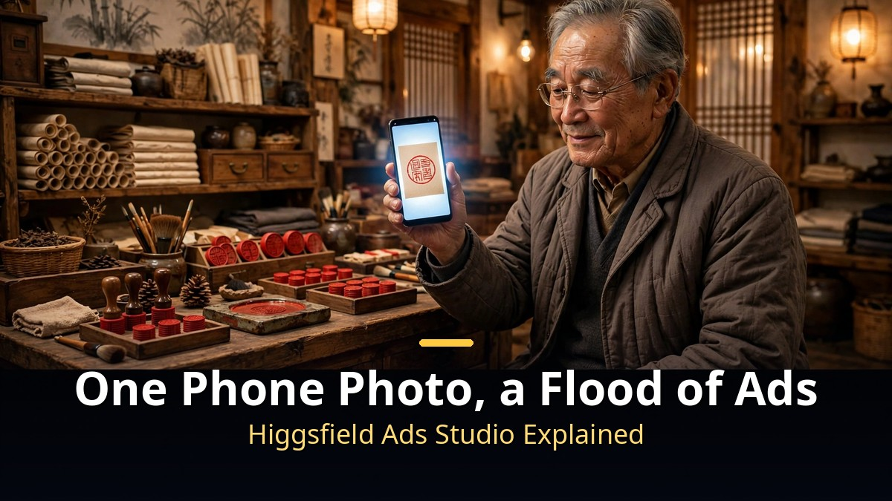
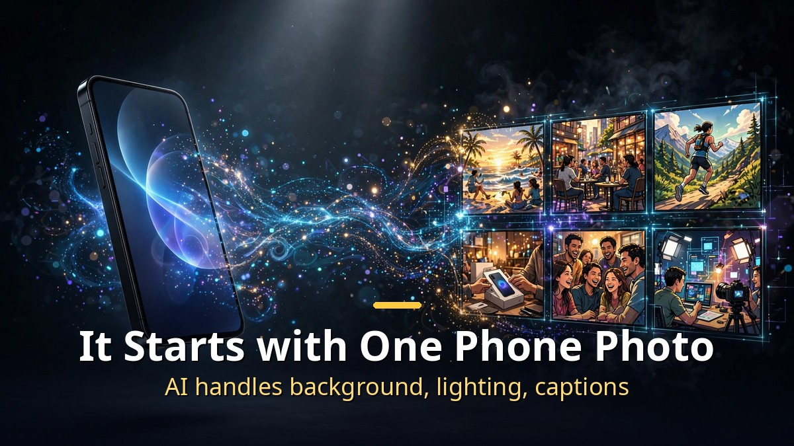
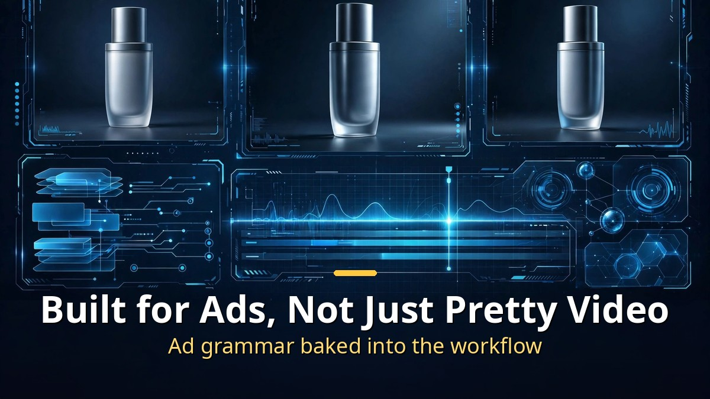
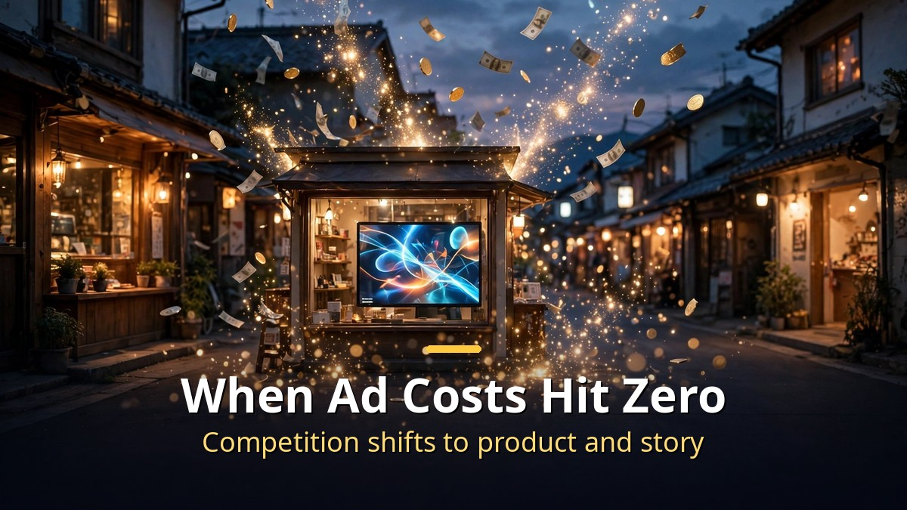

<!-- 본문 시작 -->

The owner of a 50-year-old print shop put a single phone photo into an AI tool, and out came a polished ad video.
Work that would cost thousands of dollars at an ad agency took the AI a few minutes.
The tool is called Ads Studio, an ad-making workspace Higgsfield unveiled on October 1.

> **Key takeaways**
>
> Higgsfield Ads Studio is **an AI tool that auto-generates ad videos from a single product photo**.
> Announced October 1, it lets AI handle shooting, editing, and captions.
> The era when a neighborhood shop can make enterprise-grade ads has arrived — but the **duty to disclose "AI-made" ads** still needs attention.

---

## Can one product photo really become an ad?

Ads Studio is simple to use.
Upload a product photo, pick a mood, and the AI adds the background, lighting, motion, and captions to build the ad.
A process that used to need a product shoot, model casting, and a hired editor is compressed into a single photo.

As the print shop story shows, the point is "no professional gear needed."
An ordinary smartphone photo goes through the AI and comes out with fixed lighting, a moving camera, and captions.
**The barrier to ad production has effectively disappeared.**

## How is it different from other AI video tools?

Most AI video generators focus on making "beautiful video."
Ads Studio is different because it was designed from the start to make "ads."
It bakes in ad grammar: compositions that flatter the product, caption placement that drives purchases, color grading that matches brand tone.

Higgsfield was already known for AI video generation.
This time it tuned that technology for one concrete job — ad production.
The trend is moving from do-everything tools toward tools that do one thing well.

| | General AI video tools | Higgsfield Ads Studio |
|---|---|---|
| Purpose | Beautiful video generation | Ad video production |
| Input | Text prompt | Product photo |
| Strength | Creative expression | Purchase-driving structure |
| Audience | Creators | Small businesses and brands |

## The era when a local shop's ad budget hits zero?

The biggest shift is the cost structure.
A 15-second spot for a small shop costs hundreds of dollars even outsourced.
Once tools like Ads Studio go mainstream, that cost drops to subscription level.

There are cautions too.
If an AI-made ad shows the product differently from reality, it can violate false-advertising rules.
Debate is ongoing about mandatory "AI-generated" labeling.
Checking ad review standards before use is the safe move.

When AI ads become common, the "human-made feel" could become scarce instead.
Everyone will use the same tools, so differentiation will come from the product itself and its story.
The winners won't be the hands making the ad — they'll be the ones with something worth showing.

---

Honestly, my first reaction was "another AI ad tool."
But the print shop story stuck with me.
I kept thinking of owners with great products and no way to tell anyone, quietly burning inside.
Watching technology rescue undervalued craft never gets old.

## Frequently asked questions

**Q. When did Higgsfield Ads Studio launch?**

A. It was officially announced on October 1, 2026, via the Higgsfield blog — an ad-production workspace.

**Q. Does it really work from just one photo?**

A. The product photo is the starting input. The AI auto-generates background, lighting, motion, and captions, though you still pick the mood and fine-tune details for the result you want.

**Q. Is it affordable for small businesses?**

A. It should be far cheaper than outsourced production. Exact pricing should be confirmed on Higgsfield's official channels.

<!-- 본문 끝 -->

## 작업용 출처·이미지 정보 (업로드 제외)

- 자료 출처: Higgsfield 공식 블로그 (Ads Studio 발표, 2026-10-01)
- 이미지: images/01-hero-en.jpg ~ 04-img3-en.jpg / 직접 제작 (AI 생성 + 영어 오버레이) / 사용권: 자작

## 발행 기록 (업로드 제외)

- 사용자 요청: GitHub 저장소를 통한 Codex 발행 (영어 백로그 #5)
- 처리 결과:
- 확인한 게시글 URL 또는 임시저장 식별 정보:
- 오류·미완료 항목:
