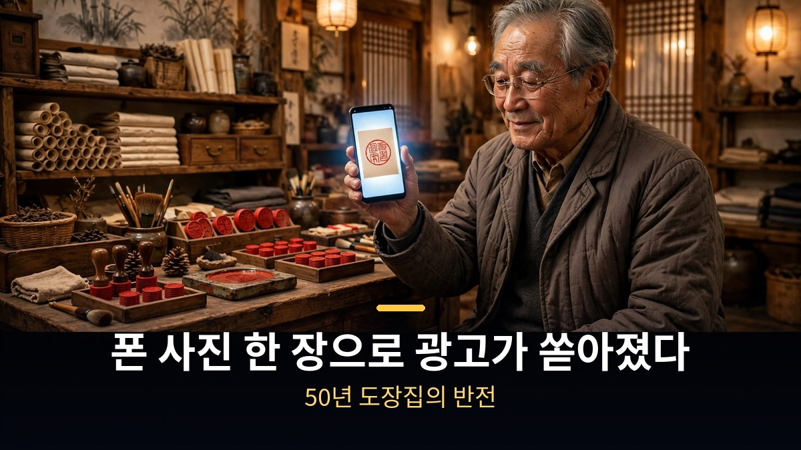
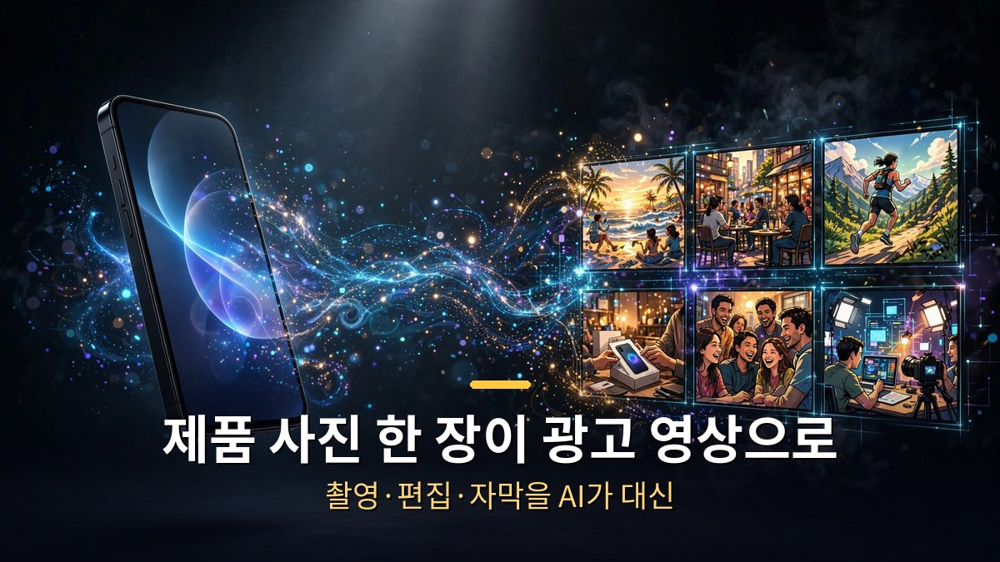
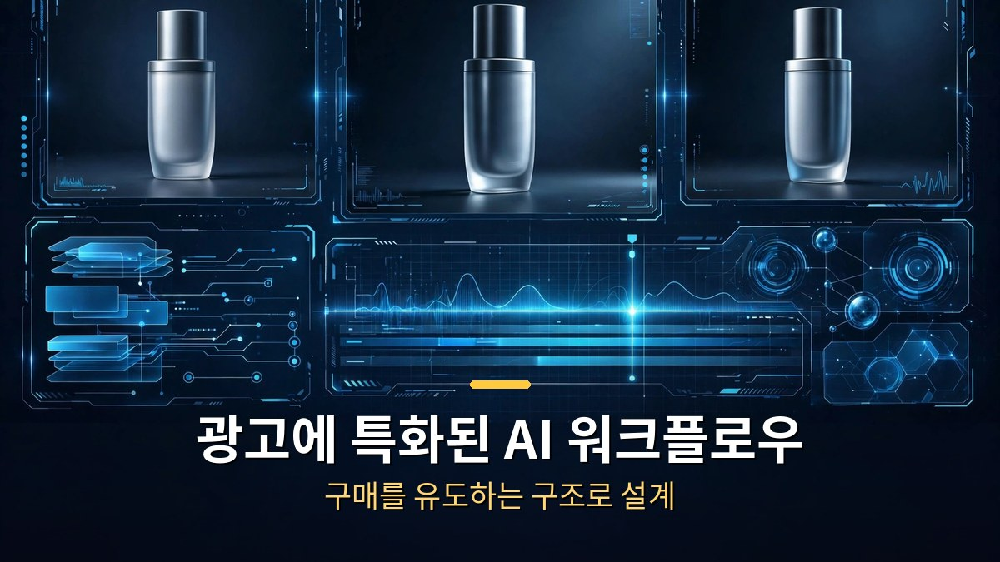
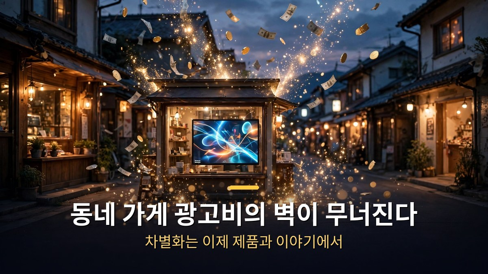

<!-- 본문 시작 -->

50년 된 도장집 사장님이 폰으로 찍은 사진 한 장을 넣었더니, 그럴듯한 광고 영상이 쏟아져 나왔다.
광고 대행사에 맡기면 수백만 원이 드는 일을 AI가 몇 분 만에 해낸 것이다.
Higgsfield가 10월 1일에 공개한 'Ads Studio'라는 광고 제작 도구의 이야기다.

> **핵심 정리**
>
> Higgsfield Ads Studio는 **제품 사진 한 장으로 광고 영상을 자동 생성하는 AI 도구**다.
> 10월 1일 공식 발표됐으며, 촬영·편집·자막을 AI가 대신 처리한다.
> 동네 가게도 대기업급 광고를 만들 수 있는 시대가 열렸지만, **'진짜 같은 가짜' 광고에 대한 표시 의무**는 따져봐야 한다.

---

## 제품 사진 한 장으로 광고가 만들어진다고?

Ads Studio의 사용법은 단순하다.
제품 사진을 올리고 원하는 분위기를 고르면, AI가 배경·조명·움직임·자막까지 붙여 광고 영상을 만든다.
기존에는 제품 촬영, 모델 섭외, 편집자 고용이 필요했던 과정을 사진 한 장으로 압축한 것이다.

50년 도장집 사례가 보여주듯, 핵심은 '전문 장비 없이도 된다'는 점이다.
스마트폰으로 찍은 평범한 사진이 AI의 손을 거치면 조명이 잡히고, 카메라가 돌고, 자막이 입혀진다.
**광고 제작의 진입 장벽이 사실상 사라진 셈이다.**

## 기존 AI 영상 도구와 뭐가 다른가?

시중의 AI 영상 생성 도구는 '예쁜 영상'을 만드는 데 초점이 있다.
Ads Studio는 처음부터 '광고'를 만들도록 설계됐다는 점이 다르다.
제품을 돋보이게 하는 구도, 구매를 유도하는 자막 위치, 브랜드 톤에 맞는 색감 같은 광고 문법을 AI가 내장하고 있다.

Higgsfield는 원래 AI 영상 생성으로 알려진 회사다.
이번에는 영상 생성 기술을 광고 제작이라는 구체적인 용도에 맞춰 다듬었다.
만능 도구보다 한 가지 일을 확실히 잘하는 쪽으로 가는 흐름이다.

| 구분 | 일반 AI 영상 도구 | Higgsfield Ads Studio |
|---|---|---|
| 목적 | 예쁜 영상 생성 | 광고 영상 제작 |
| 입력 | 텍스트 프롬프트 | 제품 사진 |
| 강점 | 창의적 표현 | 구매 유도 구조 |
| 대상 | 크리에이터 | 소상공인·브랜드 |

## 동네 가게의 광고비가 0원이 되는 시대?

가장 큰 변화는 비용 구조다.
소규모 가게가 15초짜리 광고 하나를 만들려면 외주를 줘도 수십만 원이 든다.
Ads Studio 같은 도구가 상용화되면 이 비용이 구독료 수준으로 떨어진다.

다만 주의할 점도 있다.
AI가 만든 광고 속 제품 모습이 실물과 다르면 표시광고법상 문제가 될 수 있다.
'AI로 제작됨' 표시를 의무화하는 논의도 진행 중이다.
쓰기 전에 광고 심의 기준을 확인하는 게 안전하다.

AI 광고가 흔해지면 오히려 '사람이 만든 느낌'이 희소해질 수도 있다.
도구는 누구나 쓰게 되니, 결국 차별화는 제품 자체와 이야기에서 나온다.
광고를 만드는 손이 아니라, 보여줄 것을 가진 쪽이 이기는 게임이다.

---

솔직히 처음에는 '또 AI 광고 도구인가' 싶었다.
그런데 50년 도장집 이야기가 계속 머리에 남는다.
좋은 제품을 만들어놓고도 알릴 방법이 없어 속만 태우던 사장님들이 떠올라서다.
기술이 제값을 못하는 재주를 구해주는 장면은, 볼 때마다 마음이 놓인다.

## 자주 묻는 질문

**Q. Higgsfield Ads Studio는 언제 나왔나요?**

A. 2026년 10월 1일에 공식 발표됐다. Higgsfield 공식 블로그를 통해 공개된 광고 제작 전용 워크스페이스다.

**Q. 정말 사진 한 장으로 되나요?**

A. 제품 사진이 입력의 출발점이다. AI가 배경·조명·움직임·자막을 자동 생성하지만, 원하는 결과물을 얻으려면 분위기 선택과 세부 조정이 필요하다.

**Q. 소상공인이 쓰기에 비용 부담은 없나요?**

A. 외주 제작비와 비교하면 크게 저렴해질 전망이다. 다만 정확한 요금제는 Higgsfield 공식 채널에서 확인해야 한다.

<!-- 본문 끝 -->

## 작업용 출처·이미지 정보 (업로드 제외)

- 이미지: images/01-hero.jpg ~ 04-img3.jpg / 직접 제작 (AI 생성 + 한글 오버레이) / 사용권: 자작

## 발행 기록 (업로드 제외)

- 사용자 요청: GitHub 저장소를 통한 Codex 발행
- 처리 결과:
- 확인한 게시글 URL 또는 임시저장 식별 정보:
- 오류·미완료 항목:
