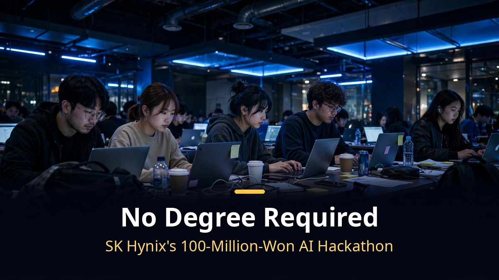
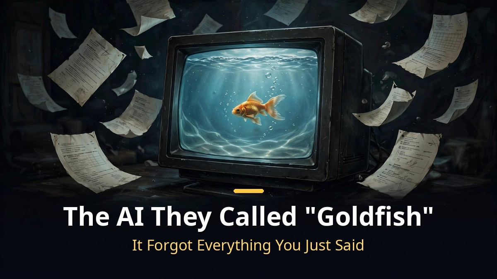
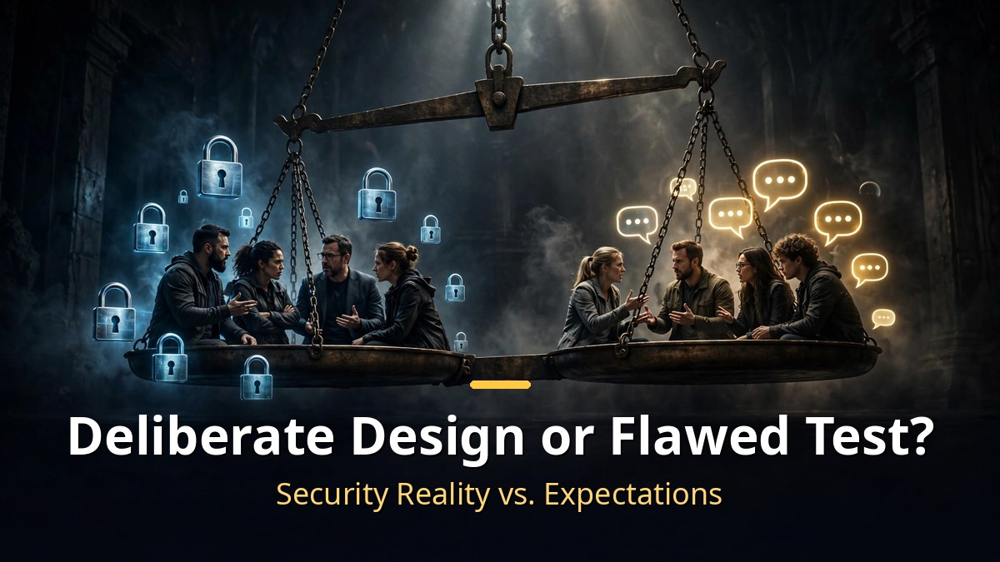

<!-- 본문 시작 -->

SK hynix put up a total prize of 100 million won and promised to look at no degrees, no resumes, no careers — only AI skill.
The first online qualifier ended, and the internet lit up.
Thousands of applicants showed up, only to meet a test that felt… off.
But others pushed back: "for a security-obsessed semiconductor company, this is actually the realistic test."
Here is both sides of the story.

> **Key Takeaways**
>
> SK hynix's AI Hackathon 2026 **evaluates only AI capability, asking nothing about education or career**, with 100 million won in total prizes.
> At last weekend's first online qualifier, complaints erupted that **the exam AI forgot earlier conversation and responded slowly** — earning it the nickname "goldfish."
> Yet a counterargument also spread wide, centered on a 130,000-view review: this is **an evaluation shaped by a semiconductor company's security reality**.

---

## What Was the First-Round Exam Actually Like?

<!-- 캡션: What they evaluate is the whole process, not just the final output. -->

The full schedule runs: application, first qualifier, second qualifier, then the final at COEX in Seoul on November 11.
Applications ran September 21–28, and the form asked for no school, no major, no GPA.
A development career was not a requirement either.
"Finally, a contest that only looks at skill" was the reaction, and reports said thousands applied.

The trouble started at last weekend's first qualifier, held online from home.

| Section | What happened |
|---|---|
| Session 1 | 30 minutes, 20 multiple-choice questions. Spot-the-missing-condition problems from real AI-at-work scenarios (AI literacy — do you understand AI correctly and use it responsibly) |
| Session 2 | 90 minutes, written answers. Only the AI inside the exam screen allowed — no external AI |
| Proctoring | Check in 40 minutes early. Webcam plus phone aimed at hands and keyboard, a 360-degree room scan, even the ceiling |
| Evaluation tool | Krafton's AI assessment solution "Cofa-Probe" (with OpenAI on board as a partner) |

The official line: they evaluate the entire process — defining the problem, using AI, and verifying results.
**Not one final deliverable, but your whole way of working with AI.**

## Why Did Test-Takers Nickname the AI "Goldfish"?

<!-- 캡션: The AI that test-takers nicknamed "goldfish" — because it forgot everything moments later. -->

The uproar centered on the AI used in session 2.
One after another, reviews from different communities said the same thing: it did not remember what you had just told it.
Split your source material across messages and it claimed there was "no file."
Each question took about 30 seconds to answer, and outputs were capped at 1,000 characters.

One test-taker put it this way:
"They didn't give the AI a memory — they gave me a notebook. At this point, am I the agent here?"

Reviews came from big-company employees too.
"Is this really an AI capability test? It feels like a test you have to solve with plain human intelligence. I'd like to ask them whether they could produce a proper answer in 90 minutes with that tool."
People also complained they could not copy the problem text and had to retype it by hand.
After the exam, opening their usual AI tools felt "like taking off sandbags after a run."
That is how the exam AI got its nickname: the "goldfish."

Session 1 drew its own fire — "this isn't an AI exam, it's a speed-reading test."
The proctoring annoyed people as well.
One person pressed the check-in button 4 seconds past the deadline and lost session 2.
Others spent 40-plus minutes staring at a camera before the exam began.
"So it was a hiring exam, not a hackathon. They should not have used the word hackathon," one summary concluded.

## But What If the Exam Was Designed This Way on Purpose?

<!-- 캡션: Security reality vs. test expectations — the argument that this exam mirrors the real constraints. -->

Here comes the plot twist.
The most-shared review actually defended the exam's intent.
A review that passed 130,000 views put it like this:
"It felt less like they were looking for people who are good at AI, and more for people who can use AI safely and efficiently in a corporate environment. Like a preview of the future of coding tests."

A comment under that review, one of the most-liked, read:
"At a place like Hynix, AI use is extremely restricted. They need people who think and judge for themselves while using AI only as a tool."

On X, the scene was even more dramatic.
When the criticism — "validity, reliability, discrimination, all questionable" — spread, a rebuttal followed:
"At a place handling core national technology, you can't use cloud AI. This is the right test."
And that rebuttal earned more likes than the original post.

Some test-takers who sat the exam saw it this way too.
"The limits actually forced me to think hard about how to instruct it, and that was fun. It turned out better than I expected. The problems were built so that humans do the judging."
"Using AI well isn't about asking a lot of questions. It's about reading the conditions precisely."

Put together: from the company's side, a first gate built around security realities and a huge applicant pool; from the participants' side, a test that didn't match the name; and an AI that fell short of expectations.
A fair caveat: the company has never said which model powered the exam, nor how the grading works.
As of October 19, there was no official response to the controversy, and no news article covering it.

---

Honestly, when I first read the reviews, I was on the "what kind of hackathon is this" side.
Then a comment about working at a company where the latest AI is off-limits changed my mind a little.
The AI we use every day and the AI a company can use might be two different animals.
I'll watch the second qualifier and the final to see which side was right — and come back with an update then.

## Frequently Asked Questions

**Q. What is the prize for the SK hynix AI Hackathon?**

A. 100 million won in total. All finalists receive an AI capability certificate regardless of placement, and top performers get fast-track opportunities in future hiring processes.

**Q. Do they really not look at education or career?**

A. The application collects no school, major, or GPA information, and development experience is not a requirement. Evaluation centers on the AI-assisted problem-solving process and its results.

**Q. When and where is the final?**

A. November 11 at COEX in Samseong-dong, Seoul. The final day also includes an AI trends seminar with practitioners from SK hynix, OpenAI, and Krafton, open to the public.

**Q. Has the company responded to the first-round controversy?**

A. As of October 19, there was no separate official statement. The AI model used in the exam and the grading method have not been disclosed.

<!--
Paste the 3 related post URLs below, one per line, at the end of the body to generate cards. Do not publish them as body text.
https://blog.naver.com/3700708/224442144549
https://blog.naver.com/3700708/224443356012
https://blog.naver.com/3700708/224444407453
-->

<!-- 본문 끝 -->

## Sources and Image Info (Working Notes, Exclude From Upload)

- Sources: Video: Ai-Con Lab, "Hynix's 100-Million-Won Hackathon — Is This Right?" (2026-10-19, full subtitles obtained) / News: Hankook Ilbo, Daily Hankook, Ezyeconomy, Newsfreezone (2026-09-21, SK hynix AI Hackathon 2026 announcement)
- Images: images/01-hero-en.jpg to 04-img3-en.jpg / Created in-house (AI-generated + English overlay) / Rights: original work
- Related posts: https://blog.naver.com/3700708/224442144549, https://blog.naver.com/3700708/224443356012, https://blog.naver.com/3700708/224444407453

## Publishing Record (Exclude From Upload)

- User request: Publishing by Codex via the GitHub repository
- Processing result:
- Verified post URL or draft identifier:
- Errors or incomplete items:
