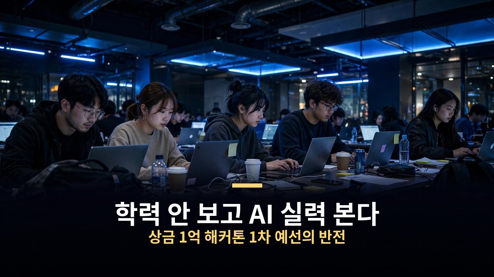
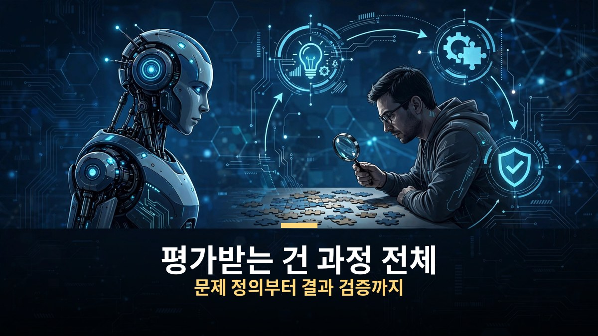
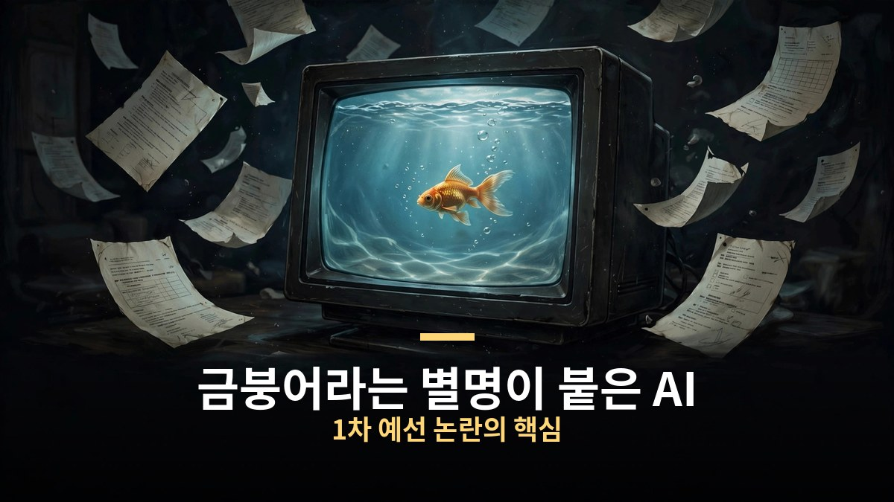
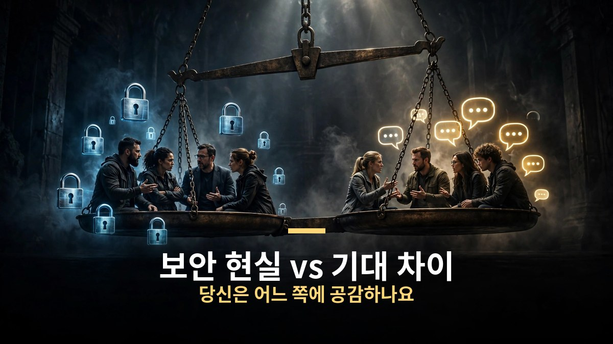

<!-- 본문 시작 -->

SK하이닉스가 총상금 1억 원을 걸고 연 AI 해커톤 1차 예선이 끝나자마자 온라인이 시끄러워졌다.
학력도 경력도 안 본다는 파격 조건에 수천 명이 몰렸지만, 막상 마주한 시험은 어딘가 어색했다는 후기가 쏟아진 것이다.
반면 "보안이 생명인 반도체 회사 입장에선 오히려 현실적인 시험"이라는 반박도 만만치 않게 퍼졌다.
무슨 일이 있었는지, 양쪽의 말을 정리해 봤다.

> **핵심 정리**
>
> SK하이닉스 AI 해커톤 2026은 **학력·경력을 묻지 않고 AI 활용 능력만 평가**하는 대회로, 총상금 1억 원이 걸렸다.
> 지난 주말 열린 1차 온라인 예선에서 **시험용 AI가 앞 대화를 기억하지 못하고 응답이 느리다**는 불만이 터졌고, '금붕어'라는 별명까지 붙었다.
> 하지만 **보안이 중요한 반도체 회사의 현실을 반영한 평가**라는 옹호론도 13만 조회 후기를 중심으로 확산 중이다.

---

## 1차 예선, 도대체 무슨 시험이었나?

대회의 전체 일정은 서류 접수, 1차 예선, 2차 예선, 그리고 11월 11일 코엑스 본선이다.
접수는 9월 21일부터 28일까지였고, 지원서에 학교도 전공도 학점도 묻지 않았다.
개발 경력도 참가 조건이 아니었다. 그래서 "드디어 실력만 보는 대회가 나왔다"는 반응이 나왔고, 수천 명이 몰렸다는 보도까지 나왔다.

문제가 된 건 지난 주말에 열린 1차 예선이었다.
1차는 집에서 보는 온라인 시험이었다.

| 구분 | 내용 |
|---|---|
| 1교시 | 30분 동안 객관식 20문제. AI를 업무에 쓰다 생긴 문제에서 빠진 조건을 찾는 유형 (AI 리터러시, AI를 올바르게 이해하고 책임 있게 쓰는 역량을 본다) |
| 2교시 | 90분 동안 서술형 문제. 시험 화면 안의 AI만 사용 가능, 외부 AI 금지 |
| 감독 | 시작 40분 전 입실. 웹캠과 휴대폰으로 손·키보드를 비추고, 방 360도와 천장까지 촬영 |
| 평가 도구 | 크래프톤의 AI 평가 솔루션 '코파-프로브' (오픈AI가 파트너사로 참여) |

공식 설명에 따르면 평가 대상은 문제를 정의하고, AI를 활용하고, 결과를 검증하는 전 과정이다.
**결과물 하나가 아니라 AI를 다루는 방식 전체를 보겠다**는 취지였다.

## 왜 '금붕어'라는 별명이 붙었나?

논란의 중심은 2교시에 쓰인 AI였다.
바로 앞에서 한 말을 기억하지 못했다는 후기가 여러 커뮤니티에서 똑같이 나왔다.
자료를 나눠서 주면 "파일이 없다"고 하고, 질문 한 번에 30초쯤 기다려야 했고, 한 번에 쓸 수 있는 글자도 1000자로 제한됐다는 것이다.

한 응시자는 이렇게 썼다.
"AI한테 메모리를 준 게 아니라 나한테 수첩을 준 거잖아. 이 정도면 내가 에이전트 아니냐?"

대기업 현직자들의 후기도 나왔다.
"이거 진짜 AI 역량 평가 맞아? 그냥 사람 지능으로 풀어야 하는 테스트 같던데. 본인들은 그 도구로 90분 안에 정상적인 답을 낼 수 있는지 묻고 싶다."
문제 글을 복사할 수 없어서 일일이 타자로 쳐야 했다는 불만도 있었다.
시험이 끝나고 평소 쓰던 AI 도구를 켜보니 "모래주머니 차고 뛰다가 풀린 기분"이었다는 후기도 나왔다.
그래서 커뮤니티에서는 이 AI에게 '금붕어'라는 별명까지 붙었다.

1교시를 두고는 "AI 시험이 아니라 속독 시험 아니냐"는 말도 나왔다.
감독 절차에 대한 불만도 많았다.
입실 마감보다 4초 늦게 눌러서 2교시를 못 봤다는 사람, 시험 전 40분 넘게 카메라 앞에서 멍하니 있어야 했다는 사람도 있었다.
"결국 해커톤이 아니라 채용 시험이었던 것 같다. 해커톤이라는 단어를 쓰지 말았으면"이라는 정리도 나왔다.

## 그런데 이 시험, 의도된 설계일 수도 있다?

여기서 반전이 있다.
가장 많이 퍼진 후기는 의외로 이 시험의 의도에 공감하는 글이었다.
조회수 13만을 넘긴 한 후기는 이렇게 말했다.
"AI를 잘 쓰는 사람보다, 기업 환경에서 AI를 안전하고 효율적으로 쓸 수 있는 사람을 찾는 느낌. 미래의 코딩 테스트를 미리 경험한 것 같다."

이 글에 달린 댓글 중 큰 공감을 받은 말도 있다.
"하이닉스 같은 곳은 AI 사용이 극도로 제한된다. AI 없이도 직접 생각하고 판단하면서 AI를 도구로만 쓰는 사람이 필요하다."

X에서는 더 극적인 장면이 펼쳐졌다.
"타당도, 신뢰도, 변별력 모두 의문"이라는 비판이 퍼지자, "국가 핵심 기술을 다루는 곳은 클라우드 AI를 못 쓴다. 이게 맞는 평가다"라는 반박이 달렸는데, 이 반박이 원글보다 더 많은 공감을 받았다.

직접 시험을 본 사람 중에도 이런 반응이 있었다.
"오히려 제한되니까 어떻게 시켜야 할지 머리를 쥐어짜게 돼서 더 재밌었다. 막상 해보니 생각보다 괜찮았다. 판단은 사람이 하도록 만든 문제들이었다."
"AI를 잘 쓴다는 건 질문을 많이 하는 게 아니라 조건을 정확히 읽는 거더라."

정리하면 회사 쪽으로 보면 보안 현실과 많은 지원자를 고려한 첫 관문, 참가자 쪽으로 보면 이름과 달랐던 시험, 그리고 기대에 못 미친 AI다.
공평하게 짚을 점도 있다.
시험에 쓰인 AI가 어떤 모델이었는지는 공식 발표가 없고, 채점을 어떻게 하는지도 공개되지 않았다.
10월 19일 기준으로 주체 측의 별도 해명이나 이 논란을 다룬 기사도 아직 나오지 않았다.

---

솔직히 처음 후기들을 볼 때는 '이게 무슨 해커톤이냐'는 쪽에 마음이 갔다.
그런데 보안 때문에 최신 AI를 못 쓰는 회사에서 일한다는 댓글을 읽고 생각이 조금 바뀌었다.
우리가 매일 쓰는 편리한 AI와 회사가 쓸 수 있는 AI는 다른 물건일 수 있다는 걸 새삼 깨달았다.
2차 예선과 본선을 지켜보면 어느 쪽 말이 맞는지 더 분명해질 것 같다. 그때 다시 정리해 보겠다.

## 자주 묻는 질문

**Q. SK하이닉스 AI 해커톤의 상금은 얼마인가요?**

A. 총상금 1억 원이다. 본선 진출자 전원에게는 수상 여부와 관계없이 AI 역량 인증서가 제공되고, 우수한 참가자에게는 향후 채용 절차의 패스트트랙 기회가 주어진다.

**Q. 정말 학력과 경력을 안 보나요?**

A. 지원 과정에서 출신 학교, 전공, 학점 정보를 수집하지 않으며 개발 경력도 참가 조건이 아니다. AI를 활용한 문제 해결 과정과 결과를 중심으로 평가한다.

**Q. 본선은 언제 어디서 열리나요?**

A. 11월 11일 서울 강남구 삼성동 코엑스에서 열린다. 본선 당일에는 SK하이닉스와 오픈AI, 크래프톤의 AI 실무자들이 참여하는 AI 트렌드 세미나도 열리며 일반인도 참관할 수 있다.

**Q. 1차 예선 논란에 대해 회사 측 해명이 있었나요?**

A. 10월 19일 기준으로 주체 측의 별도 해명은 없었다. 시험에 사용된 AI 모델의 종류와 채점 방식도 공개되지 않았다.

<!--
연관글 URL 3개를 본문 하단에 한 줄씩 붙여넣어 카드 생성, 본문 텍스트로 발행 금지
https://blog.naver.com/3700708/224442144549
https://blog.naver.com/3700708/224443356012
https://blog.naver.com/3700708/224444407453
-->

<!-- 본문 끝 -->

## 작업용 출처·이미지 정보 (업로드 제외)

- 자료 출처: 영상: Ai-Con Lab '하이닉스 상금 1억 해커톤 이게 맞나?' (2026-10-19, 자막 전문 확보) / 뉴스: 한국일보·데일리한국·이지경제·뉴스프리존 (2026-09-21, SK하이닉스 AI 해커톤 2026 발표)
- 이미지: images/01-hero.jpg ~ 04-img3.jpg / 직접 제작 (AI 생성 + 한글 오버레이) / 사용권: 자작
- 연관글: https://blog.naver.com/3700708/224442144549, https://blog.naver.com/3700708/224443356012, https://blog.naver.com/3700708/224444407453

## 발행 기록 (업로드 제외)

- 사용자 요청: GitHub 저장소를 통한 Codex 발행
- 처리 결과:
- 확인한 게시글 URL 또는 임시저장 식별 정보:
- 오류·미완료 항목:
