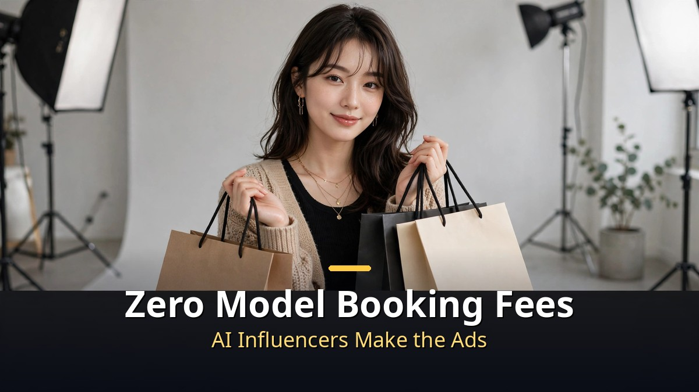
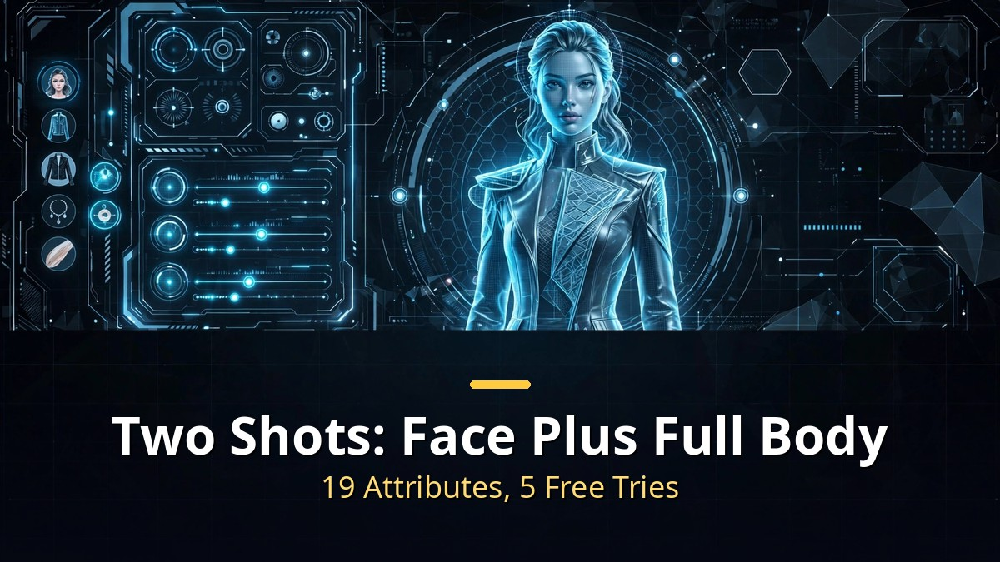
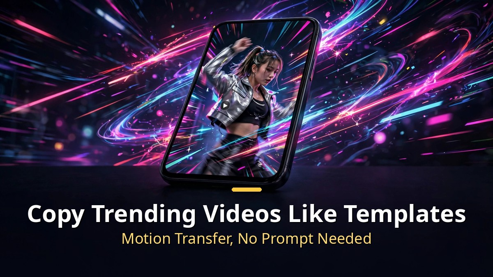
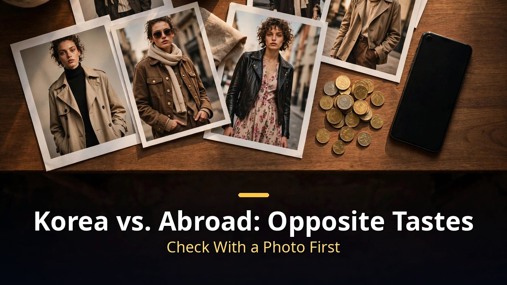

<!-- 본문 시작 -->

Advertising clothes for an online mall usually means model bookings and shoots — millions of won a month in ad spend.
But now, a few product photos and one AI influencer are enough to produce the ad video yourself.
Higgsfield's AI influencer feature, revamped on October 3, is the star of the show.
Here is how to make one and where to use it — just the essentials.

> **Key takeaways**
>
> Higgsfield AI Influencer lets you **build your own virtual model by combining 19 attributes**, with up to 5 free generations.
> **Motion transfer** puts trending video moves onto your influencer for viral short-form clips, and adding a product photo turns it into an ad video.
> In Korea, beautiful models dominate; abroad, characters with strong personalities go viral.

---

## How do you make an AI influencer?

The process is simpler than you'd think.
Open Higgsfield, go to the image menu, and tap AI Influencer to start.
Uploading your own face photo is optional — you can skip it.

Character types come in three levels — normal, bold, extreme — for how distinctive the person looks.
You can also make animal characters: cats, dogs, frogs, birds.
Pick gender, body type, hairstyle, ethnicity, and age across nineteen attributes, one click at a time — or hit the random button to fill all nineteen at once.

Turn on the free-generation toggle and press generate, and you get an AI influencer image in two cuts: a front-facing portrait and a full-body shot.
**Free generation covers 5 tries.** After that, extra generations cost 1.125 credits each — not a big burden.
When making model images, compose them with an enlarged face photo on the left and the full body on the right; it's useful later when you create content.

## Copy trending videos like templates?

Once your influencer exists, it's time to make it move.
Tap "convert to motion" on the image result to jump to Genjutsu, Higgsfield's video generation feature, on the motion tab.
Add a reference video (4 to 30 seconds) to extract motion from.
The preset tab has official Higgsfield presets plus community trends — from vlogs to whatever is going viral now, one click imports them.

Press generate and the reference video's movement, camera work, and timing stay exactly the same — only the person becomes your AI influencer.
**No prompt needed to copy a trend video like a template** — that's the biggest advantage.
With one influencer made, you just swap it into each trending video, which is great for steadily producing viral short-form content.

For brands, just upload one more product photo here.
Put the character and the product photo in together, and the viral video comes out with your influencer as the model and your product as the product.
Fast enough to post on Instagram or YouTube the same day a trend breaks.
Writing a prompt lets you direct outfit changes or close-ups on materials.
A scene like "let me show you the knit up close" boosts the ad's persuasiveness.

## Does it really make money? Korea vs. abroad

The funny thing is that Korean and overseas tastes are exact opposites.
On Korean Instagram and shopping mall ads, good-looking male and female models dominate.
Abroad, characters with distinctive personalities go far more viral than pretty faces.

There's a trick to saving money too.
Check with a photo before making the video.
Photo credits cost far less than video credits, so previewing the look in a photo lets you produce more good results with fewer credits.

One thing to note: disclosure.
If a product in an AI-made ad looks different from the real thing, it can violate advertising disclosure laws, and mandatory "made with AI" labeling is under discussion.
Since everyone will use the same tools, **differentiation will come down to the product itself and the story.**

---

Honestly, the days when AI models looked awkward feel like yesterday — and now they make ads.
For a small mall owner, the biggest wall of all, model booking fees, has fallen.
But when everyone uses the same tools, what remains is product quality and planning.
I'll keep watching who wins that race.

## FAQ

**Q. Does making an AI influencer cost money?**

A. Turn on the free-generation toggle for up to 5 free tries. Extra generations after that cost 1.125 credits each — not a big burden. Video generation credits vary by length and quality.

**Q. Can I advertise products other than clothes?**

A. Yes. Put the product photo in together with the influencer and it appears in the video. You can also change backgrounds to studios or beaches.

**Q. Won't AI models look awkward?**

A. In Korea, beautiful models trend; abroad, strong-personality characters go viral. Picking the right character type for your target matters.

**Q. Do I have to label ads as AI-made?**

A. If a product in an AI ad looks different from the real thing, it can violate advertising disclosure laws. Mandatory "made with AI" labeling is under discussion, so check ad review standards before publishing.

<!--
Paste the 3 related URLs one per line at the bottom of the post to generate cards. Do not publish as body text.
https://blog.naver.com/3700708/224443305622
https://blog.naver.com/3700708/224444416786
https://blog.naver.com/3700708/224442188419
-->

<!-- 본문 끝 -->

## 작업용 출처·이미지 정보 (업로드 제외)

- 자료 출처: 성공지식백과 'AI 인플루언서로 돈버는 방법 알려줘' (2026-10-18) / AI매터스 힉스필드 AI Influencer 개편 기사 (2026-10-03)
- 이미지: images/01-hero-en.jpg ~ 04-img3-en.jpg / 직접 제작 (AI 생성 + 영어 오버레이) / 사용권: 자작

## 발행 기록 (업로드 제외)

- 사용자 요청: GitHub 저장소를 통한 Codex 발행 (영어 백로그 #3)
- 처리 결과:
- 확인한 게시글 URL 또는 임시저장 식별 정보:
- 오류·미완료 항목:
