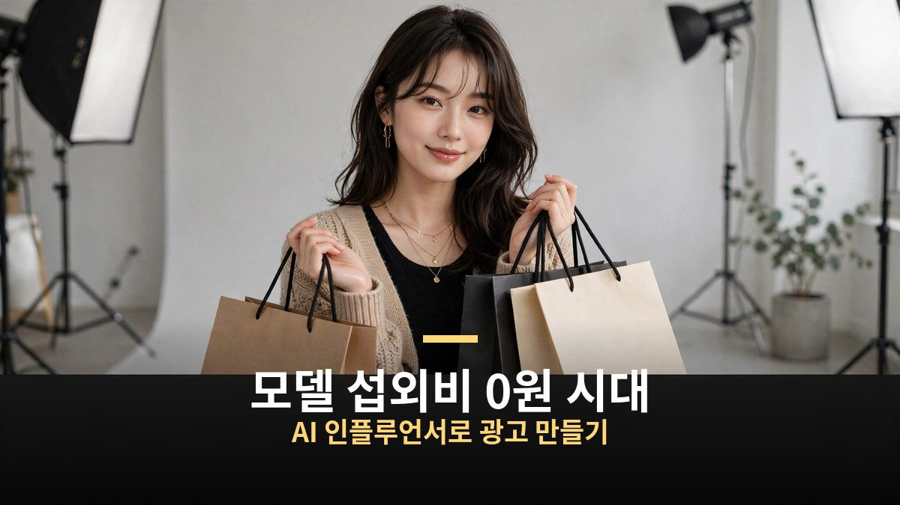
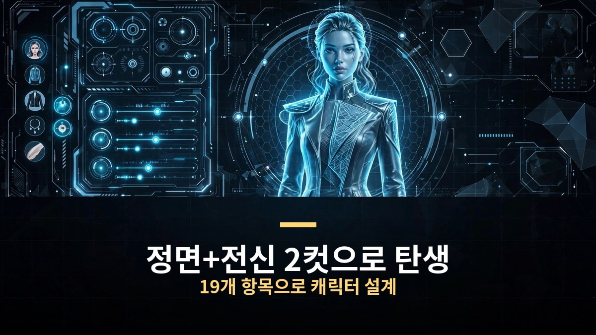
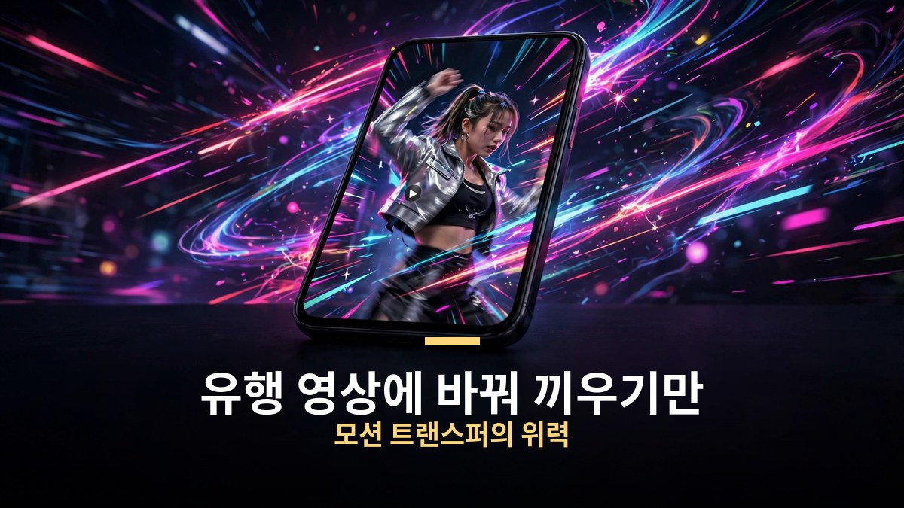
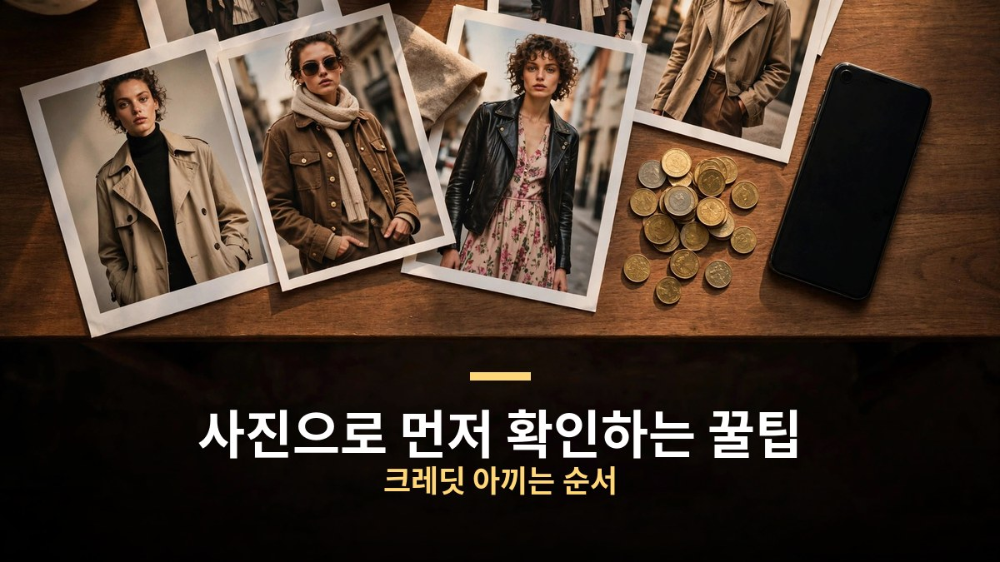

<!-- 본문 시작 -->

쇼핑몰 옷을 광고하려면 모델 섭외부터 촬영까지, 한 달 광고비가 수백만 원 깨지는 게 보통이다.
그런데 이제 제품 사진 몇 장과 AI 인플루언서 하나면 광고 영상까지 직접 만들 수 있는 시대가 왔다.
힉스필드가 10월 3일 개편한 AI 인플루언서 기능이 그 주인공이다.
어떻게 만들고 어디에 쓰는지, 핵심만 정리했다.

> **핵심 정리**
>
> 힉스필드 AI 인플루언서는 **19개 항목을 조합해 나만의 가상 모델을 만드는 기능**으로, 무료로 5회까지 생성할 수 있다.
> 만든 인플루언서에 **유행 영상의 동작을 그대로 입히는 모션 트랜스퍼**로 바이럴 숏폼을 만들고, 제품 사진을 더하면 광고 영상이 된다.
> 국내는 미모형 모델이, 해외는 개성 강한 캐릭터가 바이럴을 끄는 추세다.

---

## AI 인플루언서, 어떻게 만드나?

만드는 과정은 생각보다 단순하다.
힉스필드에 접속해 이미지 메뉴에서 AI 인플루언서를 누르면 시작된다.
내 얼굴 사진을 올리는 건 선택 사항이라 건너뛰어도 된다.

캐릭터 유형은 사람 기준 보통, 볼드, 익스트림 세 단계로 얼마나 개성 있게 만들지 고른다.
고양이, 강아지, 개구리, 새 같은 동물 캐릭터도 만들 수 있다.
성별, 체형, 헤어스타일, 인종, 나이까지 열아홉 가지 항목을 하나씩 클릭하면 되고, 뭘 골라야 할지 모르겠으면 랜덤 버튼을 누르면 열아홉 항목이 한 번에 채워진다.

무료 생성 토글을 켜고 생성 버튼을 누르면 정면 얼굴과 전신, 두 컷으로 된 AI 인플루언서 이미지가 만들어진다.
**무료 생성은 5회까지**다. 다 써도 추가 생성은 1.125크레딧이라 부담이 크지 않다.
모델 이미지를 만들 때는 왼쪽에 얼굴 확대 사진, 오른쪽에 전신 사진 형태로 만들어 두는 게 나중에 콘텐츠를 만들 때 유용하다.

## 유행 영상을 그대로 복사하듯 만든다?

인플루언서를 만들었으면 이제 움직이게 할 차례다.
이미지 결과물에서 '모션으로 변환하기'를 누르면 힉스필드의 영상 생성 기능인 Genjutsu의 모션 탭으로 넘어간다.
여기서 모션을 추출할 레퍼런스 영상(4초에서 30초 사이)을 추가하면 된다.
프리셋 탭에는 힉스필드 공식 프리셋과 커뮤니티 트렌딩이 있어서, 브이로그부터 지금 유행하는 바이럴 영상까지 클릭 한 번으로 가져올 수 있다.

생성 버튼을 누르면 레퍼런스 영상의 움직임과 카메라, 타이밍은 그대로 두고 사람만 내 AI 인플루언서로 바뀐 영상이 완성된다.
**프롬프트가 없어도 트렌드 영상을 그대로 복사하듯 만들 수 있다**는 게 가장 큰 장점이다.
인플루언서 하나만 만들어 두면 유행 영상마다 바꿔 끼우기만 하면 되니, 바이럴 숏폼을 꾸준히 뽑기에 좋다.

브랜드라면 여기서 제품 사진 한 장만 더 올리면 된다.
캐릭터와 제품 사진을 함께 넣고 생성하면, 모델은 내 인플루언서로 제품은 내 제품으로 바뀐 바이럴 영상이 나온다.
트렌드가 뜬 당일에 인스타그램이나 유튜브에 올릴 수도 있는 속도다.
프롬프트를 쓰면 옷을 바꾸거나 재질을 클로즈업하는 연출도 가능하다.
"짜임은 가까이서 보여줄게" 같은 식으로 옷의 퀄리티를 보여주는 장면을 넣으면 광고로서의 설득력이 올라간다.

## 진짜 돈이 될까? 국내와 해외의 온도차

재미있는 건 국내와 해외의 취향이 정반대라는 점이다.
국내 인스타그램과 쇼핑몰 광고에서는 미모가 있는 남녀 모델이 주류다.
반면 해외에서는 잘생긴 사람보다 특별한 개성이 있는 캐릭터가 훨씬 더 바이럴을 끈다.

비용을 아끼는 요령도 있다.
영상을 만들기 전에 사진으로 먼저 확인하는 것이다.
영상 크레딧보다 사진 크레딧이 훨씬 적게 들어가기 때문에, 사진으로 느낌을 보고 영상으로 만들면 적은 크레딧으로 좋은 결과물을 많이 뽑을 수 있다.

한 가지 짚을 점은 표시 문제다.
AI가 만든 광고 속 제품 모습이 실물과 다르면 표시광고법상 문제가 될 수 있고, 'AI로 제작됨' 표시를 의무화하는 논의도 진행 중이다.
도구는 누구나 쓰게 되니, **결국 차별화는 제품 자체와 이야기에서 나온다.**

---

솔직히 AI 모델이 어색해 보이던 시절이 엊그제 같은데, 이제는 광고까지 만드는 시대다.
작은 쇼핑몰 사장님 입장에선 모델 섭외비라는 가장 큰 벽 하나가 무너졌다.
다만 모두가 같은 도구를 쓰게 되면 결국 남는 건 제품력과 기획력이겠지.
그 경쟁에서 이기는 방법을 계속 지켜보려 한다.

## 자주 묻는 질문

**Q. AI 인플루언서를 만들 때 비용이 드나요?**

A. 무료 생성 토글을 켜면 5회까지 무료다. 이후 추가 생성은 1.125크레딧으로 부담이 크지 않다. 영상 생성 크레딧은 영상 길이와 화질에 따라 달라진다.

**Q. 옷 말고 다른 제품 광고에도 쓸 수 있나요?**

A. 가능하다. 제품 사진을 인플루언서와 함께 넣어 생성하면 해당 제품이 영상에 반영된다. 배경도 스튜디오나 해변 등으로 바꿀 수 있다.

**Q. AI 모델이 어색해 보이지는 않나요?**

A. 국내는 미모형 모델이, 해외는 개성 강한 캐릭터가 각각 바이럴을 끄는 추세다. 타깃에 맞는 캐릭터 유형을 고르는 게 중요하다.

**Q. AI로 만든 광고라는 표시를 해야 하나요?**

A. AI 광고 속 제품 모습이 실물과 다르면 표시광고법상 문제가 될 수 있다. 'AI로 제작됨' 표시 의무화 논의도 진행 중이니, 쓰기 전에 광고 심의 기준을 확인하는 게 안전하다.

<!--
연관글 URL 3개를 본문 하단에 한 줄씩 붙여넣어 카드 생성, 본문 텍스트로 발행 금지
https://blog.naver.com/3700708/224443305622
https://blog.naver.com/3700708/224444416786
https://blog.naver.com/3700708/224442188419
-->

<!-- 본문 끝 -->

## 작업용 출처·이미지 정보 (업로드 제외)

- 자료 출처: 영상: 성공지식백과 'AI 인플루언서로 돈버는 방법 알려줘' (2026-10-18, 자막 전문 확보) / 참고: AI매터스 힉스필드 AI Influencer 개편 기사 (2026-10-03)
- 이미지: images/01-hero.jpg ~ 04-img3.jpg / 직접 제작 (AI 생성 + 한글 오버레이) / 사용권: 자작
- 연관글: https://blog.naver.com/3700708/224443305622, https://blog.naver.com/3700708/224444416786, https://blog.naver.com/3700708/224442188419

## 발행 기록 (업로드 제외)

- 사용자 요청: GitHub 저장소를 통한 Codex 발행
- 처리 결과:
- 확인한 게시글 URL 또는 임시저장 식별 정보:
- 오류·미완료 항목:
