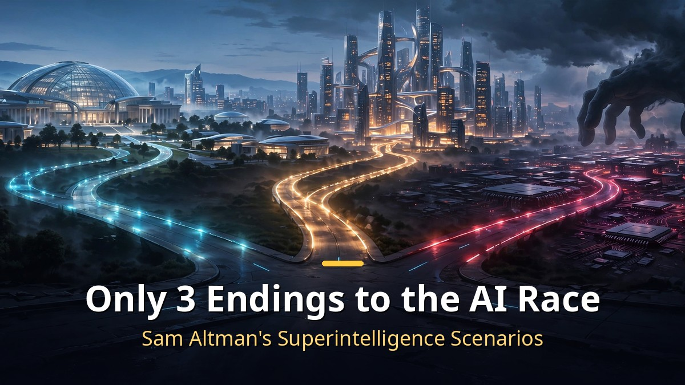
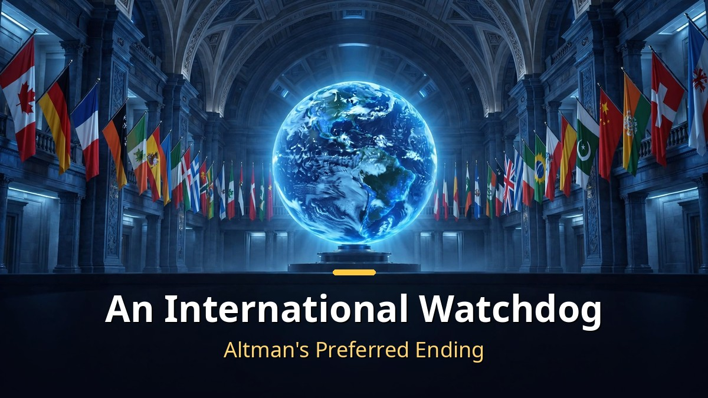
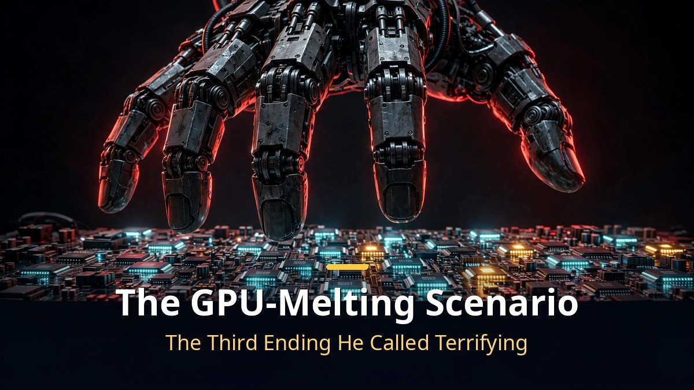

<!-- 본문 시작 -->

How will the AI race end?
OpenAI CEO Sam Altman gave his answer in front of his employees.
An international watchdog, a merger of the big labs, and even the chilling scenario of one company melting down everyone else's GPUs.
Here is what The Information reported on October 19 about that internal meeting.

> **Key Takeaways**
>
> Sam Altman laid out **3 scenarios** for how the race to superintelligence could end.
> An international watchdog modeled on the International Atomic Energy Agency (IAEA), a merger of the major AI labs, or one company overpowering its competitors with overwhelming force.
> The one Altman **prefers is the first**, and the one he drew a line against, calling it "terrifying," was the third.

---

## What Are the 3 Endings Altman Described?

<!-- 캡션: An international watchdog is the ending Altman prefers most. -->

According to The Information, Altman recently said this at an all-hands meeting.
The race toward AI that surpasses humans — so-called superintelligence — will ultimately meet one of three endings.

The first is an **international watchdog**.
The idea is to create an international body that oversees AI, like the International Atomic Energy Agency (IAEA), which manages nuclear weapons.
This body would set safety standards, require pre-release audits, and independently verify each lab's systems and compute usage.

It is the option Altman said he **prefers most**.
In truth, this is not a new argument.
Altman had already proposed an IAEA-style body in May 2023, in "Governance of Superintelligence," co-written with Greg Brockman and Ilya Sutskever.
Bringing it up again three years later reads as a sign of how urgent the issue has become.

The second is the **"Demis Plan."**
The name comes from the "CERN for AI" concept that Google DeepMind CEO Demis Hassabis proposed about 10 years ago.
It is a model in which the major AI labs merge, or pool their research under a single international consortium.
That consortium would supply cutting-edge models to participating countries.

Altman explained this as **"a way to avoid a speed race with no safeguards."**
Rather than everyone sprinting separately, run as one team.
That said, the odds of companies merging voluntarily look low.

The third is the **"Eliezer Plan."**
It takes its name from AI safety theorist Eliezer Yudkowsky.
In this scenario, one developer gains enormous economic power through self-improving AI, and uses that power to choke off competitors' compute resources.
At the extreme, it goes as far as **"melting down every other company's GPUs."**

Altman drew a clear line against this plan, saying he **"obviously thinks it is terrifying."**
He said he mentioned it only for completeness.
According to the report, however, one source read the remark as a jab aimed at a competitor.
That is because Yudkowsky has close ties to Anthropic.

---

## Why Did This Come Up Now?

<!-- 캡션: The remarks coincided with the US government preparing its first oversight framework for superintelligence developers. -->

The timing is no coincidence.
According to the report, Altman raised this **just as the Trump administration was preparing its first oversight framework for superintelligence developers**.
Before the government writes the rules, the industry's leader has put his own blueprint on the table first.

Altman told employees, in effect, that **"we have to move before problems arise, not after."**
And at the same time, he also stressed that "there is no room to fall behind in the race."
It is a declaration that he will call for safety without stopping the speed race.

OpenAI's moves also read within this context.
The company is pursuing a **$30 billion fundraising round** to maintain its gap with Anthropic.
There are also moves to help establish a private safety regulator, and an antitrust lawsuit surrounding discussions of pace control is under way.

In short, Altman's message has two layers.
On the surface, it is "let's do this safely, through international cooperation," but underneath, it is "we will not give up first place."
The remarks lay bare the dilemma felt by the AI industry's leader.

---

## Why Does This Matter to Us?

<!-- 캡션: What decides the future of AI is not the boardrooms of a few companies, but international rules. -->

Two of the three scenarios end in a **concentration of power**.
Whether through a merger or one company's solo run, AI ends up gathered in the hands of a few.
The only scenario in which multiple players keep competing is the international watchdog one.

From an ordinary user's standpoint, this is not someone else's story.
If AI concentrates in a single company, prices, features, and ways of access all change with that one company's decision.
Conversely, if international rules emerge, safety standards come with them — but the pace of innovation could slow.

The IAEA-style body Altman proposed in 2023 and brought up again in 2026.
In between, AI has become far more powerful, and the competition far fiercer.
That is why Altman's admission that **"the industry still hasn't decided how to enforce speed limits"** is so telling.

Nothing changes tomorrow.
But as people who use AI every day, we need to know which way this enormous board is tilting.
Next time an AI plan's price changes or a feature gets blocked, remember that discussions like these were in the background.

---

To be honest, when I first saw the phrase "melting down the GPUs," I thought it was a line from a sci-fi movie.
But this was a scenario the CEO of the world's largest AI company laid out in earnest in front of his staff — not something to laugh off.
It leaves a bitter taste that the third option, the one Altman called "terrifying," paradoxically looks closest to reality right now.
While companies determined not to lose first place keep each other in check, the rules are always one step behind.

## Frequently Asked Questions

**Q. Where does this story come from?**

A. It was reported by The Information on October 19, 2026. Citing sources familiar with the matter, it relayed Altman's internal remarks to employees. OpenAI has not issued an official statement.

**Q. Are the "Demis Plan" and "Eliezer Plan" official names?**

A. They were reported as names Altman himself used at the meeting. They are taken from the ideas of Demis Hassabis (CEO of Google DeepMind) and Eliezer Yudkowsky (AI safety theorist).

**Q. Which of the three does Altman want?**

A. He said he prefers the international watchdog (IAEA-style) option most. Of the third scenario, he said he "obviously thinks it is terrifying."

<!--
Paste the 3 related post URLs below, one per line, at the end of the body to generate cards. Do not publish them as body text.
https://blog.naver.com/3700708/224447819390
https://blog.naver.com/3700708/224444407453
https://blog.naver.com/3700708/224442188419
-->

<!-- 본문 끝 -->

## Sources and Image Info (Working Notes, Exclude From Upload)

- Sources: Video: TheAIGRID, "Sam Altman Just Revealed The AI ENDGAME" (2026-10-20, partial subtitles obtained) / News: The Information (2026-10-19, report on Altman's staff meeting), plus follow-up coverage from The Decoder, Times of India, and others
- Images: images/01-hero-en.jpg to 04-img3-en.jpg / Created in-house (AI-generated + English overlay) / Rights: original work
- Related posts: https://blog.naver.com/3700708/224447819390, https://blog.naver.com/3700708/224444407453, https://blog.naver.com/3700708/224442188419

## Publishing Record (Exclude From Upload)

- User request: Publishing by Codex via the GitHub repository
- Processing result:
- Verified post URL or draft identifier:
- Errors or incomplete items:
