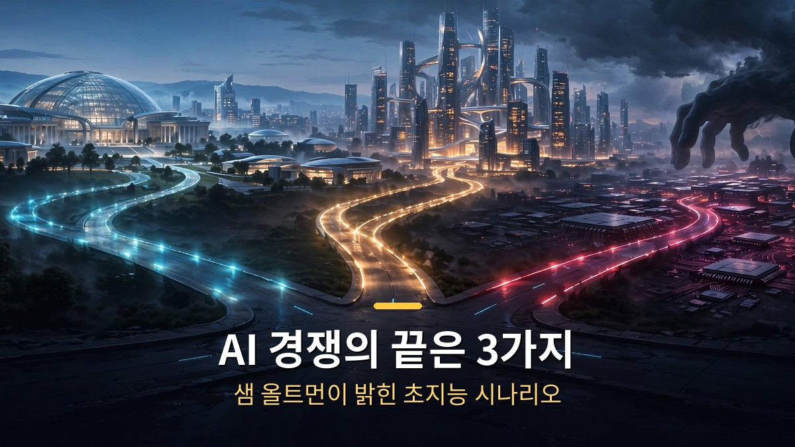
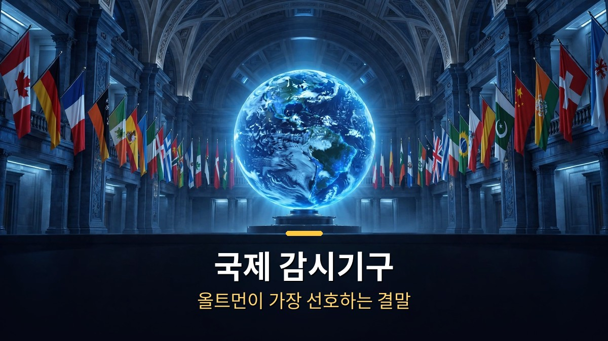
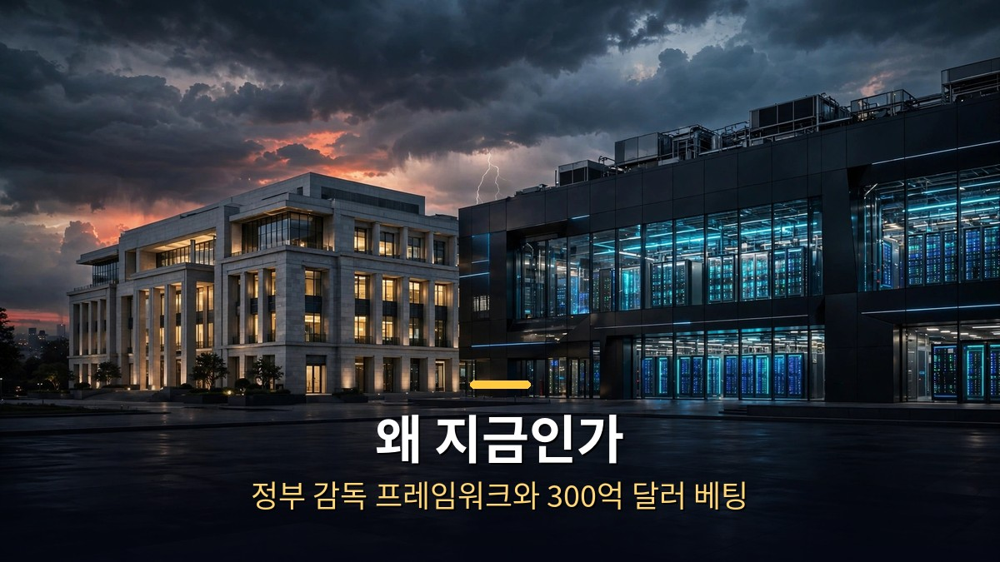
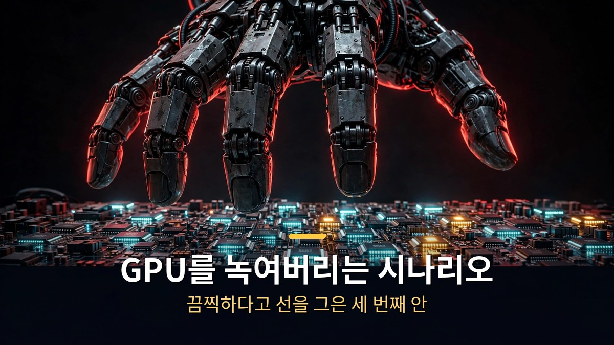

<!-- 본문 시작 -->

AI 경쟁의 끝은 어떻게 날까요?
오픈AI CEO 샘 올트먼이 직원들 앞에서 답을 내놨습니다.
국제 감시기구, 빅랩 합병, 그리고 한 회사가 모두의 GPU를 녹여버리는 섬뜩한 시나리오까지.
The Information이 10월 19일 보도한 내부 회의 내용을 정리했습니다.

> **핵심 정리**
>
> 샘 올트먼은 초지능 경쟁의 결말로 **3가지 시나리오**를 제시했습니다.
> 국제원자력기구(IAEA)식 국제 감시기구, 주요 AI 연구소들의 합병, 한 회사가 압도적 힘으로 경쟁자를 제압하는 경우입니다.
> 올트먼이 **선호하는 건 첫 번째**, "끔찍하다"고 선을 그은 건 세 번째였습니다.

---

## 올트먼이 말한 3가지 결말은 뭐야?

<!-- 캡션: 국제 감시기구가 올트먼이 가장 선호하는 결말입니다. -->

The Information 보도에 따르면 올트먼은 최근 직원 전체 회의에서 이렇게 말했습니다.
인간을 뛰어넘는 AI, 이른바 초지능을 향한 경쟁은 결국 세 가지 중 하나의 결말을 맞는다는 겁니다.

첫째는 **국제 감시기구**입니다.
핵무기를 관리하는 국제원자력기구(IAEA)처럼, AI를 감독하는 국제기구를 만드는 방안입니다.
이 기구는 안전 기준을 정하고, 출시 전 감사를 요구하고, 각 연구소의 시스템과 연산 자원 사용량을 독립적으로 검증합니다.

올트먼이 **가장 선호한다고 밝힌 방안**입니다.
사실 새로운 주장은 아닙니다.
올트먼은 2023년 5월 그레그 브록먼, 일리야 수츠케버와 함께 쓴 '초지능의 거버넌스' 글에서 이미 IAEA식 기구를 제안한 바 있습니다.
3년이 지나 다시 꺼낸 건, 그만큼 이 문제가 시급해졌다는 뜻으로 읽힙니다.

둘째는 **'데미스 플랜'**입니다.
구글 딥마인드 CEO 데미스 허사비스가 약 10년 전 제안한 'AI판 CERN' 구상에서 따온 이름입니다.
주요 AI 연구소들이 합병하거나, 하나의 국제 컨소시엄 아래 연구를 모으는 방식입니다.
이 컨소시엄이 참여국들에 최첨단 모델을 공급합니다.

올트먼은 이걸 **"아무런 안전장치 없이 벌이는 속도 경쟁을 피하는 방법"**이라고 설명했습니다.
각자 따로 달리느니 한 팀으로 뛰자는 발상입니다.
다만 기업들이 자발적으로 합병할 가능성은 낮아 보입니다.

셋째는 **'엘리저 플랜'**입니다.
AI 안전 이론가 엘리저 유드코프스키의 이름에서 따왔습니다.
한 개발사가 스스로 개선되는 AI로 막대한 경제력을 얻고, 그 힘으로 경쟁자들의 연산 자원을 틀어막는 시나리오입니다.
극단적으로는 **"다른 모든 회사의 GPU를 녹여버리는"** 수준까지 갑니다.

올트먼은 이 안에 대해 **"당연히 끔찍하다고 생각한다"**고 선을 그었습니다.
완전성을 위해 언급했을 뿐이라는 겁니다.
다만 보도에 따르면 한 소식통은 이 발언을 경쟁사를 겨냥한 비꼼으로 읽었다고 합니다.
유드코프스키가 앤트로픽과 관계가 깊기 때문입니다.

---

## 왜 지금 이런 얘기가 나왔을까?

<!-- 캡션: 미국 정부의 첫 초지능 감독 프레임워크 준비와 맞물린 발언입니다. -->

타이밍이 우연은 아닙니다.
보도에 따르면 올트먼이 이 얘기를 꺼낸 시점은 **트럼프 행정부가 초지능 개발자에 대한 첫 감독 프레임워크를 준비하던 때**와 겹칩니다.
정부가 규칙을 만들기 전에, 업계 리더가 먼저 청사진을 제시한 셈입니다.

올트먼은 직원들에게 **"문제가 생긴 뒤가 아니라 전에 움직여야 한다"**는 취지로 말했습니다.
그리고 동시에 "경쟁에서 뒤처질 여유는 없다"고도 강조했습니다.
안전을 외치면서도 속도전을 멈추지 않겠다는 선언입니다.

오픈AI의 행보도 이 맥락에서 읽힙니다.
회사는 앤트로픽과의 격차 유지를 위해 **300억 달러 규모의 투자 유치**를 추진 중입니다.
민간 안전 규제 기구 설립을 돕는 움직임도 있고, 속도 조절 논의를 둘러싼 반독점 소송도 진행 중입니다.

즉 올트먼의 메시지는 두 겹입니다.
겉으로는 "국제 협력으로 안전하게 가자"지만, 속으로는 "우리가 1등을 놓치지 않겠다"는 겁니다.
AI 업계의 리더가 느끼는 딜레마가 그대로 드러난 발언입니다.

---

## 우리에게 이 얘기가 왜 중요할까?

<!-- 캡션: AI의 미래를 정하는 건 소수 기업의 회의실이 아니라 국제 규칙입니다. -->

세 시나리오 중 두 개는 **권력의 집중**으로 끝납니다.
합병이든 한 회사의 독주든, 결국 AI는 소수의 손에 모입니다.
여러 주체가 경쟁을 이어가는 건 국제 감시기구 시나리오뿐입니다.

일반 사용자 입장에서 이건 남의 얘기가 아닙니다.
AI가 한 회사에 집중되면 가격, 기능, 접근 방식이 그 회사의 결정 하나로 바뀝니다.
반대로 국제 규칙이 생기면 안전 기준이 생기는 대신, 혁신 속도가 느려질 수 있습니다.

올트먼이 2023년에 제안하고 2026년에 다시 꺼낸 IAEA식 기구.
그 사이 AI는 훨씬 강력해졌고, 경쟁은 훨씬 치열해졌습니다.
**"속도 제한을 어떻게 강제할지 업계가 아직 못 정했다"**는 올트먼의 고백이 그래서 의미심장합니다.

당장 내일 달라지는 건 없습니다.
하지만 AI를 매일 쓰는 우리로서는, 이 거대한 판이 어디로 기울고 있는지 알아둘 필요가 있습니다.
다음에 AI 요금제가 바뀌거나 기능이 막힐 때, 그 배경에 이런 논의가 있었다는 걸 기억해 두세요.

---

솔직히 'GPU를 녹여버린다'는 표현을 처음 봤을 때는 SF 영화 대사인 줄 알았습니다.
그런데 세계에서 가장 큰 AI 회사의 CEO가 직원들 앞에서 진지하게 꺼낸 시나리오라니, 웃고 넘길 얘기가 아니었습니다.
올트먼이 "끔찍하다"고 한 세 번째 안이, 역설적으로 지금 가장 현실에 가까워 보이는 게 씁쓸합니다.
1등을 놓치지 않겠다는 회사들이 서로를 견제하는 동안, 규칙은 늘 한 발 늦으니까요.

## 자주 묻는 질문

**Q. 이 얘기의 출처는 어디인가요?**

A. The Information이 2026년 10월 19일 보도한 내용입니다. 사정에 밝은 소식통들을 인용해 올트먼의 직원 대상 내부 발언을 전했습니다. 오픈AI가 공식 성명을 낸 것은 아닙니다.

**Q. '데미스 플랜'과 '엘리저 플랜'은 공식 명칭인가요?**

A. 올트먼이 회의에서 직접 붙인 이름으로 보도됐습니다. 데미스 허사비스(구글 딥마인드 CEO)와 엘리저 유드코프스키(AI 안전 이론가)의 아이디어에서 따온 것입니다.

**Q. 올트먼은 세 가지 중 어떤 걸 원하나요?**

A. 국제 감시기구(IAEA식) 방안을 가장 선호한다고 밝혔습니다. 세 번째 시나리오에 대해서는 "당연히 끔찍하다"고 평가했습니다.

<!--
연관글 URL 3개를 본문 하단에 한 줄씩 붙여넣어 카드 생성, 본문 텍스트로 발행 금지
https://blog.naver.com/3700708/224447819390
https://blog.naver.com/3700708/224444407453
https://blog.naver.com/3700708/224442188419
-->

<!-- 본문 끝 -->

## 작업용 출처·이미지 정보 (업로드 제외)

- 자료 출처: 영상: TheAIGRID 'Sam Altman Just Revealed The AI ENDGAME' (2026-10-20, 자막 일부 확보) / 뉴스: The Information (2026-10-19, 올트먼 직원 회의 보도), the-decoder·Times of India 등 후속 보도
- 이미지: images/01-hero.jpg ~ 04-img3.jpg / 직접 제작 (AI 생성 + 한글 오버레이) / 사용권: 자작
- 연관글: https://blog.naver.com/3700708/224447819390, https://blog.naver.com/3700708/224444407453, https://blog.naver.com/3700708/224442188419

## 발행 기록 (업로드 제외)

- 사용자 요청: GitHub 저장소를 통한 Codex 발행
- 처리 결과:
- 확인한 게시글 URL 또는 임시저장 식별 정보:
- 오류·미완료 항목:
