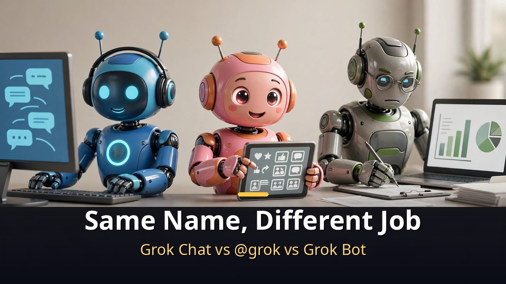

<!-- 본문 시작 -->

"From now on, have that ready on my desk every morning at 8."
With xAI's Grok Bot, that sentence can be the whole briefing.
It is not a chatbot that answers your questions — it is a coworker that takes the task and finishes it.
Here is a rundown of the three automation features that make that possible.

> **Key Takeaways**
>
> Grok Bot is an AI that **does the work instead of answering questions**.
> Give an instruction once, and it **runs on a schedule**, **fires off the moment a certain email lands**, and **opens your actual apps and tools to get things done**.
> The core design: it works alone and **only returns to you when a human decision is required**.

---

## Grok, @grok, Grok Bot — What's the Difference?

<!-- 캡션: Grok chat, X's @grok, and Grok Bot share one name, but each does a completely different job. -->

The three "Groks" get mixed up constantly, so here is the quick sort.

| Type | What it does | Think of it as |
|---|---|---|
| Grok (chat) | Answers questions with text | A well-read consultant |
| @grok | Answers when summoned in X replies | A specialist who happened to walk by |
| Grok Bot | Logs into your apps and finishes real tasks | The coworker who does the work |

Grok Bot is the **autonomous AI agent** xAI — Elon Musk's AI company — released in August 2026.
The official line calls it "an AI teammate you can hand real work to."

Three things make it what it is.
First, **it owns a computer of its own**.
A dedicated machine in the cloud keeps its memory, files, and browser login sessions alive.
Shut your laptop and the work continues.

Second, **it signs into the tools you already use**.
Where an official integration exists, it connects directly; where there is none, it drives the screen the way you would.
Not getting stuck on unsupported services is one of its biggest strengths.

Third, **it sees the job through and only checks back for approval**.
It chains multiple steps together on its own, and asks you only at the moments where your judgment is genuinely needed.

The entry ticket is **a paid plan of the AI coding tool Cursor (Cursor Pro, $20/month) or better**, with a limited free trial on the side.
It runs on macOS, Windows, and iPhone.

---

## What Can Its 3 Automation Features Do?

<!-- 캡션: Set a schedule, trigger on email, link your tools. Configure once, then stop thinking about it. -->

The Automations feature is exactly what it sounds like: you tell it once, and then you stop thinking about it.
Setup is conversational — just say it like you mean it.
"Round up the industry news every morning before 8." Pick the timing, and you're done.

**The first is scheduled execution.**
Choose once, daily, weekdays only, weekly, monthly, or yearly, then pick a time.
A morning briefing before 8 every day, a rent reminder on the first of every month — recurring chores live here.
Every run follows the same brief, but **it always fetches fresh data**.
It researches again each time instead of recycling yesterday.

**The second is email-triggered execution.**
It keeps an eye on your inbox, and when a message matches your conditions, the job starts immediately.
Filters work on sender, recipient, and subject.
Say "when a quote request arrives from a client, summarize it and draft the reply," and the instant that email lands, it goes to work with the email as context.
If you want, it will even **send the reply itself**.

**The third is tool-targeted execution.**
Put a connected tool's name after **@** in your instructions, and it uses that tool automatically every time.
Like "@Calendar, organize this week's schedule."
When setup is complete, a manual run button lets you test it right away.
Confirm it behaves, then hand it over to the schedule.

---

## Who Gets the Most Out of It?

<!-- 캡션: People buried in repetitive research, write-ups, and alerts get the most out of it. -->

The biggest winners are people with **repetitive research, write-up, and alerting work** on their plate.
Daily industry briefings, first drafts of weekly reports, first-pass replies to routine emails.
Grok Bot quietly handles these exactly as instructed.

A few caveats, though.
It launched in August 2026 and is still early, so features and pricing can shift.
Some coverage describes it based on higher-tier plans, so before diving in, verify **what your own plan actually includes**.
And when you hand it company email or sensitive material, **keep the approval step switched on**.
Precisely because it acts on its own, the safe setup is the one where a human signs off on the important calls.

Stack it against the competition and the picture sharpens.
ChatGPT Work is usable from the free tier, and Claude Cowork starts at $20/month.
Grok Bot's signature is structural: **spin up several bots at once, each on its own dedicated cloud PC**.
It feels less like one tireless assistant and more like running a small team.

---

I'll admit the pitch — "hand it off and go home" — sounded like pure ad copy at first.
What changed my mind was the pairing of scheduled runs with email triggers.
Think about how much of your day is "the work is fixed, but it still takes hands."
Being able to hand over that entire category is a bigger deal than it sounds.
That said, the price is still steep, so if there's nothing urgent to automate, waiting for the price to settle is a perfectly rational move.

## Frequently Asked Questions

**Q. Can I use Grok Bot for free?**

A. There is a limited free trial. Real use requires a Cursor Pro plan ($20/month) or higher, and the plan structure can change — check xAI's official guidance for the current terms.

**Q. Is it the same thing as @grok on X?**

A. No. @grok is a chatbot that answers questions in X replies, while Grok Bot is an agent that carries out real work on a cloud computer. Same name, different species.

**Q. Is it safe for work use?**

A. Data lives in the cloud, and sensitive tasks go through an approval step. Still, when entrusting it with important material, keep approvals on and check your company's security policy first.

<!--
Paste the 3 related post URLs below, one per line, at the end of the body to generate cards. Do not publish them as body text.
https://blog.naver.com/3700708/224447488785
https://blog.naver.com/3700708/224444407453
https://blog.naver.com/3700708/224443356012
-->

<!-- 본문 끝 -->

## Sources and Image Info (Working Notes, Exclude From Upload)

- Sources: Video: Shin Young-seon's AI Exploration, "3 Work Automation Features With Grok Bot" (2026-10-19) / Materials: xAI official announcement, news.aibase.com (Grok Automations), eesel.ai and note.com (Grok Bot roundups)
- Images: images/01-hero-en.jpg to 04-img3-en.jpg / Created in-house (AI-generated + English overlay) / Rights: original work
- Related posts: https://blog.naver.com/3700708/224447488785, https://blog.naver.com/3700708/224444407453, https://blog.naver.com/3700708/224443356012

## Publishing Record (Exclude From Upload)

- User request: Publishing by Codex via the GitHub repository
- Processing result:
- Verified post URL or draft identifier:
- Errors or incomplete items:
