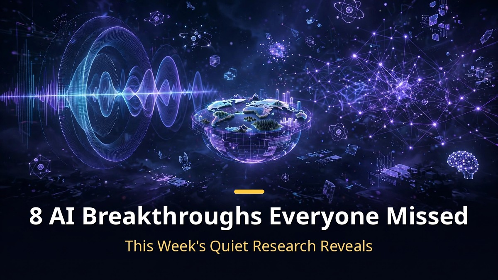
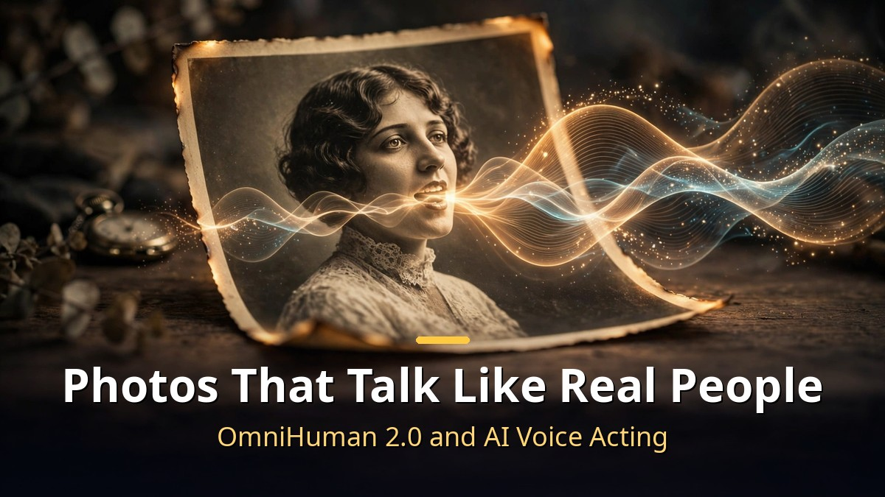
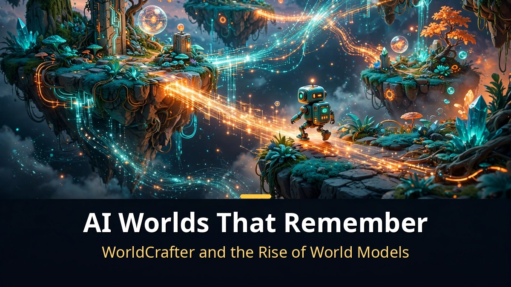
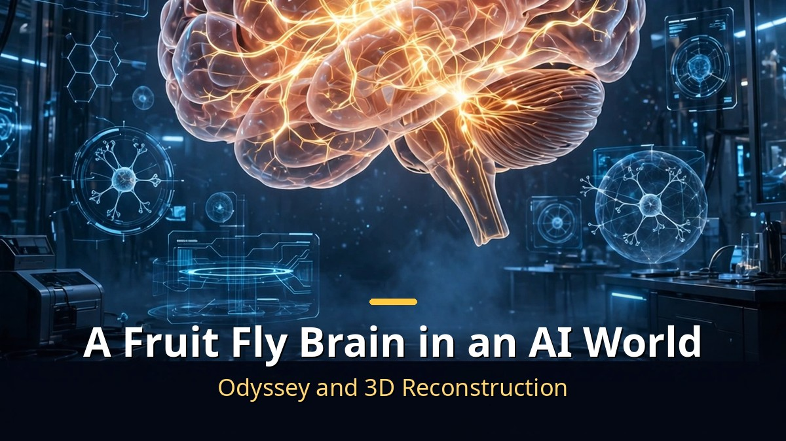

<!-- 본문 시작 -->

This week's biggest AI stories were not about giant models.
Eight quietly released research projects showed where AI is heading next.
Photos that talk like real people. AI worlds that remember where you have been.

> **Key Takeaways**
>
> Here are 8 AI breakthroughs released this week.
> **Fish Audio Drama 3**, which directs voice performances from plain text. **OmniHuman 2.0**, which turns a single photo into a 5-minute video. **WorldCrafter**, a world model that remembers places you visited.
> The common thread: AI is evolving from **generating things** to **remembering and performing**.

---

## Can a Single Photo Really Talk Like a Person?

<!-- Caption: AI voice acting from stage directions, and technology that turns one photo into a 5-minute video. -->

First, the voice side.
**Fish Audio Drama 3**, released October 13, does not just convert text to speech. It **takes acting direction**.

Write `[barely holding it together]` in brackets before a line, and the model reads it in a voice that is genuinely holding it together.
Wrap words in `<whisper>` tags and only those words turn into a whisper.
A single sentence can start calm, grow angry, and end in a whisper, all in one take.

The scale is serious too.
A 35-billion-parameter mixture-of-experts model that performs **up to 16 characters** in distinct voices at once.
It supports **83 languages**, and pronunciation accuracy hit 93.2%, up sharply from its predecessor's 88.1%.
Weights are open on Hugging Face, and the API is 80% off until November 12 ($10 per million characters).

With the voice ready, here comes the face.
**OmniHuman 2.0**, released October 15 by ByteDance via BytePlus, turns **one photo and one audio track into a 720p video up to 5 minutes long**.
That is five times the previous 60-second limit.

The difference is in how it listens.
Older talking-photo tools matched mouth shapes to sound. OmniHuman 2.0 **reads tone and emotion**.
The same photo whispers a lullaby, shouts a cheer, and sings a song, each as a different performance.
Head motion, expressions, and gestures all follow the feeling in the audio.
Pricing is $0.07 per second.

---

## Can an AI-Generated World Actually Remember?

<!-- Caption: World models that remember visited places, and playable AI games built on game engines. -->

Next, world models, the "worlds" AI creates.
**WorldCrafter**, from Tencent ARC and Peking University, has a telling paper title: "a consistent video world model with implicit 3D-aware memory."

The key word is **memory**.
Start from a single image or text prompt and explore a world for minutes with a moving camera.
Leave an area and come back, and **it is still there, unchanged**.
Older AI video would turn a wall into a different wall when the camera turned. Now, "places you visited" persist.
The paper is on arXiv and weights are on Hugging Face.

Gaming saw a bolder attempt.
**Matrix Game 4.0**, open-sourced October 15 by Kunlun Tech's Skywork AI, splits the job in two.
**A game engine handles world state and physics. A video model only paints the picture.**
The engine decides "this box is here with this health," and the AI renders it beautifully.
Objects keep their state off-screen, and health, collisions, and quest progress are computed in code, precisely.

Performance is striking: **480p at 60 FPS on a single RTX 5090**, with 112 milliseconds from key press to screen.
Code and weights for three scenarios (Medieval Castle, Ancient Egypt, City Racing) are all public.

NVIDIA is looking the same direction.
**StreamRender-H3** separates a code game engine from a streaming diffusion renderer, turning a daylight scene into a snowy one from a single reference image.
Rules stay. Only the visuals are painted by AI in real time.
ByteDance has also entered the race with a new world model.

---

## Did They Really Put a Fruit Fly Brain Into an AI World?

<!-- Caption: An experiment where a simulated biological brain explores a world imagined by AI. -->

The last one sounds like science fiction.
On October 17, the AI lab **Odyssey** announced it had **placed a fruit fly's brain inside an AI-generated virtual world**.

The fruit fly brain was fully mapped in 2024 by the FlyWire project: about 139,000 neurons and 54.5 million synapses.
Odyssey loaded a digital simulation of this brain into its world model **Odyssey-3**.
The fly began **flying on its own** through harbors and markets generated live by AI.

No developer built the terrain.
The scenery is imagined frame by frame by AI, while the fly's brain does the flying.
Odyssey-3 is a research preview released October 8, at 14 billion parameters.
The accuracy of the brain simulation is not yet published as a paper, so verification is still pending.

In a similar vein, 3D reconstruction tools keep improving.
Tools like **T3lescope**, **Gaussianimate**, and **WorldGacha** are making it easy to reconstruct real spaces in 3D and animate them.

All eight at a glance:

| Breakthrough | Field | In one line |
|---|---|---|
| Fish Audio Drama 3 | AI voice | Voice synthesis that acts from stage directions |
| OmniHuman 2.0 | Talking photos | 5-minute 720p video from one photo and audio |
| WorldCrafter | World models | AI world generation that remembers visited places |
| ByteDance world model | World models | ByteDance's new entry in the world model race |
| Matrix Game 4.0 | AI games | Playable at 480p 60FPS on a single RTX 5090 |
| StreamRender-H3 | Neural rendering | Real-time AI rendering over fixed game rules |
| Odyssey | Brain simulation | A fruit fly brain exploring an AI-generated world |
| 3D reconstruction trio | 3D reconstruction | Tools that rebuild reality in 3D and animate it |

---

Honestly, I first assumed the "fruit fly brain" story was clickbait.
But the neuron and synapse counts check out, and the video of it flying through a harbor is real.

What strikes me most about these eight is the direction.
AI is moving from "generating well" to "remembering and performing."
Voices act from scripts. Photos read emotions. Worlds remember where you have been.

Next time you watch an AI video, ask whether there is a "memory" behind it.
That is no longer a joke.

## Frequently Asked Questions

**Q. Where does this information come from?**

A. From each project's official announcement (arXiv papers, company tech blogs) and a roundup published October 21, 2026. Figures are from the announcements.

**Q. Can ordinary users try these?**

A. Fish Audio Drama 3, WorldCrafter, and Matrix Game 4.0 have open weights you can run yourself (a powerful GPU is needed). OmniHuman 2.0 is available as an API.

**Q. Is the fruit fly brain experiment real?**

A. Odyssey did publish the demo video on X on October 17. But technical details are not yet in a paper, so the simulation's accuracy remains unverified.

<!--
Related post URLs: paste one per line at the bottom of the body to generate cards. Do not publish as body text.
https://blog.naver.com/3700708/224444416786
https://blog.naver.com/3700708/224444407453
https://blog.naver.com/3700708/224442188419
-->

<!-- 본문 끝 -->

## 작업용 출처·이미지 정보 (업로드 제외)

- 자료 출처: 정리 영상 (2026-10-21) / Fish Audio 공식 발표, BytePlus, arXiv (WorldCrafter), Skywork AI, NVIDIA Research, Odyssey X
- 이미지: images/01-hero-en.jpg ~ 04-img3-en.jpg / 직접 제작 (AI 생성 + 영어 오버레이) / 사용권: 자작
- 연관글: https://blog.naver.com/3700708/224444416786, https://blog.naver.com/3700708/224444407453, https://blog.naver.com/3700708/224442188419

## 발행 기록 (업로드 제외)

- 사용자 요청: GitHub 저장소를 통한 Codex 발행
- 처리 결과:
- 확인한 게시글 URL 또는 임시저장 식별 정보:
- 오류·미완료 항목:
