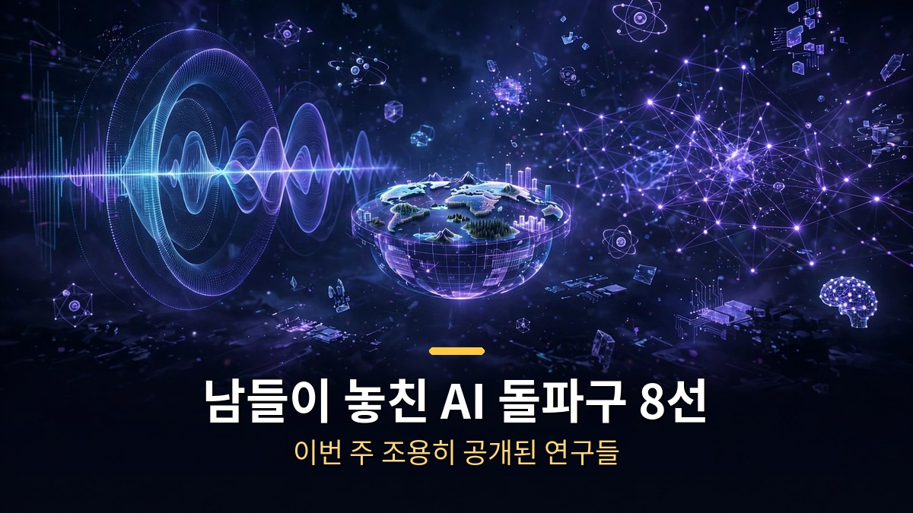
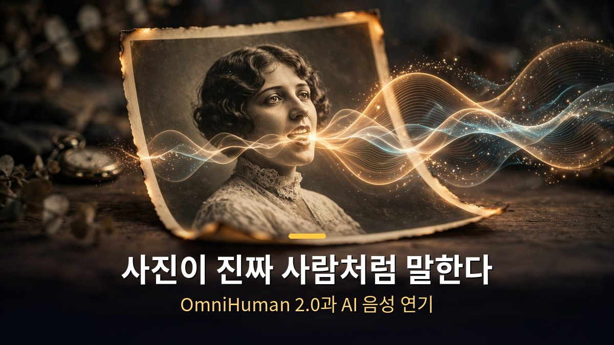
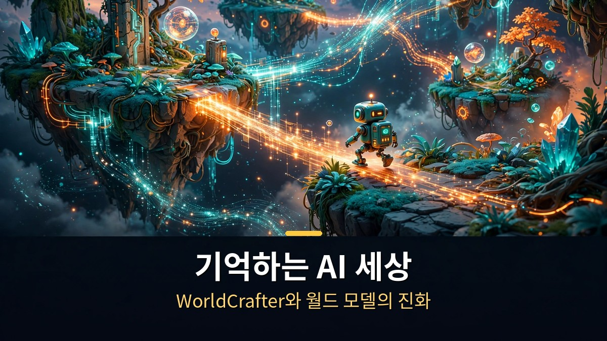
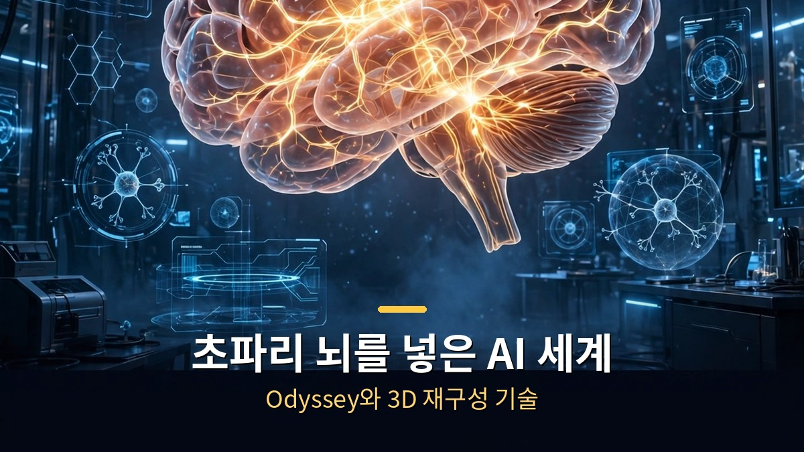

<!-- 본문 시작 -->

이번 주 AI 뉴스의 주인공은 거대 모델이 아니었습니다.
조용히 공개된 연구 8가지가 AI의 다음 단계를 보여줬습니다.
사진이 사람처럼 말하고, AI가 만든 세상이 기억을 갖기 시작했습니다.

> **핵심 정리**
>
> 이번 주 공개된 AI 연구 8선을 정리했습니다.
> **목소리에 연기를 입히는** Fish Audio Drama 3, **사진 한 장을 5분짜리 영상으로** 바꾸는 OmniHuman 2.0, **다녀온 곳을 기억하는** 월드 모델 WorldCrafter까지.
> 공통점은 하나입니다. AI가 '만드는 것'을 넘어 **'기억하고 연기하는 것'**으로 진화하고 있습니다.

---

## 사진 한 장이 진짜 사람처럼 말한다고?

<!-- 캡션: 대본에 연기 지시를 쓰면 그대로 연기하는 AI 음성, 사진 한 장으로 5분 영상을 만드는 기술입니다. -->

먼저 목소리 쪽입니다.
10월 13일 공개된 **Fish Audio Drama 3**는 텍스트를 음성으로 바꾸는 게 아니라, **연기를 지시**받는 모델입니다.

대본에 `[겨우 참고 있는]` 같은 지시를 대괄호로 쓰면, 그 대사를 정말로 참고 있는 목소리로 읽습니다.
`<whisper>` 태그로 감싼 단어만 속삭이듯 바꿀 수도 있습니다.
한 문장 안에서 차분하다가 점점 화를 내다가 속삭임으로 끝내는 연기가 한 번에 됩니다.

규모도 큽니다.
350억 파라미터 규모의 전문가 혼합(MoE) 모델로, 한 번에 **16명의 캐릭터**를 각각 다른 목소리로 연기합니다.
**83개 언어**를 지원하고, 발음 정확도는 93.2%로 전작(88.1%)보다 크게 올랐습니다.
가중치는 허깅페이스에 공개되어 있고, API는 11월 12일까지 80% 할인(100만 자당 10달러)에 쓸 수 있습니다.

목소리가 준비됐으면 이제 얼굴 차례입니다.
10월 15일 바이트댄스가 BytePlus를 통해 공개한 **OmniHuman 2.0**은 사진 한 장과 오디오 하나로 **최대 5분짜리 720p 영상**을 만듭니다.
기존 60초 제한에서 5배로 늘어난 겁니다.

차별점은 '듣는 방식'입니다.
기존 말하는 사진 기술이 입 모양만 소리에 맞췄다면, OmniHuman 2.0은 **어조와 감정을 읽습니다**.
같은 사진이라도 자장가는 속삭이듯, 응원 구호는 외치듯, 노래는 노래하듯 연기합니다.
고개 움직임과 표정, 제스처까지 오디오의 감정에 맞춰 바뀝니다.
가격은 초당 0.07달러입니다.

---

## AI가 만든 세상이 '기억'을 갖는다고?

<!-- 캡션: 다녀온 곳을 기억하는 월드 모델과 게임 엔진이 결합된 플레이 가능한 AI 게임의 등장입니다. -->

다음은 월드 모델, 즉 AI가 만드는 '세계' 쪽입니다.
텐센트 ARC와 베이징대가 발표한 **WorldCrafter**는 논문 제목부터 다릅니다.
"암묵적 3D 인식 메모리를 가진 일관된 비디오 월드 모델"입니다.

핵심은 **기억**입니다.
한 장의 이미지나 텍스트로 시작해 카메라를 움직이며 수 분간 세계를 탐험할 수 있습니다.
어느 구역을 떠났다가 돌아오면, 그곳이 **그대로** 있습니다.
예전 AI 영상은 카메라가 돌아서면 벽이 다른 벽이 되곤 했는데, 이제는 '다녀온 곳'이 유지됩니다.
arXiv에 논문이 공개됐고 가중치는 허깅페이스에서 받을 수 있습니다.

게임 쪽에서는 더 과감한 시도가 나왔습니다.
쿤룬테크의 Skywork AI가 10월 15일 오픈소스로 공개한 **Matrix Game 4.0**입니다.

구조가 영리합니다.
**게임 엔진이 세계의 상태와 물리 법칙을 맡고, 비디오 모델은 그 위에 그림만 그립니다.**
엔진이 "이 상자의 위치와 체력은 이렇다"고 정하면, AI는 그걸 예쁜 영상으로 렌더링만 합니다.
그래서 물체가 화면 밖으로 사라져도 상태가 유지되고, 체력·충돌·퀘스트 진행도가 코드로 정확히 계산됩니다.

성능도 놀랍습니다.
**RTX 5090 한 장으로 480p 60FPS**, 키를 누르고 화면에 반영되기까지 112밀리초입니다.
중세 성, 고대 이집트, 시티 레이싱 3종 시나리오의 코드와 가중치가 모두 공개됐습니다.

엔비디아도 같은 방향을 보고 있습니다.
**StreamRender-H3**는 코드 게임 엔진과 스트리밍 디퓨전 렌더를 분리해, 참조 이미지 하나로 낮 풍경을 눈 내리는 풍경으로 통째로 바꿉니다.
게임의 규칙은 그대로 두고 보이는 것만 AI가 실시간으로 칠하는 방식입니다.
바이트댄스도 새 월드 모델을 공개하며 이 경쟁에 뛰어든 상태입니다.

---

## 초파리 뇌를 AI 세계에 넣는다고?

<!-- 캡션: 생물의 뇌 시뮬레이션이 AI가 만든 세계를 탐험하는 실험이 공개됐습니다. -->

마지막이 가장 SF 같습니다.
AI 연구소 **Odyssey**가 10월 17일 공개한 실험입니다.
**초파리의 뇌를 AI가 만든 가상 세계에 넣었습니다.**

초파리 뇌는 2024년 FlyWire 프로젝트가 완전히 매핑한 것으로, 약 13만 9천 개의 뉴런(신경세포)과 5,450만 개의 시냅스(뉴런 간 연결점)로 이뤄져 있습니다.
Odyssey는 이 뇌의 디지털 시뮬레이션을 자사의 월드 모델 **Odyssey-3** 안에 탑재했습니다.
그러자 파리가 AI가 실시간으로 생성하는 항구와 시장을 **스스로 날아다니기** 시작했습니다.

개발자가 지형을 만든 게 아닙니다.
풍경은 AI가 매 프레임 상상하고, 파리의 뇌가 그 안에서 나는 겁니다.
Odyssey-3는 10월 8일 공개된 연구 프리뷰로 140억 파라미터 규모입니다.
다만 뇌 시뮬레이션의 정확도나 세부 기술은 아직 논문으로 나오지 않아, 검증은 더 지켜봐야 합니다.

비슷한 결에서는 3D 복원 도구들도 진화 중입니다.
**T3lescope**, **Gaussianimate**, **WorldGacha** 같은 도구들이 현실 공간을 3D로 복원하고 애니메이션을 입히는 작업을 쉽게 만들고 있습니다.

8가지를 한눈에 정리하면 이렇습니다.

| 돌파구 | 분야 | 한 줄 요약 |
|---|---|---|
| Fish Audio Drama 3 | AI 음성 | 대본에 연기 지시를 쓰면 그대로 연기하는 음성 합성 |
| OmniHuman 2.0 | 말하는 사진 | 사진 1장과 오디오로 5분짜리 720p 영상 생성 |
| WorldCrafter | 월드 모델 | 다녀온 곳을 기억하는 AI 세계 생성 |
| 바이트댄스 월드 모델 | 월드 모델 | 월드 모델 경쟁에 뛰어든 바이트댄스의 신작 |
| Matrix Game 4.0 | AI 게임 | RTX 5090 한 장으로 480p 60FPS 플레이 가능 |
| StreamRender-H3 | 뉴럴 렌더링 | 게임 규칙은 두고 화면만 AI가 실시간으로 렌더링 |
| Odyssey | 뇌 시뮬레이션 | 초파리 뇌가 AI 생성 세계를 자율 탐험 |
| 3D 복원 3종 | 3D 복원 | 현실을 3D로 복원·애니메이션하는 도구들 |

---

솔직히 '초파리 뇌' 얘기를 처음 봤을 때는 낚시인 줄 알았습니다.
그런데 뉴런 수와 시냅스 수가 정확히 나오고, 항구를 날아다니는 영상이 있으니 부정할 수가 없었습니다.

이번 8선에서 가장 인상적인 건 방향입니다.
AI가 '잘 만드는 것'에서 '기억하고 연기하는 것'으로 넘어가고 있습니다.
목소리는 대본을 연기하고, 사진은 감정을 읽고, 세계는 다녀온 곳을 기억합니다.

다음에 AI 영상을 볼 때, 그 뒤에 '기억'이 있는지 한 번 떠올려 보세요.
그게 이제는 농담이 아닙니다.

## 자주 묻는 질문

**Q. 이 정보들의 출처는 어디인가요?**

A. 각 연구의 공식 발표(arXiv 논문, 기업 기술 블로그)와 2026년 10월 21일 공개된 정리 영상을 바탕으로 했습니다. 수치는 발표 자료의 것입니다.

**Q. 일반인도 직접 써볼 수 있나요?**

A. Fish Audio Drama 3, WorldCrafter, Matrix Game 4.0은 가중치가 공개되어 직접 실행할 수 있습니다(고성능 GPU가 필요합니다). OmniHuman 2.0은 API 형태로 이용할 수 있습니다.

**Q. 초파리 뇌 실험은 정말 사실인가요?**

A. Odyssey가 10월 17일 X에 데모 영상을 공개한 것은 사실입니다. 다만 기술 세부 사항이 논문으로 나오지 않아 시뮬레이션의 정확도는 아직 검증되지 않았습니다.

<!--
연관글 URL 3개를 본문 하단에 한 줄씩 붙여넣어 카드 생성, 본문 텍스트로 발행 금지
https://blog.naver.com/3700708/224444416786
https://blog.naver.com/3700708/224444407453
https://blog.naver.com/3700708/224442188419
-->

<!-- 본문 끝 -->

## 작업용 출처·이미지 정보 (업로드 제외)

- 자료 출처: 정리 영상 (2026-10-21) / Fish Audio 공식 발표, BytePlus, arXiv (WorldCrafter), Skywork AI, NVIDIA Research, Odyssey X
- 이미지: images/01-hero.jpg ~ 04-img3.jpg / 직접 제작 (AI 생성 + 한글 오버레이) / 사용권: 자작
- 연관글: https://blog.naver.com/3700708/224444416786, https://blog.naver.com/3700708/224444407453, https://blog.naver.com/3700708/224442188419

## 발행 기록 (업로드 제외)

- 사용자 요청: GitHub 저장소를 통한 Codex 발행
- 처리 결과:
- 확인한 게시글 URL 또는 임시저장 식별 정보:
- 오류·미완료 항목:
