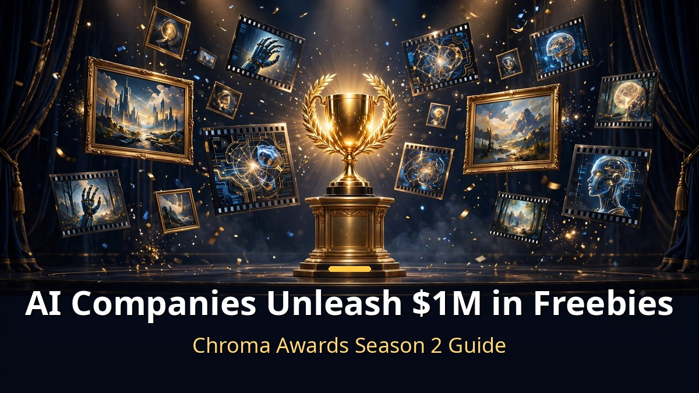
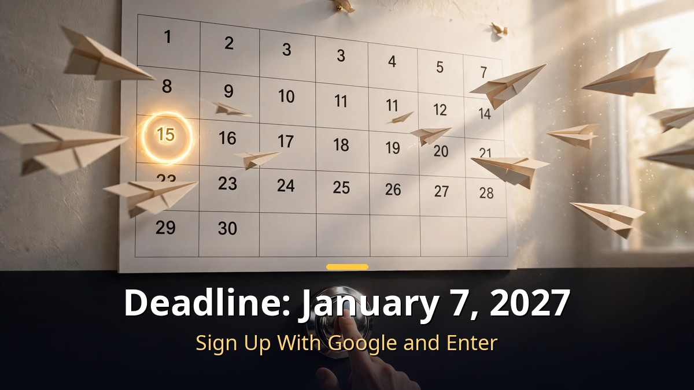

<!-- 본문 시작 -->

AI companies just gave away $1 million.
It sounds suspicious because it is free, but there is one condition.
Create an image or a video with AI and enter it.

> **Key Takeaways**
>
> The AI image and video competition **Chroma Awards Season 2** is open.
> **Free benefits alone total $1 million (about 1.4 billion KRW)**, with **over $450,000** in prizes and travel perks.
> A dozen sponsors released credits and free passes. Entries close on **January 7, 2027**.

---

## What Is Actually in the $1 Million of Freebies?

<!-- Caption: Credits and free passes from a dozen sponsors. First come, first served, so hurry. -->

Let us look at what the "$1 million" actually is.
This season's free benefits total $1 million, released by AI video and image tool companies as sponsors, in the form of credits and passes.

From largest to smallest:

| Sponsor | Benefit | Notes |
|---|---|---|
| Reactor | $150 in credits | Apply with a code |
| LTX | $75 in credits | Apply with a code |
| VEED | $50 in credits | Apply with a code |
| Meshy | One month of Pro free | 3D generation tool |
| Hyper3D | One month Creator Pass free | 3D asset generation |
| PixVerse | One month of Pro free | AI video generation |
| CapCut | 60% off | Video editing |
| ElevenLabs | 45% off | AI voice |
| Nimble Fox / Rosebud | Free access | AI game creation tools |

There are also "coming soon" benefits not yet revealed.
Sign up for Get Notified alerts and you will hear when they drop.

One warning: **free credits are first come, first served**.
They can run out fast once people pile in, so grab them early if you plan to use them.
It is simple: sign up with a Google account and apply the codes on each platform.

---

## How Do You Win the Prizes?

<!-- Caption: Over $450,000 in prizes. Brand awards go to works that feature that brand's tool prominently. -->

Freebies are not the whole story.
Over $450,000 in prizes and travel perks are on the line.

The centerpiece is the **Creative Tools** category, with **$263,750** in total prizes, the largest pool.
There is also a separate **Film & TV** category.

The interesting part is the **brand awards**.
Brands like Kling offer an "Ad of the Year" award, with a condition: **the brand's tool must feature prominently in the work**.
To chase the Kling award, Kling-made footage should stand out in your piece.
For the tool companies, it collects showcase use cases. For entrants, it creates a strategy.

So there are two ways to chase prizes.
Compete on overall quality in Creative Tools or Film & TV, or go all-in on one tool for a brand award.
The latter favors people already using that tool.

---

## How Do You Enter?

<!-- Caption: Sign up with a Google account and submit your work. Deadline: January 7, 2027. -->

The process is simple.

1. Go to **submit.chromaawards.com**.
2. Sign up with a Google account.
3. Grab each sponsor's code and apply it on their platform (free benefits).
4. Create an AI image or video and submit it.

**Entries close on January 7, 2027**, about 78 days from the announcement (October 21, 2026).
Not a short window, but start early if you are making a piece.

Categories center on Creative Tools and Film & TV.
Pick based on your work's character. An ad-style piece can also chase brand awards like Kling's.

---

Honestly, I first assumed the "$1 million" figure was marketing exaggeration.
But adding up the sponsor breakdown, the scale is real.

Why would AI tool companies give away this much? The answer is clear.
Getting people to try their tools is the most effective marketing there is.
For participants, tools you would normally pay for are free to try, with prize money on top.

Just remember the first-come part.
Freebies belong to whoever moves first.

## Frequently Asked Questions

**Q. Is it really free? Any hidden conditions?**

A. The sponsor credits and free passes are genuinely free. But credits are first come, first served, and some are time-limited like one free month. There is no entry fee.

**Q. Can I enter if I am not good with AI yet?**

A. Prize-level quality matters for winning, but grabbing the free benefits only needs a signup. If you want to learn the tools, using the credits for practice is a fine approach.

**Q. Do the benefits disappear after the deadline?**

A. Entries close January 7, 2027. Free credits can run out earlier on a first-come basis, so move fast regardless of the deadline.

<!--
Related post URLs: paste one per line at the bottom of the body to generate cards. Do not publish as body text.
https://blog.naver.com/3700708/224438205520
https://blog.naver.com/3700708/224443305622
https://blog.naver.com/3700708/224444416786
-->

<!-- 본문 끝 -->

## 작업용 출처·이미지 정보 (업로드 제외)

- 자료 출처: 정리 영상 (2026-10-21) / 크로마 어워즈 공식 (chromaawards.com, submit.chromaawards.com)
- 이미지: images/01-hero-en.jpg ~ 04-img3-en.jpg / 직접 제작 (AI 생성 + 영어 오버레이) / 사용권: 자작
- 연관글: https://blog.naver.com/3700708/224438205520, https://blog.naver.com/3700708/224443305622, https://blog.naver.com/3700708/224444416786

## 발행 기록 (업로드 제외)

- 사용자 요청: GitHub 저장소를 통한 Codex 발행
- 처리 결과:
- 확인한 게시글 URL 또는 임시저장 식별 정보:
- 오류·미완료 항목:
