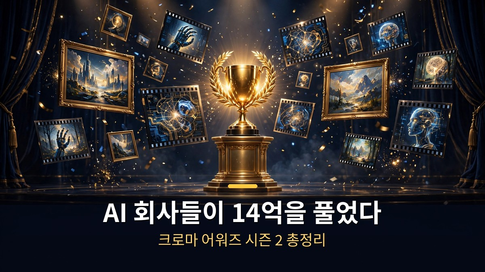
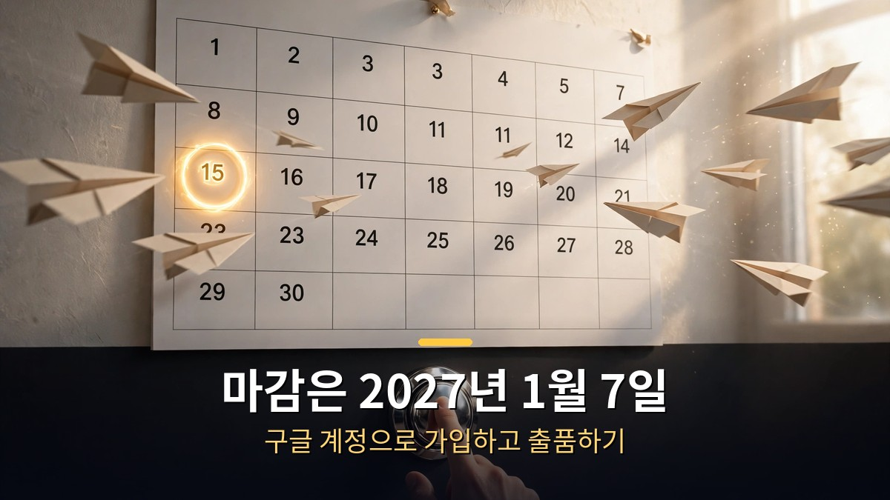

<!-- 본문 시작 -->

AI 회사들이 14억 원을 풀었습니다.
공짜로 주는 거라서 의심부터 들 수 있는데, 조건은 하나입니다.
AI로 이미지나 영상을 만들어 출품하는 것.

> **핵심 정리**
>
> AI 이미지·영상 경연대회 **크로마 어워즈 시즌 2**가 열렸습니다.
> **무료 혜택만 100만 달러(약 14억 원)**, 상금과 여행 혜택은 **45만 달러**가 넘습니다.
> 스폰서 10여 곳이 크레딧과 무료 이용권을 풀었고, 출품 마감은 **2027년 1월 7일**입니다.

---

## 14억 원어치 무료 혜택, 뭐가 있길래?

<!-- 캡션: 스폰서 10여 곳이 푼 크레딧과 무료 이용권, 선착순이라 서두르는 게 좋습니다. -->

'14억'이라는 숫자의 실체부터 봅니다.
이번 시즌에 풀린 무료 혜택은 총 100만 달러, 우리 돈으로 약 14억 원입니다.
AI 영상·이미지 도구 회사들이 스폰서로 참여해 자사 크레딧(유료 기능을 쓸 수 있는 포인트)과 이용권을 내놓은 겁니다.

금액이 큰 순서대로 정리하면 이렇습니다.

| 스폰서 | 혜택 | 비고 |
|---|---|---|
| Reactor | 150달러 크레딧 | 코드 입력 후 적용 |
| LTX | 75달러 크레딧 | 코드 입력 후 적용 |
| VEED | 50달러 크레딧 | 코드 입력 후 적용 |
| Meshy | 프로 한 달 무료 | 3D 생성 도구 |
| Hyper3D | 크리에이터 패스 한 달 무료 | 3D 에셋 생성 |
| PixVerse | 프로 한 달 무료 | AI 영상 생성 |
| CapCut | 60% 할인 | 영상 편집 |
| ElevenLabs | 45% 할인 | AI 음성 |
| Nimble Fox·Rosebud | 무료 이용 | AI 게임 제작 도구 |

여기에 아직 공개되지 않은 '커밍순' 혜택도 있습니다.
알림 신청(Get Notified, 공개 알림)을 해두면 공개될 때 알려줍니다.

주의할 점이 하나 있습니다.
**무료 크레딧은 선착순**입니다.
사람이 몰리면 금방 사라질 수 있어서, 쓸 계획이면 미리 받아두는 게 좋습니다.
받는 방법은 간단합니다.
구글 계정으로 가입하고, 받은 코드를 각 플랫폼에 적용하면 됩니다.
영상에서는 실제 화면으로 코드 적용 과정을 보여줍니다.

---

## 상금은 어떻게 받을 수 있어?

<!-- 캡션: 총상금 45만 달러, 브랜드 상은 해당 도구를 작품에 크게 써야 받을 수 있습니다. -->

무료 혜택이 전부가 아닙니다.
상금과 여행 혜택이 45만 달러 이상 걸려 있습니다.

상금 구조의 핵심은 **Creative Tools 부문**입니다.
이 부문의 총상금이 **26만 3,750달러**로 가장 큽니다.
여기에 **Film & TV 부문**이 따로 있습니다.

재미있는 건 **브랜드별 상**입니다.
Kling의 'Ad of the Year'처럼 특정 브랜드가 거는 상인데, 조건이 있습니다.
**해당 브랜드의 도구를 작품에 크게 써야** 받을 수 있습니다.
예를 들어 Kling 상을 노린다면 Kling으로 만든 분량이 작품에서 두드러져야 합니다.
도구 회사 입장에서는 자사 도구의 활용 사례를 모으는 셈이고, 참가자 입장에서는 상금을 노릴 전략이 생기는 구조입니다.

정리하면, 상금을 노리는 전략은 두 가지입니다.
전체 완성도로 승부하는 Creative Tools·Film & TV 부문에 도전하거나, 특정 도구에 올인해 브랜드 상을 노리거나.
후자는 해당 도구를 이미 쓰고 있는 사람에게 유리합니다.

---

## 참여하려면 뭘 해야 해?

<!-- 캡션: 구글 계정으로 가입하고 출품하면 됩니다. 마감은 2027년 1월 7일입니다. -->

절차는 단순합니다.

1. **submit.chromaawards.com**에 접속합니다.
2. 구글 계정으로 가입합니다.
3. 스폰서별 코드를 받아 각 플랫폼에 적용합니다(무료 혜택).
4. AI로 이미지나 영상을 만들어 출품합니다.

**출품 마감은 2027년 1월 7일**입니다.
영상 공개 시점(2026년 10월 21일) 기준으로 약 78일이 남았습니다.
짧지 않은 기간이지만, 작품을 만든다면 미리 시작하는 게 좋습니다.

부문은 Creative Tools와 Film & TV가 중심입니다.
어떤 부문에 낼지는 작품의 성격에 따라 정하면 됩니다.
광고처럼 만든다면 Kling 같은 브랜드 상도 함께 노려볼 수 있습니다.

---

솔직히 처음에는 '14억'이라는 숫자가 마케팅용 과장인 줄 알았습니다.
그런데 스폰서별 내역을 보니 크레딧과 이용권을 합치면 실제로 그 정도 규모가 됩니다.

AI 도구 회사들이 왜 이런 돈을 푸는지 생각해 보면 답은 명확합니다.
자사 도구를 써본 사람을 늘리는 게 가장 확실한 마케팅이니까요.
참가자 입장에서는 평소에 돈 내고 쓰던 도구를 공짜로 써보고, 잘하면 상금까지 노릴 수 있습니다.

다만 선착순이라는 점은 기억해 두세요.
공짜는 빨리 움직이는 사람의 것입니다.

## 자주 묻는 질문

**Q. 정말로 무료인가요? 숨은 조건은 없나요?**

A. 스폰서가 제공하는 크레딧과 무료 이용권은 실제로 무료입니다. 다만 크레딧은 선착순이고, 일부는 한 달 무료 같은 기간 제한이 있습니다. 출품 자체에는 참가비가 없습니다.

**Q. AI를 잘 못 다루는데도 참여할 수 있나요?**

A. 출품작의 수준은 상금과 직결되지만, 무료 혜택을 받는 것 자체는 가입만으로 가능합니다. 도구를 배워보려는 목적이라면 크레딧을 받아 연습용으로 쓰는 것도 방법입니다.

**Q. 마감일이 지나면 혜택도 사라지나요?**

A. 출품 마감은 2027년 1월 7일입니다. 무료 크레딧은 선착순이라 그 전에 소진될 수 있습니다. 혜택을 받으려면 마감과 무관하게 서두르는 게 좋습니다.

<!--
연관글 URL 3개를 본문 하단에 한 줄씩 붙여넣어 카드 생성, 본문 텍스트로 발행 금지
https://blog.naver.com/3700708/224438205520
https://blog.naver.com/3700708/224443305622
https://blog.naver.com/3700708/224444416786
-->

<!-- 본문 끝 -->

## 작업용 출처·이미지 정보 (업로드 제외)

- 자료 출처: 정리 영상 (2026-10-21) / 크로마 어워즈 공식 (chromaawards.com, submit.chromaawards.com)
- 이미지: images/01-hero.jpg ~ 04-img3.jpg / 직접 제작 (AI 생성 + 한글 오버레이) / 사용권: 자작
- 연관글: https://blog.naver.com/3700708/224438205520, https://blog.naver.com/3700708/224443305622, https://blog.naver.com/3700708/224444416786

## 발행 기록 (업로드 제외)

- 사용자 요청: GitHub 저장소를 통한 Codex 발행
- 처리 결과:
- 확인한 게시글 URL 또는 임시저장 식별 정보:
- 오류·미완료 항목:
