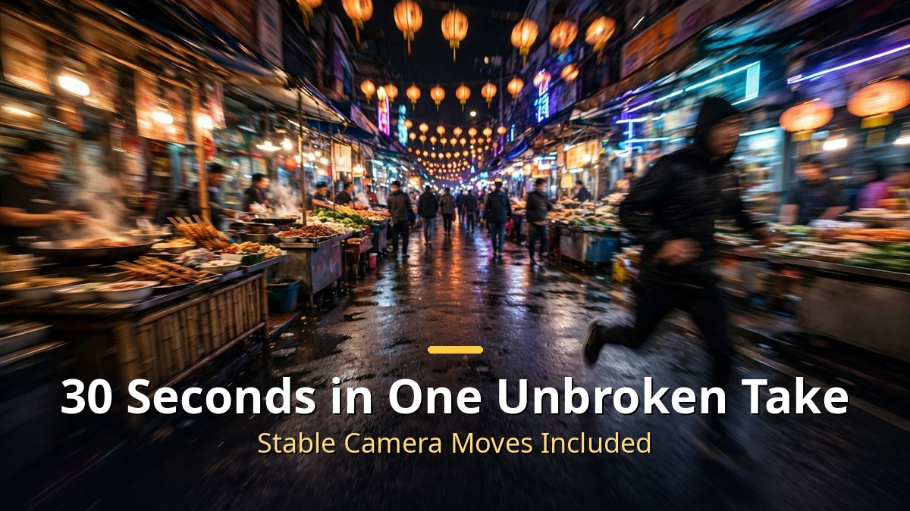
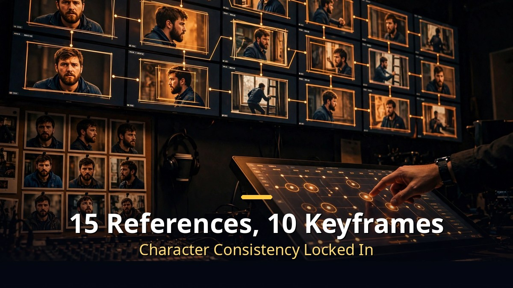
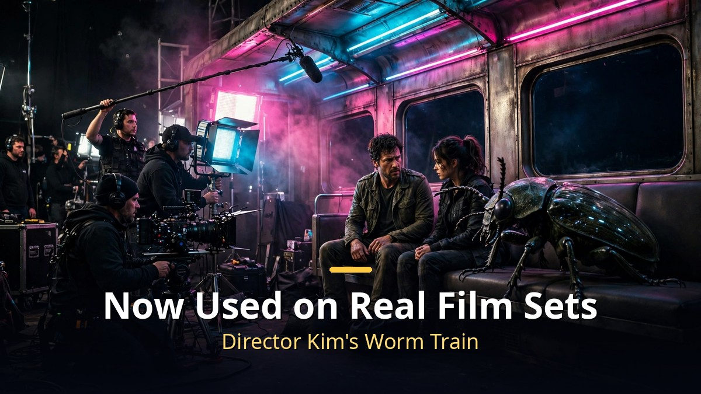

<!-- 본문 시작 -->

AI video is no longer about 5-second fragments.
Kuaishou's Kling AI officially launched its next-generation video model **Kling 4.0** on October 15.
It generates 30 seconds in a single unbroken take — and film sets are already using it.

> **Key takeaways**
>
> Kling 4.0 is an AI video model that generates **30 seconds of video in one continuous shot**.
> With **up to 15 reference assets and 10 keyframes**, it locks in character and scene consistency, and **10-bit HDR and 4K** output is coming soon.
> Director Kim Sung-soo revealed at the Busan International Film Festival that he is using it for an AI short film — a sign AI video has moved **from amateur toy to professional production tool**.

---

## Why does a 30-second single take matter?

<!-- Caption: 30-second long takes in one generation, with stable camera movement. -->

Until now, AI video tools worked in fragments: generate a few seconds, keep one usable moment, stitch them together in editing.
Faces changed between shots, and backgrounds fell apart whenever the camera moved.

Kling 4.0 changes that premise.
It generates **30 seconds at once, with no cuts**.
A character running down a street, colliding with a fruit stand, staying under a following camera — all in one flow.

Camera language got better too.
It understands push-ins, pull-outs, pans, tracking shots, and orbit shots, and renders them as directed.
Prompt input length grew to **8,000 tokens**, so creators can brief a shot like a director's shot list.
Kuaishou calls this the "Director's Eye."

---

## What do middle frames and 15 references change?

<!-- Caption: Middle frames plus up to 15 reference assets keep characters and scenes consistent. -->

The real weapons of this upgrade are **middle frames** and **Omni Reference**.
Previously you could only set a start and end frame; now you can add **middle frames** too.
Decide what your character should be doing mid-scene, and Kling 4.0 fills in the motion between.
You can still use just start and end frames if you prefer.

**Omni Reference** combines up to **15 reference assets** in a single generation.
Image and video references are supported (audio references are not yet available),
and tagging each image lets you call it out in the prompt with @image2 for much finer detail.
In a yacht ad test, separate references for the yacht, the models, an orange juice bottle, and Positano background photos produced a seamless shot even as the camera moved from wide to close.

The practical payoff is **consistency**.
Lock a product's exact color from a photo, keep a character's face identical across shots, carry a lighting mood into the next cut.
You can also borrow the rhythm and camera grammar of a reference video and swap in your own products and characters —
aimed squarely at commercial video like fashion, beauty, and consumer electronics where things must look identical.

Creation paths widened as well.
On platforms like Artlist you can generate directly at **720/1080p, 3 to 30 seconds, 21:9** aspect ratio,
and connecting **Claude Code or Codex via MCP** (a standard for linking AI to external tools) lets you order up a video by chat:
"make a spaceship warp video with these first and last frames."
(Middle frames are not yet supported over MCP, so the start/end-frame workflow is recommended there.)
An extension feature that stretches videos up to **2 minutes** is also planned.

---

## Is it really being used on film sets?

<!-- Caption: Director Kim Sung-soo presented his Kling 4.0-powered AI short at the Busan International Film Festival. -->

The most surprising news comes from real film sets.
**Kim Sung-soo**, director of "12.12: The Day," presented his in-production AI short film **"Worm Train"** at the Asian Contents & Film Market of the 31st Busan International Film Festival.
He completed a key scene — passengers and a giant insect colliding in the same train car — during Kling 4.0's internal test period in September.
"This brings us closer to making real films," he said.

Industry recognition followed.
At this summer's Cannes Lions festival, **AI entered the judging criteria for the first time**, and two works made with Kling AI won Gold.
Proof that AI video can carry an advertising narrative.

The numbers are big too.
Kling AI has **over 100 million users across 224 countries and regions** and **50,000+ enterprise customers**, with annual revenue around **$500 million**.
It is pushing into the Korean market as well, partnering with the Korea AI Content Creators Association and the Korea Artificial Intelligence Association on AI education and industry use cases.
An **API for developers** and **MCP/CLI integration** for AI agents shipped with this release.

| Item | Details |
|---|---|
| Launch | October 15, 2026 (developer: Kuaishou, China) |
| Max length | 30 seconds in one take (extension to 2 minutes planned) |
| Control | Up to 15 reference assets, up to 10 keyframes |
| Quality | 10-bit HDR and 4K output coming soon; 21:9 supported |
| Prompts | Up to 8,000 tokens, auto-refined by the Director's Eye |
| Use cases | Film, advertising, short dramas; API, MCP, CLI support |

Honestly, every AI video announcement makes me ask "is it real this time?"
But this time a film director staked his own work on it at a film festival.
With Cannes Golds on top, "toy" no longer fits.

What Kling 4.0 changed is not the spec sheet but the **unit of production**.
The era of planning 30-second "scenes" instead of 5-second fragments has arrived.
The day when generating an ad or a short-drama episode with AI feels normal seems closer than expected.

## FAQ

**Q. Where can I use Kling 4.0?**

A. On the Kling AI official site (kling.ai). Kling 4.0 Flash opened to Ultra Yearly subscribers on September 28, and the main model officially launched on October 15 after early access.

**Q. How is it different from Seedance 2.5?**

A. In hands-on tests, Seedance 2.5 is slightly stronger on human skin and texture in portrait shots, while Kling 4.0 handles backgrounds, nature, and action scenes better. Kling 4.0 credits are also cheaper, so it offers better value for high-quality background-heavy video.

**Q. Is it free?**

A. Kling AI runs on credits: 450 credits for 30 seconds at 1080p, 120 credits for 20 seconds at 720p on the Flash tier. Check the official site for current pricing.

**Q. Is it actually used in Korean film and advertising?**

A. Director Kim Sung-soo used it for the AI short "Worm Train," and two Kling AI-made works won Gold at Cannes Lions. In Korea, partnerships with the Korea AI Content Creators Association and the Korea Artificial Intelligence Association are expanding education and industry adoption.

<!--
Paste the 3 related URLs one per line at the bottom of the post to generate cards. Do not publish as body text.
https://blog.naver.com/3700708/224444416786
https://blog.naver.com/3700708/224443305622
https://blog.naver.com/3700708/224442188419
-->

<!-- 본문 끝 -->

## 작업용 출처·이미지 정보 (업로드 제외)

- 자료 출처: 성공지식백과 정리 영상 (2026-10-22) / 조선비즈·GlobeNewswire (클링 4.0 공식 발표) / Wikipedia (Kling AI)
- 이미지: images/01-hero-en.jpg ~ 04-img3-en.jpg / 직접 제작 (AI 생성 + 영어 오버레이) / 사용권: 자작
