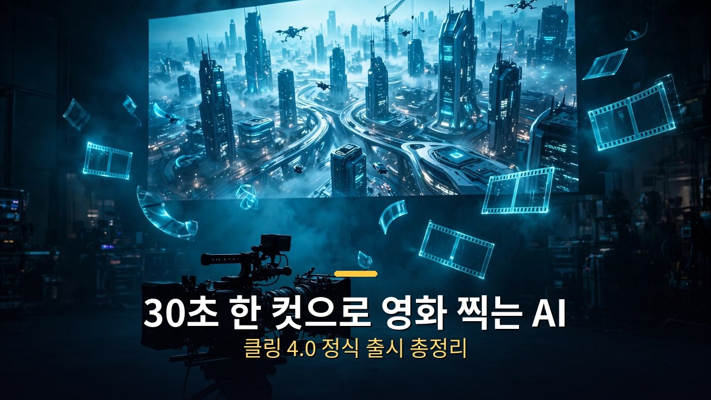
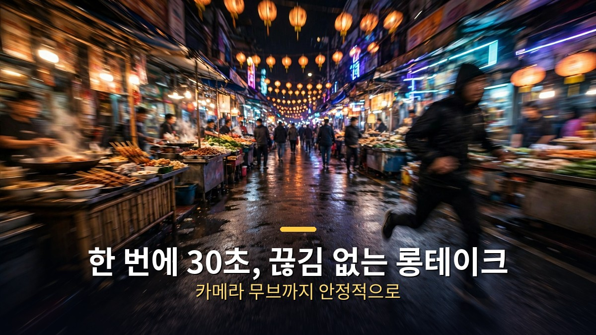
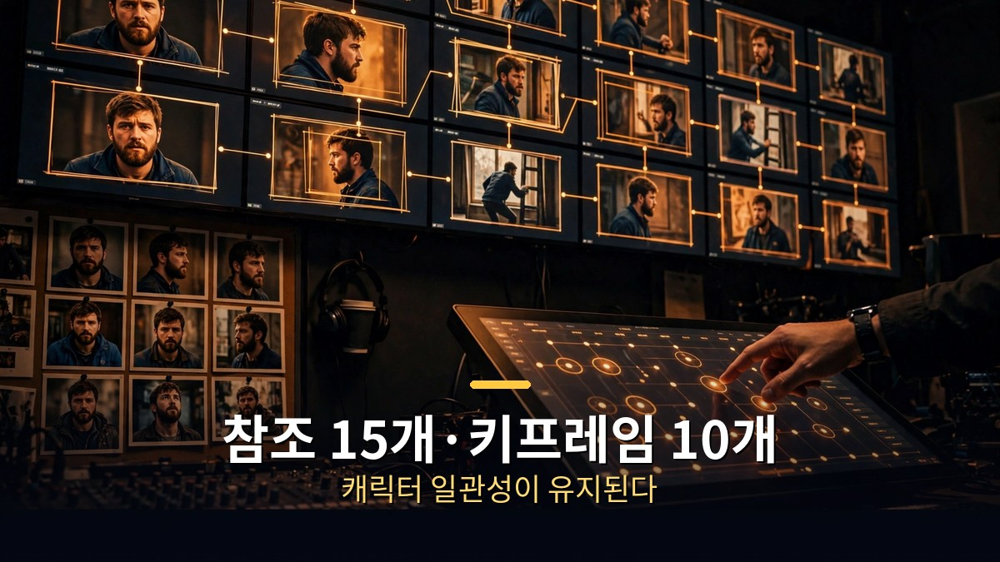
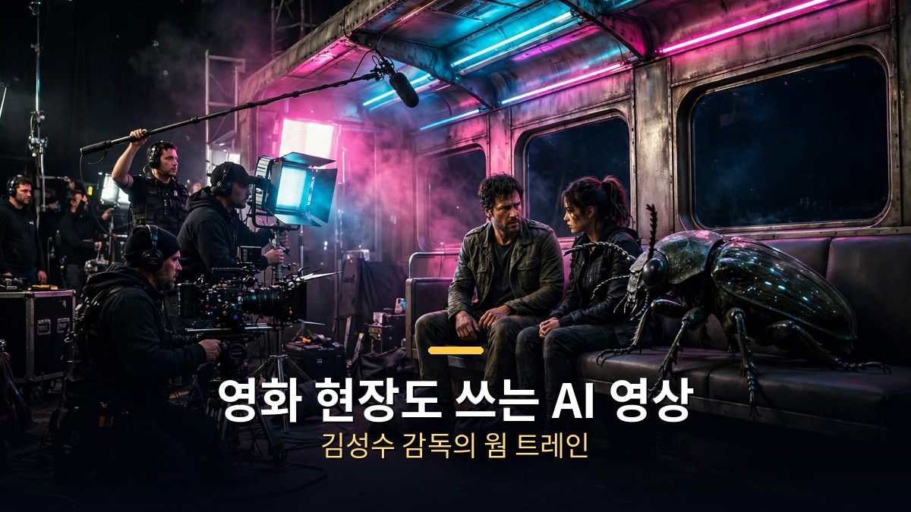

<!-- 본문 시작 -->

AI 영상, 이제 5초짜리 조각이 아닙니다.
중국 콰이쇼우의 클링 AI가 10월 15일 차세대 영상 생성 모델 **클링 4.0**을 정식 출시했습니다.
한 번에 30초를 끊김 없이 뽑고, 영화 현장에서도 쓰이기 시작했습니다.

> **핵심 정리**
>
> 클링 4.0은 **한 번에 30초 분량의 영상을 한 컷으로** 생성하는 AI 영상 모델입니다.
> **참조 자료 15개·키프레임 10개**로 인물과 장면의 일관성을 잡고, **10비트 HDR·4K** 출력으로 색감을 끌어올렸습니다.
> 김성수 감독이 부산국제영화제에서 AI 단편 제작에 활용했다고 공개하면서, AI 영상이 **아마추어 놀이를 넘어 전문 제작 영역**으로 들어섰습니다.

---

## 30초 한 컷이 왜 대단한가요?

<!-- 캡션: 30초 롱테이크 한 번에 생성, 카메라 무브까지 안정적으로 구현합니다. -->

지금까지 AI 영상 도구는 '짧게 뽑고 이어 붙이기'가 기본이었습니다.
몇 초짜리 클립을 만들고, 그중 쓸 만한 장면 하나를 골라, 편집에서 이어 붙이는 방식입니다.
인물이 장면마다 얼굴이 바뀌고, 카메라가 움직이면 배경이 무너지는 게 일상이었습니다.

클링 4.0은 이 전제를 바꿨습니다.
**30초를 한 번에, 컷 없이** 생성합니다.
거리를 달리는 인물, 과일 가판대에 부딪히는 장면, 따라오는 카메라까지 하나의 흐름으로 뽑아냅니다.

카메라 움직임 이해도 좋아졌습니다.
푸시인(다가가기), 풀아웃(멀어지기), 팬(좌우 회전), 트래킹(따라가기), 오빗(빙 둘러싸기) 같은 촬영 용어를 알아듣고 그대로 구현합니다.
프롬프트 입력 길이도 **최대 8,000토큰**으로 늘어서, 감독이 촬영 지시서를 쓰듯 세세하게 지시할 수 있습니다.
콰이쇼우는 이를 '감독의 눈(Director's Eye)'이라 부릅니다.

---

## 참조 15개·키프레임 10개가 뭘 바꾸나요?

<!-- 캡션: 참조 자료 15개와 키프레임 10개로 인물·장면의 일관성을 잡습니다. -->

이번 업그레이드의 진짜 무기는 **미들 프레임**과 **옴니 레퍼런스**입니다.
기존에는 시작 프레임과 끝 프레임만 지정할 수 있었는데, 이제 **중간 프레임**까지 넣을 수 있습니다.
"중간에 내 캐릭터가 이런 행동을 했으면 좋겠다"는 장면을 직접 정하면, 클링 4.0이 사이 움직임을 자동으로 채웁니다.
원한다면 기존처럼 시작·끝 프레임만 써도 됩니다.

**옴니 레퍼런스**는 참조 자료를 한 번에 **최대 15개**까지 조합하는 기능입니다.
이미지와 비디오 레퍼런스를 넣을 수 있고(오디오 레퍼런스는 아직 미지원),
각 이미지에 태그를 달아 프롬프트에서 "@이미지2"처럼 지목하면 디테일이 훨씬 살아납니다.
요트 광고 테스트에서는 요트·모델·오렌지주스병·포지타노 배경 실사를 따로 넣어,
카메라가 멀리서 가까이로 바뀌어도 이질감 없는 영상이 나왔습니다.

실전 의미는 **일관성**입니다.
광고에 쓰는 상품의 색을 사진 그대로 고정하고, 인물의 얼굴을 장면마다 똑같이 유지하고, 조명 분위기를 다음 컷으로 이어갈 수 있습니다.
참조 영상의 리듬과 카메라 구성을 가져와서, 그 안에 자기 상품과 인물만 갈아끼우는 것도 됩니다.
패션·뷰티·전자제품 광고처럼 '똑같아야 하는' 상업 영상에 정면으로 겨냥한 기능입니다.

만드는 경로도 넓어졌습니다.
아트리스트(Artlist) 같은 플랫폼에서는 **720·1080 화질, 3초~30초, 21:9** 화면비로 바로 만들 수 있고,
**클로드 코드나 코덱스와 MCP**(외부 도구를 연결하는 규격)로 연결하면 채팅으로 "첫 장면과 마지막 장면 프레임을 넣은 우주선 워프 영상을 만들어줘"라고 시킬 수도 있습니다.
(MCP에서는 아직 미들 프레임은 미지원이라 시작·끝 프레임 방식이 권장됩니다.)
영상 길이를 **최대 2분까지** 늘리는 이어 붙이기 기능도 추가될 예정입니다.

---

## 이제 영화 현장에서도 쓴다고요?

<!-- 캡션: 김성수 감독이 부산국제영화제에서 클링 4.0 활용 AI 단편을 공개했습니다. -->

가장 놀라운 소식은 영화 현장 소식입니다.
영화 '서울의 봄'을 연출한 **김성수 감독**이 제31회 부산국제영화제 아시아콘텐츠·필름마켓에서 제작 중인 AI 단편영화 **'웜 트레인'**을 공개했습니다.
승객과 거대 곤충이 같은 객차에 타고 몸이 부딪히는 장면을 클링 4.0 내부 테스트 기간(9월)에 완성했다고 합니다.
김 감독은 "진짜 영화 만들기에 더 가까워졌다"고 평가했습니다.

업계의 인정도 이어집니다.
올해 여름 칸 국제광고제(칸 라이언즈)는 **처음으로 AI를 작품 평가 체계에 포함**했는데, 클링 AI로 만든 작품 2편이 금상을 받았습니다.
AI 영상이 광고 서사의 주역이 될 수 있다는 걸 증명한 셈입니다.

숫자도 큽니다.
클링 AI는 전 세계 **224개 국가·지역에서 1억 명 이상**의 이용자, **5만여 개 기업** 고객을 확보했고 연 매출은 **5억 달러(약 6,667억 원)** 규모입니다.
한국 시장 공략에도 속도를 내고 있는데, 최근 한국AI콘텐츠크리에이터협회·한국인공지능협회와 협력 관계를 맺고 AI 교육 과정과 산업 활용 사례를 함께 만들기로 했습니다.
개발자를 위한 **API 공개**와 AI 에이전트가 호출할 수 있는 **MCP·CLI 연동**도 이번에 들어갔습니다.

| 항목 | 내용 |
|---|---|
| 출시 | 2026년 10월 15일 정식 출시 (개발사: 중국 콰이쇼우) |
| 최대 길이 | 한 번에 30초, 한 컷 (이어 붙이면 최대 2분 예정) |
| 제어 | 참조 자료 최대 15개, 키프레임 최대 10개 |
| 화질 | 10비트 HDR, 4K·21:9 지원 예정 |
| 프롬프트 | 최대 8,000토큰, 감독의 눈으로 자동 보정 |
| 활용 | 영화·광고·숏드라마, API·MCP·CLI 지원 |

솔직히 AI 영상 소식을 전할 때마다 '이번엔 진짜냐'는 마음이 먼저 들었습니다.
그런데 이번엔 영화감독이 영화제에서 자기 작품을 걸고 썼다고 말합니다.
광고제 금상까지 받은 마당에, '장난감'이라는 말은 이제 어울리지 않습니다.

클링 4.0이 바꾼 건 기술 스펙이 아니라 **제작 단위**입니다.
5초짜리 조각이 아니라 30초짜리 '장면'을 기획하는 시대가 왔습니다.
광고 한 편, 숏드라마 한 회를 AI로 뽑는 게 이상하지 않은 날이 생각보다 빨리 올 것 같습니다.

## 자주 묻는 질문

**Q. 클링 4.0은 어디서 쓸 수 있나요?**

A. 클링 AI 공식 사이트(kling.ai)에서 이용할 수 있습니다. 9월 말에는 연간 구독자 대상 '클링 4.0 플래시' 사전 체험이 먼저 열렸고, 10월 15일 정식 출시됐습니다.

**Q. 시댄스 2.5와 뭐가 다른가요?**

A. 영상 테스트에 따르면 인물 피부·질감 같은 인물샷은 시댄스 2.5가 조금 더 강하고, 배경·자연·액션 장면은 클링 4.0이 잘 만듭니다. 크레딧도 클링 4.0이 더 저렴한 편이라, 배경이 들어가는 고퀄리티 영상을 뽑을 때 가성비가 좋습니다.

**Q. 무료로도 쓸 수 있나요?**

A. 클링 AI는 크레딧制로 운영되며, 30초 1080p 생성에 450 크레딧이 듭니다. 플래시 등급은 20초 720p에 120 크레딧입니다. 시댄스 2.5보다 저렴하다는 평가가 있습니다. 정확한 요금제는 공식 사이트에서 확인하세요.

**Q. 한국 영화·광고 현장에서 실제로 쓰이나요?**

A. 김성수 감독이 AI 단편 '웜 트레인' 제작에 활용했고, 칸 라이언즈에서 클링 AI 제작 작품 2편이 금상을 받았습니다. 국내에서는 한국AI콘텐츠크리에이터협회·한국인공지능협회와 협력을 맺고 교육·산업 활용을 넓히고 있습니다.

<!--
연관글 URL 3개를 본문 하단에 한 줄씩 붙여넣어 카드 생성, 본문 텍스트로 발행 금지
https://blog.naver.com/3700708/224444416786
https://blog.naver.com/3700708/224443305622
https://blog.naver.com/3700708/224442188419
-->

<!-- 본문 끝 -->

## 작업용 출처·이미지 정보 (업로드 제외)

- 자료 출처: 성공지식백과 정리 영상 (2026-10-22) / 조선비즈·GlobeNewswire (클링 4.0 공식 발표) / Wikipedia (Kling AI)
- 이미지: images/01-hero.jpg ~ 04-img3.jpg / 직접 제작 (AI 생성 + 한글 오버레이) / 사용권: 자작
