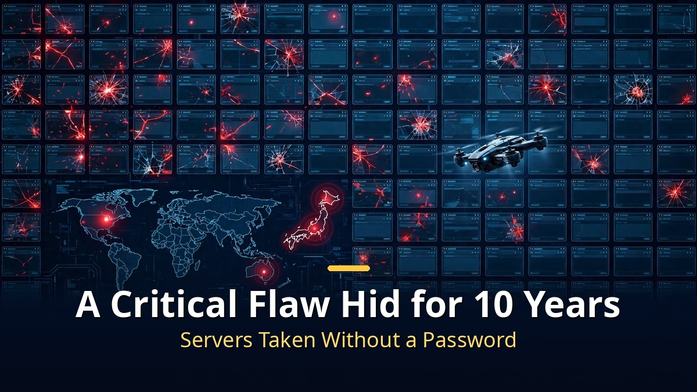

<!-- 본문 시작 -->

On October 21, websites around the world started going dark one by one.
The cause: critical flaws in PHP, the programming language underneath much of the internet — found by AI.
With **70% of the world's websites** in the blast radius, governments and companies rushed to respond.

> **Key takeaways**
>
> AI models found **two critical flaws (CVE-2026-109618, CVE-2026-109619) that had hidden in PHP for over a decade**.
> They allow server takeover with no password, so the US NSA told organizations to **"patch immediately or go offline,"** and several countries pulled government sites.
> It is the first major case of AI finding what humans missed — and vulnerabilities discovered in 2026 are on track to **double** 2025's record.

---

## Why did websites go dark worldwide?

<!-- Caption: 70% of the world's websites affected by a critical flaw hidden for over a decade. -->

It started with a leak on October 20 on an online bulletin board.
The PHP team had planned to release the security patch on the 22nd, but moved it up to **the 21st** in an emergency release:
versions 8.5.12, 8.4.27, 8.3.36, and 8.2.35 all at once.

The flaws are **remote code execution (RCE)**.
CVE-2026-109618 and CVE-2026-109619, paired under the informal name **"PHP2Shell,"** score **9.2 out of 10 on CVSS v4.0** — near the maximum.
The scary part is what they don't require: **no password, no login, no prior access.**
A single crafted request can run arbitrary code on the server.
The NSA warned they "often provide a direct path to the server's file system or database."

PHP is the foundation under much of the internet.
Security firm Wiz estimates **about 70% of the world's websites** run on PHP —
online stores, news outlets, government services included.
The Drupal Association (a website-building platform) warned that "all servers running PHP versions released over the past 20 years are vulnerable."

The response was fast.
The NSA told organizations to patch immediately or take vulnerable systems offline, and the FBI warned of remote code execution risk.
The Netherlands, Finland, Belgium, and Denmark **blocked access to some government websites** as a precaution.
Japan's Prime Minister Sanae Takaichi urged action personally on X, and cyber authorities in Australia and Singapore issued emergency advisories.
In Australia, public broadcaster ABC reported that the cyber agency's own site (cyber.gov.au) was among those affected.

---

## How did AI find a decade-old flaw?

<!-- Caption: GPT-5.6 Sol and Gemini 4 Argon independently found the same flaw. -->

What makes this case special is who found it.
In August, security firm **Calif** found the flaws using OpenAI's **GPT-5.6 Sol** model,
as part of an OpenAI-funded audit of PHP's code.

Weeks later, Google-owned **Wiz** found the same class of flaw **independently**,
with help from Google's **Gemini 4 Argon** and GPT-5.6 Sol.
Neither team set out looking for a PHP bug — the AI models surfaced it while combing through code.
Both teams say AI did the heavy lifting.

PHP Foundation security engineer Volker Dusch compared it to **Heartbleed** —
the 2014 flaw that sent the world scrambling to patch, the most serious PHP problem in over a decade.
Wiz co-founder Ami Luttwak called it "the most severe among security vulnerabilities found by AI,"
adding that "without AI, it would have been too complex to discover."

The numbers tell the shift too.
As ever-more-powerful AI models spot weaknesses humans missed for years,
vulnerabilities discovered in 2026 are on track to **roughly double** 2025's record total.
AI has become the eye that sees cracks in the internet.

---

## What should we do?

<!-- Caption: WordPress users should check whether their host has updated PHP. -->

No known breaches have been reported so far.
But Cloudflare says it is **"seeing early attack attempts,"** and multiple proof-of-concept exploits have surfaced.
"Not yet" is the most unsettling phrase here.

What ordinary people should do is surprisingly simple.
If your site runs on **WordPress** or another PHP-based platform, check whether your **hosting provider has updated server PHP** to the latest (8.5.12 or the newest in your series).
Most personal bloggers are covered by their host, but if you run your own server, update it yourself.
Keep WordPress itself and your plugins up to date too.

OpenAI calls this response **"Patch the Planet"** —
two months of work with Calif, Wiz, Cloudflare, and others to prepare defenses before disclosure.
"Frontier AI found these vulnerabilities before attackers did," OpenAI said, calling it a **"Defender's Window"**: time for maintainers to prepare fixes before going public.

| When | What happened |
|---|---|
| August 2026 | Calif finds the flaws with GPT-5.6 Sol (OpenAI-funded audit) |
| Weeks later | Wiz independently finds them with Gemini 4 Argon and others |
| October 20 | Information leaks → patch release moved up a day |
| October 21 | Emergency PHP patches ship; global patch-and-pull-offline scramble |

Honestly, my first thought on this story was not "AI is scary."
It was: "without AI, this flaw would have hidden for another decade."
Attackers have started using AI too — defenders can't play the game without it.

The internet stands on thinner ground than we think.
That 70% of the world's websites rest on PHP became visible this week.
AI finding the cracks in that foundation may be the first scene of the internet learning to defend itself.

## FAQ

**Q. Is my WordPress blog at risk?**

A. Sites running on PHP are in principle affected. But most personal bloggers are covered by their hosting provider's server PHP update — check your host's announcements, and keep WordPress and plugins current. If you run your own server, upgrade PHP to 8.5.12 (or the latest in your series).

**Q. Have any sites been hacked already?**

A. No known breaches so far. But Cloudflare has observed early attack attempts, and proof-of-concept code is circulating. Patching is the only answer.

**Q. Why does AI finding flaws matter?**

A. AI found what humans missed for over a decade. Vulnerabilities discovered in 2026 are on track to double 2025's count. The lesson: now that attackers use AI too, defense can't hold without it.

<!--
Paste the 3 related URLs one per line at the bottom of the post to generate cards. Do not publish as body text.
https://blog.naver.com/3700708/224436914406
https://blog.naver.com/3700708/224444407453
https://blog.naver.com/3700708/224444416786
-->

<!-- 본문 끝 -->

## 작업용 출처·이미지 정보 (업로드 제외)

- 자료 출처: TheAIGRID 정리 영상 (2026-10-22) / New Indian Express·Straits Times·Korea Times·조선비즈 (PHP 결함 보도) / OpenAI·Wiz 공식 발표
- 이미지: images/01-hero-en.jpg ~ 04-img3-en.jpg / 직접 제작 (AI 생성 + 영어 오버레이) / 사용권: 자작
