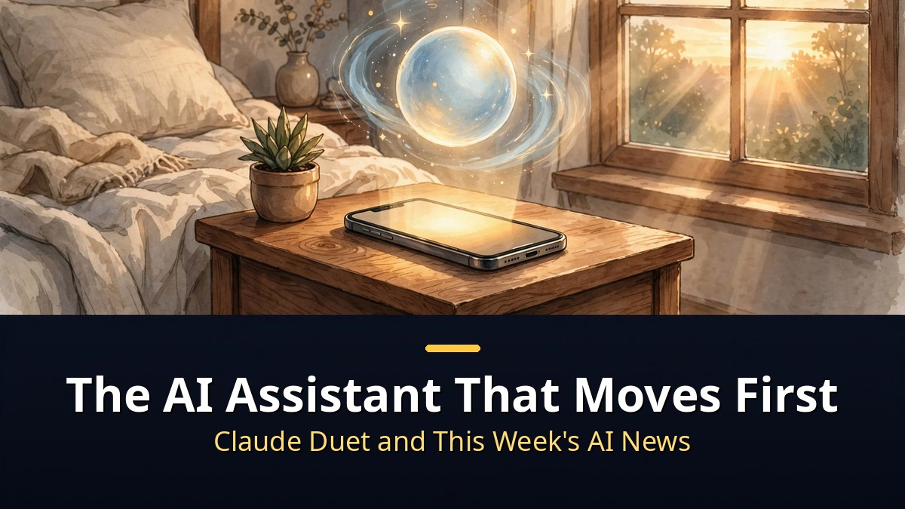
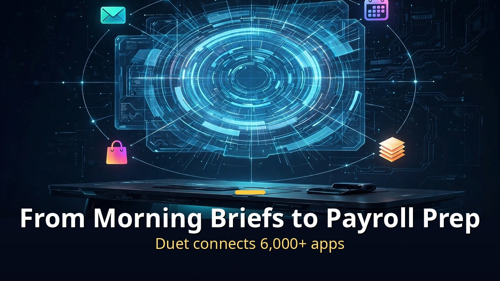
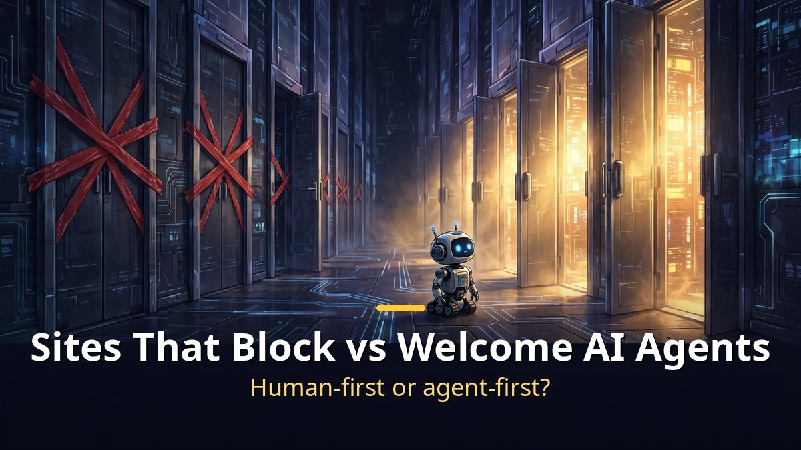

<!-- 본문 시작 -->

This week's biggest AI story is Anthropic's "Claude Duet."
An AI assistant that moves before you ask — the opening act of the proactive agent era.
Websites, meanwhile, are moving the opposite direction. They've started shutting AI agents out.

> **Key takeaways**
>
> Anthropic opened a research preview of **"Claude Duet"** on October 21. It sends a morning brief, checks connected apps every few hours, and **reaches out first only when something truly needs you**.
> Meanwhile **Yelp, Delta, and JPMorgan** began blocking AI agents, while **Shopify** declared the exact opposite: full welcome.
> "Assistants that move first" versus "websites that close their doors" — this was a week of tug-of-war over AI agents.

---

## Why a "reach out first" assistant?

The Claude Duet dashboard, connected to more than 6,000 apps.

Chatbots waited for questions. Duet goes the other way.
Each morning it scans your email and calendar and briefs you on what matters most today.
"Morning, Nicole — health permit, hiring decisions, Northfield renewal today," that kind of thing.

It watches connected apps every few hours and messages you only when something needs attention.
Gmail, Slack, QuickBooks, Stripe, HubSpot, Shopify — more than 6,000 connectors.
It finds unpaid invoices and drafts reminders, preps payroll for review.

**The key is the approval system.**
Before sending a message, making a payment, signing, or deleting, it shows exactly what it plans and waits for your go-ahead.
Securities trading and transfers between accounts are blocked even with approval.
A dedicated classifier filters sensitive data like credit card numbers and government IDs.

It also runs differently: on its own virtual machine with its own browser, so work continues even with your phone or laptop off.
You get notified when it's done or needs a check.
Right now it's a research preview, waitlisted for U.S. Claude Pro and Max subscribers.

---

## Websites start shutting AI agents out

The web splitting in two: sites that block AI agents and sites that welcome them.

Amazon was first to block agents from shopping on users' behalf, and this week the line grew longer.
Yelp, Delta Airlines, JPMorgan Chase, Charles Schwab, Cars.com, Amtrak — "humans only on our site."

The reason is simple. **When agents do the buying, sites become mere shopping carts.**
Today it's "buy it on Amazon." In the agent era it's "tell my agent to buy it."
The agent picks whoever is cheapest or fastest. Amazon becomes just one option.

So Shopify played the opposite card: full embrace.
"Let agents shop at our merchants," it declared.
Agent-friendly sites get the orders; closed doors lose them.
Every website now faces a choice: **human-first or agent-first.**

The funny part is Yelp's double play.
It blocks other agents while its own AI agent calls restaurants to check wait times for you.
"Your assistant is out, ours is in."

| Proactive AI assistant | Reaches out first | Key weapon | Current status |
|---|---|---|---|
| Claude Duet (Anthropic) | Morning brief, periodic checks | 6,000+ connectors, approval system | U.S. Pro/Max waitlist |
| Dots (ChatGPT) | Reaches out first | Conversational agent | Live |
| Muse (Meta) | Reaches out first | Messenger integration | Live |
| Grokbot (xAI) | Reaches out first | X integration | Live |

---

## The rest of the week at a glance

From robots to medical AI — this week's flood of AI news.

**Image and video tools** were busy too.
Ideogram shipped a **vector generation model**. Prompt it and get editable SVGs you can pull apart element by element.
ElevenLabs unveiled **Chimera**: Seed Dance 2.5 plus ElevenLabs V4 turns one photo and an audio clip into a talking video, with impressively tight lip sync.
Canva launched its first in-house image model, **Canva Craft**. A two-stage pipeline that plans the layout like a blueprint first, then renders at 2K. Trained on design templates, so text doesn't melt.
GPT Image 3 rumors are swirling — the name "Aurora Red Alpha" was spotted on leaderboards.

**Decision-making AI** keeps evolving.
Perplexity open-sourced **Decider v1.2**: 27B and 4B Flash flavors that output probabilities, choices, and scores instead of prose.
Perplexity Computer now **runs fully on a Mac**. The era of agents running on your own machine.

**Security and medicine** had news too.
Zoom shipped **deepfake detection** for video calls — it checks whether the person on screen is actually human.
Microsoft unveiled **MAI-DxO**, claiming 1.7× the accuracy of physicians.
Unitree's humanoid **H2 kung-fu video** went viral — kicking cars, jumping from 4 meters. Likely a remote-controlled demo.

OpenAI kept its **28-day shipping streak** going: chat PIN locks and the Decisions API's general release this week.
And Railway got hacked — environment variables holding developers' API keys were nearly exposed, triggering a key-rotation scramble.

---

Sorting this week's news left me with one thought.
The shift from AI as "answering tool" to AI as "colleague that moves first" is happening faster than I expected.
My hand was halfway to Duet's waitlist button before I noticed — that's my evidence.
How the tug-of-war with door-closing websites ends, nobody knows.
Maybe the real winner of the agent era will be whoever keeps the door open.

## Frequently asked questions

**Q. Can I use Claude Duet right now?**

A. Not yet — it's in research preview. Only U.S. Claude Pro and Max subscribers can join the waitlist, rolling out gradually.

**Q. What if Duet pays for something on its own?**

A. It must show you the planned action and get approval before any message, payment, signature, or deletion. Securities trading and account-to-account transfers stay blocked even with approval.

**Q. What changes when websites block agents?**

A. Agent-driven shopping gets cut off there. Orders can flow instead to open sites like Shopify's, forcing every site to choose between human-first and agent-first.

## Further reading

[AI That Films in 30-Second Takes｜Kling 4.0 Official Launch — the monster model with 30-second long takes and 15 references, now on real film sets](https://aitechnotesen.blogspot.com/2026/10/ai-that-films-in-30-second-takeskling.html)
[AI Found a Crack in the Internet｜70% of Websites on Emergency Alert — how AI found a 20-year-old PHP flaw before attackers did](https://aitechnotesen.blogspot.com/2026/10/ai-found-crack-in-internet70-of.html)
[AI Worlds That Remember? 8 AI Breakthroughs You Missed — the under-the-radar advances from Fish Audio to world models](https://aitechnotesen.blogspot.com/2026/10/ai-worlds-that-remember-8-ai.html)

<!-- 본문 끝 -->

## 작업용 출처·이미지 정보 (업로드 제외)

- 자료 출처: Matt Wolfe 'AI News: 24 Things You Need To Know This Week' (2026-10-23) / itmunch·webpronews·TechCrunch (클로드 듀엣 발표 보도) / TechCrunch (캔바 크래프트)
- 이미지: images/01-hero-en.jpg ~ 04-img3-en.jpg / 직접 제작 (AI 생성 + 영어 오버레이) / 사용권: 자작
