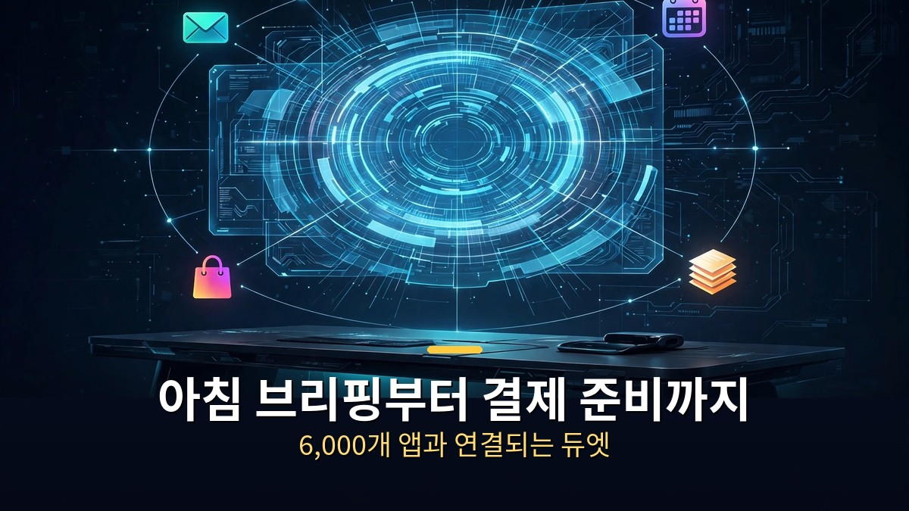
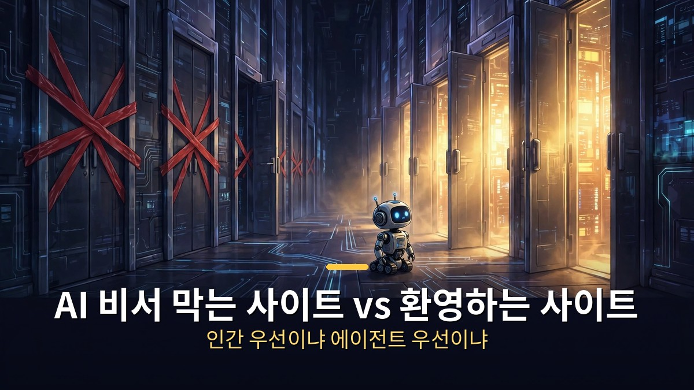

<!-- 본문 시작 -->

이번 주 AI 뉴스의 주인공은 앤트로픽의 '클로드 듀엣'입니다.
묻기 전에 먼저 움직이는 AI 비서, 프로액티브 에이전트 시대의 개막을 알리는 제품입니다.
그런데 웹사이트들은 정반대로 움직이고 있습니다. AI 에이전트의 출입을 막기 시작한 것입니다.

> **핵심 정리**
>
> 앤트로픽이 10월 21일 **'클로드 듀엣'** 리서치 프리뷰를 공개했습니다. 아침 브리핑을 보내고, 몇 시간마다 연결된 앱을 살펴보다가 **정말 필요한 일에만 먼저 연락하는** AI 비서입니다.
> 한편 **Yelp·Delta·JP모건** 등은 AI 에이전트의 접속을 차단하기 시작했고, **쇼피파이**는 정반대로 전면 수용을 선언했습니다.
> '먼저 움직이는 비서'와 '문을 닫는 웹사이트' — 이번 주는 AI 에이전트를 둘러싼 힘겨루기의 한 주였습니다.

---

## 왜 '먼저 연락 오는' 비서가 나왔나?

6,000개가 넘는 앱과 연결되는 클로드 듀엣의 대시보드입니다.

지금까지의 챗봇은 질문을 기다렸습니다.
듀엣은 반대로 갑니다. 아침에 이메일과 캘린더를 훑어 오늘 가장 중요한 일을 브리핑으로 보내줍니다.
"아침이야, 니콜. 오늘은 보건소 허가, 채용 결정, 노스필드 계약 갱신이 있어" 같은 식입니다.

연결된 앱을 몇 시간마다 살펴보다가, 주의가 필요한 일에만 메시지를 보냅니다.
지메일·슬랙·퀵북스·스트라이프·허브스팟·쇼피파이까지 6,000개 넘는 커넥터를 씁니다.
미결제 청구서를 찾아 독촉 메일 초안을 써주고, 급여 작업을 준비해 검토용으로 올립니다.

**핵심은 '승인제'**입니다.
메시지 전송·결제·서명·삭제 전에는 하려는 일을 정확히 보여주고 승인을 기다립니다.
증권 거래와 계좌 간 송금은 승인해도 금지됩니다.
신용카드 번호나 신분증 같은 민감 정보는 전용 분류기가 걸러냅니다.

작동 방식도 다릅니다. 자체 가상머신과 브라우저에서 돌아가서, 내 폰이나 노트북이 꺼져 있어도 일이 계속됩니다.
끝나거나 확인이 필요하면 그때 알림이 옵니다.
현재는 미국 클로드 Pro·Max 요금제 대기자 명단제로 운영되는 리서치 프리뷰입니다.

---

## 웹사이트들이 AI 비서의 출입을 막기 시작했다

AI 에이전트를 막는 사이트와 환영하는 사이트로 갈라지는 웹의 풍경입니다.

아마존이 먼저 AI 에이전트의 대리 쇼핑을 막더니, 이번 주에 대열에 합류한 곳이 줄을 이었습니다.
Yelp·델타항공·JP모건체이스·찰스슈왑·Cars.com·암트랙까지 "우리 사이트는 사람만"을 선언했습니다.

이유는 단순합니다. **에이전트가 대신 사주면 사이트는 '장바구니'로 전락**하기 때문입니다.
지금은 "아마존에서 사라"지만, 에이전트 시대에는 "에이전트에게 사라"가 됩니다.
에이전트는 가장 싸거나 가장 빨리 보내주는 곳을 고릅니다. 아마존은 그중 하나일 뿐입니다.

그래서 쇼피파이는 정반대 카드를 꺼냈습니다. 전면 수용입니다.
"우리 가맹점에서 에이전트가 사게 하라"는 선언입니다.
에이전트에게 친화적이면 주문이 오고, 문을 닫으면 주문을 놓칩니다.
웹사이트마다 **'인간 우선'이냐 '에이전트 우선'이냐**를 골라야 하는 시대가 온 것입니다.

재미있는 건 Yelp의 이중 플레이입니다.
다른 에이전트의 출입은 막으면서, 자기네 AI 에이전트로는 식당에 직접 전화해 대기 시간을 확인해줍니다.
"남의 비서는 안 되고 우리 비서는 된다"는 셈입니다.

| 먼저 움직이는 AI 비서 | 먼저 연락 | 핵심 무기 | 현재 상태 |
|---|---|---|---|
| 클로드 듀엣 (앤트로픽) | 아침 브리핑·수시 점검 | 6,000+ 커넥터, 승인제 | 미국 Pro·Max 대기자 명단 |
| Dots (ChatGPT) | 먼저 연락 | 대화형 에이전트 | 서비스 중 |
| Muse (메타) | 먼저 연락 | 메신저 연동 | 서비스 중 |
| 그록봇 (xAI) | 먼저 연락 | X 연동 | 서비스 중 |

---

## 이번 주 나머지 소식 한눈에

로봇부터 의료 AI까지, 이번 주 쏟아진 AI 소식들입니다.

**이미지·영상 도구**도 바빴습니다.
Ideogram이 **벡터 생성 모델**을 내놨습니다. 프롬프트로 SVG를 뽑고 요소별로 뜯어고칠 수 있습니다.
ElevenLabs는 **키메라**를 공개했습니다. 시댄스 2.5와 일레븐랩스 V4를 묶어 사진 한 장과 오디오로 말하는 영상을 만듭니다. 립싱크가 꽤 정교해졌습니다.
캔버는 첫 자체 이미지 모델 **캔바 크래프트**를 출시했습니다. 프롬프트를 먼저 '설계도'로 다듬고 2K로 렌더링하는 2단계 방식입니다. 디자인 템플릿으로 학습해서 글자가 잘 안 깨집니다.
GPT Image 3의 소문도 돕니다. 'Aurora Red Alpha'라는 이름이 리더보드에 포착됐습니다.

**판단형 AI**도 진화 중입니다.
퍼플렉시티가 **Decider v1.2**를 오픈소스로 풀었습니다. 27B와 4B 플래시 두 가지로, 글을 쓰는 대신 확률·선택·점수를 뱉는 모델입니다.
퍼플렉시티 Computer는 이제 **맥에서 통째로 로컬 실행**됩니다. 내 컴퓨터에서 에이전트가 돌아가는 시대입니다.

**보안과 의료** 소식도 있습니다.
줌은 화상회의용 **딥페이크 탐지** 도구를 내놨습니다. 화면 속 상대가 진짜 인간인지 가려줍니다.
마이크로소프트는 **MAI-DxO**를 공개하며 의사보다 1.7배 정확하다고 주장했습니다.
유니트리의 휴머노이드 **H2 쿵푸 영상**은 바이럴을 탔습니다. 자동차를 차고 4m에서 뛰어내리는데, 원격 조종 시연일 가능성이 큽니다.

오픈AI는 **28일 연속 출시**를 이어가고 있습니다. 채팅방 잠금 PIN과 Decisions API 정식 출시가 이번 주 몫이었습니다.
Railway 해킹도 터졌습니다. 웹 앱을 올리는 클라우드 서비스인 Railway에서 개발자들의 API 키가 든 환경변수가 털릴 뻔해 키 교체 소동이 벌어졌습니다.

---

솔직히 이번 주 뉴스를 정리하면서 든 생각은 하나입니다.
AI가 '대답하는 도구'에서 '먼저 움직이는 동료'로 넘어가는 속도가 생각보다 빠르다는 것.
듀엣의 대기자 명단에 저도 모르게 신청 버튼을 찾고 있는 제 손이 증거입니다.
다만 문을 닫는 웹사이트들과의 줄다리기가 어떻게 끝날지는 아무도 모릅니다.
에이전트 시대의 진짜 승자는, 어쩌면 '문을 여는 쪽'이 될지도 모르겠습니다.

## 자주 묻는 질문

**Q. 클로드 듀엣은 지금 바로 쓸 수 있나요?**

A. 아직은 리서치 프리뷰 단계입니다. 미국 클로드 Pro·Max 요금제 사용자만 대기자 명단에 올릴 수 있고, 순차적으로 풀리고 있습니다.

**Q. 듀엣이 마음대로 결제하면 어떡하나요?**

A. 메시지 전송·결제·서명·삭제 전에는 반드시 내용을 보여주고 승인을 받습니다. 증권 거래와 계좌 간 송금은 승인해도 막혀 있습니다.

**Q. 웹사이트들이 에이전트를 막으면 뭐가 달라지나요?**

A. 에이전트가 대신 쇼핑하는 흐름이 막힙니다. 반대로 문을 여는 사이트(쇼피파이 등)로 주문이 몰릴 수 있어, 사이트마다 인간 우선과 에이전트 우선 중 선택이 불가피해졌습니다.

## 함께 읽으면 좋은 글

[30초 한 컷으로 영화 찍는 AI｜클링 4.0 정식 출시 — 30초 롱테이크·참조 15개로 영화 현장까지 진출한 괴물 모델 정리](https://aitechnoteskr.tistory.com/22)
[AI가 찾아낸 인터넷의 균열｜전 세계 사이트 70% 비상사태 — AI가 20년 묵은 PHP 결함을 찾아내기까지의 전말](https://aitechnoteskr.tistory.com/23)
[AI 회사들이 14억을 풀었다｜크로마 어워즈 시즌 2 무료 혜택·상금 총정리 — 상금 45만 달러, 마감 2027년 1월 7일](https://aitechnoteskr.tistory.com/17)

<!-- 본문 끝 -->

## 작업용 출처·이미지 정보 (업로드 제외)

- 자료 출처: Matt Wolfe 'AI News: 24 Things You Need To Know This Week' (2026-10-23) / itmunch·webpronews·TechCrunch (클로드 듀엣 발표 보도) / TechCrunch (캔바 크래프트)
- 이미지: images/01-hero.jpg ~ 04-img3.jpg / 직접 제작 (AI 생성 + 한글 오버레이) / 사용권: 자작
