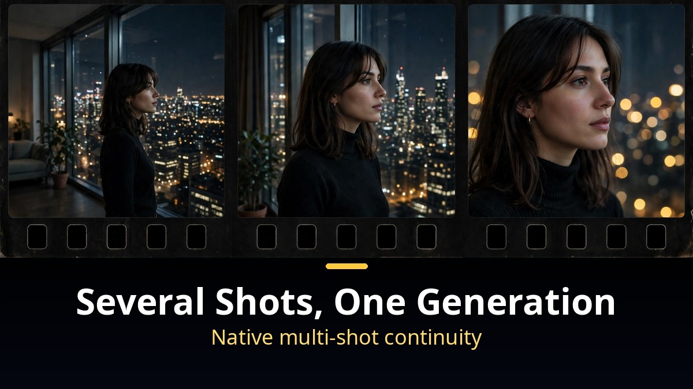
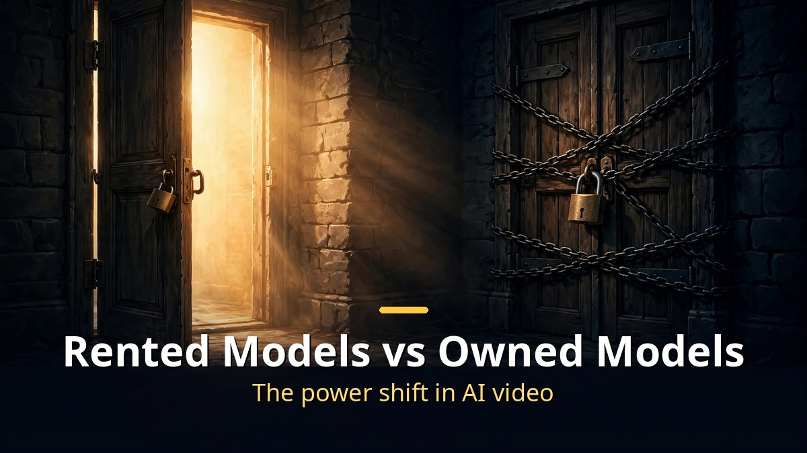

<!-- 본문 시작 -->

AI video has been something you "rent."
You send a prompt to a company's servers, and they make it and send it back.
LTX-2.5 breaks that premise. You can download the full model weights and run them on your own hardware.

> **Key takeaways**
>
> Lightricks' **LTX-2.5** is a 22-billion-parameter **open-weights AI video model**.
> It generates video and **audio together in one pass**, with native multi-shot that connects **several shots in a single generation**.
> Rent it via API, or take the weights and **run it on your own machine**.
> The center of gravity in AI video is shifting from "the companies that lend" to "the people who use."

---

## Why does generating video and sound "together" matter?

Synchronized speech generation, with dialogue locked to lip movement.

AI video used to be silent film.
You generated the picture, then dubbed sound on top — lips and dialogue drifting apart was routine.
LTX-2.5 generates video and audio **as one system**.
Dialogue, sound effects, and ambience come out breathing with the scene.

The reviewer deliberately set a hard test.
A man alone in a dim diner booth says, "I've been waiting here for 3 hours and nobody has shown up."
Bad lip sync shows instantly in that framing. A morphing face shows too.
The result was clean — lips, voice, and expression locked as one.

It matters because of what comes after short clips.
A real scene needs dialogue glued to mouths and room tone matched to space.
LTX-2.5 handles that in a single generation.

---

## Native multi-shot: several shots in one generation

Native multi-shot: wide, medium, and close-up pulled in a single generation.

AI video's chronic disease was stitching.
Generate the wide, medium, and close-up separately and the clothes change, the room reshapes, the face becomes someone else.
People spent more time fighting continuity than creating.

LTX-2.5's **native multi-shot** holds several shots inside one generation.
Same person, same room, same lighting, same voice — wide into medium into close-up.
"Generate me this whole scene" becomes a real request.

A **diffusion video decoder** backs the quality.
It reconstructs exactly where AI video usually gives itself away — zoomed faces, background signage text, fast-moving hands.
A landscape can look stunning from far away and melt the moment you zoom into a face; that was the old limit.
LTX-2.5 aims straight at that weak link by changing how frames get rebuilt.

---

## What "running it yourself" actually means

The fork in the road: rented closed models versus owned open ones.

LTX-2.5 ships in two flavors: **standard** and **distilled**.
Distilled slashes the generation steps, so it's the friendly one for your own hardware.
Three ways to deploy: the LTX API, managed inference, or **downloading the weights and self-hosting**.

The reviewer actually did it — pulled the weights onto a remote NVIDIA GPU box and ran generation there.
A night-window dialogue scene came out locally with flawless lip sync and a face that held together.
Not a fake local mode. Really running on hardware under his control.

The requirements are public: Lightricks recommends an NVIDIA GPU with at least 32 GB of memory.
A 10-second clip renders in 6.8 seconds — faster than real time.
The license is **free for commercial use for organizations under $10M in yearly revenue**.
It runs in ComfyUI (the community's node-based AI video workbench) from day one, and the community is already busy.

| | LTX-2.5 (open weights) | Closed video models |
|---|---|---|
| Ownership | Downloadable weights | Company servers only |
| Price, region | You decide | The company decides |
| Customization | Fine-tuning, custom workflows | Within API limits |
| API-change risk | None (your infrastructure) | Your workflow shakes with it |

Closed models are a subscription to access. The company sets the price, the countries, the features.
When the API changes, your workflow changes with it.
Open-weights models are a **foundation you take and build into your product**.
Experiment, refine, run on your own stack.

One disclosure: the review video itself was sponsored by LTX.
I cross-checked the specs against official sources, but nothing beats running it yourself for the real feel.
That you can — because the weights are open — may be this release's biggest message.

---

Watching AI video, I felt a sense of "ownership" for the first time.
I'd been a regular at a well-stocked rental shop; now there's a store selling the whole toolbox.
At 10 seconds rendered in 6.8, generation is becoming an **iteration loop**, not a render queue.
The next shift may not be "who makes it best" but "who makes it theirs."

## Frequently asked questions

**Q. Is LTX-2.5 free?**

A. The weights are published as open weights, free for commercial use for organizations under $10M yearly revenue. Above that needs a separate agreement with Lightricks.

**Q. Can I run it on my own computer?**

A. The distilled version is light enough for self-hosting. Lightricks recommends an NVIDIA GPU with at least 32 GB of memory, and it runs in ComfyUI out of the box.

**Q. What's better about it than closed models?**

A. No company dictates price, region, or features; fine-tuning and custom workflows are free; API changes can't shake you. You supply the hardware instead.

## Further reading

[AI That Films in 30-Second Takes｜Kling 4.0 Official Launch — the monster model with 30-second long takes and 15 references, now on real film sets](https://aitechnotesen.blogspot.com/2026/10/ai-that-films-in-30-second-takeskling.html)
[AI Found a Crack in the Internet｜70% of Websites on Emergency Alert — how AI found a 20-year-old PHP flaw before attackers did](https://aitechnotesen.blogspot.com/2026/10/ai-found-crack-in-internet70-of.html)
[AI Worlds That Remember? 8 AI Breakthroughs You Missed — the under-the-radar advances from Fish Audio to world models](https://aitechnotesen.blogspot.com/2026/10/ai-worlds-that-remember-8-ai.html)

<!-- 본문 끝 -->

## 작업용 출처·이미지 정보 (업로드 제외)

- 자료 출처: TheAIGRID 'This New AI Video Model Changes EVERYTHING' (2026-10-23, LTX 협찬) / LTX-2.5 모델 카드·Wikipedia (스펙 교차 확인)
- 이미지: images/01-hero-en.jpg ~ 04-img3-en.jpg / 직접 제작 (AI 생성 + 영어 오버레이) / 사용권: 자작
