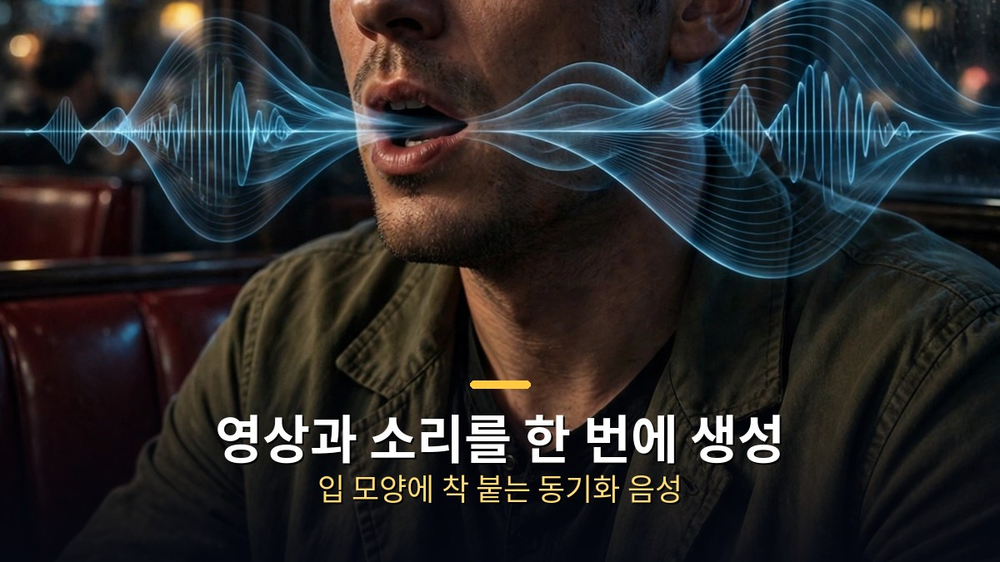
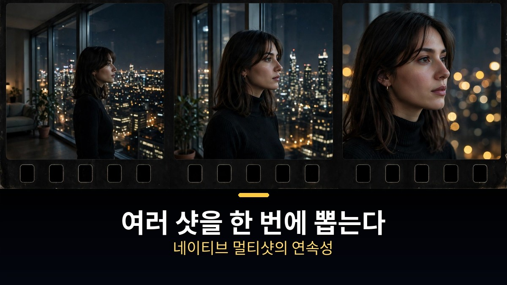
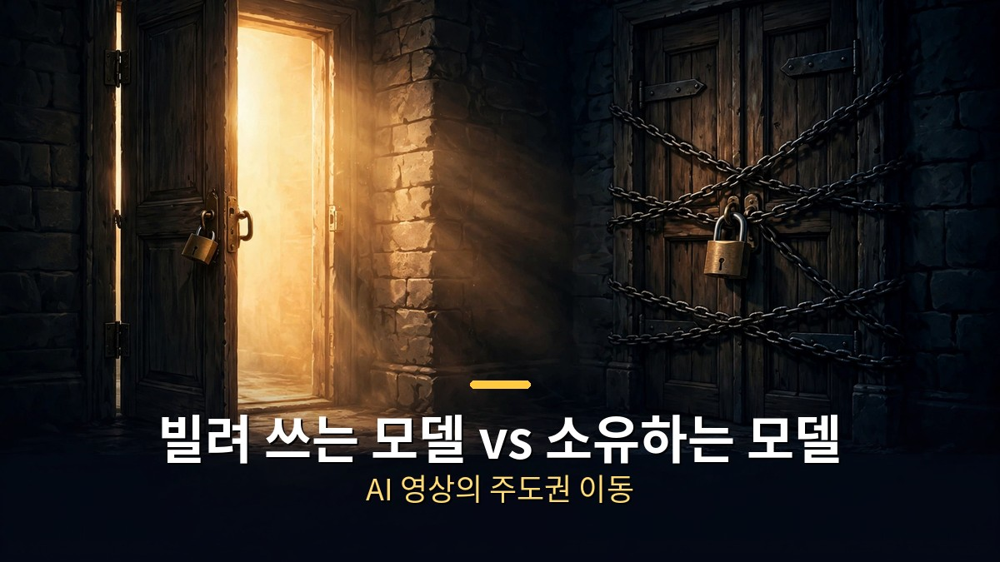

<!-- 본문 시작 -->

AI 영상은 지금까지 '빌려 쓰는' 것이었습니다.
회사 서버에 프롬프트를 보내면, 그쪽에서 만들어 돌려주는 구조였습니다.
LTX-2.5는 이 전제를 깹니다. 모델 가중치를 통째로 다운받아 내 하드웨어에서 직접 돌릴 수 있습니다.

> **핵심 정리**
>
> 라이트릭스의 **LTX-2.5**는 220억 파라미터 규모의 **오픈 웨이트 AI 영상 모델**입니다.
> 영상과 **음성을 한 번에** 생성하고, 여러 샷을 **한 번의 생성으로 이어 붙이는** 네이티브 멀티샷을 지원합니다.
> API로 빌려 쓸 수도, 가중치를 받아 **내 컴퓨터에서 직접 돌릴 수도** 있습니다.
> AI 영상의 주도권이 '빌려주는 회사'에서 '쓰는 사람'으로 넘어가는 신호탄입니다.

---

## 영상과 소리를 '한 번에' 만드는 게 왜 다른가?

대사와 입 모양이 어긋나지 않는 동기화 음성 생성의 모습입니다.

기존 AI 영상은 '무성 영화'였습니다.
영상을 뽑고 소리는 나중에 덧입히는 구조라, 입 모양과 대사가 어긋나는 게 일상이었습니다.
LTX-2.5는 영상과 오디오를 **하나의 시스템으로 함께** 생성합니다.
대사·효과음·배경음이 장면과 같은 호흡으로 나옵니다.

리뷰어는 일부러 까다로운 테스트를 걸었습니다.
어두운 식당에 앉은 남자가 "3시간째 기다리는 중인데 아무도 안 왔다"고 말하는 장면입니다.
립싱크가 나쁘면 바로 보이고, 얼굴이 바뀌면 바로 티 나는 구도입니다.
결과는 깨끗했습니다. 입 모양·목소리·표정이 하나로 붙어 있었습니다.

이게 중요한 이유는 '짧은 클립'을 넘어서기 때문입니다.
진짜 장면을 만들려면 대사가 입에 붙고, 배경음이 공간에 맞아야 합니다.
LTX-2.5는 그걸 한 번의 생성으로 처리합니다.

---

## 여러 샷을 한 번에 뽑는 '네이티브 멀티샷'

와이드·미디엄·클로즈업을 한 번에 뽑는 네이티브 멀티샷의 개념도입니다.

AI 영상의 고질병은 '이어 붙이기'였습니다.
와이드샷·미디엄샷·클로즈업을 따로 뽑으면 옷이 바뀌고, 방 모양이 달라지고, 얼굴이 다른 사람이 됩니다.
이어 붙이는 것보다 장면을 자연스럽게 잇는 데 시간을 더 쓰는 게 현실이었습니다.

LTX-2.5의 **네이티브 멀티샷**은 한 번의 생성 안에 여러 샷을 담습니다.
같은 인물·같은 공간·같은 조명·같은 목소리로 와이드 다음 미디엄, 다음 클로즈업이 이어집니다.
"이 장면 전체를 뽑아줘"가 되는 것입니다.

품질을 받치는 건 **디퓨전 비디오 디코더**입니다.
AI 영상이 가장 잘 들키는 지점 — 얼굴 확대, 배경 간판 글자, 빠르게 움직이는 손 — 을 정교하게 복원합니다.
멀리서 보면 멋진 풍경도 얼굴만 확대하면 녹아내리던 게 기존 모델의 한계였습니다.
복원 방식을 바꾼 LTX-2.5는 그 약한 고리를 직접 겨냥했습니다.

---

## 내 컴퓨터에서 돌린다는 것의 의미

빌려 쓰는 클로즈드 모델과 소유하는 오픈 모델의 갈림길입니다.

LTX-2.5는 **스탠다드**와 **디스틸드** 두 버전으로 나옵니다.
디스틸드는 생성 단계를 확 줄인 경량 버전이라 내 하드웨어에서 돌리기 좋습니다.
배포 방식도 세 가지입니다. LTX API, 매니지드 추론, 그리고 **가중치 다운로드 후 셀프호스팅**입니다.

리뷰어는 실제로 원격 엔비디아 GPU 머신에 가중치를 받아 직접 돌려봤습니다.
창가 여성의 대사 장면을 로컬 생성했는데, 립싱크와 얼굴 일관성이 흠잡을 데 없었습니다.
"가짜 로컬 모드"가 아니라 진짜로 자기 하드웨어에서 돌아간 것입니다.

조건도 공개돼 있습니다. 라이트릭스는 최소 32GB 메모리의 엔비디아 GPU를 권장합니다.
10초짜리 클립을 6.8초에 뽑아내니, 실시간보다 빠릅니다.
라이선스는 **연 매출 1,000만 달러 이하 조직에 상업 이용 무료**입니다.
ComfyUI(노드 연결로 AI 영상을 조립하는 커뮤니티 도구)에서도 바로 돌릴 수 있어 커뮤니티가 이미 활발합니다.

| 구분 | LTX-2.5 (오픈 웨이트) | 클로즈드 영상 모델 |
|---|---|---|
| 모델 소유 | 가중치 다운로드 가능 | 회사 서버에서만 |
| 가격·국가 | 내가 정함 | 회사가 정함 |
| 커스텀 | 파인튜닝·워크플로우 자유 | API 범위 내 |
| API 변경 리스크 | 없음 (내 인프라) | 워크플로우 통째로 흔들림 |

클로즈드 모델은 '접속료를 내는' 구조입니다. 회사가 가격을 정하고, 국가를 정하고, 기능을 정합니다.
API가 바뀌면 내 작업 흐름도 같이 바뀝니다.
오픈 웨이트 모델은 **기반을 가져와 내 제품에 박아넣는** 구조입니다.
실험하고, 다듬고, 내 인프라에서 돌립니다.

한 가지 덧붙이자면, 이 리뷰 영상 자체가 LTX의 협찬으로 제작됐습니다.
스펙은 공식 자료로 교차 확인했지만, 실제 체감은 직접 돌려보는 게 가장 정확합니다.
가중치가 열려 있으니 그게 가능하다는 게, 어쩌면 이번 릴리스의 가장 큰 메시지입니다.

---

AI 영상을 보면서 처음으로 '소유'의 감각을 느꼈습니다.
지금까지는 잘 만들어진 렌털 숍의 단골이었는데, 이제 공구 상자를 통째로 파는 가게가 생긴 기분입니다.
10초를 6.8초에 뽑는 속도가 말해주듯, 영상 생성은 렌더링 대기열이 아니라 **반복 실험의 루프**가 되어가고 있습니다.
다음에 바뀔 판은, 어쩌면 '누가 더 잘 만드냐'가 아니라 '누가 더 자기 것으로 만드냐'일지도 모르겠습니다.

## 자주 묻는 질문

**Q. LTX-2.5는 무료인가요?**

A. 가중치는 오픈 웨이트로 공개돼 있고, 연 매출 1,000만 달러 이하 조직은 상업 이용도 무료입니다. 그 이상은 라이트릭스와 별도 계약이 필요합니다.

**Q. 내 컴퓨터에서도 돌릴 수 있나요?**

A. 디스틸드 버전이 가벼워 셀프호스팅에 적합합니다. 라이트릭스는 최소 32GB 메모리의 엔비디아 GPU를 권장하고, ComfyUI에서 바로 실행할 수 있습니다.

**Q. 클로즈드 모델보다 뭐가 좋나요?**

A. 가격·국가·기능을 회사가 정하지 않고, 파인튜닝과 커스텀 워크플로우가 자유롭고, API 변경에 흔들리지 않습니다. 대신 하드웨어는 직접 준비해야 합니다.

## 함께 읽으면 좋은 글

[30초 한 컷으로 영화 찍는 AI｜클링 4.0 정식 출시 — 30초 롱테이크·참조 15개로 영화 현장까지 진출한 괴물 모델 정리](https://aitechnoteskr.tistory.com/22)
[AI가 찾아낸 인터넷의 균열｜전 세계 사이트 70% 비상사태 — AI가 20년 묵은 PHP 결함을 찾아내기까지의 전말](https://aitechnoteskr.tistory.com/23)
[AI 회사들이 14억을 풀었다｜크로마 어워즈 시즌 2 무료 혜택·상금 총정리 — 상금 45만 달러, 마감 2027년 1월 7일](https://aitechnoteskr.tistory.com/17)

<!-- 본문 끝 -->

## 작업용 출처·이미지 정보 (업로드 제외)

- 자료 출처: TheAIGRID 'This New AI Video Model Changes EVERYTHING' (2026-10-23, LTX 협찬) / LTX-2.5 모델 카드·Wikipedia (스펙 교차 확인)
- 이미지: images/01-hero.jpg ~ 04-img3.jpg / 직접 제작 (AI 생성 + 한글 오버레이) / 사용권: 자작
