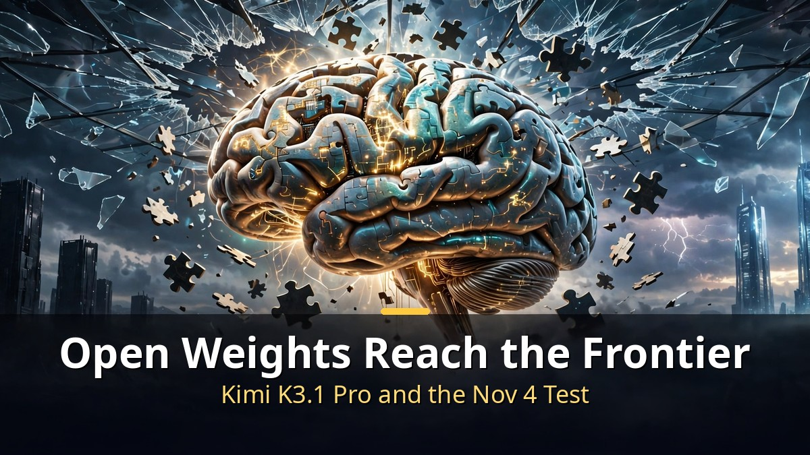
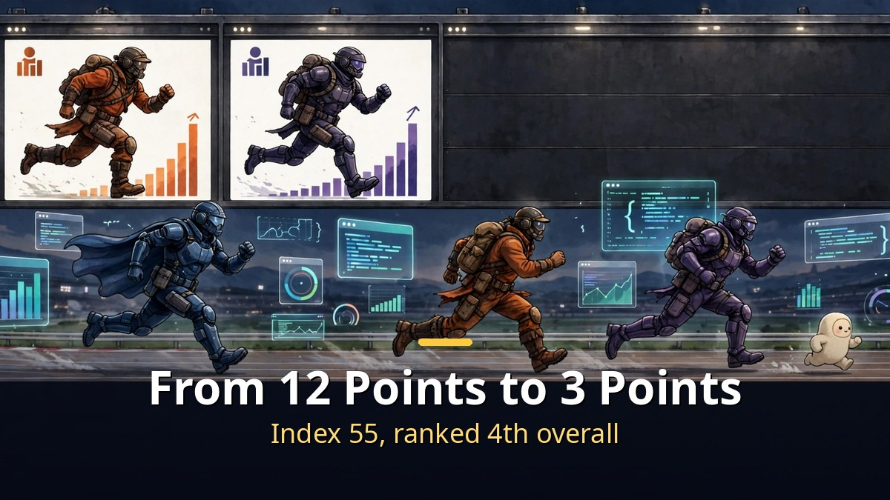

<!-- 본문 시작 -->

Open-source AI has reached the doorstep of the very top models.
That is the story of Kimi K3.1 Pro, released by China's Moonshot AI on October 23.
On an independent evaluation it ranks fourth overall — and is set to become the highest-scoring open-weight model ever.
But the word "open" still comes with a condition.

> **Key takeaways**
>
> Moonshot AI released **Kimi K3.1 Pro** on October 23. On the independent Artificial Analysis Intelligence Index it scored **55, fourth out of 215 models**, behind only Claude Opus 5.5 (58), Claude Sonnet 5.5 (56), and Muse Wonder (56).
> On launch day, though, it is available only through the app and API — the **weights are promised by November 4**. Only when the weights actually ship does the "best open-weight model ever" claim become complete.
> Pricing is $2 per million input tokens and $10 per million output tokens, about half the Claude Opus 5.5 rate card.

---

## Why does fourth place matter so much?

The open-weight camp has closed to within 3 points of the frontier.

Until now, the gap between open-weight and proprietary models was 12 points.
Kimi K3.1 Pro has narrowed it to 3.
By an independent measure, no open-weight model has ever come this close to the top.

The model itself is huge.
2.8 trillion total parameters, 104 billion active at a time.
It reads up to 1 million tokens at once.
As a post-trained successor to K3, it is said to be especially stronger at coding, 3D modeling, and financial analysis.

The standout score is Terminal-Bench 4.0.
On this test of coding agents doing real terminal work, it scored **65.7%**.
That beats GPT-6 Astra (58.2%) and sits just 0.7 points behind Claude Opus 5.5 (66.4%).
One caution: this is Moonshot's own number, and the test details matter.

Other scores rose too.
The agentic-work metric GDPval-AA climbed 312 points to 1,846, and AutomationBench rose from 58% to 73%.
The hallucination rate fell from 53% to 44% — better, but still wrong nearly half the time on that measure.
Humanity's Last Exam moved from 47% to 52%. There is still a long way to go.

---

## Can you use it right now? Read the fine print on "open"

On launch day it is API-only; the weights are promised by November 4.

Start with the most important fact.
Kimi K3.1 Pro launched **without published weights**.
You can use it only through the Kimi app, Kimi Work, Kimi Code, and the Kimi API.
The "open-weight model" label rests on the promise of weights by November 4.

The license has not been published either.
K3 used Moonshot's own custom license; the K2 line used a modified MIT license.
What conditions will apply to K3.1 Pro can only be confirmed when the weights ship.
If you want to run it on your own server, waiting until November 4 is the right move.

If speed matters, there is a Highspeed variant.
**Kimi K3.1 Pro Highspeed** runs 2–3 times faster at twice the price.
That is $4 per million input tokens and $20 per million output tokens.
Cached input stays at $0.20 per million tokens in both tiers, which helps repeated agent loops.

| Item | Kimi K3.1 Pro | Claude Opus 5.5 |
|---|---|---|
| Intelligence Index | 55 (4th) | 58 (1st) |
| Terminal-Bench 4.0 | 65.7% | 66.4% |
| Input price (per 1M tokens) | $2 | about 2x |
| Output price (per 1M tokens) | $10 | about 2x |
| Context | 1M tokens | — |
| Weights release | promised by Nov 4 | closed |

---

## The cybersecurity "cut" leaves a question

An unusual release choice: deliberately trimming vulnerability-research ability.

The most unusual part of this release is the cybersecurity section.
Moonshot says it found that cyber-related content in general training data raised vulnerability-research ability, and removed it before release.
On an internal hard test, the unfiltered checkpoint solved 90.5% of problems; the shipped model solved 81.0% — still far above K3's 33.3%.

An independent Cyber Index rates it the highest publicly accessible model, second only to a restricted-access OpenAI system.
But rivals' declined tasks score zero in that ranking, so the order should not be taken at face value.

Moonshot's stated principle is clear: it will not release open weights that "extend the absolute frontier of cyber capability."
What it does not address is whether someone can fine-tune that capability back once the weights are public.
The tug-of-war between openness and safety will continue well past November 4.

---

Honestly, one thought stayed with me after this announcement.
Open source has moved from "cheap alternative" to "head-on contender."
A 3-point gap is now a fight over price tags and usage terms, not a performance cliff.
But whenever you hear the word "open," check the date.
November 4 — the day the weights actually ship — is the real ending of this story.

## Frequently asked questions

**Q. Can I run Kimi K3.1 Pro on my own computer now?**

A. Not yet. On launch day it is available only through the Kimi app and API, with weights promised by November 4. Until then, the API is the only way to use it.

**Q. Is it really cheaper than Claude Opus?**

A. On the rate card, yes — about half. Input costs $2 per million tokens and output $10 per million. Actual cost depends on how many tokens each task uses.

**Q. What does the cybersecurity "cut" mean?**

A. Moonshot removed training content that raised vulnerability-research ability before release. Its internal hard-test score fell from 90.5% to 81.0%, still far above its predecessor. Whether that ability can be restored after the weights ship is unconfirmed.

## Further reading

[The AI Assistant That Moves Before You Ask｜Claude Duet and This Week's AI News — from morning briefings to payroll prep, connected to 6,000+ apps](https://aitechnotesen.blogspot.com/2026/10/the-ai-assistant-that-moves-before-you.html)
[AI Video You Download and Run Yourself｜Why LTX-2.5 Changes the Game — rented models versus owned models](https://aitechnotesen.blogspot.com/2026/10/ai-video-you-download-and-run.html)
[AI That Films in 30-Second Takes｜Kling 4.0 Official Launch — the monster model with 30-second long takes and 15 references, now on real film sets](https://aitechnotesen.blogspot.com/2026/10/ai-that-films-in-30-second-takeskling.html)

<!-- 본문 끝 -->

## 작업용 출처·이미지 정보 (업로드 제외)

- 자료 출처: Matt Wolfe 'Open-Source AI Models Caught Up! (Kimi K3.1 Pro)' (2026-10-25) / Moonshot release coverage via Artificial Analysis, CGTN, explainx.ai, GenAInews (Oct 23-24, 2026)
- 이미지: images/01-hero-en.jpg ~ 04-img3-en.jpg / 직접 제작 (AI 생성 + 영어 오버레이) / 사용권: 자작
