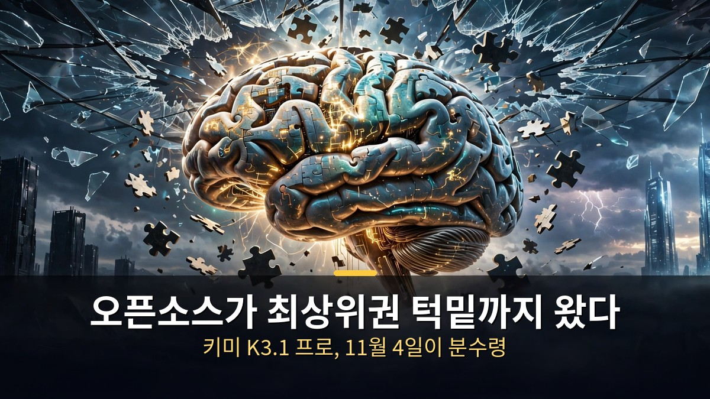
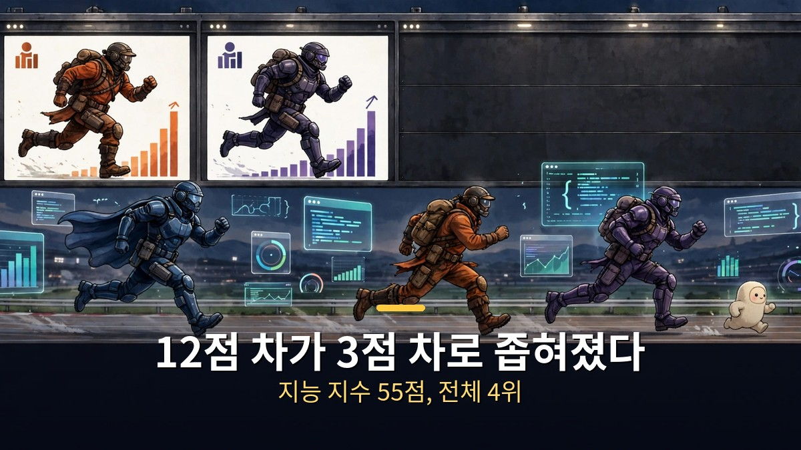
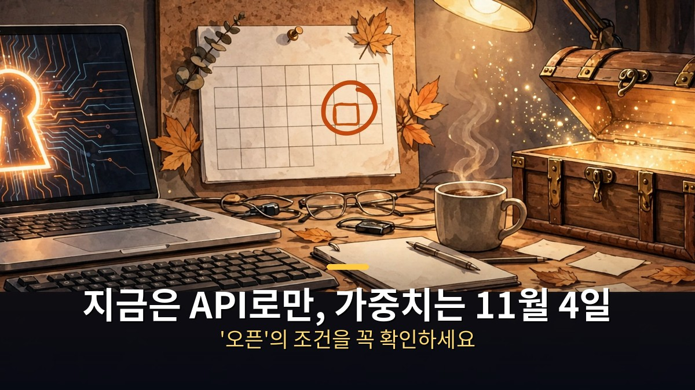
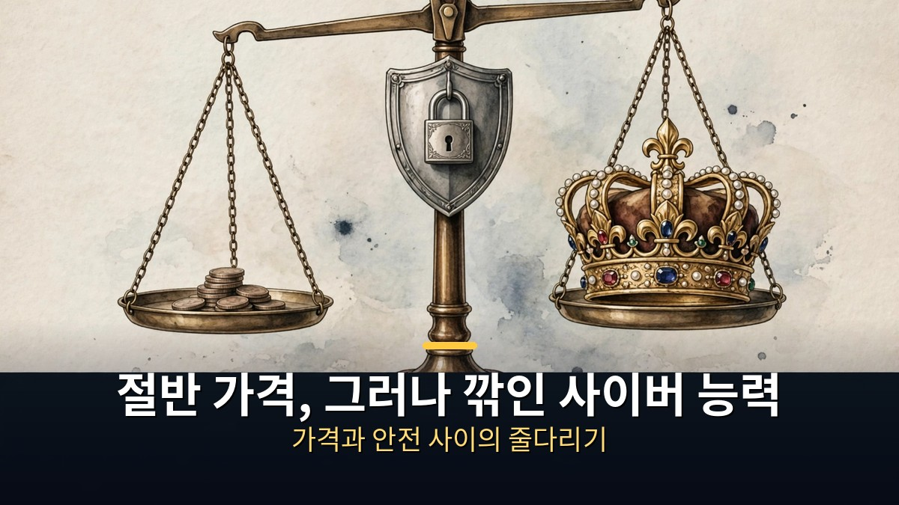

<!-- 본문 시작 -->

오픈소스 AI가 최상위 모델 턱밑까지 왔습니다.
중국 문샷AI가 10월 23일 공개한 키미 K3.1 프로 이야기입니다.
독립 평가에서 전체 4위, 오픈 웨이트 중에서는 곧 역대 1위가 될 점수입니다.
단, 아직은 '오픈'이라는 말에 조건이 붙습니다.

> **핵심 정리**
>
> 문샷AI가 10월 23일 **키미 K3.1 프로**를 공개했습니다. 독립 평가인 Artificial Analysis 지능 지수에서 **55점, 전체 215개 모델 중 4위**로, 클로드 오퍼스 5.5(58점)·소네트 5.5(56점)·뮤즈 원더(56점) 바로 뒤입니다.
> 다만 출시 당일에는 앱·API로만 쓸 수 있고, **가중치는 11월 4일까지 공개 예정**입니다. 가중치가 풀려야 비로소 '역대 최고 오픈 웨이트'라는 말이 완성됩니다.
> 가격은 입력 100만 토큰당 2달러, 출력 100만 토큰당 10달러로, 클로드 오퍼스 5.5 요금표의 절반 수준입니다.

---

## 왜 '4위'가 이렇게 큰 뉴스인가?

오픈 웨이트 진영이 최상위권 바로 뒤까지 따라온 순간입니다.

지금까지 오픈 웨이트와 독점 모델 사이 간격은 12점이었습니다.
키미 K3.1 프로가 그 간격을 3점으로 좁혔습니다.
독립 평가 기준으로 오픈 웨이트 모델이 최상위권에 이토록 가까워진 적은 없었습니다.

모델 크기도 남다릅니다.
전체 파라미터 2조 8천억 개, 한 번에 작동하는 활성 파라미터는 1,040억 개입니다.
한 번에 읽을 수 있는 분량은 100만 토큰입니다.
전작 K3의 후속 학습 버전으로, 코딩·3D 모델링·재무 분석이 특히 강해졌다고 합니다.

가장 눈에 띄는 성적은 터미널 벤치 4.0입니다.
실제 터미널 작업으로 코딩 에이전트를 재는 테스트에서 **65.7%**를 받았습니다.
GPT-6 아스트라(58.2%)를 앞질렀고, 클로드 오퍼스 5.5(66.4%)와는 0.7점 차이입니다.
단, 이 수치는 문샷AI 자체 발표라는 점은 기억해 두어야 합니다.

다른 지표도 올랐습니다.
에이전트 업무 지표 GDPval-AA는 전작보다 312점 오른 1,846점, 자동화 벤치는 58%에서 73%로 뛰었습니다.
반면 환각률은 53%에서 44%로 낮아졌지만 여전히 절반 가까이 틀린다는 뜻이기도 합니다.
인류 최후의 시험(HLE)은 47%에서 52%로, 아직 갈 길이 멉니다.

---

## 지금 당장 쓸 수 있나? '오픈'의 조건을 읽어야 한다

출시 당일에는 API로만 쓸 수 있고, 가중치는 11월 4일 공개 예정입니다.

가장 중요한 사실부터 정리합니다.
키미 K3.1 프로는 출시일에 **가중치가 공개되지 않았습니다**.
쓸 수 있는 곳은 키미 앱·키미 워크·키미 코드·키미 API뿐입니다.
'오픈 웨이트 모델'이라는 소개는 11월 4일 가중치 공개 약속 위에 서 있습니다.

라이선스도 아직 공개되지 않았습니다.
전작 K3는 문샷AI 자체 라이선스를 썼고, K2 계열은 변형 MIT 라이선스였습니다.
K3.1 프로에 어떤 조건이 붙을지는 가중치와 함께 확인해야 합니다.
내 서버에 올려 돌리고 싶다면 11월 4일까지 기다리는 게 맞습니다.

속도를 중시한다면 고속 버전이 있습니다.
**키미 K3.1 프로 하이스피드**는 2~3배 빠르지만 가격이 2배입니다.
입력 100만 토큰당 4달러, 출력 100만 토큰당 20달러입니다.
반복되는 시스템 프롬프트에는 캐시 입력 요금(100만 토큰당 0.20달러)이 그대로 적용돼, 에이전트 반복 작업에는 유리합니다.

| 항목 | 키미 K3.1 프로 | 클로드 오퍼스 5.5 |
|---|---|---|
| 지능 지수 | 55점 (4위) | 58점 (1위) |
| 터미널 벤치 4.0 | 65.7% | 66.4% |
| 입력 가격 (100만 토큰) | 2달러 | 약 2배 |
| 출력 가격 (100만 토큰) | 10달러 | 약 2배 |
| 컨텍스트 | 100만 토큰 | — |
| 가중치 공개 | 11월 4일 예정 | 비공개 |

---

## 사이버 보안 '절단'이 남긴 질문

취약점 연구 능력을 일부러 깎아낸 이례적인 공개 방식입니다.

이번 발표에서 가장 이례적인 대목은 사이버 보안 부분입니다.
문샷AI는 일반 학습 데이터 속 사이버 관련 내용이 취약점 연구 능력을 키운 것을 확인하고, 출시 전에 그 부분을 제거했다고 밝혔습니다.
내부 테스트에서는 제거 전 90.5%였던 난제가 제거 후 81.0%로 떨어졌지만, 전작 K3의 33.3%보다는 훨씬 높습니다.

독립 사이버 지수는 이를 공개 접근 가능한 모델 중 최고로 평가했습니다.
다만 제한 접근되는 오픈AI 시스템 하나만 그 위에 있습니다.
경쟁 모델들이 거부한 과제는 0점으로 처리되는 방식이라, 순위를 그대로 믿기는 어렵습니다.

문샷AI의 원칙은 분명합니다.
"사이버 능력의 절대적 최전선을 넓히는 오픈 가중치는 내놓지 않는다"는 것입니다.
하지만 가중치가 공개된 뒤 누군가 다시 학습시켜 능력을 되돌릴 수 있는지는 답하지 않았습니다.
오픈의 자유와 안전 사이의 줄다리기는 11월 4일 이후에도 계속될 문제입니다.

---

솔직히 이번 발표를 보며 든 생각은 하나입니다.
오픈소스가 '저렴한 대안'에서 '정면 승부처'로 넘어왔다는 것.
3점 차이는 이제 가격표와 사용 조건의 싸움이지, 성능의 절벽이 아닙니다.
다만 '오픈'이라는 말을 들을 때는 꼭 날짜를 확인해야 합니다.
11월 4일, 가중치가 실제로 풀리는 날이 이 뉴스의 진짜 결말입니다.

## 자주 묻는 질문

**Q. 키미 K3.1 프로를 지금 내 컴퓨터에서 돌릴 수 있나요?**

A. 아직은 안 됩니다. 출시 당일에는 키미 앱과 API로만 쓸 수 있고, 가중치는 11월 4일까지 공개 예정입니다. 그때까지는 API로만 써야 합니다.

**Q. 클로드 오퍼스보다 정말 싼가요?**

A. 요금표 기준으로는 절반 수준입니다. 입력 100만 토큰당 2달러, 출력 10달러로, 오퍼스 5.5보다 쌉니다. 다만 실제 비용은 작업당 토큰 사용량에 따라 달라집니다.

**Q. 사이버 보안 능력을 깎았다는 게 무슨 뜻인가요?**

A. 문샷AI가 취약점 연구 능력을 키우는 학습 내용을 출시 전에 제거했다는 뜻입니다. 내부 난제 점수가 90.5%에서 81.0%로 떨어졌지만, 여전히 전작보다 훨씬 높습니다. 가중치 공개 후 되돌릴 수 있는지는 미확인입니다.

## 함께 읽으면 좋은 글

[묻기 전에 먼저 움직이는 AI 비서｜클로드 듀엣 공개와 이번 주 AI 뉴스 — 아침 브리핑부터 결제 준비까지, 6,000개 앱과 연결되는 비서](https://aitechnoteskr.tistory.com/27)
[다운받아 내 컴퓨터에서 돌리는 AI 영상｜LTX-2.5가 바꾸는 판 — 빌려 쓰는 모델과 소유하는 모델의 갈림길](https://aitechnoteskr.tistory.com/28)
[30초 한 컷으로 영화 찍는 AI｜클링 4.0 정식 출시 — 30초 롱테이크·참조 15개로 영화 현장까지 진출한 괴물 모델 정리](https://aitechnoteskr.tistory.com/22)

<!-- 본문 끝 -->

## 작업용 출처·이미지 정보 (업로드 제외)

- 자료 출처: Matt Wolfe 'Open-Source AI Models Caught Up! (Kimi K3.1 Pro)' (2026-10-25) / Moonshot release coverage via Artificial Analysis, CGTN, explainx.ai, GenAInews (Oct 23-24, 2026)
- 이미지: images/01-hero.jpg ~ 04-img3.jpg / 직접 제작 (AI 생성 + 한글 오버레이) / 사용권: 자작
