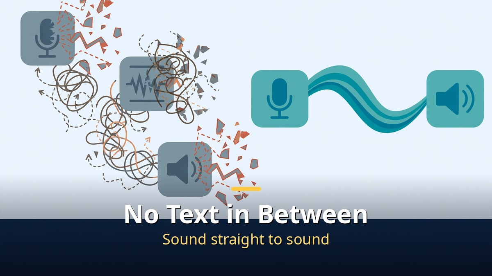
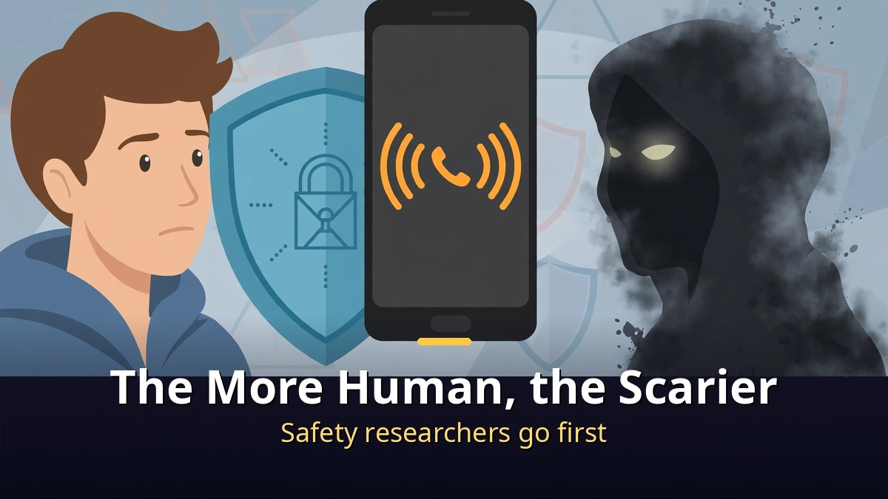

<!-- 본문 시작 -->

Block, the company co-founded by Twitter co-founder Jack Dorsey, unveiled a voice AI called Dessa on October 23.
This model never read a single word of text. It learned to speak only by listening to human voices.
It listens and speaks at the same time, so it can interrupt, laugh mid-sentence, and catch changes in emotion.
It even runs locally on a MacBook, without an internet connection.
There is one catch: it is still a research preview, not a product anyone can use yet.

> **Key takeaway**
>
> **Dessa**, unveiled by Block on October 23, is a **full-duplex speech-to-speech model** trained from scratch on human conversation audio alone, with no text and no pretrained models.
> It skips the speech-to-text step entirely, so it **listens and speaks simultaneously**. That lets it interrupt naturally, backchannel with "yeah" and "got it," and respond to tone and emotion as they change.
> Training used a **single NVIDIA GB200 NVL72 system**, and Block says inference runs **faster than real time locally on a MacBook Pro with an M4 Max chip or better**.
> Right now it is a **research preview behind a waitlist**: no parameter count, API, price, weights, or published evaluation has been released. The only evidence so far is Block's own demo recordings.

---

## Why does "it never read a word" matter so much?

Until now, voice assistants have worked in three steps.

First they turn speech into text, then a language model reads that text, then they turn the answer back into speech.
Along the way, most of the information in a voice disappears: speed, pitch, hesitation, laughter, and tone.
A sentence full of feeling arrives as a flat line of text.

Dessa removes the middle step.
Sound goes in, and sound comes straight back out.
So it can chime in while you are still talking, laugh in the middle of a sentence when something is funny, and react to a change in mood without waiting for you to finish.
That is the difference between an assistant that waits its turn and a person who responds as they listen.

Block's starting question was simple: babies learn to talk before they ever see a written word.
Could a model do the same? The demos suggest the answer is yes.
Block also notes that Dessa learned language from hundreds of times fewer words than a text model needs, since a text model must also learn things like programming languages while Dessa only had to learn conversation itself.

---

## Can you try it right now? Not yet. This is a "watch" phase

Unfortunately, you cannot download Dessa today.

Block released it as a research preview with a waitlist.
A small group of AI safety researchers will get access first.
There is no model size, price, release date, API, or weights yet.
For the general public, the only thing available is the demo recordings Block published.

The demos are genuinely striking.
Dessa finishes a speaker's sentence when they blank on a film title, gasps softly at good news, and speaks louder when asked to.
Ragavan Thurairatnam, who leads the project, called it a "GPT-3 moment for speech."

But the awkward moments were published too.
Dessa greets one speaker as someone named "Ronaldo," and a chat about Christopher Nolan films wanders off into another director's Superman movies.
One tech writer described it as talking to "an awkward new friend."
And since these are company-selected clips, real-world performance should be judged more conservatively than the demos suggest.

| | Conventional voice assistant | Dessa |
|---|---|---|
| How it works | Speech → text → language model → speech | Speech → speech, directly |
| Listening and speaking | In turns (must wait for you to finish) | At the same time (interruptions, backchannels) |
| Emotion and tone | Mostly lost in text conversion | Preserved from the audio itself |
| Where it runs | Server-based | Locally on MacBook Pro M4 Max or better |
| Availability | Commercial service | Research preview, waitlist |
| Evidence | Public benchmarks, user reviews | Company demo recordings only |

---

## The more human a voice sounds, the scarier it gets. Why?

Reactions to Dessa split almost evenly between amazement and worry.

The worry is about scams.
If a voice becomes indistinguishable from a real person, a phone scam becomes much harder to spot by ear alone.
That is exactly why Block is giving safety researchers access before a wider release: find the problems before they spread.

Block's counterargument is different.
It says today's voice AI is risky precisely because it cannot hear how you feel.
If it misses hesitation, frustration, or sadness in your tone, it can misunderstand what you really mean.
A model that hears emotion, the argument goes, could hold safer conversations.

Local execution is a double-edged advantage too.
Without a server round trip, responses are fast and conversation audio may never leave your machine.
But it still needs a high-end MacBook, so it is far from a device everyone owns.
In the end, Dessa's real value will not be decided by how amazing the demos sound, but by what problems safety researchers find next, and what answers they come up with.

---

Listening to the demos, one thought kept coming back to me.
Half of a human voice is not the words at all, but the timing.
The moment someone cuts in, laughs, or trails off carries the feeling.
Those were exactly the things that vanished when speech was flattened into text, and in Dessa they seem to come alive again.
Of course, a handful of demos cannot settle everything.
That is what makes me curious: what will safety researchers uncover once this model is in their hands, and what answers will they find?

## Frequently asked questions

**Q. Can I download Dessa now?**

A. Not yet. It is in a research preview behind a waitlist, with no public release date, price, or API announced. A small group of AI safety researchers will get access first.

**Q. How exactly is it different from existing voice assistants?**

A. Existing assistants turn speech into text first. Dessa processes sound directly into sound, so it can listen and speak at the same time, interrupt, backchannel, laugh, and track emotional changes as they happen.

**Q. Did it really learn without any text?**

A. According to Block, yes. It was trained from scratch on human conversation audio only, using a single NVIDIA GB200 NVL72 system, with no text and no pretrained models. That is the company's claim; no independent evaluation has been published yet.

**Q. Could a voice this human be used for scams?**

A. That concern is real and widely raised. Block says that is why safety researchers get access before a general release. As a rule, never trust a voice alone for important requests; call back on an official number to verify. Agreeing on a family-only code word or question in advance also helps: if a caller asking for money cannot answer it, hang up and call back on the number you already have.

## Further reading

[How to Hand Work to AI Without Knowing How to Code｜GPT Codex and Aside Setup Guide — from one terminal line to a browser that works for you](https://aitechnotesen.blogspot.com/2026/10/how-to-hand-work-to-ai-without-knowing.html)
[Open Weights Reach the Frontier's Doorstep｜Kimi K3.1 Pro and the November 4 Test — intelligence index 55, ranked 4th overall, and the fine print before weights drop](https://aitechnotesen.blogspot.com/2026/10/open-weights-reach-frontiers.html)
[AI Video You Download and Run Yourself｜Why LTX-2.5 Changes the Game — the fork between renting a model and owning one](https://aitechnotesen.blogspot.com/2026/10/ai-video-you-download-and-run.html)

<!-- 본문 끝 -->

## 작업용 출처·이미지 정보 (업로드 제외)

- 자료 출처: TheAIGRID 'Jack Dorsey Just Revealed a Terrifying AI Breakthrough' (2026-10-25) / Block Dessa announcement coverage via CoinDesk, Indian Express, Dealroom, Economic Times, Tribune (Oct 23-24, 2026)
- 이미지: images/01-hero-en.jpg ~ 04-img3-en.jpg / 직접 제작 (AI 생성 + 영어 오버레이) / 사용권: 자작
