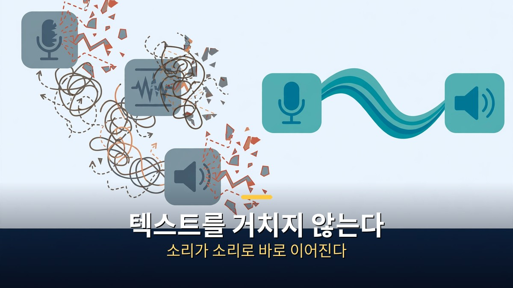
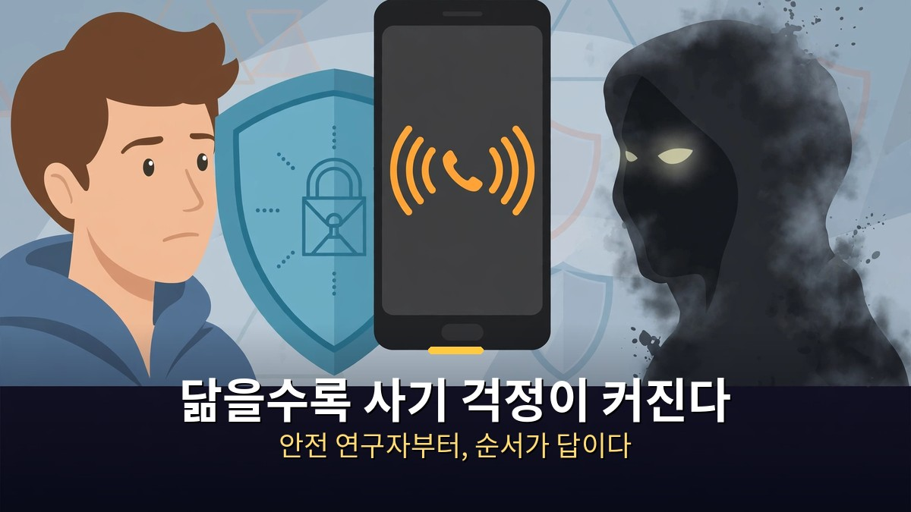

<!-- 본문 시작 -->

트위터 공동 창업자 잭 도시의 회사 블록이 10월 23일 음성 AI 데사를 공개했습니다.
이 모델은 글을 단 한 자도 읽지 않고, 사람의 말소리만 듣고 말을 배웠습니다.
듣는 것과 말하는 것을 동시에 해서, 말 도중에 끼어들고 웃고 감정을 알아듣습니다.
심지어 맥북 한 대에서 인터넷 없이도 돌아간다고 합니다.
단, 아직은 누구나 쓸 수 있는 제품이 아니라 연구 미리보기 단계입니다.

> **핵심 정리**
>
> 블록이 10월 23일 공개한 **데사(Dessa)**는 텍스트 없이 사람의 대화 음성만으로 처음부터 학습한 **풀듀플렉스 음성 대 음성 모델**입니다.
> 말소리를 텍스트로 바꾸는 단계를 아예 없애, **듣기와 말하기를 동시에** 처리합니다. 그래서 말 도중 웃거나 끼어들고, 말투·감정의 변화를 그대로 알아듣습니다.
> 학습에는 **엔비디아 GB200 NVL72 시스템 한 대**만 썼고, 추론은 **맥북 프로 M4 맥스 이상에서 로컬로 실시간보다 빠르게** 돌아간다고 합니다.
> 다만 현재는 **연구 미리보기·대기자 명단 단계**로, 파라미터 수·API·가격·가중치·공개 평가 결과는 아직 없습니다. 근거는 블록이 공개한 데모 녹음이 전부입니다.

---

## 왜 '글을 안 읽었다'는 게 이렇게 큰 뉴스인가?

지금까지의 음성 비서는 세 단계를 거쳤습니다.

먼저 말을 텍스트로 바꾸고, 그 텍스트를 언어 모델이 읽은 뒤, 다시 음성으로 바꿔 답했습니다.
이 과정에서 말의 속도·높낮이·머뭇거림·웃음 같은 정보는 대부분 날아갔습니다.
감정이 담긴 말도 평평한 문장으로 바뀌어 들어간 셈입니다.

데사는 이 중간 단계를 없앴습니다.
소리가 들어오면 소리로 바로 답을 만들어 냅니다.
그래서 상대가 말하는 도중에 "응", "알겠어" 같은 맞장구를 넣을 수 있고, 재미있는 대목에서는 문장 중간에 웃을 수도 있습니다.
말을 끝까지 기다렸다 답하는 비서와, 말을 들으며 반응하는 사람의 차이가 바로 여기에 있습니다.

블록의 설명에 따르면, 아기는 글을 읽기 전에 말을 먼저 배웁니다.
데사도 같은 질문에서 출발했습니다.
글 없이도 언어를 배울 수 있는지, 그리고 그 데모가 보여주는 답은 "할 수 있다"입니다.
다만 데사가 배운 언어의 양은 텍스트 모델보다 수백 배 적다는 점도 함께 밝혔습니다.
텍스트 모델은 프로그래밍 언어까지 배워야 하지만, 데사는 대화 자체에만 집중했다는 설명입니다.

---

## 지금 당장 써볼 수 있나? 아직은 '보는 단계'다

아쉽지만, 지금 당장 데사를 내려받아 쓸 수는 없습니다.

블록은 데사를 연구 미리보기로 공개했고, 대기자 명단을 받고 있습니다.
가장 먼저 써보는 사람은 소수의 AI 안전 연구자들입니다.
모델 크기·가격·출시일은 공개되지 않았고, API나 가중치도 없습니다.
일반 사용자가 접할 수 있는 것은 블록이 공개한 데모 녹음뿐입니다.

데모는 확실히 인상적입니다.
데사는 상대가 영화 제목을 떠올리지 못하자 문장을 이어 완성해 주고, 좋은 소식을 듣고는 작게 "오 마이 갓" 하고 감탄합니다.
목소리를 키워 달라는 요청에는 실제로 목소리를 키웁니다.
데사 개발을 이끄는 라가반 투라이라트남은 이를 "음성의 GPT-3 순간"이라고 표현했습니다.

그러나 어색한 장면도 그대로 공개됐습니다.
데사는 대화 상대를 '호날두'라고 잘못 부르기도 했고, 크리스토퍼 놀란 영화 이야기 도중에 갑자기 다른 감독의 슈퍼맨 영화로 화제가 새기도 했습니다.
한 기술 매체는 이를 "어색한 새 친구와 대화하는 느낌"이라고 평했습니다.
데모가 회사에서 고른 장면이라는 점까지 감안하면, 실제 성능은 공개 데모보다 더 보수적으로 봐야 합니다.

| 구분 | 기존 음성 비서 | 데사 |
|---|---|---|
| 처리 방식 | 음성→텍스트→언어 모델→음성 | 음성→음성 직접 처리 |
| 듣기·말하기 | 차례대로 (끝나야 답함) | 동시에 (끼어들기·맞장구 가능) |
| 감정·말투 정보 | 텍스트 변환에서 대부분 소실 | 소리 그대로 반영 |
| 실행 환경 | 서버 중심 | 맥북 프로 M4 맥스 이상 로컬 실행 |
| 공개 상태 | 상용 서비스 | 연구 미리보기·대기자 명단 |
| 검증 근거 | 공개 벤치마크·사용자 평가 | 회사 데모 녹음뿐 |

---

## 사람 목소리를 닮을수록, 왜 무섭다는 말이 나올까?

데사에 대한 반응은 감탄과 걱정이 딱 반반입니다.

걱정의 핵심은 사기 악용 가능성입니다.
사람과 구분하기 어려운 목소리가 전화 사기에 쓰이면, 목소리만으로는 진짜와 가짜를 가리기 어려워집니다.
블록이 안전 연구자에게 먼저 공개하는 이유도 여기에 있습니다.
문제를 찾기 전에 널리 풀지 않겠다는 순서입니다.

반대로 블록의 주장은 이렇습니다.
지금의 음성 AI가 감정을 못 듣는 것 자체가 위험하다는 것입니다.
말투에 담긴 망설임·짜증·슬픔을 놓치면, AI는 사람의 진짜 의도를 오해한 채 답할 수 있습니다.
감정을 듣는 모델이 오히려 더 안전한 대화가 될 수 있다는 논리입니다.

로컬 실행도 양날의 장점입니다.
서버를 거치지 않으니 응답이 빠르고, 대화 음성이 밖으로 나가지 않을 수 있습니다.
대신 고성능 맥북이 필요하고, 누구나 쓸 수 있는 보급형 기기에서는 아직 먼 이야기입니다.
결국 데사의 진짜 가치는 데모의 신기함이 아니라, 앞으로 안전 연구자들이 찾아낼 문제와 그에 대한 답에 달려 있습니다.

---

데모를 듣다 보니 문득 이런 생각이 들었습니다.
사람 목소리의 절반은 말이 아니라 타이밍이라는 것.
끼어드는 순간, 웃는 순간, 말끝을 흐리는 순간에 마음이 실립니다.
그걸 텍스트로 바꾸는 순간 사라졌던 것들이, 데사에서는 다시 살아나는 것처럼 보였습니다.
물론 데모 몇 개로 전부를 판단할 수는 없습니다.
그래서 더 궁금해집니다.
안전 연구자들의 손에서 이 모델이 어떤 문제를 드러내고, 어떤 답을 찾을지 말입니다.

## 자주 묻는 질문

**Q. 데사를 지금 다운로드할 수 있나요?**

A. 아직은 안 됩니다. 연구 미리보기 단계로 대기자 명단만 받고 있고, 일반 공개 일정·가격·API는 발표되지 않았습니다. 가장 먼저 써보는 것은 소수의 AI 안전 연구자들입니다.

**Q. 기존 음성 비서와 정확히 뭐가 다른가요?**

A. 기존 비서는 말을 텍스트로 바꿔 처리하지만, 데사는 소리를 소리로 바로 처리합니다. 그래서 듣기와 말하기를 동시에 하고, 끼어들기·맞장구·웃음·감정 변화를 그대로 다룰 수 있습니다.

**Q. 데사가 정말 글자를 전혀 배우지 않았나요?**

A. 블록의 설명으로는 그렇습니다. 텍스트나 사전 학습된 모델 없이 사람의 대화 음성만으로 처음부터 학습했고, 학습에는 엔비디아 GB200 NVL72 시스템 한 대만 썼다고 합니다. 다만 이는 회사 발표이며, 독립 검증된 평가 결과는 아직 없습니다.

**Q. 사람 목소리와 똑같아지면 사기에 악용되지 않나요?**

A. 그 우려가 실제로 제기되고 있습니다. 블록은 그래서 일반 공개 전에 소수 안전 연구자에게 먼저 공개해 위험을 찾겠다는 입장입니다. 목소리만으로 상대를 확신하지 말고, 중요한 요청은 공식 번호로 다시 확인하는 습관이 필요합니다. 가족끼리만 아는 암호나 질문을 미리 정해두면, 돈을 요구하는 전화가 왔을 때 그걸로 먼저 확인하고 기존 번호로 다시 걸어 확인할 수 있습니다.

## 함께 읽으면 좋은 글

[코딩 몰라도 AI에게 일을 맡기는 법｜GPT 코덱스·어사이드 설치 활용 총정리 — 터미널 한 줄로 시작해 브라우저가 직접 일하게 만드는 방법](https://aitechnoteskr.tistory.com/30)
[오픈소스가 최상위권 턱밑까지 왔다｜키미 K3.1 프로, 11월 4일이 분수령 — 지능 지수 55점 전체 4위, 가중치 공개 전 확인해야 할 조건](https://aitechnoteskr.tistory.com/29)
[다운받아 내 컴퓨터에서 돌리는 AI 영상｜LTX-2.5가 바꾸는 판 — 빌려 쓰는 모델과 소유하는 모델의 갈림길](https://aitechnoteskr.tistory.com/28)

<!-- 본문 끝 -->

## 작업용 출처·이미지 정보 (업로드 제외)

- 자료 출처: TheAIGRID 'Jack Dorsey Just Revealed a Terrifying AI Breakthrough' (2026-10-25) / Block Dessa announcement coverage via CoinDesk, Indian Express, Dealroom, Economic Times, Tribune (Oct 23-24, 2026)
- 이미지: images/01-hero.jpg ~ 04-img3.jpg / 직접 제작 (AI 생성 + 한글 오버레이) / 사용권: 자작
