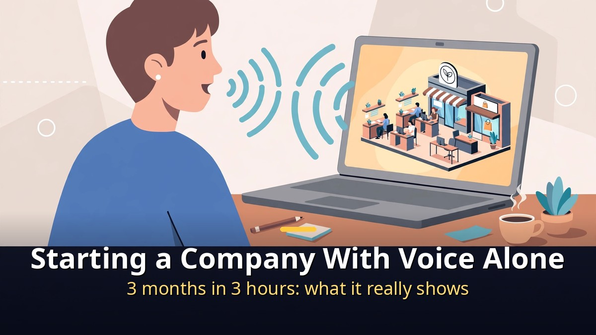
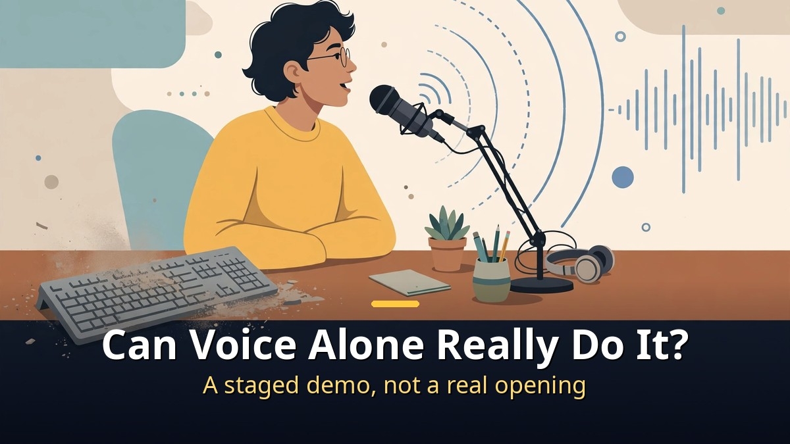
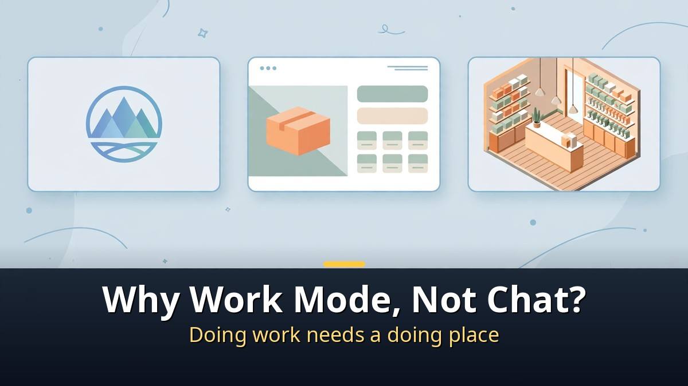
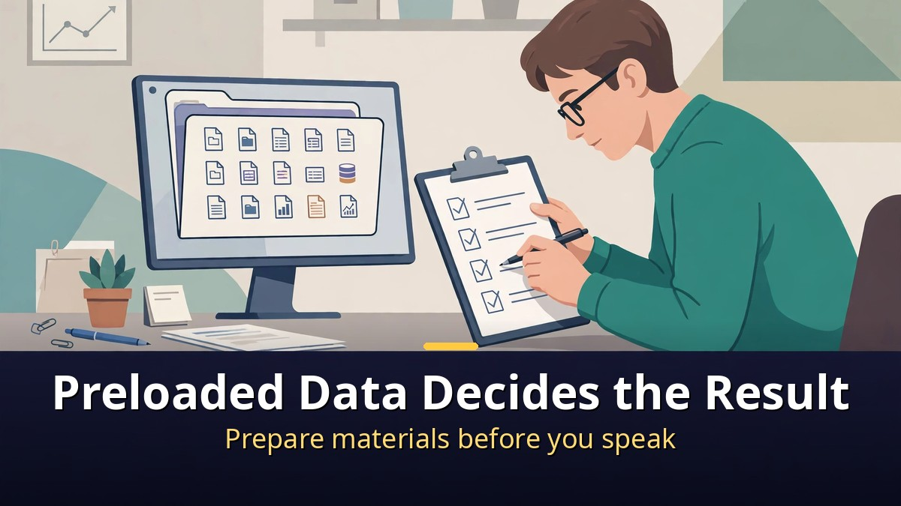

<!-- 본문 시작 -->

No keyboard was touched at all. A company was set up by voice alone.
On stage at OpenAI Korea's first anniversary conference, an engineer gave GPT-6 Astra voice commands only.
The results: three logo and website drafts, a 3D store tour video, a new product plan, and a 10-second commercial.
Taken at face value, three months of work shrank to three hours.
But this demo comes with conditions.

> **Key takeaway**
>
> At OpenAI Korea's first anniversary conference, an engineer demonstrated **setting up a virtual company with GPT-6 Astra using voice commands only, without a keyboard**.
> The outputs were **three logo and website drafts, a 3D store tour video, a new product plan, and a 10-second commercial**.
> This works only in **Work mode and Codex on the $20 Plus plan**, not in the standard chat window.
> And the quality of the results was decided not by the commands, but by the **data loaded in advance**. The video notes that the demonstrating engineer spent **3 hours the day before loading in materials**. The real point of the demo is preparation, not voice.

---

## Can you really start a company by voice alone?

First, how the demo worked.

The engineer did not type. They spoke instructions, and Astra carried them out.
Logo, website, a 3D tour of a shop, a product plan, and an ad followed in sequence.
It was not a single chat, but an entire company-setup process handed over at once.

An important distinction follows.
This was not a real company opening its doors.
It was a staged virtual company setup demo.
"Three months in three hours" compares demo production time, not real startup procedures.
Business registration, products, inventory, and payments all sit outside this demo.

Still, the demo matters for a different reason.
It changes how fast the front end of starting up becomes visible.
Logo drafts, a website, and a promo video used to take days or an outside contractor.
Now you can speak the instruction, look at what comes back, and refine from there.
That shift in speed is the real news.

---

## Why Work mode and Codex, not the regular chat window?

The same model does different things in different places.

The standard chat window is for asking and answering.
Work mode and Codex are for doing work: handling files, running multi-step tasks, and producing finished outputs.
That is why a continuous job like setting up a virtual company only works in Work mode and Codex.

The plan condition matters too.
Based on the demo summary, a plan of $20 or more per month is required.
The free or basic chat alone cannot reproduce the same demo.
Before upgrading, check whether what you want to do truly needs Work mode and Codex.

One more thing: voice does not mean vague works.
Spoken instructions still have to be specific.
What kind of shop, what mood, who it is for.
Without that information, the AI produces something plausible but wrong.
Voice changes how you input, not how much thinking the job needs.

| Task | Demo output | What a real startup must still check |
|---|---|---|
| Logo and website | 3 drafts | Trademarks, domain, real product info |
| Shop intro | 3D store tour video | Real shop photos, location, hours |
| Product planning | New product plan | Costs, suppliers, sales channels |
| Promotion | 10-second ad | Ad rules, factual claims in the copy |

---

## What should you prepare before you try it?

The demo summary gives the answer directly.
The results are decided by the data loaded in advance.

For anyone who wants to try this, the most important step comes before speaking.
Settle the shop name, mood, products, price range, and target customers first.
Gather photos, logo direction, and shop information in advance.
If the data is thin, no matter how smooth the voice commands are, the output will be a plausible empty shell.

A safe order of work looks like this.
First organize your materials, then hand over one small job by voice in Work mode or Codex.
The video's example goes like this: opening a neighborhood bakery, asking step by step from customer analysis to three logo drafts and a shop intro page.
One logo draft, one website draft, with results checked as you go.
Once a direction you like is settled, expand to the tour video, plan, and ad.
For reference, the video says the 10-second ad took 20 minutes to produce.
Office workers can use the same approach for proposals and presentation materials, not just startups.
Handing over the whole company at once makes it hard to find where things went wrong.

Finally, never use the output as-is.
Check trademarks against the logo, facts against the website copy, and exaggeration against the ad copy.
AI output is a draft. Final responsibility stays with the person.
The demo's speed is attractive, but speed does not replace accuracy.

---

Watching this demo, one simple thought stayed with me.
The barrier to starting up may never have been money or technology, but the time it takes to see a first result.
When a spoken sentence turns into a draft before your eyes, an idea stops living only in your head.
Still, beware the illusion that a fast first step equals a finished company.
Prepare the data, check small things first, and keep only what is true.
When those three are in place, delegating work by voice finally becomes real work.

## Frequently asked questions

**Q. Can I do the voice company setup in the free chat?**

A. Based on the demo summary, no. It requires Work mode and Codex on the $20 Plus plan, and it is not available in the standard chat window.

**Q. Does a real startup really finish in three hours by voice?**

A. No. Three hours compares demo production time on stage. Business registration, products, inventory, and payments are separate, real procedures.

**Q. What should I prepare first if I want to try it?**

A. The data to load in advance: shop name, mood, products, price range, target customers, plus photos and shop information. Without that, voice commands produce plausible but unusable results.

**Q. Can I use an AI-made logo or website as-is?**

A. No. Check trademark overlap, domain availability, product facts, and ad claims yourself first. AI output is a draft.

## Further reading

[How to Hand Work to AI Without Knowing How to Code｜GPT Codex and Aside Setup Guide — from one terminal line to a browser that works for you](https://aitechnotesen.blogspot.com/2026/10/how-to-hand-work-to-ai-without-knowing.html)
[Open Weights Reach the Frontier's Doorstep｜Kimi K3.1 Pro and the November 4 Test — intelligence index 55, ranked 4th overall, and the fine print before weights drop](https://aitechnotesen.blogspot.com/2026/10/open-weights-reach-frontiers.html)
[AI Video You Download and Run Yourself｜Why LTX-2.5 Changes the Game — the fork between renting a model and owning one](https://aitechnotesen.blogspot.com/2026/10/ai-video-you-download-and-run.html)

<!-- 본문 끝 -->

## 작업용 출처·이미지 정보 (업로드 제외)

- 자료 출처: honjobs 'AI Finishes a 3-Month Startup Process in 3 Hours' (2026-10-24) / video description (OpenAI Korea 1st anniversary demo, GPT-6 Astra voice-only, Work mode/Codex $20+ plan, pre-loaded data)
- 이미지: images/01-hero-en.jpg ~ 04-img3-en.jpg / 직접 제작 (AI 생성 + 영어 오버레이) / 사용권: 자작
