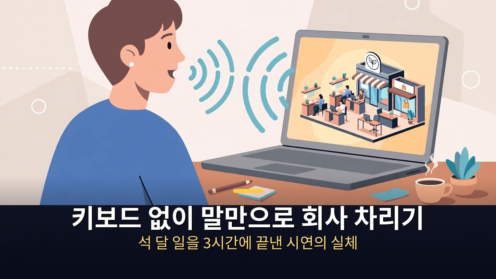
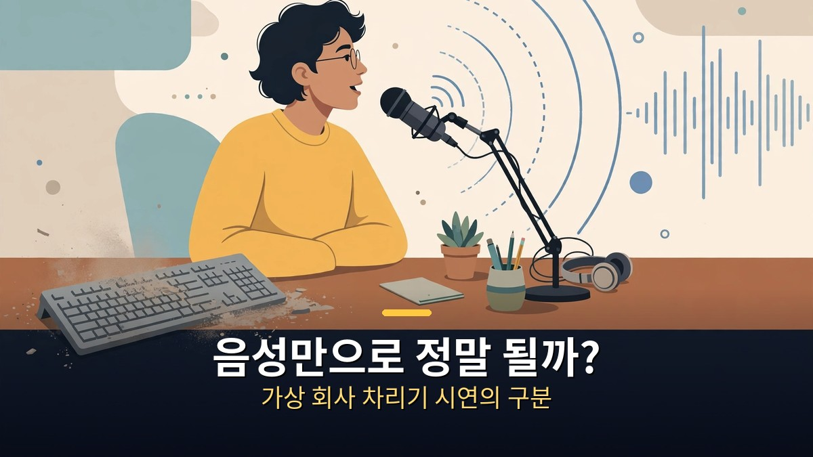
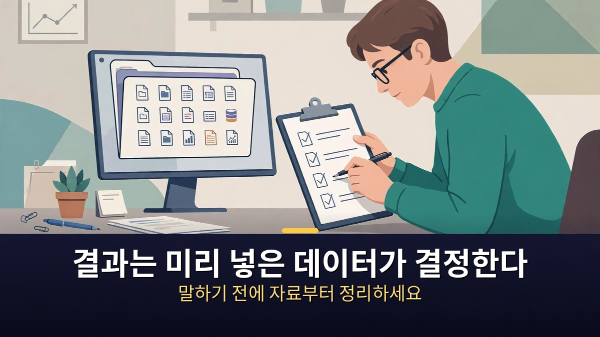

<!-- 본문 시작 -->

키보드를 한 번도 두드리지 않고, 말만으로 회사를 차리는 시연이 공개됐습니다.
오픈AI 코리아 1주년 컨퍼런스 무대에서 엔지니어는 GPT-6 아스트라에게 음성 명령만 내렸습니다.
그 결과 로고와 홈페이지 시안 3종, 3D 매장 투어 영상, 신제품 기획안, 10초짜리 광고까지 나왔습니다.
제목 그대로라면 석 달 걸릴 일이 3시간으로 줄었다는 이야기입니다.
단, 이 시연에는 전제 조건이 있습니다.

> **핵심 정리**
>
> 오픈AI 코리아 1주년 컨퍼런스에서 엔지니어는 **GPT-6 아스트라**에게 키보드 없이 **음성 명령만으로 가상 회사 차리기**를 시연했습니다.
> 나온 결과물은 **로고·홈페이지 시안 3종, 3D 매장 투어 영상, 신제품 기획안, 10초 광고**입니다.
> 이 기능은 **월 20달러 이상 요금제의 워크 모드와 코덱스에서만** 쓸 수 있고, 일반 채팅창에서는 쓸 수 없습니다.
> 그리고 결과물의 품질은 명령이 아니라 **미리 넣어둔 데이터가 결정**했습니다. 시연의 진짜 포인트는 음성이 아니라 사전 준비입니다.

---

## 음성만으로 정말 회사 차리기가 되나?

시연의 방식부터 정리합니다.

엔지니어는 키보드를 쓰지 않았습니다.
말로 일을 지시했고, 아스트라가 그 일을 수행했습니다.
로고를 만들고, 홈페이지를 만들고, 매장을 3D로 둘러보는 영상을 만들고, 제품 기획안을 짜고, 광고까지 만드는 흐름이 이어졌습니다.
하나의 채팅이 아니라, 회사를 차리는 과정 자체를 통째로 맡긴 셈입니다.

여기서 중요한 구분이 있습니다.
이건 실제 회사가 문을 연 사례가 아닙니다.
무대에서 보여준 가상 회사 차리기 시연입니다.
석 달이 3시간으로 줄었다는 말도 시연의 시간 비교이지, 실제 창업 절차가 3시간 만에 끝난다는 뜻이 아닙니다.
사업자 등록·제품·재고·결제 같은 실제 창업의 본질은 이 시연 밖에 있습니다.

그럼에도 시연이 의미 있는 이유는 따로 있습니다.
창업 준비의 앞부분, 즉 아이디어를 눈앞의 결과물로 바꾸는 속도가 달라졌기 때문입니다.
로고 시안·홈페이지·홍보 영상은 예전에는 외주를 주거나 며칠을 써야 했던 일입니다.
이제는 말로 지시하고, 나온 것을 고르면서 다듬는 방식으로 바뀔 수 있다는 걸 보여줬습니다.

---

## 왜 일반 채팅창이 아니라 워크 모드·코덱스인가?

같은 아스트라라도 장소가 다르면 할 수 있는 일이 다릅니다.

일반 채팅창은 묻고 답하는 곳입니다.
반면 워크 모드와 코덱스는 일을 수행하는 곳입니다.
파일을 다루고, 여러 단계를 이어서 실행하고, 결과물을 만들어 내는 데 맞춰져 있습니다.
그래서 가상 회사 차리기 같은 연속 작업은 워크 모드·코덱스에서만 가능합니다.

요금제 조건도 확인해야 합니다.
시연 정리 기준으로는 월 20달러 이상 요금제가 필요합니다.
무료나 기본 채팅만으로는 같은 시연을 따라 할 수 없습니다.
요금제를 바꾸기 전에, 내가 하려는 일이 정말 워크 모드·코덱스에서만 가능한 일인지부터 따져보는 게 순서입니다.

또 하나, 음성이라고 해서 아무 말이나 통하는 건 아닙니다.
말로 지시해도, 지시 자체는 구체적이어야 합니다.
어떤 가게인지, 어떤 분위기인지, 누구에게 파는지.
이 정보가 없으면 AI는 그럴듯하지만 엉뚱한 결과물을 내놓습니다.
음성은 입력 방식이 바뀐 것이지, 생각할 거리가 사라진 게 아닙니다.

| 작업 | 시연 결과물 | 실제 창업에서 따로 확인할 것 |
|---|---|---|
| 로고·홈페이지 | 시안 3종 | 상표·도메인·실제 상품 정보 |
| 매장 소개 | 3D 매장 투어 영상 | 실제 매장 사진·위치·영업 정보 |
| 제품 기획 | 신제품 기획안 | 원가·공급처·판매 채널 |
| 홍보 | 10초 광고 | 광고 심의·문구 사실 확인 |

---

## 따라 하려면 뭘 미리 준비해야 하나?

시연 정리가 직접 말해주는 답이 있습니다.
결과는 미리 넣어둔 데이터가 결정한다는 것입니다.

따라 하려는 사람에게 가장 중요한 단계는 말하기 전입니다.
가게 이름·분위기·파는 물건·가격대·타깃 고객을 먼저 정리해 두어야 합니다.
사진·로고 방향·매장 정보 같은 자료도 미리 모아두어야 합니다.
데이터가 부실하면, 음성 명령이 아무리 매끄러워도 결과물은 그럴듯한 빈 껍데기가 됩니다.

실전 순서는 이렇게 잡는 게 안전합니다.
먼저 자료를 정리하고, 워크 모드·코덱스에서 음성으로 작은 일부터 맡겨봅니다.
로고 시안 하나, 홈페이지 초안 하나처럼 범위를 좁혀서 결과를 확인합니다.
마음에 드는 방향이 정해지면 그때 범위를 넓혀 투어 영상·기획안·광고로 이어갑니다.
처음부터 회사 전체를 한 번에 맡기면, 어디서 틀어졌는지 찾기 어렵습니다.

마지막으로, 나온 결과물은 그대로 쓰지 말아야 합니다.
로고는 상표와 겹치는지, 홈페이지 문구는 사실과 맞는지, 광고 문구는 과장이 없는지.
AI가 만든 초안은 초안일 뿐, 최종 책임은 사람에게 있습니다.
시연이 보여준 속도는 매력적이지만, 속도가 정확성을 대신해 주지는 않습니다.

---

이 시연을 보며 든 생각은 단순합니다.
창업의 진입 장벽은 돈이나 기술보다 '첫 결과물을 보는 데 걸리는 시간'이었을지 모른다는 것.
말 한마디로 시안이 눈앞에 나타나면, 아이디어는 더 이상 머릿속에만 머물지 않습니다.
다만 그 빠른 첫걸음이 곧 완성된 회사라는 착각만은 조심해야 합니다.
자료를 준비하고, 작은 것부터 확인하고, 사실만 골라내는 일.
이 세 가지가 갖춰질 때, 음성으로 일 맡기기는 비로소 실무가 됩니다.

## 자주 묻는 질문

**Q. 무료 채팅으로도 음성 회사 차리기를 할 수 있나요?**

A. 시연 정리 기준으로는 안 됩니다. 이 작업은 월 20달러 이상 요금제의 워크 모드와 코덱스에서만 가능하고, 일반 채팅창에서는 쓸 수 없습니다.

**Q. 음성 명령만으로 실제 창업이 3시간 만에 끝나나요?**

A. 아닙니다. 3시간은 무대 시연에서 결과물을 만드는 데 걸린 시간 비교입니다. 사업자 등록·제품·재고·결제 등 실제 창업 절차는 별개로 필요합니다.

**Q. 따라 하려면 가장 먼저 뭘 준비해야 하나요?**

A. 미리 넣어둘 데이터입니다. 가게 이름·분위기·상품·가격대·타깃 고객과 사진·매장 정보를 먼저 정리해야, 음성 명령의 결과가 그럴듯한 수준을 넘어 실제 쓸 만한 수준이 됩니다.

**Q. AI가 만든 로고·홈페이지를 그대로 써도 되나요?**

A. 그대로 쓰면 안 됩니다. 상표 중복·도메인·상품 정보·광고 문구의 사실 여부를 사람이 직접 확인한 뒤에 써야 합니다. AI 결과물은 초안입니다.

## 함께 읽으면 좋은 글

[코딩 몰라도 AI에게 일을 맡기는 법｜GPT 코덱스·어사이드 설치 활용 총정리 — 터미널 한 줄로 시작해 브라우저가 직접 일하게 만드는 방법](https://aitechnoteskr.tistory.com/30)
[오픈소스가 최상위권 턱밑까지 왔다｜키미 K3.1 프로, 11월 4일이 분수령 — 지능 지수 55점 전체 4위, 가중치 공개 전 확인해야 할 조건](https://aitechnoteskr.tistory.com/29)
[묻기 전에 먼저 움직이는 AI 비서｜클로드 듀엣 공개와 이번 주 AI 뉴스 — 아침 브리핑부터 결제 준비까지, 6,000개 앱과 연결되는 비서](https://aitechnoteskr.tistory.com/27)

<!-- 본문 끝 -->

## 작업용 출처·이미지 정보 (업로드 제외)

- 자료 출처: honjobs 'AI Finishes a 3-Month Startup Process in 3 Hours' (2026-10-24) / video description (OpenAI Korea 1st anniversary demo, GPT-6 Astra voice-only, Work mode/Codex $20+ plan, pre-loaded data)
- 이미지: images/01-hero.jpg ~ 04-img3.jpg / 직접 제작 (AI 생성 + 한글 오버레이) / 사용권: 자작
