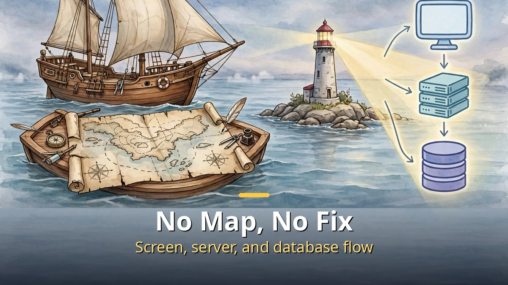
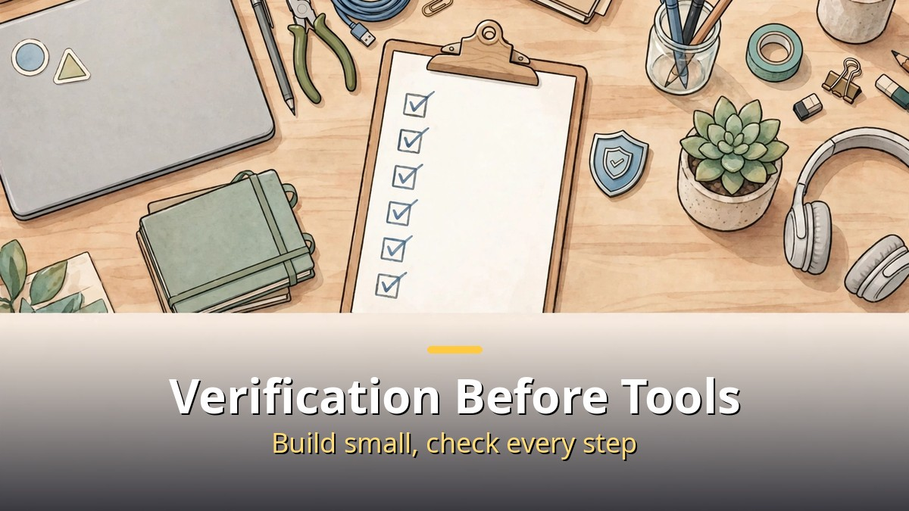

<!-- 본문 시작 -->

Vibe coding is a breakthrough.
But the problem is that people who know nothing can build something huge with it.
When trouble hits, it becomes big trouble.
This video's answer is a map of 112 stars.
It turns one web service into one restaurant and walks from the internet to machine learning.

> **Key takeaway: A professional developer's mind holds a map of 112 technologies connected by lines. This video explains that map through the analogy "one web service equals one restaurant." The dining hall customers see, the kitchen they don't, Git that records changes, and machine learning that learns from records all fit on one page. Professionals don't memorize every star. Knowing where things sit is the map.**

## Why a map comes first

Vibe coding does not stall because of AI performance.

If words like React, Python, Java, and Docker mean nothing to you, you don't even know what to ask the AI.
This video aims straight at that state.
Its goal is to give a taste of the giant map.
Each star is a technology, and each arrow means "knowing this lets you learn that next."

The map's left side is the dining hall customers see.
The right side is the kitchen they don't see.
Below sit Git, which records code, machine learning, which learns from records, and developer tools.
Knowing this layout lets you tell which neighborhood you are lost in when things break.
It is the starting point for avoiding the loop of repeating "just fix it" until the app is no longer what you intended.

## One web service, seen as a restaurant

Walked as a restaurant, a web service looks like this.

The hall is the customer side.
The internet is the road connecting computers worldwide, the browser is the customer, and HTML is the menu.
HTML is the promise that marks where things sit: this is a heading, this is text, this is a photo.
CSS is the interior and plating, the rules for color, font, and placement.
JavaScript is the hall staff reacting to customer actions.
Liking a post, search suggestions, and swiping photos are all this staff's work.

The kitchen is the unseen side.
The server is the computer that hands over what is asked for, the client is the side asking.
Whether a password matches or an item remains in stock is not judged in the hall.
Anything involving money or passwords must be checked again in the kitchen.
Kitchen languages split into Node, Python, Java, PHP and others, and the database is the fridge and ledger.
Memberships, orders, comments, and like counts almost all come from here.

There are also order forms and wristbands.
HTTP is the order form browsers and servers exchange.
GET writes on the envelope's outside, the address; POST puts it inside the envelope.
Cookies are amusement park wristbands, sessions are the shop's regular-customer ledger.
Staying logged in and keeping a cart are thanks to these two.
Infrastructure is the floor and building.
Linux is the floor, DNS is the address book, AWS is the rented kitchen, Docker is the food truck that tastes the same wherever it parks.
Git is the record book of when, who, and how code changed.

## Three paths, starting from one HTML star

You don't need to memorize the map.

Developers walk three paths.
First is frontend, the customer side through HTML, CSS, JavaScript, and React.
Second is backend, the kitchen side through servers, languages, databases, HTTP, login, and cloud.
Third is data, the apprentice side through Python and databases to machine learning.
Git and developer tools are the shared bag carried on every path.

The starting point is the one HTML star at the map's center.
Writing a few HTML lines in a notepad and opening them in a browser, seeing one Hello World line on screen, lights the first star.
Asking AI as you light stars one by one is much easier now.
But you need the map in your head to know what to ask the AI.
That is the video's conclusion.
Not memorizing an encyclopedia, but holding a map.

---

| Zone | Restaurant analogy | Real technologies |
|---|---|---|
| Hall (customer side) | Menu, interior, hall staff | HTML, CSS, JavaScript, React |
| Kitchen (server side) | Chefs, fridge, order forms | Node, Python, Java, PHP, databases, HTTP |
| Entry and records | Wristbands, ledger, record book | Cookies, sessions, OAuth, Git, GitHub |
| Floor and delivery | Floor, address book, rented kitchen, food truck | Linux, DNS, AWS, Docker |
| Apprentice | Predicting tomorrow from records | Machine learning, deep learning |

---

What struck me while checking the transcript is simple.
More than the methodology I wrote in revision 1, what this video really gives is the map's layout.
"Knowing where things sit" is what separates professionals from beginners, the video says.
So revision 2 leads with the restaurant analogy and the three paths.
Before handing work to AI, ask whether your app is hall or kitchen.
That one question is the map's first star.

## Frequently asked questions

**Q. Must I memorize all 112 technologies?**

A. No. The video itself says professional developers don't memorize every star. Knowing where things sit is the map.

**Q. Which of the three paths do I start with?**

A. Whichever path you take, start with HTML. Write a few HTML lines in a notepad and open them in a browser.

**Q. Isn't vibe coding alone enough?**

A. Building is fast, but when trouble hits you need the map to locate the cause. You also need the map to know what to ask the AI.

## Further reading

[How to Hand Work to AI Without Knowing How to Code｜GPT Codex and Aside Setup Guide — from one terminal line to a browser that works for you](https://aitechnotesen.blogspot.com/2026/10/how-to-hand-work-to-ai-without-knowing.html)
[Open Weights Reach the Frontier's Doorstep｜Kimi K3.1 Pro and the November 4 Test — intelligence index 55, ranked 4th overall, and the fine print before weights drop](https://aitechnotesen.blogspot.com/2026/10/open-weights-reach-frontiers.html)
[AI Video You Download and Run Yourself｜Why LTX-2.5 Changes the Game — the fork between renting a model and owning one](https://aitechnotesen.blogspot.com/2026/10/ai-video-you-download-and-run.html)

<!-- 본문 끝 -->

## 작업용 출처·이미지 정보 (업로드 제외)

- 자료 출처: honjobs '바이브코딩 원리는 알고 하세요' (2026-10-26) 자막 원문 대조 완료 — 112개 별 지도, 식당 비유, 세 갈래 길(프론트엔드·백엔드·데이터), HTML 출발점
- 이미지: images/01-hero-en.jpg ~ 04-img3-en.jpg / 직접 제작 (AI 생성 + 영어 오버레이) / 사용권: 자작
- 참고: 자막 원문 대조 완료 후 정정본 (rev2)
