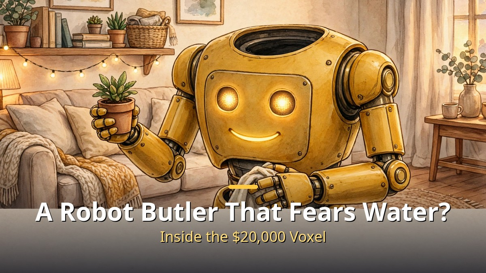
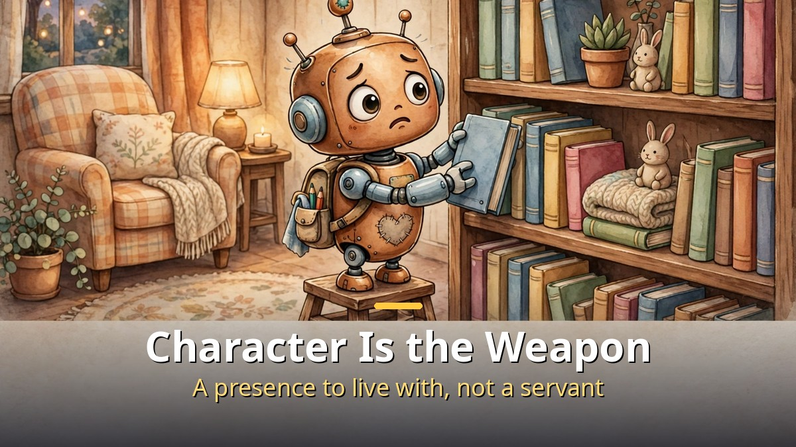
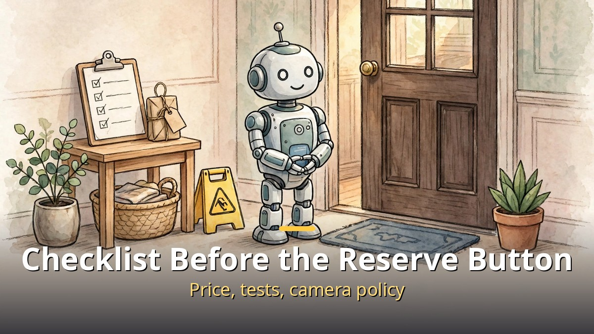

<!-- 본문 시작 -->

A headless robot tidies your home.
Its eyes sit in its belly, and it is afraid of water.
Meet Voxel, the robot butler from New York startup Tuesday Labs.
The deposit is $200, the price about $20,000, deliveries from 2028.
But this robot's real weapon is not cleaning skill. It is character.

> **Key takeaway: Voxel is a two-legged home robot from Tuesday Labs, led by former Boston Dynamics engineer Rosalind Shinkle. Ex-Pixar animators built its character and movement, and its jobs are tidying rooms, finding things, fetching objects, and watering plants. The deposit is $200 (fully refundable), the expected price about $20,000, US deliveries from 2028. But the robot in the launch film is a prototype, and some of its moves mix autonomy with human teleoperation.**

## What kind of robot is Voxel?

The first thing you notice about Voxel is that it has no head.

Its eyes sit near its belly, with a small mouth below.
The body is mustard yellow, and the legs are Z-shaped with knees bending backward.
That design is meant to reach objects inside tight kitchen cabinets and under tables.
Each arm has 7 degrees of freedom, and the hands are simple grippers.
Stereo RGB cameras and a wide-field camera watch the surroundings.

Its maker worked on manipulation algorithms for Boston Dynamics' Spot robot arm.
Tuesday Labs has spent three years developing Voxel.
The team is about seven people.
Founder Rosalind Shinkle calls Voxel "a gentleman-in-training, obsessed with elegance."

The launch film runs just 90 seconds.
It shows Voxel dancing to a digital wind instrument.
The Pixar DNA is not decoration.
An animator who spent over a decade at Pixar joined to develop the character, and another ex-Pixar animator's 3D animations train Voxel's movement.

## Why is character the weapon?

Most humanoid robots sell themselves on what they can do.

Backflips, or factory work.
Tuesday Labs argues the opposite.
To become a robot people want to live with and use every day, it must have character and capability together.
It put as much work into character as Pixar puts into creating one, and as much into robots as Boston Dynamics does.

So Voxel is deliberately designed with flaws.
A little obsessive, sometimes stuck on a task because it wants it just right, sometimes anxious.
Afraid of water, the outdoors, and sharp things.
That fits the "gentleman-in-training" setup.
The aim is to feel less like a perfect servant and more like a presence you live with.

Movement also starts from animation.
Motion is first created as 3D animation, then models trained on it recreate it on the real robot, handling gravity, sloping floors, and sudden shoves.
Its job is the home reset.
Tidy rooms, learn where things belong, remember where it last saw an item, and find lost things.
It will not cook or change diapers at launch.

## Before paying $20,000, check this

Start with the price tag, precisely.

The deposit is $200 and fully refundable.
The expected price is about $20,000, with US deliveries from 2028.
Series-1 units are numbered in reservation order, and the number is printed on the robot.
The company notes the price is not final yet.

The current state matters more.
The Voxel in the launch film is a prototype, and the hardware may change a lot before delivery.
For now it works with a mix of autonomy and teleoperation, meaning a person sometimes holds the controls.
First owners will help train its software at home.
A lot can change between now and 2028, and reservations should be made knowing that.

Privacy belongs on the checklist too.
Cameras keep watching the home while the robot learns where things belong.
Reports advise checking confirmed pricing, reservation terms, published capability tests, and clear camera privacy policies before reserving.
A robot without an answer to "who sees my home" is hard to let in.

A wider pattern is forming.
Startups founded by Boston Dynamics alumni and focused on expressive robots have appeared one after another this year.
In September, Dynamic Creatures, founded by a former chief strategy officer, unveiled a robot character for theme parks.
The contest for home robots may be shifting from hardware specs to "a character worth living with."

---

| Item | Detail |
|---|---|
| Product | Voxel Series-1, Tuesday Labs |
| Maker | Rosalind Shinkle (ex-Boston Dynamics) |
| Look | Headless, belly eyes, mustard yellow, Z-shaped legs |
| Arms and hands | Two 7-DoF arms, simple grippers |
| Jobs | Tidying, finding things, fetching, watering plants |
| Deposit | $200 (fully refundable) |
| Expected price | About $20,000 |
| Delivery | US from 2028 |
| Current state | Prototype, autonomy plus teleoperation mix |

---

What struck me while organizing this material is simple.
The condition for a robot entering a home may not be "does it work well" but "is it okay to live with."
Voxel fearing water is not just cute.
Admitting imperfection first looks like a calculation that earns trust.
But a 2028 promise is being bought with $200 today, so the checklist comes before the reserve button.
Confirmed pricing, published capability tests, camera policy.
It is not too late to look again when those three appear.

## Frequently asked questions

**Q. Can Voxel do all housework right now?**

A. No. The revealed robot is a prototype mixing autonomy and teleoperation. Its target jobs are tidying, finding things, fetching, and watering plants.

**Q. Is the $200 deposit refundable?**

A. The company says it is fully refundable. The expected price of about $20,000 is not yet final.

**Q. Does it cook or change diapers?**

A. Not at launch. Its jobs center on tidying and managing household objects.

**Q. How do its cameras see the home?**

A. Stereo RGB cameras and a wide-field camera recognize surroundings and learn where objects belong. How footage is handled and stored should be checked separately before reserving.

## Further reading

[How to Hand Work to AI Without Knowing How to Code｜GPT Codex and Aside Setup Guide — from one terminal line to a browser that works for you](https://aitechnotesen.blogspot.com/2026/10/how-to-hand-work-to-ai-without-knowing.html)
[Open Weights Reach the Frontier's Doorstep｜Kimi K3.1 Pro and the November 4 Test — intelligence index 55, ranked 4th overall, and the fine print before weights drop](https://aitechnotesen.blogspot.com/2026/10/open-weights-reach-frontiers.html)
[AI Video You Download and Run Yourself｜Why LTX-2.5 Changes the Game — the fork between renting a model and owning one](https://aitechnotesen.blogspot.com/2026/10/ai-video-you-download-and-run.html)

<!-- 본문 끝 -->

## 작업용 출처·이미지 정보 (업로드 제외)

- 자료 출처: Matt Wolfe 'The Robot Butler Will Clean Up After You' (2026-10-26) / Fast Company, Interesting Engineering, Dezeen, Moss & Fog, The Rundown (Oct 20-23, 2026)
- 이미지: images/01-hero-en.jpg ~ 04-img3-en.jpg / 직접 제작 (AI 생성 + 영어 오버레이) / 사용권: 자작
- 참고: 자막 원문 확인 작업 진행 중, 자막 도착 시 원고와 대조해 정정 여부 판단
