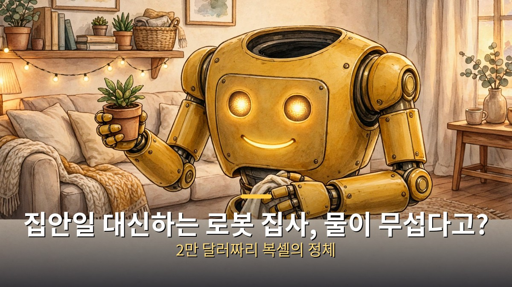
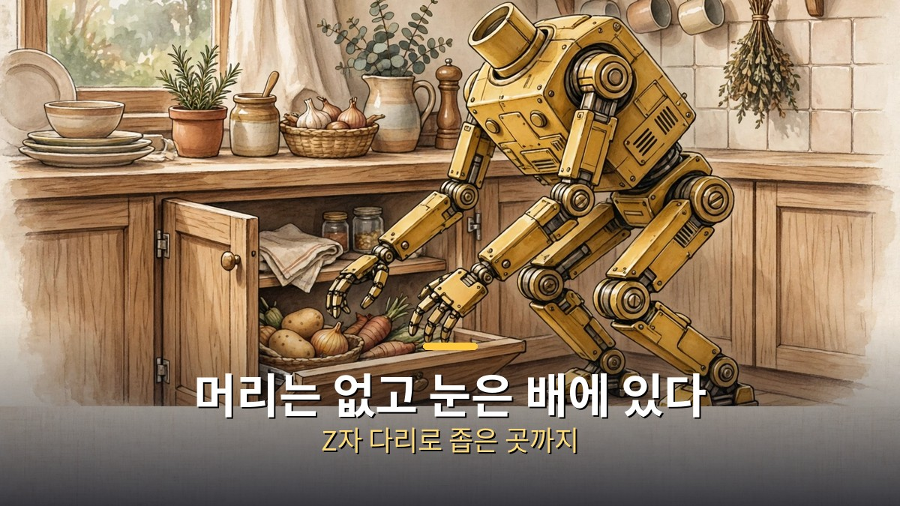
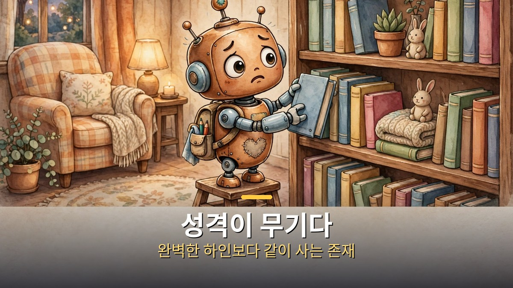
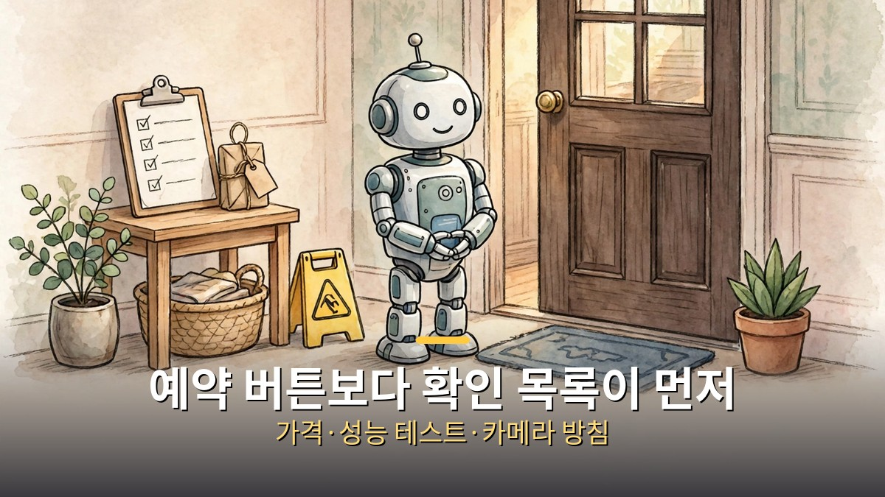

<!-- 본문 시작 -->

머리 없는 로봇이 집안을 정리한다.
눈은 배에 있고, 물이 무섭다고 한다.
뉴욕 스타트업 튜즈데이 랩스가 공개한 로봇 집사 복셀이다.
예약금은 200달러, 가격은 약 2만 달러, 배송은 2028년부터다.
그런데 이 로봇의 진짜 무기는 청소 실력이 아니라 성격이다.

> **핵심 정리: 복셀은 보스턴 다이내믹스 출신 로잘린드 싱클이 이끄는 튜즈데이 랩스의 2족 보행 가정용 로봇이다. 픽사 출신 애니메이터들이 성격과 움직임을 만들었고, 방 정리·물건 찾기·물건 가져오기·화분 물주기가 맡은 일이다. 예약금 200달러(전액 환불 가능)에 가격 약 2만 달러, 미국 배송은 2028년부터다. 다만 공개된 영상 속 로봇은 프로토타입이고, 일부 동작은 사람이 원격 조종하는 방식이 섞여 있다.**

## 복셀은 어떤 로봇인가?

복셀을 처음 보면 머리가 없다는 점부터 눈에 들어온다.

눈은 배 쪽에 있고, 입은 작게 달려 있다.
몸은 겨자색, 다리는 무릎이 뒤로 꺾이는 Z자 형태다.
좁은 주방 찬장 안이나 테이블 아래 물건에 닿기 위한 설계라고 한다.
팔은 양쪽 각각 7자유도, 손은 단순한 집게 형태다.
주변을 보는 건 스테레오 RGB 카메라와 광각 카메라가 맡는다.

만든 사람은 보스턴 다이내믹스에서 스팟 로봇 팔의 조작 알고리즘을 다뤘던 로잘린드 싱클이다.
튜즈데이 랩스는 3년 동안 복셀을 개발해왔다.
팀은 7명 남짓의 작은 규모다.
창업자 본인은 복셀을 "수습 중인 신사, 우아함에 집착하는 존재"라고 소개한다.

출시 영상은 1분 30초짜리 짧은 필름이다.
영상은 "CG가 아니다"라는 카드를 내걸고, 부스러기를 작은 쓰레받기에 쓸어 담고 분재에 물을 주는 장면을 보여준다.
픽사 DNA는 장식이 아니다.
픽사에서 10년 넘게 일한 애니메이터가 캐릭터 개발에 참여했고, 다른 픽사 출신은 복셀의 3D 애니메이션을 만들어 움직임 학습에 쓰고 있다.

## 왜 성격이 무기인가?

대부분의 휴머노이드 로봇은 "무엇을 할 수 있나"로 말한다.

뒤집기를 하거나 공장에서 일하는 식이다.
튜즈데이 랩스의 주장은 정반대다.
집에서 매일 쓰고 싶어지는 로봇이 되려면 능력과 성격이 함께 있어야 한다는 것.
픽사의 캐릭터 창작만큼, 보스턴 다이내믹스의 로봇 제작만큼 성격에 공을 들였다고 한다.

그래서 복셀은 일부러 결핍이 있는 캐릭터로 설계됐다.
조금 강박적이고, 일을 완벽하게 하려다 멈추기도 하고, 가끔 불안해한다.
물과 야외, 날카로운 물건을 무서워한다.
"신사가 되기 위해 수습 중"이라는 설정과 맞물린다.
집안일 로봇이 완벽한 하인이 아니라 같이 사는 존재처럼 느껴지게 하려는 의도다.

움직임 만드는 방식도 애니메이션에서 출발한다.
3D 애니메이션으로 움직임을 먼저 만들고, 그걸 학습한 모델이 실제 로봇 위에서 중력·경사진 바닥·갑작스러운 밀침까지 처리하며 재현한다.
맡은 일은 집안 리셋이다.
방을 정리하고, 물건이 있어야 할 자리를 배우고, 마지막으로 본 위치를 기억해 잃어버린 물건을 찾아준다.
대표 시연은 남자에게 클라리넷을 건네고 연주에 맞춰 춤추는 장면이다.
요리나 기저귀 교체는 출시 단계에서 하지 않는다.

## 2만 달러, 사기 전에 따져볼 것

가격표부터 정확히 보자.

예약금은 200달러로 전액 환불이 가능하다.
예상 가격은 약 2만 달러, 미국 배송은 2028년부터다.
시리즈-1은 예약 순서대로 번호가 매겨지고, 번호가 로봇 본체에 인쇄된다.
가격이 최종 확정된 건 아니라는 점도 회사 측 설명에 들어 있다.

더 중요한 건 현재 상태다.
공개 영상 속 복셀은 프로토타입이고, 배송 전에 하드웨어가 크게 바뀔 수 있다.
지금은 자율 동작과 원격 조종이 섞여 있다.
사람이 가끔 조종간을 잡는다는 뜻이다.
첫 구매자는 집에서 소프트웨어를 함께 학습시키는 역할을 맡게 된다.
2028년까지 바뀔 여지가 크다는 걸 알고 예약해야 한다.

프라이버시도 따져볼 항목이다.
카메라가 집안을 계속 보며 물건의 위치를 배우는 로봇이다.
예약 전에 가격 확정 여부, 예약 조건, 공개된 성능 테스트, 카메라 영상 처리 방침을 확인하라는 지적이 나온다.
"누가 내 집을 보는가"에 대한 답이 없는 로봇은 집에 들이기 어렵다.

비슷한 흐름도 있다.
보스턴 다이내믹스 출신들이 세운 표현력 로봇 스타트업이 올해 잇따라 등장했다.
9월에는 전 최고전략책임자가 세운 다이나믹 크리처스가 테마파크용 로봇 캐릭터를 공개했다.
집안 로봇 경쟁의 승부처가 하드웨어 스펙이 아니라 "같이 살고 싶은 성격"으로 옮겨가고 있다는 신호다.

---

| 항목 | 내용 |
|---|---|
| 제품 | 복셀(Voxel) 시리즈-1, 튜즈데이 랩스 |
| 만든 이 | 로잘린드 싱클(전 보스턴 다이내믹스) |
| 외형 | 머리 없음, 배 쪽 눈, 겨자색, Z자 다리 |
| 팔·손 | 7자유도 팔 2개, 단순 집게 |
| 맡은 일 | 방 정리, 물건 찾기, 가져오기, 화분 물주기 |
| 예약금 | 200달러(전액 환불 가능) |
| 예상 가격 | 약 2만 달러 |
| 배송 | 미국 기준 2028년부터 |
| 현재 상태 | 프로토타입, 자율+원격 조종 혼합 |

---

자료를 정리하면서 든 생각은 단순했다.
로봇이 집에 들어오는 조건은 "잘하느냐"가 아니라 "같이 살아도 되겠느냐"인 것 같다.
복셀이 물이 무섭다는 설정은 귀엽기만 한 게 아니다.
불완전하다는 걸 먼저 밝히는 쪽이 오히려 신뢰를 얻는다는 계산이 보인다.
다만 2028년까지의 약속을 지금 200달러로 사는 셈이니, 예약 버튼보다 확인 목록이 먼저다.
가격 확정, 성능 테스트 공개, 카메라 방침.
이 세 가지가 나올 때 다시 봐도 늦지 않다.

## 자주 묻는 질문

**Q. 복셀은 지금 바로 집안일을 다 해주나요?**
A. 아니다. 공개된 로봇은 프로토타입이고 자율 동작과 원격 조종이 섞여 있다. 방 정리·물건 찾기·가져오기·화분 물주기가 목표 작업이다.

**Q. 예약금 200달러는 돌려받을 수 있나요?**
A. 전액 환불이 가능하다고 회사가 밝혔다. 예상 가격 약 2만 달러는 아직 최종 확정 가격이 아니다.

**Q. 요리와 기저귀 교체도 하나요?**
A. 출시 단계에서는 하지 않는다. 맡은 일은 집안 정리와 물건 관리 중심이다.

**Q. 카메라는 집안을 어떻게 보나요?**
A. 스테레오 RGB 카메라와 광각 카메라로 주변을 인식하고 물건의 위치를 배운다. 영상 처리·보관 방침은 예약 전에 별도로 확인해야 한다.

## 함께 읽으면 좋은 글

[코딩 몰라도 AI에게 일을 맡기는 법｜GPT 코덱스·어사이드 설치 활용 총정리 — 터미널 한 줄로 시작해 브라우저가 직접 일하게 만드는 방법](https://aitechnoteskr.tistory.com/30)
[오픈소스가 최상위권 턱밑까지 왔다｜키미 K3.1 프로, 11월 4일이 분수령 — 지능 지수 55점 전체 4위, 가중치 공개 전 확인해야 할 조건](https://aitechnoteskr.tistory.com/29)
[묻기 전에 먼저 움직이는 AI 비서｜클로드 듀엣 공개와 이번 주 AI 뉴스 — 아침 브리핑부터 결제 준비까지, 6,000개 앱과 연결되는 비서](https://aitechnoteskr.tistory.com/27)

<!-- 본문 끝 -->

## 작업용 출처·이미지 정보 (업로드 제외)

- 자료 출처: Matt Wolfe 'The Robot Butler Will Clean Up After You' (2026-10-26) 자막 원문 대조 완료 / Fast Company, Interesting Engineering, Dezeen, Moss & Fog, The Rundown (Oct 20-23, 2026)
- 이미지: images/01-hero.jpg ~ 04-img3.jpg / 직접 제작 (AI 생성 + 한글 오버레이) / 사용권: 자작
- 참고: 자막 원문 대조 완료 후 정정본 (rev2)
