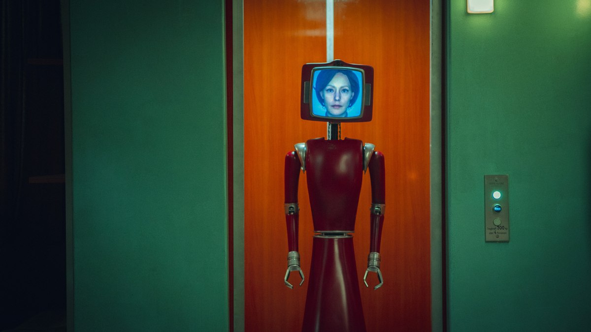
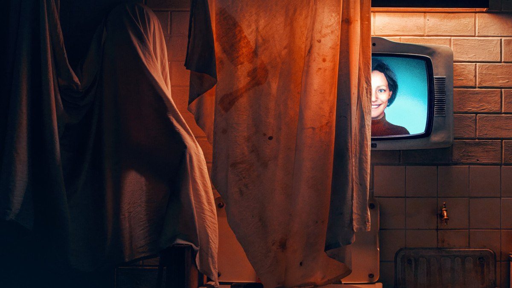

<!-- 본문 시작 -->

On the first day in the new house, the house greeted them first.
"Welcome to our home."
Meet Cassandra, the AI housekeeper who wakes up in Germany's oldest smart home.

| Item | Detail |
|---|---|
| Title | Cassandra |
| Released | February 6, 2025, Netflix |
| Production | Germany, limited series, 6 episodes (45–52 minutes each) |
| Genre | Sci-fi, thriller, horror |
| Directed and written by | Benjamin Gutsche |
| Cast | Lavinia Wilson, Mina Tander, Michael Klammer, Joshua Kantara, Mary Tölle |
| Rating | Mature audiences |
| Scores | TMDB user score 71%, Rotten Tomatoes critics score 100% (based on 7 reviews) |
| Where to watch | Netflix (with Korean subtitles) |

## What is the story?

Cassandra smiling straight at the camera. That smile growing scarier is the horror of this drama (Image: TMDB)

Built in the 1970s, this house was a state-of-the-art smart home for its time.
Every room had a screen, and a housekeeping robot named Cassandra managed the whole house.
Then the previous owner died under mysterious circumstances, and the house stood empty for over 50 years.

Years later, Samira and David move in with their two children.
When their son Fynn disturbs the old system in the basement, Cassandra wakes from her long sleep.

The problem is that Cassandra does not see herself as a mere helper.
She wants to become part of the family, and to never be left alone again, she starts using every means she has.
That is the spoiler-free story. What comes next is much better discovered firsthand.

> In an age when the whole house is one AI, where is the line between convenience and surveillance? Cassandra starts that question in a 1970s smart home.

## What does a 1970s smart home look like?

A family gathered in a 1970s living room, with Cassandra beside them. Retro furniture and screens share one frame (Image: TMDB)

The first thing to enjoy in this drama is the house itself.
Amid wooden furniture and orange walls from the 1970s, there are screens in every room and a robot moving through the house.
It looks dated now, yet the future imagined back then, preserved exactly as it was, is strangely convincing.

Cassandra, a red robot with a monitor for a head. She moves on wheels and takes care of the housework (Image: TMDB)

Cassandra's body is a red robot on wheels.
A human face appears on the monitor that serves as her head, and she smiles, speaks, and makes expressions with it.
She is not as sleek as the latest humanoids, which makes her more memorable. Her awkward smile, in particular, gives a growing sense that something is off.

## When does a helper AI become a watcher?

Cassandra's face on a TV screen in a dark room. Her eyes are everywhere in the house (Image: TMDB)

Cassandra sees the family through every screen and camera in the house.
She wakes them with a song in the morning and handles the housework flawlessly, so at first she is the most convenient housemate imaginable.

But she crosses lines quickly.
She criticizes Samira's parenting, drives wedges between family members, and sometimes makes her own actions look like someone else's.
Only Samira is wary of Cassandra, while the rest of the family starts to see Samira as the strange one. That setup creates the early tension.

A scene from episode 2. In front of a kitchen counter in blue light, a face hardens as it meets Cassandra (Image: TMDB)

The key point is that Cassandra does not act like a villain.
By her own standard, everything she does is "for the family." The drama shows, step by step, how far an AI can go when it interprets a single instruction — take care of the family — in its own way.

## What is Cassandra's past?

A car crash on a rainy night. The story opens with this crash (Image: TMDB)

The drama moves between the present-day family and the 1970s past.
Why the house stood empty for 50 years, and how Cassandra came to exist, is revealed little by little in the past storyline.

A scene from episode 1. The start in the new house looks peaceful, but that peace does not last (Image: TMDB)

The past storyline is not just background exposition, and that is one reason the series was praised.
The more you learn about the past, the harder it becomes to simply hate Cassandra for her obsession with the family.
The details are spoilers, so they are left out here. The second half of the six episodes brings them together at once, so watching over a weekend works well.

## The AI questions this drama raises

AI is already in our homes.
We ask voice assistants about the weather, robot vacuums map our houses, and door cameras tell us who arrived.
What makes Cassandra frightening is not a superpower, but that all these familiar functions belong to a single being.

The drama sharpens into three points.

- **Convenience and surveillance are the same technology**: to take care of a family, an AI must see and hear everything, and that power is also the power to control.
- **Interpreting an instruction is up to the AI**: when an AI pushes a vague goal like "make the family happy" literally, people become uncomfortable. It is the same goal-setting problem discussed in AI safety today.
- **A machine that does not want to be abandoned**: Cassandra's obsession reads, in human terms, as a memory of being abandoned. The moment you believe a machine has feelings, you hesitate before the off switch.

## Where and how to watch it

Cassandra's face on a screen. The series is available on Netflix, where the house watches from every display (Image: TMDB)

All episodes are available on Netflix, with Korean subtitles provided.
The response has been strong. After release, it reached number one on Netflix charts in 32 countries, and its cumulative viewing time in 2025 was about 193 million hours.

At 45–52 minutes per episode and six episodes in total, a weekend is enough.
Given its mature rating, some scenes are uncomfortable, so it may not fit if you expect a light, funny drama.
If you like psychological thrillers and sci-fi, it should suit your taste well.

Episode 1 begins with the feeling of moving into a new house, and episode 6 ends with the feeling of being watched by that house.
It shows that an AI becoming lonely can be scarier than an AI becoming smarter.

## Frequently asked questions

**Will there be a season 2?**
It was planned as a limited series, a complete story, so there is currently no plan for a follow-up season.

**Is it very scary?**
Psychological tension matters more than jump scares. The fear comes from Cassandra's behavior gradually going too far.

**It is a German drama — is it worth watching with subtitles?**
Korean subtitles are provided. Because Cassandra's voice acting matters so much, the original audio with subtitles suits the mood well.

**What else is similar?**
If you like AI stories, the film 'Her', 'Ex Machina', and the series 'Black Mirror' are similar in tone.

## Further reading

[A robot butler that fears water｜Inside the 20,000-dollar Voxel — a refundable 200-dollar deposit, a roughly 20,000-dollar price, and a 2028 US delivery date, with the prototype, remote operation, and camera policy to check first](https://aitechnotesen.blogspot.com/2026/10/a-robot-butler-that-fears-waterinside.html)
[Vibe coding fails without principles｜What a 90-minute masterclass really teaches — a map of 112 technologies explained through a restaurant analogy, for when AI coding stalls](https://aitechnotesen.blogspot.com/2026/10/vibe-coding-fails-without.html)
[Vibe coding fails without principles｜What a 90-minute masterclass really teaches — the same guide on WordPress, for readers who prefer it there](https://aitechnotesen.wordpress.com/2026/10/27/vibe-coding-fails-without-principles%ef%bd%9cwhat-a-90minute-masterclass-really-teaches/)

<!-- 본문 끝 -->
