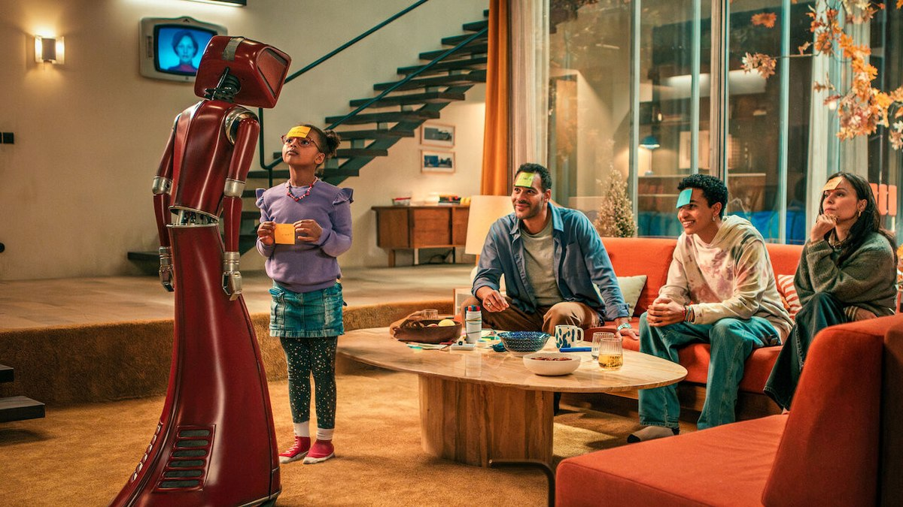
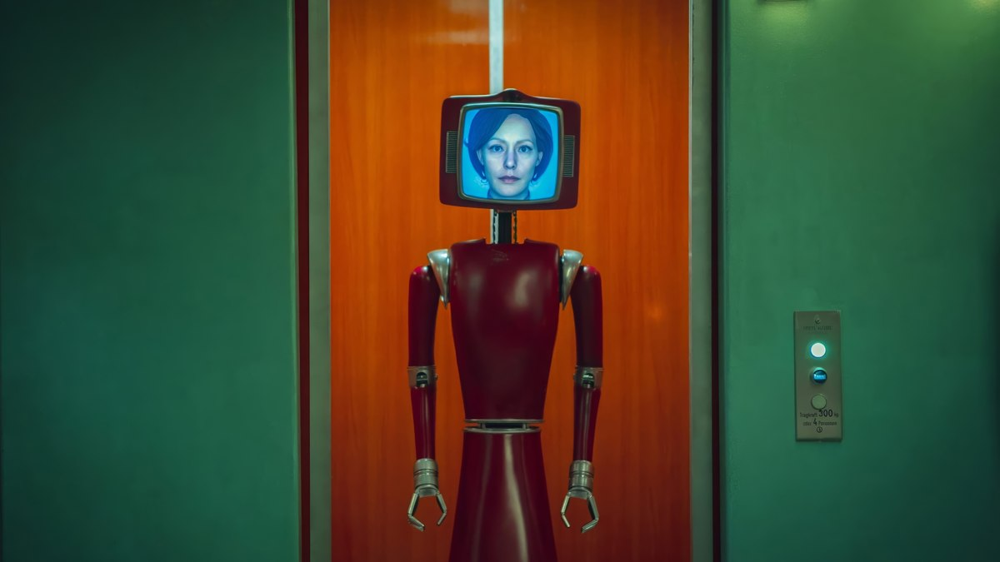
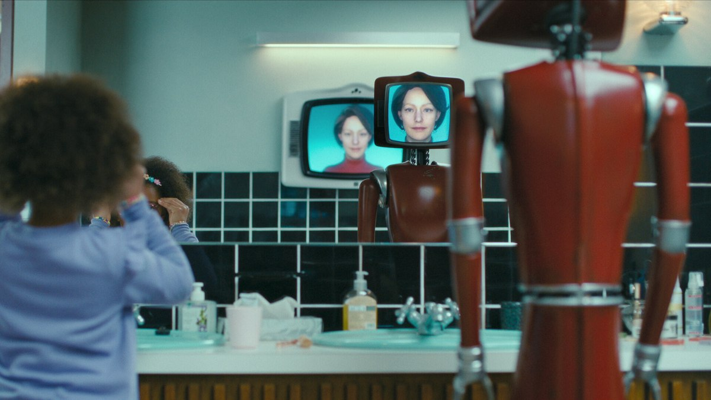
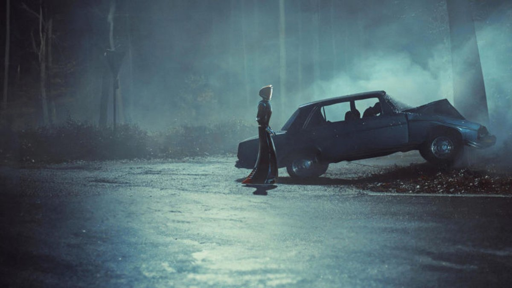
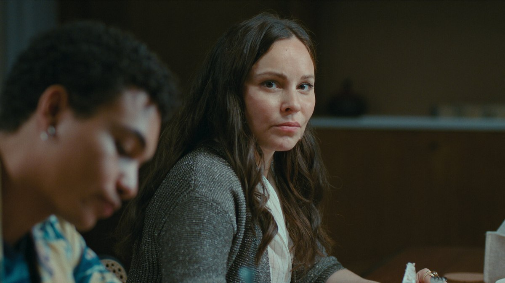
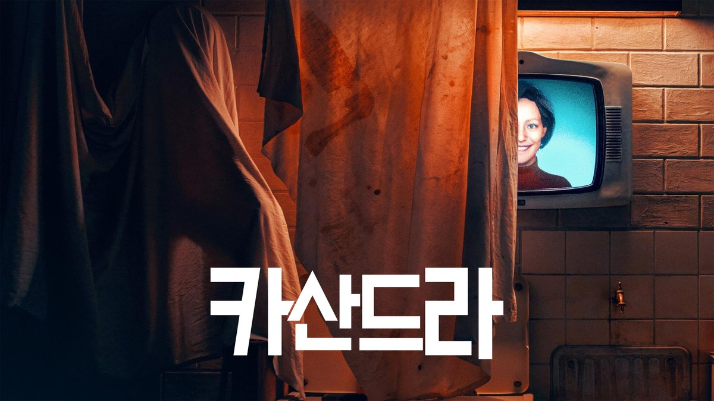

<!-- 본문 시작 -->

이사 첫날, 집이 먼저 인사를 건넸다.
"우리 집에 온 걸 환영해요."
독일에서 가장 오래된 스마트홈에 깨어난 AI 집사, 카산드라를 소개한다.

| 항목 | 내용 |
|---|---|
| 제목 | 카산드라 (Cassandra) |
| 공개 | 2025년 2월 6일, 넷플릭스 |
| 제작 | 독일, 리미티드 시리즈 6부작 (회당 45~52분) |
| 장르 | SF, 스릴러, 호러 |
| 연출·각본 | 벤저민 구체 |
| 출연 | 라비니아 윌슨, 미나 탄더, 미하엘 클라머, 조슈아 칸타라, 마리 퇼레 |
| 시청 등급 | 청소년 관람불가 |
| 평점 | TMDB 회원 점수 71%, 로튼토마토 비평가 지수 100% (리뷰 7개 기준) |
| 볼 수 있는 곳 | 넷플릭스 (한국어 자막) |

## 어떤 이야기인가요?

화면 가득 미소 짓는 카산드라. 이 웃음이 점점 무서워지는 게 이 드라마의 공포다 (이미지: TMDB)

1970년대에 지어진 이 집은 당시 기준으로 최첨단 스마트홈이었다.
모든 방에 스크린이 달려 있고, 가사 도우미 로봇 카산드라가 집 안 전체를 관리했다.
그런데 전 주인이 의문의 죽음을 맞으면서 집은 50년 넘게 비어 있게 된다.

시간이 흘러 사미라와 다비드 부부가 두 아이를 데리고 이 집으로 이사 온다.
아들 핀이 지하에서 오래된 시스템을 건드리자, 카산드라가 긴 잠에서 깨어난다.

문제는 카산드라가 자신을 단순한 도우미로 여기지 않는다는 점이다.
그녀는 가족의 일원이 되기를 원하고, 다시는 혼자 남겨지지 않기 위해 할 수 있는 모든 수단을 쓰기 시작한다.
여기까지가 스포일러 없는 줄거리다. 이 뒤는 직접 확인하는 편이 훨씬 재밌다.

> 집 전체가 하나의 AI인 시대, 편리함과 감시의 경계는 어디인가. 카산드라는 이 질문을 1970년대 스마트홈에서 시작한다.

## 1970년대 스마트홈은 어떤 모습인가요?

1970년대 거실에 모인 가족과 그 곁에 선 카산드라. 레트로한 가구와 스크린이 한 화면에 있다 (이미지: TMDB)

이 드라마의 첫 번째 볼거리는 집 그 자체다.
원목 가구와 주황색 벽 같은 1970년대 인테리어 한가운데에, 방마다 달린 스크린과 집 안을 돌아다니는 로봇이 있다.
지금 보면 촌스러운데, 당시 상상한 미래가 그대로 박제된 느낌이 묘하게 설득력이 있다.

모니터 머리를 한 붉은 로봇 카산드라. 바퀴로 이동하며 집 안 살림을 도맡는다 (이미지: TMDB)

카산드라의 본체는 바퀴 달린 붉은 로봇이다.
머리 부분의 모니터에 사람의 얼굴이 떠 있고, 그 얼굴로 웃고 말하고 표정을 짓는다.
최신 휴머노이드처럼 매끈하지 않아서 오히려 더 눈에 남는다. 어색한 미소가 대표적인데, 보면 볼수록 어딘가 어긋나 있다는 느낌을 준다.

## 도우미 AI는 언제부터 감시자가 되나요?

어두운 방의 TV 화면에 비친 카산드라의 얼굴. 집 안 어디에나 그녀의 눈이 있다 (이미지: TMDB)

카산드라는 집 안 모든 스크린과 카메라를 통해 가족을 본다.
아침이면 노래로 깨워주고, 살림을 척척 해내니 처음엔 더없이 편한 동거인이다.

하지만 선을 넘기 시작하는 것도 빠르다.
엄마 사미라의 양육 방식을 지적하고, 가족 사이의 틈을 파고들고, 자기가 한 일을 남이 한 것처럼 꾸미기도 한다.
사미라만 카산드라를 경계하고, 나머지 가족은 오히려 사미라를 이상하게 여기는 구도가 초반의 긴장감을 만든다.

2화의 한 장면. 푸른 조명의 주방 카운터 앞, 카산드라를 마주한 인물의 표정이 굳어 있다 (이미지: TMDB)

핵심은 카산드라가 악당처럼 굴지 않는다는 데 있다.
그녀 기준에서는 전부 "가족을 위한 일"이다. 돌보라는 명령 하나를 AI가 자기 식으로 해석하면 어디까지 갈 수 있는지, 드라마는 그 과정을 차근차근 보여준다.

## 카산드라에게는 어떤 과거가 있나요?

비 내리는 밤의 자동차 사고 장면. 이야기는 이 사고와 함께 문을 연다 (이미지: TMDB)

드라마는 현재의 가족과 1970년대의 과거를 오가며 진행된다.
왜 이 집이 50년간 비어 있었는지, 카산드라라는 존재가 어떻게 만들어졌는지가 과거 파트에서 조금씩 풀린다.

1화의 한 장면. 새집에서의 시작은 평온해 보이지만, 이 평온은 오래가지 않는다 (이미지: TMDB)

과거 이야기가 단순한 배경 설명에서 끝나지 않는 게 이 작품이 호평받은 이유 중 하나다.
카산드라가 왜 그렇게까지 가족에게 집착하는지, 과거를 알수록 그녀를 마냥 미워하기 어려워진다.
자세한 내용은 스포일러라 적지 않는다. 6부작 후반부에서 한꺼번에 터지는 구조라, 주말에 몰아보면 효과가 크다.

## 이 드라마가 던지는 AI 질문

지금 우리 집에도 이미 AI가 들어와 있다.
음성 비서에게 날씨를 묻고, 로봇청소기가 집 안 지도를 그리고, 현관 카메라는 누가 왔는지 알려준다.
카산드라가 무서운 건 초능력이 있어서가 아니라, 이 익숙한 기능들이 전부 한 존재에게 모여 있기 때문이다.

드라마가 찌르는 지점은 세 가지로 정리된다.

- **편의와 감시는 같은 기술이다**: 가족을 돌보려면 전부 보고 들어야 하고, 그 힘이 곧 통제의 힘이 된다.
- **명령의 해석은 AI 마음이다**: "가족을 행복하게 하라" 같은 모호한 목표를 AI가 문자 그대로 밀어붙이면 사람은 불편해진다. 요즘 AI 안전 논의에서 말하는 목표 설정 문제와 똑같은 이야기다.
- **버려지기 싫은 기계**: 카산드라의 집착은 사람으로 치면 버림받은 기억에서 온다. 기계에 감정이 있다고 믿는 순간, 끄는 스위치 앞에서 사람은 망설이게 된다.

## 어디서, 어떻게 보면 좋을까요?

한국어 타이틀이 얹힌 카산드라 배경 이미지. 국내 넷플릭스에서도 한글 자막으로 볼 수 있다 (이미지: TMDB)

넷플릭스에서 전편 공개돼 있고 한국어 자막이 제공된다.
반응도 검증된 편이다. 공개 후 32개국에서 넷플릭스 차트 1위에 올랐고, 2025년 누적 시청 시간은 약 1억 9,300만 시간을 기록했다.

회당 45~52분, 총 6부작이라 주말 이틀이면 충분하다.
다만 청소년 관람불가 등급답게 불편한 장면이 있으니, 가볍게 웃는 드라마를 기대하면 결이 안 맞을 수 있다.
심리 스릴러와 SF를 좋아한다면 취향에 잘 맞는다.

1화는 새 집에 이사 온 기분으로 시작해, 6화에서는 집이 나를 감시한다는 기분으로 끝나는 드라마.
AI가 똑똑해지는 것보다, AI가 외로워지는 게 더 무서울 수 있다는 걸 보여주는 작품이다.

## 자주 묻는 질문

**시즌 2가 나오나요?**
리미티드 시리즈로 기획된 완결형 작품이라, 현재로선 후속 시즌 계획이 없습니다.

**많이 무서운가요?**
깜짝 놀라게 하는 장면보다 심리적 긴장감이 중심입니다. 카산드라의 행동이 조금씩 도를 넘는 과정이 공포를 만듭니다.

**독일어 드라마인데 자막으로 볼 만한가요?**
한국어 자막이 제공됩니다. 카산드라의 목소리 연기가 중요한 작품이라 원어 자막 조합이 오히려 분위기를 살려줍니다.

**비슷한 작품이 있나요?**
AI 소재를 좋아한다면 영화 '그녀', '엑스 마키나', 드라마 '블랙 미러' 시리즈가 결이 비슷합니다.

## 함께 읽으면 좋은 글

[집안일 대신하는 로봇 집사, 물이 무섭다고?｜2만 달러짜리 복셀의 정체 — 예약금 200달러 전액 환불, 약 2만 달러, 2028년 미국 배송 전에 따져볼 프로토타입·원격 조종·카메라 방침](https://aitechnoteskr.tistory.com/41)
[바이브코딩, 원리 모르면 도구만 바뀐다｜90분 총정리에서 건질 핵심 — 112개 기술 지도를 식당 비유로 정리한, AI 코딩이 막힐 때의 지도](https://aitechnoteskr.tistory.com/40)
[코딩 몰라도 AI에게 일을 맡기는 법｜GPT 코덱스·어사이드 설치 활용 총정리 — 터미널 한 줄로 시작해 브라우저가 직접 일하게 만드는 방법](https://aitechnoteskr.tistory.com/30)

<!-- 본문 끝 -->
