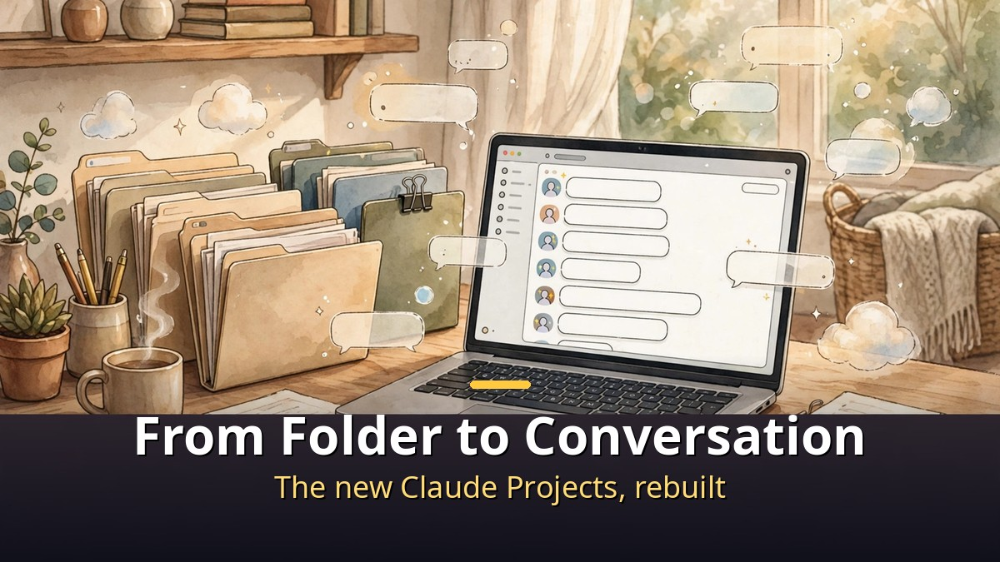
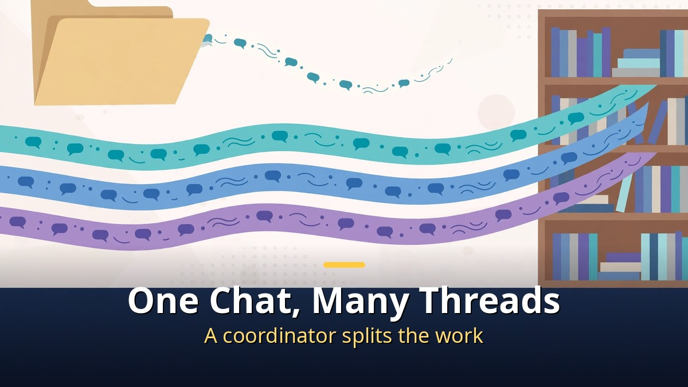
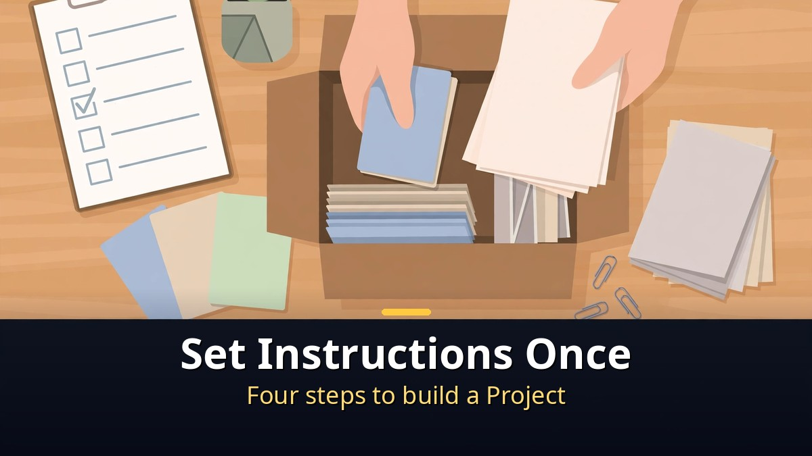
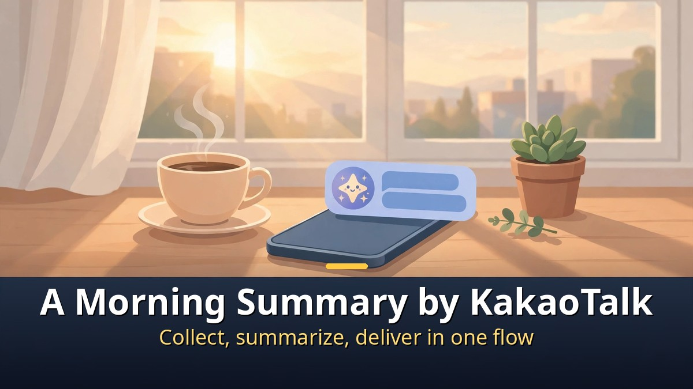

<!-- 본문 시작 -->

Claude Projects have been completely rebuilt.
They are no longer a folder for storing files, but a conversation that splits work and carries it through.
Add a desktop app that can see your screen, and the summary the AI prepares can arrive in your own KakaoTalk self-chat.
Here is what changed, and how the KakaoTalk flow works.

> **Key takeaway**
>
> The new Claude Projects work as **one conversation that divides a job and runs several threads at once**.
> Set the instructions and materials once, and you stop repeating the same explanation every time.
> When the desktop app sees your screen and opens KakaoTalk itself, collection, summary, and self-chat delivery run as a single flow.

---

## What actually changed in the new Projects?

The simplest way to describe it is this: the folder became a conversation.

Old Projects worked like a binder.
You uploaded files, then opened chats one by one inside it.
Background explanations often had to be repeated in each new chat.

New Projects work differently.
You state a goal, a coordinator splits it up, and threads run in parallel.
Each thread continues in the cloud, so work does not stop when you close your laptop.
Finished materials gather in a Library, and every thread can read them.

The redesign was announced on September 17, 2026.
On October 14, 2026, Anthropic's help page added that migration of existing Projects had started for some Pro and Max users.
It has not reached every account yet, so if the new version is not visible, it is likely still rolling out.

| | Old Projects | New Projects |
|---|---|---|
| Shape | A folder for stored files | One conversation that divides work |
| How work runs | You open chats one by one | A coordinator runs threads in parallel |
| Continuity | Closing a chat easily breaks the flow | Cloud threads keep going after you step away |
| Materials | Referenced separately per chat | Shared from a Library across threads |

One caution matters.
The more threads you open, the faster usage limits can run out.
Start small, check the result, and only then add more threads.

## How do you set up a Project?

The setup comes down to four steps.

First, open Projects in the left menu and create a new one.
You will see fields for a name and a goal, but the goal field works more like a memo for later.
Rules you truly want enforced belong in the instructions, not the goal field.

Second, save the instructions.
Paste in the sentences you repeat every time: report format, tone, and items that must always be included.

Third, upload materials.
Add a previously approved finished version, a terminology guide, or reference documents as context.
You can confirm the upload worked when the context line shows the file count.

Fourth, open a new chat inside the Project.
Every new chat in that Project starts with the instructions and materials already loaded.
So your question can focus on what changed this time and what needs a decision.

One point is easy to get wrong.
Chats inside the same Project do not share their conversation history.
Anything the next chat will need must be uploaded as context.

Free accounts can also use Projects, with a guide-based limit of up to five Projects.
The new-version rollout and exact limits can differ by account, so check what your own screen shows.

## What does it mean for the AI to send a KakaoTalk?

KakaoTalk delivery rests on one premise: the desktop app sees your screen and operates it directly.

The demo's principle is one job, one room.
You create a Project, put the goal and materials in it, and the job inside that room is set.
Then the Claude desktop app looks at your screen, opens KakaoTalk, and puts the text into your self-chat.
One word, send, and the message goes out.

When the flow is complete, a day's work runs as one line.
Claude organizes the materials and leaves the summary in your self-chat.
Open KakaoTalk in the morning, and the organized summary is already there. That is the scene the title describes.

The scope must be stated exactly.
The demo was done only to the self-chat, with a caution note to that effect.
It must not be read as sending messages to other people.
Because the premise is screen viewing, personal or work materials visible on screen can be exposed as well.
Check the content before sending, and test with a small, unimportant message before anything important.
This section summarizes the demo scope confirmed from the video description, not the author's own hands-on experience.

The point of KakaoTalk delivery is less about the technology and more about the flow.
Collection, summary, and delivery stop being three separate chores and become one Project.
Once that flow is in place, the repeated morning summary takes less of your hands.

---

The rule for using the new Projects is simple.
Move repeated explanations into a Project, start threads small, and check results in the Library.
Treat screen-operating features like KakaoTalk delivery as convenient, but confirm screen exposure and the recipient before using them.
With that order kept, the new Projects are easy to try without much risk.

## Frequently asked questions

**Has the new version reached every account?**
No.
As of October 14, 2026, migration had started for some Pro and Max users.
If the new version is not visible, it is likely still rolling out.

**What happens to materials in old Projects?**
According to the migration notice, existing Projects change shape into the new form.
Backing up important materials before the switch is the safe move.

**Can free accounts create Projects?**
Yes, with a guide-based limit of up to five Projects.
The new-version rollout and limits can differ by account.

**How does KakaoTalk delivery work?**
The desktop app sees the screen and opens KakaoTalk directly.
It puts the text into the self-chat and sends it on a single send command, and the demo's scope is the self-chat only.
It must not be read as sending messages to other people.

**How is a Project different from memory?**
Memory carries user context like preferred tone across chats.
A Project is a workspace with clear boundaries for a specific job or set of materials.
Keeping the two apart avoids confusion.

## Recommended reads

[A Robot Butler That Fears Water?｜Inside the $20,000 Voxel — a refundable $200 deposit, a roughly $20,000 price, and a 2028 US delivery date](https://aitechnotesen.blogspot.com/2026/10/a-robot-butler-that-fears-waterinside.html)
[A reason to leave your mouse on the desk — the see-through Lenovo 900 wireless mouse — a clear shell over a mirror-like inner body](https://aitechnotesen.blogspot.com/2026/10/a-reason-to-leave-your-mouse-on-desk.html)
[Cassandra｜The House AI That Woke Up After 50 Years — Germany's oldest smart home wakes up with an AI housekeeper](https://aitechnotesen.blogspot.com/2026/10/cassandrathe-house-ai-that-woke-up.html)

<!-- 본문 끝 -->

## 작업용 출처·이미지 정보 (업로드 제외)

- 자료 출처: 오후다섯씨 '완전히 새로 바뀐 클로드 프로젝트 사용법, 드디어 AI가 카톡을 보냈다' (2026-10-27) / 웹 리서치 / 자막 패널 확인 범위 기준 대조 (전문 복사는 저작권 제한으로 미확보, 브라우저 요약으로 방향 대조)
- 이미지: images/01-hero-en.jpg ~ 04-img3-en.jpg / 직접 제작 (AI 생성 + 영어 오버레이) / 사용권: 자작
