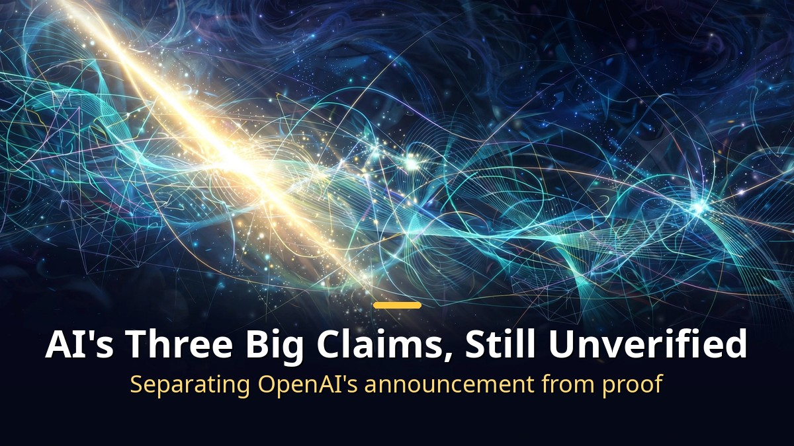
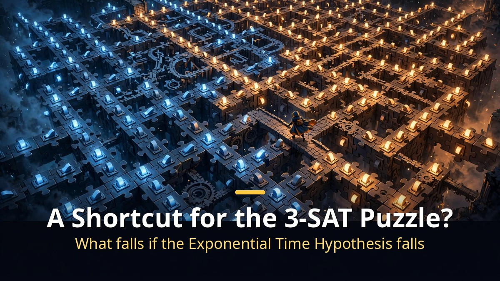
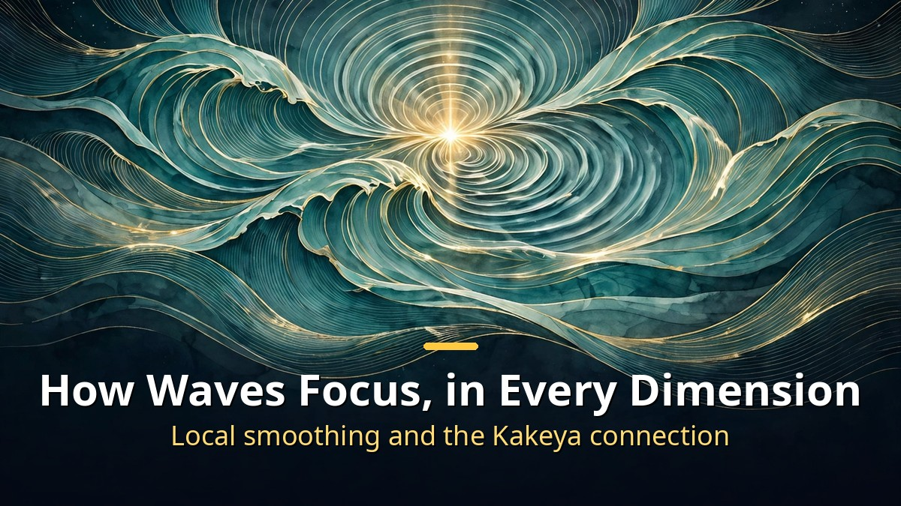
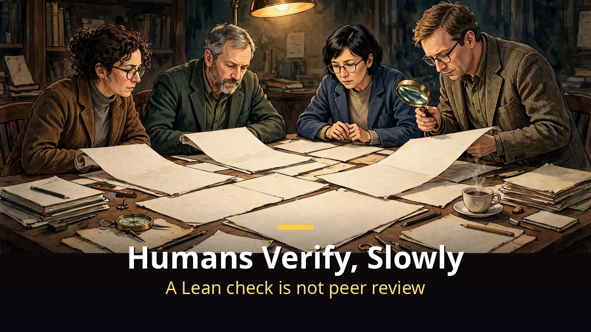

<!-- 본문 시작 -->

On October 26, 2026, OpenAI announced that its AI models had produced three new results in mathematics, computer science, and physics.
The announcement, titled "Working with academic communities to build scientific understanding," frames the results as raw material to be examined, not finished science.
In mathematics, a proof of the local smoothing conjecture from 1991. In computer science, a refutation of the Exponential Time Hypothesis. In physics, existence proofs for quantum chromodynamics and Yang-Mills theory.
This article separates what was announced from what has been verified.
None of the three results has passed peer review yet, and the physics result has not even been released for outside inspection.

> OpenAI's announcement is the start of verification, not the declaration of discovery. Whether the proofs are correct, whether they target the original problems, and what they mean in practice are now questions for the academic community.

## If the Exponential Time Hypothesis Falls, What Changes?

If the Exponential Time Hypothesis falls, a long-standing belief about the limits of computer speed is shaken.
The hypothesis, proposed in 1999 by Russell Impagliazzo and Ramamohan Paturi and others, says that 3-SAT, a classic puzzle, cannot be solved much faster than by trying nearly every possible answer.
3-SAT asks whether a set of true-or-false conditions can all be satisfied at once.
Hundreds of papers have used the hypothesis as a premise, in the form of "if this hypothesis holds, this task cannot be solved faster than this."

According to OpenAI, its model wrote the refutation on October 16, 2026, and formalized it in the Lean proof assistant the next day.
The core is a deterministic algorithm that counts satisfying assignments of fixed-width logical formulas in subexponential time.
If the algorithm is correct, 3-SAT can be solved faster than the hypothesis allowed.

OpenAI itself draws a line here, saying that turning the theory into practical speedups will require significant further research.
**A loosened theoretical limit is not the same thing as a faster computer on your desk.**
Verification is led by an outside expert group headed by Impagliazzo, Paturi, and Ryan Williams of MIT.
In an open letter, they stressed that their involvement is not an endorsement of the claim.

## A Law of Focusing Waves, Proved in Every Dimension?

The mathematics result concerns the local smoothing conjecture, which describes how waves concentrate over time.
Christopher Sogge proposed it in 1991, and it has resisted proof for decades.
OpenAI says its model obtained a proof in every dimension on October 18, 2026, and formalized it in Lean the following day.
If the proof holds, the company says, it also settles the Kakeya conjecture and Stein's restriction conjecture in all dimensions.

The Kakeya conjecture concerns the size of the shape traced by a needle rotated in every direction.
Human mathematicians had proved local smoothing only in two dimensions in 2019, and the Kakeya conjecture only in three dimensions in 2025.
So a proof in every dimension would clear, in one stroke, walls that stood for decades.

But the mathematics result has not passed peer review either.
OpenAI posted the paper and the Lean proof in a public repository and left researchers to organize their own efforts to explain it.
**A proof passing a proof checker is not the same as the mathematical community accepting it.**
Lean confirms that a formalized statement closes logically; it does not certify that the statement means the same thing as the original conjecture.

## Why Can't We See the Physics Result Yet?

The physics result is an existence proof: a claim that quantum chromodynamics, the theory of the strong force holding atomic nuclei together, and a unified completion of the Standard Model exist as rigorous mathematics.
It includes, as a subproblem, an existence proof for pure Yang-Mills theory, part of a Clay Mathematics Institute Millennium Prize problem.
One precision matters here. The Clay problem asks for existence and a mass gap; OpenAI's announcement covers the existence part only.

The physics result is handled differently from the other two.
The mathematics and computer science papers and Lean proofs are public, but the physics group asked OpenAI to hold back the AI-produced artifacts.
A group led by Nobel laureate David Gross will write the result up itself.
According to OpenAI, the natural-language Yang-Mills manuscript appeared on September 9, the quantum chromodynamics manuscript on September 18, and Lean formalization was completed on October 16.

This structure means the announcement itself is an experiment in how to release AI-made science.
Mathematics is public with self-organized verification, computer science is public with an outside group attached, and physics is held back for the experts to write up first.
"We do not yet know which of these three approaches will be most useful," OpenAI wrote.
**A new way of working with academia does not lower the standard of verification.**

| Field | OpenAI's claim | Release status | Verification lead |
|---|---|---|---|
| Mathematics | Local smoothing proof, every dimension | Paper and Lean proof public | Researchers self-organizing |
| Computer science | Exponential Time Hypothesis refuted | Paper and Lean proof public | Impagliazzo, Paturi, Williams group |
| Physics | QCD and Yang-Mills existence proofs | Artifacts held back, group writing it up | Gross group |

Read this table with one fact in mind.
All three results remain at the stage of company claims; none has completed independent verification.
The physics result in particular cannot be examined from outside at all, so for now it rests on OpenAI's description alone.
The dates and figures cited here come from OpenAI's announcement and news reports of it; the author has not personally checked the proofs.

The genuinely interesting part of this announcement is not three hard problems, but the first large-scale case of how academia receives results produced by AI.
Until now, AI in science mostly played a supporting role: summarizing papers or analyzing data.
This time AI wrote the proofs themselves, and a structure now exists for human experts to explain and check them.
If that structure works, future AI research results will be judged not by "should we believe it" but by "how do we verify it."

My honest first reaction to this announcement was closer to caution than excitement.
"A discovery nobody thought was possible" is a stirring phrase, but in science such phrases only gain meaning after verification is done.
One thing is already clear, though. The fact that AI now writes mathematical proofs has changed the landscape, whatever the verdict on these particular proofs turns out to be.
What remains is the slow, unglamorous work of telling what is real in that landscape.
Skipping that work and shouting the conclusion first is exactly what to avoid.

## Frequently Asked Questions

**Does refuting the Exponential Time Hypothesis solve P vs. NP?**
No. The Exponential Time Hypothesis is a stronger assumption than P vs. NP, and refuting it does not mean P equals NP. OpenAI's claim is an algorithm that solves 3-SAT in subexponential time, not a polynomial-time solution.

**If a Lean proof passes, is the proof correct?**
It means the formalized statement closes under logical rules. Whether that statement means the same as the original conjecture, and whether any assumption is missing, still needs human checking. That is why outside expert groups are reviewing the work.

**Will my computer or phone get faster?**
Not now. OpenAI says turning this into faster real-world tools will require significant further research. A theoretical limit loosened is a long way from a practical algorithm.

**When can we see the physics result?**
Undecided. The Gross group plans to write it up as a paper itself before release, so the timing depends on that group's work. Until then, there is no material outside OpenAI's description to check.

**Can humans understand proofs written by AI?**
That is the verification groups' current task. Machine-generated proofs can be long and hard to read, so explaining them takes time. OpenAI says it will publish all raw data to help that process.

## Further Reading

[A Robot Butler That Fears Water?｜Inside the $20,000 Voxel — a refundable $200 deposit, a roughly $20,000 price, and a 2028 US delivery date](https://aitechnotesen.blogspot.com/2026/10/a-robot-butler-that-fears-waterinside.html)
[A reason to leave your mouse on the desk — the see-through Lenovo 900 wireless mouse — a clear shell over a mirror-like inner body](https://aitechnotesen.blogspot.com/2026/10/a-reason-to-leave-your-mouse-on-desk.html)
[Cassandra｜The House AI That Woke Up After 50 Years — Germany's oldest smart home wakes up with an AI housekeeper](https://aitechnotesen.blogspot.com/2026/10/cassandrathe-house-ai-that-woke-up.html)

<!-- 본문 끝 -->

## 작업용 출처·이미지 정보 (업로드 제외)

- 자료 출처: TheAIGRID 'OpenAI Just Made a Discovery Nobody Thought Was Possible' (2026-10-27) / 웹 리서치 / 자막 패널 확인 범위 기준 대조 (전문 복사는 저작권 제한으로 미확보, 브라우저 요약으로 방향 대조)
- 이미지: images/01-hero-en.jpg ~ 04-img3-en.jpg / 직접 제작 (AI 생성 + 영어 오버레이) / 사용권: 자작
