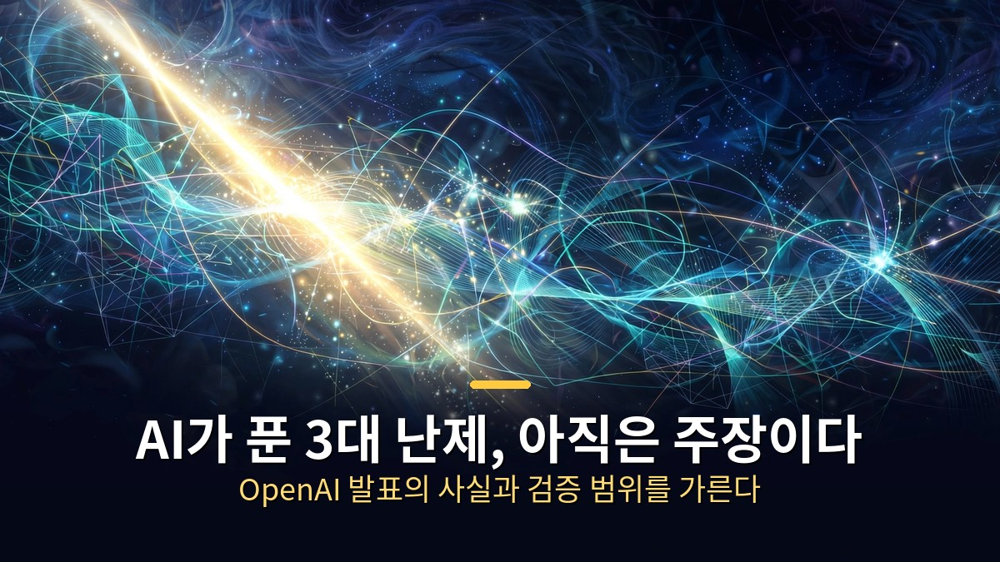
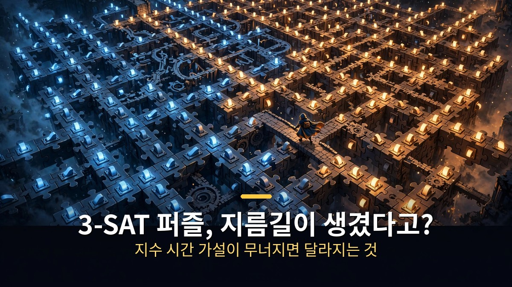
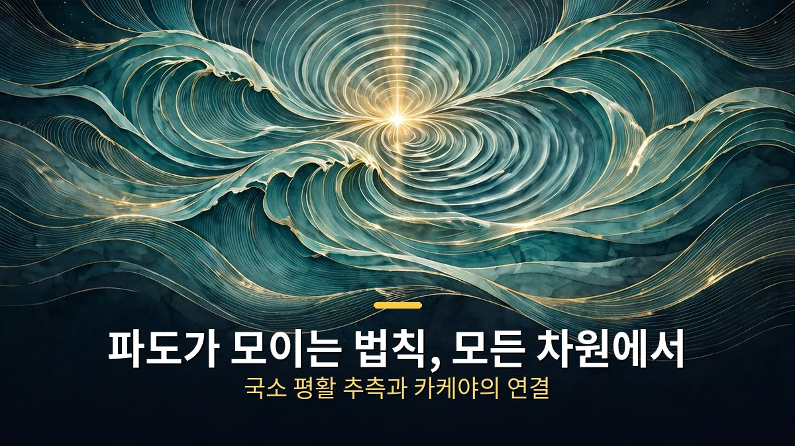
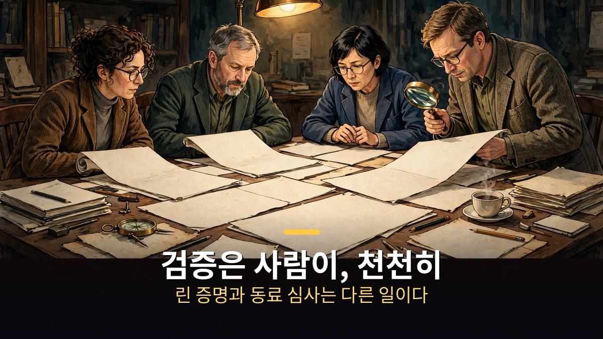

<!-- 본문 시작 -->

OpenAI가 2026년 10월 26일, 자사 AI 모델이 수학·컴퓨터과학·물리학에서 세 가지 새로운 결과를 냈다고 발표했다.
발표 제목은 "학계와 함께 과학적 이해를 쌓아가기"로, 회사는 이 결과들을 완성된 과학이 아니라 검증받아야 할 원자료로 부른다.
수학에서는 1991년 제기된 국소 평활 추측의 증명, 컴퓨터과학에서는 지수 시간 가설의 반박, 물리학에서는 양자색역학과 양-밀스 이론의 존재 증명이다.
이 글은 발표 내용과 검증 범위를 가르는 데 초점을 맞춘다.
아직 어느 결과도 동료 심사를 통과하지 않았고, 물리학 결과는 원자료 자체가 공개되지 않았다는 점을 먼저 밝혀둔다.

> OpenAI의 발표는 발견의 선언이 아니라 검증의 시작이다. 증명이 맞는지, 증명이 원래 문제를 제대로 겨냥했는지, 실생활에 어떤 의미가 있는지는 이제부터 학계가 따질 일이다.

## 지수 시간 가설이 무너지면, 무엇이 달라지나?

지수 시간 가설이 무너지면 컴퓨터의 속도 한계에 대한 오랜 믿음이 흔들린다.
이 가설은 1999년 러셀 임팔리아초와 라모한 파투리 등이 제안한 것으로, 3-SAT이라는 고전 퍼즐을 푸는 데는 경우의 수를 거의 다 뒤져보는 수준의 시간이 필요하다고 본다.
3-SAT은 참·거짓 조건들을 모두 만족시키는 조합이 있는지를 묻는 문제다.
수백 편의 논문이 "이 가설이 참이라면 이 작업은 이보다 빨리 풀 수 없다"는 식으로 이 가설을 전제로 삼아 왔다.

OpenAI에 따르면 자사 모델은 2026년 10월 16일 이 가설의 반박을 써냈고, 다음 날 증명 검사기 린(Lean)으로 형식화했다.
핵심은 고정된 너비의 논리식을 만족시키는 경우의 수를 지수 시간보다 느리게 세는 결정적 알고리즘이다.
이 알고리즘이 맞다면 3-SAT은 가설이 허용한 것보다 빠른 시간 안에 풀 수 있게 된다.

다만 OpenAI 스스로도 실제 속도 향상으로 이어지려면 상당한 추가 연구가 필요하다고 선을 그었다.
**이론의 한계가 느슨해졌다는 것과 내 컴퓨터가 빨라진다는 것은 전혀 다른 이야기다.**
검증은 가설을 처음 제안한 임팔리아초와 파투리, 매사추세츠공대 라이언 윌리엄스가 이끄는 외부 전문가 그룹이 맡는다.
이들은 참여가 곧 보증이 아니라고 공개 서한에서 못 박았다.

## 파도가 모이는 법칙, 모든 차원에서 풀렸나?

수학 결과는 파도가 시간에 따라 어떻게 모이는지를 다루는 국소 평활 추측이다.
이 추측은 1991년 크리스토퍼 소지가 제기했고, 파동의 집중 현상을 수학적으로 설명하는 문제다.
OpenAI는 자사 모델이 2026년 10월 18일 모든 차원에서 이 추측의 증명을 얻었고, 다음 날 린으로 형식화했다고 밝혔다.
이 증명이 맞다면 카케야 추측과 스타인 제한 추측도 모든 차원에서 함께 해결된다고 회사는 설명한다.

카케야 추측은 바늘을 모든 방향으로 돌릴 때 바늘이 그리는 도형의 크기에 관한 문제다.
인간 수학자는 2019년에 2차원에서 국소 평활을, 2025년에 3차원에서 카케야 추측을 증명하는 데 그쳤다.
그래서 "모든 차원"이라는 주장이 사실이라면, 수십 년간 막혀 있던 벽을 한 번에 넘은 셈이다.

그러나 수학 결과 역시 아직 동료 심사를 거치지 않았다.
OpenAI는 수학 논문과 린 증명을 공개 저장소에 올렸고, 연구자들이 각자 조직해 설명에 나서도록 맡겼다.
**증명 검사기가 통과했다는 사실과 수학계가 증명을 받아들였다는 사실은 구분해야 한다.**
린은 형식화된 문장이 논리적으로 닫혀 있는지를 확인할 뿐, 그 문장이 원래 추측과 같은 뜻인지까지 보증하지 않는다.

## 물리학 결과는 왜 아직 볼 수 없나?

물리학 결과는 존재 증명이다. 원자핵을 묶는 강한 힘을 설명하는 양자색역학과, 표준모형을 아우르는 통일 이론이 수학적으로 존재한다는 주장이다.
여기에는 클레이 수학연구소의 밀레니엄 문제 중 하나인 순수 양-밀스 이론의 존재 증명도 부분 문제로 들어 있다.
다만 이 부분은 정확히 짚어야 한다. 클레이 문제가 요구하는 것은 존재 증명뿐 아니라 질량 간격(mass gap)까지인데, OpenAI의 발표는 존재 부분만을 다룬다.

물리학 결과의 취급은 앞의 두 결과와 다르다.
수학과 컴퓨터과학 결과는 논문과 린 증명이 공개됐지만, 물리학 결과는 외부 전문가 그룹이 원자료 공개를 보류해 달라고 요청했다.
노벨 물리학상 수상자 데이비드 그로스가 이끄는 그룹이 직접 논문으로 정리하겠다는 것이다.
OpenAI에 따르면 양-밀스 존재 증명의 자연어 원고는 9월 9일, 양자색역학 원고는 9월 18일에 나왔고, 린 형식화는 10월 16일에 마쳤다.

이 구조는 발표 방식 자체가 하나의 실험이라는 뜻이다.
수학은 공개 후 각자 검증, 컴퓨터과학은 공개와 함께 외부 그룹 구성, 물리학은 비공개 정리 후 공개라는 세 가지 경로를 동시에 시험한다.
OpenAI는 "어느 방식이 가장 유용한지는 아직 모른다"고 밝혔다.
**학계와 손잡는 방식이 새로워졌다고 해서, 검증의 기준까지 낮아진 것은 아니다.**

| 분야 | OpenAI의 주장 | 공개 상태 | 검증 담당 |
|---|---|---|---|
| 수학 | 국소 평활 추측 증명, 모든 차원 | 논문·린 증명 공개 | 연구자 자율 조직 |
| 컴퓨터과학 | 지수 시간 가설 반박 | 논문·린 증명 공개 | 임팔리아초·파투리·윌리엄스 그룹 |
| 물리학 | 양자색역학·양-밀스 존재 증명 | 원자료 비공개, 그룹이 정리 중 | 그로스 그룹 |

이 표를 읽을 때 한 가지는 분명히 해두자.
세 결과 모두 "AI가 발견했다"는 회사의 주장 단계이며, 어느 하나도 독립 검증이 끝난 사실이 아니다.
특히 물리학 결과는 외부에서 들여다볼 자료 자체가 없어, 지금으로서는 회사의 설명에만 의존한다.
이 글에서 인용하는 수치와 날짜는 모두 OpenAI 발표와 이를 전한 보도에 근거한 것으로, 필자가 직접 증명을 확인한 것은 아니다.

이 발표가 흥미로운 진짜 이유는 난제 세 개가 아니라, AI가 내놓은 결과를 학계가 어떻게 받아들일지를 보여주는 첫 사례라는 점이다.
그동안 AI의 과학 활용은 논문 요약이나 데이터 분석 같은 보조 역할에 머물렀다.
이번에는 AI가 증명 자체를 써냈고, 그 증명을 인간 전문가가 설명하고 검증하는 구조가 만들어졌다.
그 구조가 제대로 작동하면, 앞으로 AI의 연구 결과는 "믿을 것인가"가 아니라 "어떻게 검증할 것인가"의 문제로 넘어간다.

솔직히 말하면, 이 발표를 처음 접했을 때 든 생각은 기대보다 경계에 가까웠다.
"아무도 불가능하다고 본 발견"이라는 말은 자극적이지만, 과학에서 자극적인 말은 검증이 끝난 뒤에야 의미가 생긴다.
그래도 한 가지는 분명하다. AI가 수학 증명을 써내는 시대가 왔다는 사실 자체는, 증명의 옳고 그름과 별개로 이미 풍경을 바꿨다.
이제 남은 일은 그 풍경 속에서 무엇이 진짜인지를 가려내는, 느리고 지루한 검증이다.
그 지루함을 건너뛰고 결론부터 외치는 일만은 피하고 싶다.

## 자주 묻는 질문

**지수 시간 가설이 거짓이면 P 대 NP 문제도 풀린 건가요?**
아니다. 지수 시간 가설은 P 대 NP보다 강한 가정에 가깝고, 이 가설의 반박이 P=NP를 뜻하지는 않는다. OpenAI의 주장도 3-SAT을 지수 시간보다 느리게 푸는 알고리즘이 존재한다는 것이지, 다항 시간 해법을 찾았다는 것이 아니다.

**린(Lean) 증명이 통과하면 증명이 맞는 건가요?**
형식화된 문장이 논리 규칙에 맞게 닫혀 있다는 뜻이다. 그 문장이 원래 추측과 같은 의미인지, 가정이 빠지지 않았는지는 사람이 따로 확인해야 한다. 그래서 외부 전문가 그룹의 검토가 필요하다.

**내 컴퓨터나 스마트폰이 빨라지나요?**
지금은 아니다. OpenAI도 실제 속도 향상으로 이어지려면 상당한 추가 연구가 필요하다고 밝혔다. 이론적 한계가 느슨해졌을 뿐, 실용 알고리즘으로 바뀌려면 갈 길이 멀다.

**물리학 결과는 언제 볼 수 있나요?**
미정이다. 그로스 그룹이 직접 논문으로 정리한 뒤 공개하겠다는 입장이어서, 시점은 그룹의 작업 속도에 달려 있다. 그전까지는 OpenAI의 설명 외에 확인할 자료가 없다.

**AI가 쓴 증명을 인간이 이해할 수 있나요?**
그것이 지금 검증 그룹의 과제다. 증명이 길고 기계적으로 생성됐을 수 있어, 사람이 읽고 설명하는 데 시간이 걸린다. OpenAI는 원자료를 모두 공개해 이 과정을 돕겠다고 밝혔다.

## 함께 읽으면 좋은 글

[어도비 7종 무료로 다시 만든 AI｜포토크래프트와 REA의 충격 — 어도비 7종을 AI로 무료 복제한 사례와 저작권 논쟁](https://aitechnoteskr.tistory.com/43)
[마우스를 책상 위에 올려두는 이유 — 속이 보이는 Lenovo 900 투명 무선 마우스 — 투명 껍질 속 거울 같은 속살이 책상 위 물건이 된 이유](https://aitechnoteskr.tistory.com/45)
[카산드라｜이사 온 집의 AI가 50년 만에 깨어났다 — 독일 최古 스마트홈에 깨어난 AI 집사의 스릴러](https://aitechnoteskr.tistory.com/46)

<!-- 본문 끝 -->

## 작업용 출처·이미지 정보 (업로드 제외)

- 자료 출처: TheAIGRID 'OpenAI Just Made a Discovery Nobody Thought Was Possible' (2026-10-27) / 웹 리서치 / 자막 패널 확인 범위 기준 대조 (전문 복사는 저작권 제한으로 미확보, 브라우저 요약으로 방향 대조)
- 이미지: images/01-hero.jpg ~ 04-img3.jpg / 직접 제작 (AI 생성 + 한글 오버레이) / 사용권: 자작
