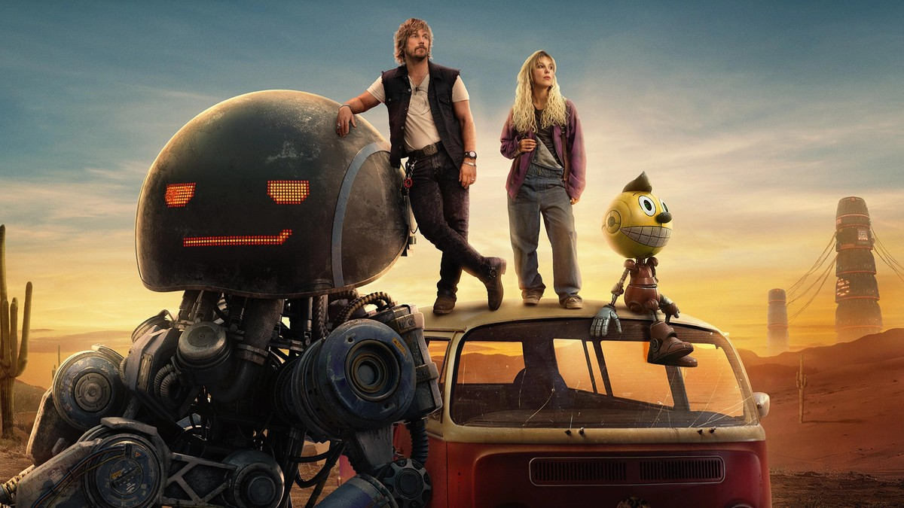
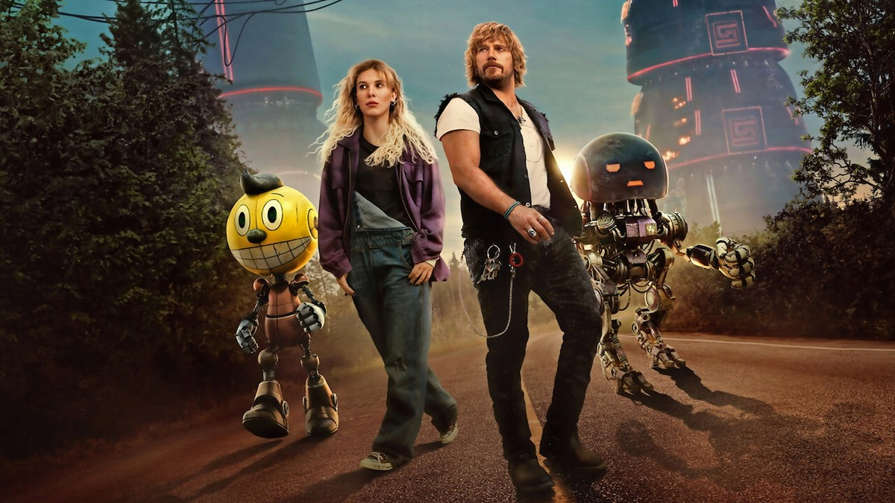
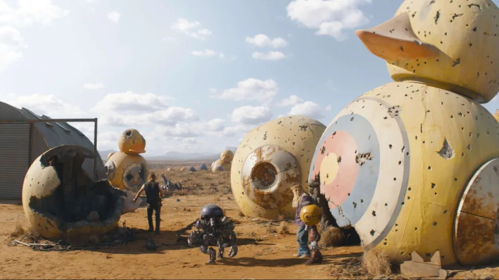
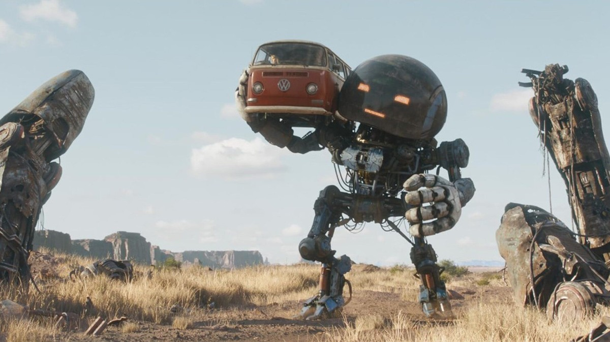
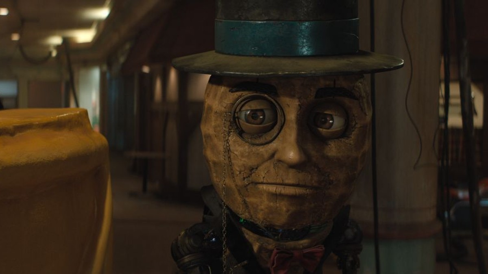

<!-- 본문 시작 -->

A girl and a smuggler standing on a van in the desert, flanked by two robots. This single image sums up the whole film (Image: TMDB)

In an alternate 1990s America, robots once lived among people, then were banished to the desert after a war.
In that world, a girl sets out with one small robot to find her brother.
This is an introduction to the Netflix film 'The Electric State'.

| Item | Details |
|---|---|
| Title | The Electric State |
| Released | March 14, 2025, on Netflix |
| Based on | The 2018 illustrated novel by Simon Stålenhag |
| Directed by | Anthony Russo, Joe Russo |
| Cast | Millie Bobby Brown (Michelle), Chris Pratt (Keats), Ke Huy Quan (Dr. Amherst), Woody Norman (Christopher), Giancarlo Esposito (Colonel Bradbury), Stanley Tucci (Ethan Skate) |
| Voice cast | Alan Tudyk (Cosmo), Anthony Mackie (Herman), Woody Harrelson (Mr. Peanut), Jenny Slate (Penny Pal), Brian Cox (Popfly) |
| Runtime | 128 minutes (2 hours 8 minutes) |
| Rating | PG-13 (US); 15+ in Korea |
| Score | TMDB 6.5/10 (checked on the TMDB page on October 28, 2026, from 1,868 ratings) |
| Where to watch | Netflix |

## What Is the Story?

Keats and Michelle standing on a van, with Herman and Cosmo beside them. The road-trip companions are the heart of the film (Image: TMDB)

The setting is a slightly different version of 1990s America.
In this world, robots have long been part of everyday life.
Cartoon-mascot-like robots guard shops and help around the house, and nobody finds that strange.

Then robots begin demanding rights of their own, and a war breaks out between humans and robots.
Humans win the war with Neurocaster technology, which lets people remotely pilot robot bodies.
The defeated robots are banished to a desert quarantine area called the Exclusion Zone.

Michelle, an orphan, believes she has lost her younger brother Christopher.
Then one day, a small robot named Cosmo appears before her.
Following the clue that Cosmo is somehow connected to her brother, Michelle heads west with Keats, a smuggler, and his robot partner Herman.
That is the spoiler-free setup. What follows on the road is better discovered firsthand.

> What do humans owe robots that demand rights? The Electric State carries that question inside a 1990s road movie.

## A Journey That Begins with Cosmo

Michelle and the small robot Cosmo. Light shining from Cosmo's body marks their first meeting (Image: press still)

The first scene between Michelle and Cosmo is the smallest scene in the film, and also the most important one.
The story does not begin with a grand war, but with a single small robot appearing before one girl.
Cosmo does not say much, but its very existence is a clue that her brother may still be alive.

Michelle and Keats walking down a road with Cosmo and Herman. The four companions are now on their way (Image: TMDB)

Soon Keats and Herman join the journey.
Keats is a smuggler, and Herman is the large robot at his side.
The moment two humans and two robots become one team, the film widens from a search for family into a story about humans and robots traveling together.
Why that combination feels both awkward and natural becomes clear as their conversations unfold.

## The Land Where Robots Were Banished

Giant duck robots abandoned in the Exclusion Zone. What remains after the war is enormous wreckage (Image: press still)

The Exclusion Zone is the quarantine area where defeated robots live together.
A giant duck-shaped robot, covered in bullet marks and left in the desert, shows that world at a glance.
A mascot robot that once brightened people's days now lies discarded like an abandoned object.
That one image alone explains how this world treated its robots.

Herman lifting a van with ease. Despite his huge frame, his movements are careful (Image: press still)

Herman is the largest robot in the film.
In the scene where he lifts a van effortlessly, his power shows, and in the care with which he uses it, his character shows.
The point of the scene is that power itself is not a threat; what defines a being is how it chooses to use its power.

Herman peeking from behind a crate. His dotted LED face reads like a facial expression (Image: press still)

Herman's face is an LED display made of dots.
With just a few dots for eyes and a mouth, the audience can still tell whether he is smiling or worried.
Building expressions out of light patterns rather than muscles is the most interesting design choice in the film's robots.
The reason emotion still comes across is simple: an expression is a signal, not a muscle.

## Mr. Peanut, the Smiling Robot

A close-up of Mr. Peanut. A peanut-shaped face with a top hat, monocle, and bow tie (Image: press still)

Mr. Peanut is a robot with a peanut-shaped face, a top hat, and a monocle.
At first glance he looks like a toy mascot, but in the Exclusion Zone he carries real weight.
That a robot born as an advertising mascot still wears the same face after war and banishment is something this close-up captures in full.

Mr. Peanut standing in an indoor corridor. Traces of a once-glamorous mascot and traces of time share one face (Image: press still)

Seen from another angle, Mr. Peanut's face is cracked and worn by time.
It is strange that a design once made to make people smile has survived the war unchanged.
The design did not change, but the way humans look at it did.
One of the questions the film asks through its robots sits exactly here.

## The AI Questions This Film Asks

The film uses robots as its subject, but its questions point back at humans.
They boil down to three.

- **Do robots have rights?** Is it just to defeat robots that began asserting themselves and then quarantine them? The film does not settle the question; it asks it again by showing the land of the quarantined robots.
- **Where does consciousness live?** Can a robot that seems connected to her brother be called her brother? Once body and consciousness can be separated by technology, what makes a person a person, the body or the memory?
- **When technology replaces reality:** Are people who live inside the virtual world through Neurocasters escaping reality, or were they left with no choice but to escape? The film draws the moment when convenience becomes isolation as the aftermath of a war.

## Where and How to Watch

The film streams on Netflix.
It was released as a Netflix original worldwide on March 14, 2025, so it is available on Netflix in Korea the same way.
At 128 minutes, it is a comfortable length for a single sitting.

It is worth knowing in advance that reactions are sharply divided.
The TMDB score sits around 6.5/10, and on Rotten Tomatoes the gap between the critics' score and the audience score is wide (14% critics, 67% audience, per 2026 reporting).
Critics tended to fault the adaptation and the story, while audiences tended to praise the robot designs and the world itself.
Viewers expecting a huge blockbuster thrill may come away disappointed, while viewers who enjoy exploring a robot world will find plenty to discuss.

In the end, the question the film leaves behind is simple.
It is not how to treat robots, but what kind of beings humans remain in front of robots.
After a war ends, what remains is not victory or defeat, but how each side remembers the other.
That single question alone is reason enough to take this road trip.

## Frequently Asked Questions

**Do I need to read the original novel to follow the film?**
No. The film can be followed on its own. The novel is an illustrated book that treats the same world in a different register, so reading it after watching the film also works.

**What kind of robot is Cosmo?**
A small robot that comes to find Michelle. It carries the clue that connects to her brother, and the film's journey begins with Cosmo's arrival. Its exact nature is left unspoiled here.

**Is the Neurocaster a real technology?**
It is a fictional device in the film. It is presented as a headset that lets people enter a virtual world and remotely pilot robot bodies. It touches on real research into virtual reality headsets and brain-computer interfaces, but no product exists in the film's exact form.

**Is it suitable for children?**
It is rated PG-13 in the US (15+ in Korea). With war and battle scenes, it fits teenagers and older better than young children.

**Why are the ratings so divided?**
Critics mainly faulted the adaptation and the story, while audiences mainly praised the robot designs and the world. What you expect from the film changes how it feels.

## Further Reading

[Cassandra｜The House AI That Woke Up After 50 Years — Germany's oldest smart home wakes up with an AI housekeeper](https://aitechnotesen.blogspot.com/2026/10/cassandrathe-house-ai-that-woke-up.html)
[A Robot Butler That Fears Water?｜Inside the $20,000 Voxel — a refundable $200 deposit, a roughly $20,000 price, and a 2028 US delivery date](https://aitechnotesen.blogspot.com/2026/10/a-robot-butler-that-fears-waterinside.html)
[A reason to leave your mouse on the desk — the see-through Lenovo 900 wireless mouse — a clear shell over a mirror-like inner body](https://aitechnotesen.blogspot.com/2026/10/a-reason-to-leave-your-mouse-on-desk.html)

<!-- 본문 끝 -->

## 작업용 출처·이미지 정보 (업로드 제외)

- 자료 출처: TMDB 영화 777443 페이지 (2026-10-28 확인) / Collider 등 보도 / 국내 등급·시청처는 공개 정보 기준 확인 (넷플릭스 오리지널 전 세계 공개작)
- 이미지: images/01-hero-en.jpg ~ 09-img7-en.jpg / TMDB 원본 + 보도 스틸, 1200x675 (한국어본과 동일 내용)
