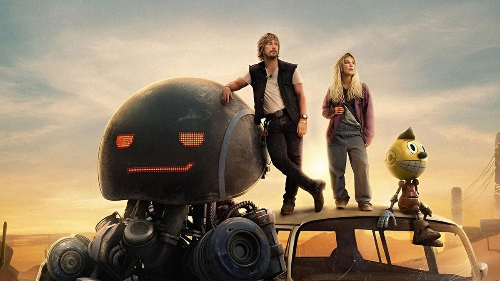
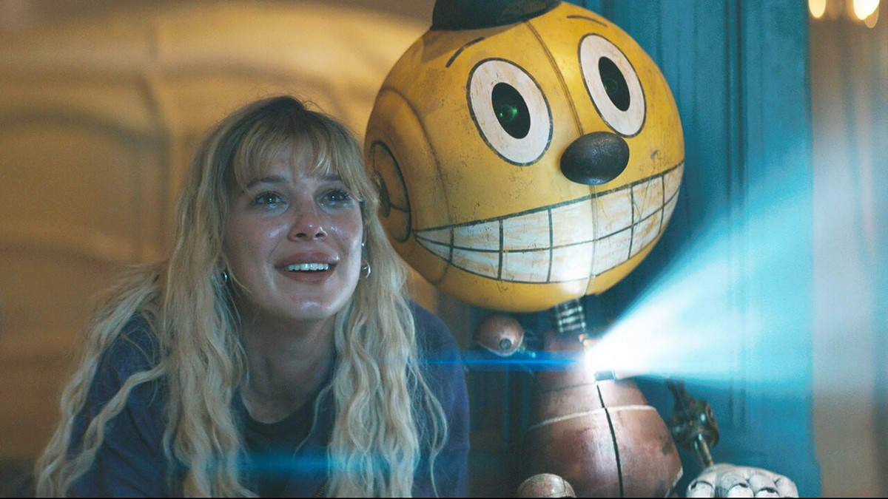
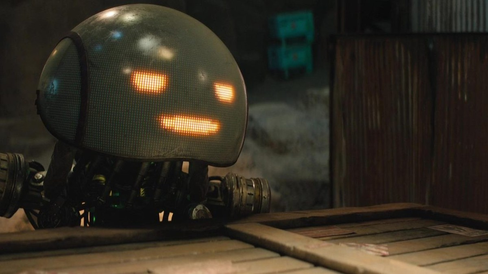
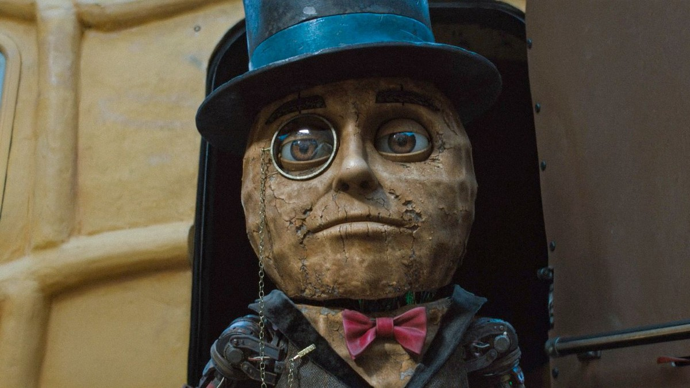

<!-- 본문 시작 -->

사막 위 밴 위에 선 소녀와 밀수업자, 그리고 그 곁의 두 로봇. 이 한 장면이 이 영화의 전부다 (이미지: TMDB)

로봇이 인간의 일상에 스며들었다가, 전쟁 끝에 사막으로 추방된 1990년대 미국.
그 세계에서 한 소녀가 작은 로봇 한 대와 함께 동생을 찾아 길을 떠난다.
넷플릭스 영화 '일렉트릭 스테이트'를 소개한다.

| 항목 | 내용 |
|---|---|
| 제목 | 일렉트릭 스테이트 (The Electric State) |
| 공개 | 2025년 3월 14일, 넷플릭스 |
| 원작 | 시몬 스톨렌하그의 2018년 일러스트 소설 |
| 연출 | 앤서니 루소, 조 루소 |
| 출연 | 밀리 바비 브라운(미셸), 크리스 프랫(키츠), 키 호이 콴(아머스트 박사), 우디 노먼(크리스토퍼), 지안카를로 에스포지토(브래드버리 대령), 스탠리 투치(에단 스케이트) |
| 목소리 출연 | 앨런 투딕(코스모), 앤서니 매키(허먼), 우디 해럴슨(미스터 피넛), 제니 슬레이트(페니 팰), 브라이언 콕스(팝플라이) |
| 러닝타임 | 128분 (2시간 8분) |
| 시청 등급 | 15세 이상 관람가 (미국 PG-13) |
| 평점 | TMDB 6.5/10 (2026-10-28 TMDB 페이지 확인 기준, 1,868개 평가) |
| 볼 수 있는 곳 | 넷플릭스 |

## 어떤 이야기인가요?

밴 위에 선 키츠와 미셸, 그리고 허먼과 코스모. 길 위의 동행이 이 영화의 중심이다 (이미지: TMDB)

이야기의 배경은 우리가 아는 1990년대와 조금 다른 미국이다.
이 세계에서는 로봇이 오래전부터 사람들의 일상 속에 있었다.
마스코트처럼 생긴 로봇이 가게를 지키고, 집안일을 돕는 것이 자연스러운 풍경이었다.

그러다 로봇들이 스스로의 권리를 요구하면서 인간과 로봇 사이에 전쟁이 벌어진다.
인간은 뉴로캐스터라는 신경 연결 기술로 로봇의 몸을 원격 조종하는 방식을 앞세워 전쟁에서 승리한다.
패배한 로봇들은 사막 한가운데의 격리 구역, 익스클루전 존으로 쫓겨난다.

고아가 된 소녀 미셸은 동생 크리스토퍼를 잃었다고 알고 지낸다.
그런데 어느 날 작은 로봇 코스모가 미셸 앞에 나타난다.
코스모가 동생과 연결돼 있다는 단서를 따라, 미셸은 밀수업자 키츠와 그의 로봇 파트너 허먼과 함께 서부로 향한다.
여기까지가 스포일러 없는 줄거리다. 이 뒤의 여정은 직접 확인하는 편이 훨씬 재밌다.

> 로봇이 권리를 요구하면 인간은 어떻게 답해야 하는가. 일렉트릭 스테이트는 이 질문을 1990년대 로드무비에 실어 던진다.

## 코스모와 함께 시작된 여정

미셸과 작은 로봇 코스모. 코스모의 몸에서 나오는 빛이 두 사람의 첫 만남을 비춘다 (이미지: 보도 스틸)

미셸과 코스모의 첫 장면은 이 영화에서 가장 작은 장면이자 가장 중요한 장면이다.
거창한 전쟁 이야기가 아니라, 한 소녀 앞에 나타난 작은 로봇 한 대에서 이야기가 시작된다.
코스모는 말을 많이 하지 않지만, 그 존재 자체가 미셸에게는 동생이 살아 있을지도 모른다는 단서다.

도로를 걷는 미셸과 키츠, 코스모와 허먼. 네 사람의 동행이 본격적으로 시작된다 (이미지: TMDB)

곧 여정에는 키츠와 허먼이 합류한다.
키츠는 물건을 몰래 나르는 밀수업자이고, 허먼은 그의 곁을 지키는 커다란 로봇 파트너다.
사람 두 명과 로봇 두 대가 한 팀이 되는 순간, 영화는 가족 찾기를 넘어 인간과 로봇의 동행 이야기로 넓어진다.
이 동행이 왜 어색하면서도 자연스러운지는, 네 사람의 대화를 따라가다 보면 금방 감이 온다.

## 로봇이 추방된 땅, 익스클루전 존

익스클루전 존에 버려진 거대한 오리 로봇들. 전쟁이 끝난 자리에 남은 것은 거대한 잔해다 (이미지: 보도 스틸)

익스클루전 존은 패배한 로봇들이 모여 사는 격리 구역이다.
거대한 오리 모양 로봇이 총알 자국투성이로 사막에 쓰러져 있는 장면이 그 세계를 한눈에 보여준다.
한때 사람들의 일상을 지키던 마스코트 로봇이, 전쟁이 끝난 뒤에는 버려진 물건처럼 방치돼 있다.
이 장면 하나만으로 이 세계가 로봇을 어떻게 대했는지가 설명된다.

밴을 가볍게 들어 올린 허먼. 커다란 몸집과 달리 움직임은 조심스럽다 (이미지: 보도 스틸)

허먼은 이 영화의 로봇 중에서도 몸집이 가장 크다.
밴 한 대를 가볍게 들어 올리는 장면에서는 로봇의 힘이, 그 힘을 조심스럽게 쓰는 방식에서는 로봇의 성격이 드러난다.
힘이 곧 위협이 아니라, 힘을 어떻게 쓰느냐가 그 존재를 규정한다는 점이 이 장면의 포인트다.

상자 뒤에서 얼굴을 내민 허먼. 점으로 표시되는 LED 얼굴이 표정처럼 읽힌다 (이미지: 보도 스틸)

허먼의 얼굴은 점으로 이루어진 LED 디스플레이다.
눈과 입을 점 몇 개로만 표시하는데도, 장면에 따라 웃는 얼굴인지 걱정하는 얼굴인지가 읽힌다.
표정을 얼굴 근육이 아니라 빛의 패턴으로 만드는 방식이, 이 영화의 로봇 디자인이 가진 가장 흥미로운 선택이다.
사람의 얼굴을 닮지 않았는데도 감정이 전달되는 이유는, 결국 표정이란 근육이 아니라 신호이기 때문이다.

## 웃는 얼굴의 로봇, 미스터 피넛

미스터 피넛의 클로즈업. 땅콩 모양 얼굴에 중절모와 단안경, 나비넥타이를 갖췄다 (이미지: 보도 스틸)

미스터 피넛은 땅콩 모양 얼굴에 중절모와 단안경을 쓴 로봇이다.
처음 보면 장난감 마스코트처럼 보이지만, 익스클루전 존에서는 결코 가볍지 않은 존재감을 가진 인물이다.
광고 마스코트에서 태어난 로봇이 전쟁과 추방을 겪은 뒤 어떤 얼굴을 하고 있는지를, 이 클로즈업 한 장이 고스란히 보여준다.

실내 통로에 선 미스터 피넛. 화려했던 마스코트의 흔적과 세월의 흔적이 한 얼굴에 있다 (이미지: 보도 스틸)

또 다른 각도에서 본 미스터 피넛의 얼굴에는 금이 가고 세월이 묻어 있다.
한때 사람들을 웃게 하던 디자인이, 전쟁을 거치면서도 그대로 남아 있다는 점이 묘하다.
로봇의 겉모습은 바뀌지 않았는데, 그 겉모습을 보는 인간의 마음이 달라졌다는 것.
이 영화가 로봇을 통해 묻는 질문 중 하나가 바로 여기에 있다.

## 이 영화가 던지는 AI 질문

이 영화는 로봇을 소재로 삼지만, 질문의 방향은 인간을 향한다.
정리하면 세 가지다.

- **로봇에게 권리가 있는가**: 스스로를 주장하기 시작한 로봇을 전쟁으로 누르고 격리하는 것이 정당한가. 이 영화는 이 질문에 답을 정해두지 않고, 격리된 로봇들의 땅을 보여주는 방식으로 되묻는다.
- **의식은 어디에 있는가**: 동생과 연결된 듯한 로봇을 동생이라 부를 수 있는가. 몸과 의식이 분리되는 기술이 가능해지면, 사람을 사람으로 만드는 것은 몸인지 기억인지가 문제 된다.
- **기술이 현실을 대신할 때**: 뉴로캐스터에 들어가 가상세계에서 사는 사람들은 현실을 외면한 것인가, 아니면 현실에서 도망칠 수밖에 없었던 것인가. 편리함이 고립이 되는 순간을 이 영화는 전쟁의 뒷모습으로 그린다.

## 어디서, 어떻게 보면 좋을까요?

넷플릭스에서 스트리밍으로 볼 수 있다.
2025년 3월 14일 넷플릭스 오리지널로 전 세계에 공개된 작품이라, 국내 넷플릭스에서도 같은 방식으로 시청할 수 있다.
러닝타임은 128분으로, 한 번에 몰아보기 좋은 분량이다.

다만 평점의 온도 차는 알고 보는 편이 좋다.
TMDB 평점은 6.5/10 수준이고, 로튼토마토에서는 비평가 지수와 관객 지수의 차이가 큰 편으로 소개된다(2026년 보도 기준 비평가 14%, 관객 67%).
비평가는 각색과 서사를, 관객은 로봇 디자인과 볼거리를 각각 다르게 평가한 셈이다.
거대한 블록버스터의 재미를 기대하면 아쉬울 수 있고, 로봇 세계관 자체를 구경하는 재미로 보면 할 말이 많은 작품이다.

결국 이 영화가 남기는 질문은 단순하다.
로봇을 어떻게 대할 것인가가 아니라, 로봇 앞에서 인간이 어떤 존재로 남을 것인가다.
전쟁이 끝난 뒤에도 남는 것은 승패가 아니라, 서로를 어떻게 기억하느냐는 문제다.
그 질문 하나만으로도, 이 로드무비는 볼 만한 이유가 충분하다.

## 자주 묻는 질문

**원작 소설을 읽어야 이해할 수 있나요?**
아니요. 영화만으로 줄거리를 따라가는 데 무리가 없다. 원작은 같은 세계관을 다른 결로 그린 일러스트 소설이라, 영화를 본 뒤 원작을 찾아보는 순서도 가능하다.

**코스모는 어떤 로봇인가요?**
미셸을 찾아온 작은 로봇이다. 동생과 연결돼 있다는 단서를 가진 존재로, 영화의 여정은 코스모의 등장으로부터 시작된다. 자세한 정체는 스포일러라 적지 않는다.

**뉴로캐스터는 실제로 있는 기술인가요?**
영화 속 가상 장치다. 머리에 쓰는 장치로 가상세계에 들어가고 로봇의 몸을 원격 조종한다는 설정인데, 현실의 가상현실 기기나 뇌-컴퓨터 인터페이스 연구와 닿아 있는 지점은 있지만 영화 속 형태 그대로의 제품은 아니다.

**아이와 함께 봐도 되나요?**
15세 이상 관람가(미국 PG-13)다. 전쟁과 전투 장면이 있어 어린아이보다는 청소년 이상과 함께 보는 편이 맞다.

**평점이 갈리는 이유는 뭔가요?**
비평가는 원작 각색과 서사의 아쉬움을, 관객은 로봇 디자인과 세계관의 볼거리를 주로 평가했다. 무엇을 기대하고 보느냐에 따라 체감이 달라지는 작품이다.

## 함께 읽으면 좋은 글

[카산드라｜이사 온 집의 AI가 50년 만에 깨어났다 — 독일 최古 스마트홈에 깨어난 AI 집사의 스릴러](https://aitechnoteskr.tistory.com/46)
[어도비 7종 무료로 다시 만든 AI｜포토크래프트와 REA의 충격 — 어도비 7종을 AI로 무료 복제한 사례와 저작권 논쟁](https://aitechnoteskr.tistory.com/43)
[마우스를 책상 위에 올려두는 이유 — 속이 보이는 Lenovo 900 투명 무선 마우스 — 투명 껍질 속 거울 같은 속살이 책상 위 물건이 된 이유](https://aitechnoteskr.tistory.com/45)

<!-- 본문 끝 -->

## 작업용 출처·이미지 정보 (업로드 제외)

- 자료 출처: TMDB 영화 777443 페이지 (2026-10-28 확인) / Collider 등 보도 / 국내 등급·시청처는 공개 정보 기준 확인 (넷플릭스 오리지널 전 세계 공개작)
- 이미지: images/01-hero.jpg ~ 09-img7.jpg / TMDB 원본 + 보도 스틸, 1200x675 / img7은 1200x502 원본 크롭·확대이나 육안 품질 이상 없음
