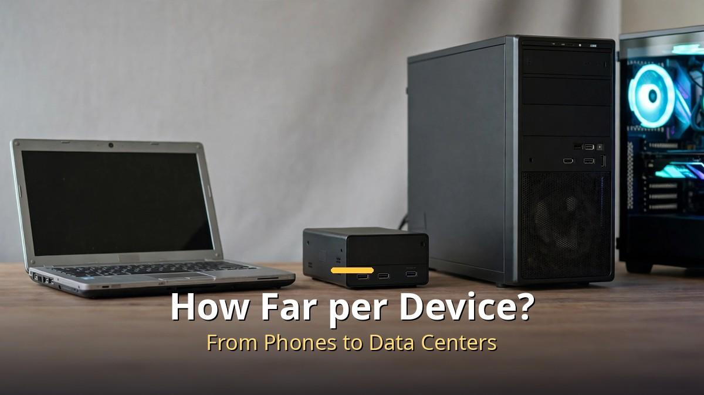
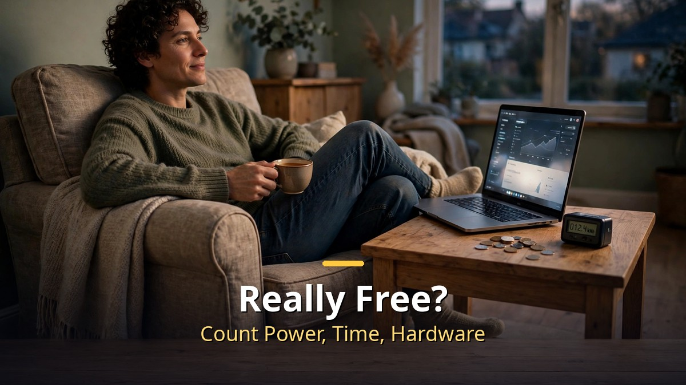

<!-- 본문 시작 -->

Add up ChatGPT, Claude, Gemini, image AI, and voice AI, and subscriptions alone can reach hundreds of thousands of won per month.
That is why people ask: "Can I run AI on my own computer for free?"
The short answer is: almost free, yes — but what each device can do is clearly different.
Today, I put everything from phones to data centers on one map and lay out how far your own machine can go.

> **Key takeaway**
>
> Local AI comes down to a memory battle.
> A model only answers once its whole file sits in the device's memory, so small memory means small models, and big memory means bigger models.
> You also have to count the other costs — electricity, time, and the price of the machine — before deciding whether local AI really saves money.

---

## What is local AI, and why is it a memory battle?

Think of it as delivery food versus home cooking.
Cloud AI is delivery food.
You order and it arrives quickly, but you pay every time, and you hand your data to someone else's kitchen.

Local AI is cooking at home.
You download the model file to your computer and run it on your own machine.
Once downloaded, there is no per-use fee, and your data does not leave your home.

But home cooking still needs a kitchen big enough.
A model is a file made of billions of numbers, and to run it, those numbers must be loaded into memory.
If memory is short, the model may not start at all, or answers may take a long time.

So the first question for local AI is not "which model is best," but "how much memory does my machine have?"
There is also a technique for shrinking models, called quantization, which trims numbers to make files smaller.
That is why even a laptop can run models with billions of parameters — though trimming can cost some accuracy.

## How far can each device go?

Here are five tiers in one line.
The further down you go, the bigger and more expensive the model you can run; the further up, the lighter and cheaper.

| Device | Feel | Good for |
|---|---|---|
| Phone · Raspberry Pi | Lightest | Short summaries, simple Q&A |
| Old laptop (e.g., M1, 8GB) | The tested baseline | Dictation, voice, writing, drawing |
| Mac Mini (16–64GB) | A step up on the desk | Bigger models, longer writing |
| Mac Studio · DGX Spark (128–512GB) | Professional desktops | Coding, long document work |
| Gaming PC | Graphics card as weapon | Image and video work |
| Data center | A different kitchen altogether | Practically unlimited scale |

The old laptop baseline stands out.
Even an older MacBook (M1, 8GB of memory) was tested hands-on for dictation, voice, writing, and drawing.
But the results varied by job.
Dictation was fast and accurate, while voice was slow and nearly used up the memory; a small writing model produced plausible sentences that dropped key points, and a single image took more than 10 minutes.
That it runs at all and that it runs comfortably are two different stories.

The data center is the other end of the comparison.
A facility worth millions of dollars runs at a scale no desk machine can match.
That is why cloud AI is still the biggest brain available.

One more trend to note: machine prices are rising.
"Free" does not mean the machine itself is free.
Starting with the machine you already own costs almost nothing extra, but the math changes the moment you buy a new machine for a bigger model.

## Is it really free? Which device fits me?

Here is the twist.
Local AI has no usage fee, but electricity, time, and the effort of buying and maintaining a machine remain.
Downloading models, tuning settings, and finding out why answers are slow are all your job.
A subscription pays money to hand that hassle over; local AI saves money and takes the hassle on.
Security belongs in the same check.
A local program left wide open or a model file from an unverified source can be risky, so start with widely used tools and verified files.

LM Studio and Ollama are often named as starting tools.
They let you download a model file and use it like a chat window, which lowers the setup barrier a lot.
For a first try, starting with a small model in one of these tools is the right order.

Three criteria pick the right device for you.
First, check your machine's memory and graphics card memory.
Second, narrow the job to one thing. Summary, writing, or drawing each need a different model size.
Third, ask whether slow answers are acceptable. If you need real-time conversation, a small model wins; if you can wait, a bigger model works.

If subscription fees are pushing you toward local AI, the order is this.
Do not buy a machine first. Put a small model on the machine you have, find where it falls short, and then decide the next step.
That one test saves you from buying an expensive machine and regretting it.
And you do not have to pick one side only.
Running everyday repeat jobs locally while leaving demanding writing or video work to a subscription is the realistic mix.
For the first model, pick a small one that stays under half your memory.

## Frequently asked questions

**Does local AI work without the internet?**
Yes, once a model is downloaded. You need the internet for downloading and updating models.

**Will my old laptop work?**
For light jobs, yes. An older laptop has been tested for dictation and writing. Big models or fast answers will hit limits.

**Should I pick LM Studio or Ollama?**
Both make models easy to run. LM Studio suits you if you prefer clicking in a window; Ollama is a good start if you are comfortable with commands.

## Further reading

[OpenAI Says AI Solved Three Hard Problems — But So Far, They Are Claims, Not Verdicts — the verification scope sorted by Lean proofs and peer review](https://aitechnotesen.blogspot.com/2026/10/openai-says-ai-solved-three-hard.html)
[The Electric State｜A Girl, a Robot, and a Road Trip Across 1990s America to Find Her Brother — TMDB 6.5, Rotten Tomatoes critics 14% versus audience 67%](https://aitechnotesen.blogspot.com/2026/10/the-electric-statea-girl-robot-and-road.html)
[Cassandra｜An AI Housekeeper Wakes Up After 50 Years — Rotten Tomatoes critics 100%, audience 71%, a German smart-home thriller](https://aitechnotesen.blogspot.com/2026/10/cassandrathe-house-ai-that-woke-up.html)

<!-- 본문 끝 -->

## 작업용 출처·이미지 정보 (업로드 제외)

- 자료 출처: honjobs '내 컴퓨터로 AI 공짜로 돌리면 어디까지 될까? | 9분만에 모든 로컬 AI 비교분석' (2026-10-28 업로드 확인, 스크립트 패널 0:00~8:57 전 구간 확인 기준 요약) / 웹 리서치 없음
- 이미지: images/01-hero-en.jpg ~ 04-img3-en.jpg / 직접 제작 (AI 생성 + 영어 오버레이) / 사용권: 자작
