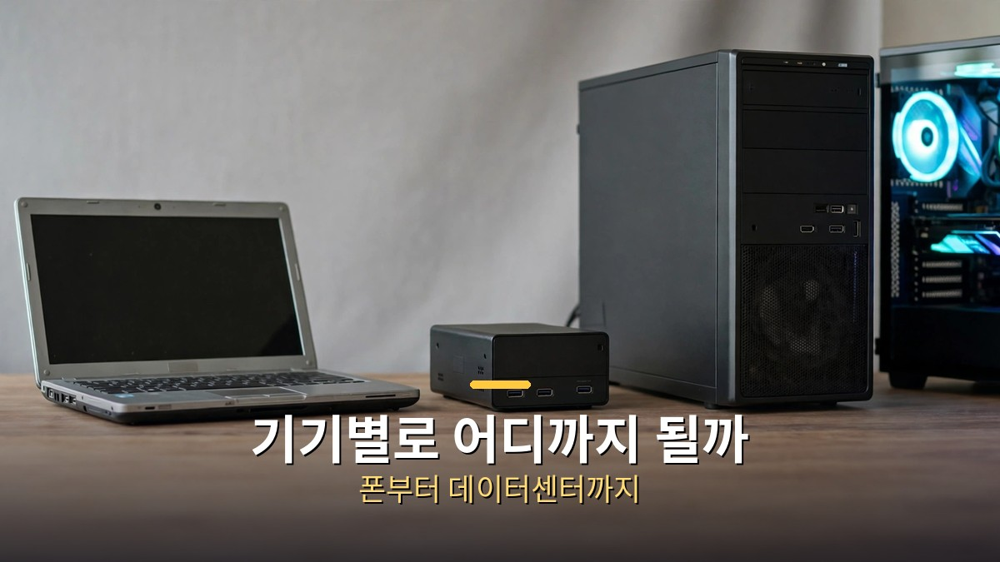

<!-- 본문 시작 -->

챗GPT, 클로드, 제미나이, 그림 AI, 음성 AI까지 구독료를 합치면 한 달에 수십만 원이 된다.
그래서 나온 말이 "내 컴퓨터로 AI를 공짜로 돌리면 안 될까"다.
결론부터 말하면, 공짜에 가깝게 돌리는 것은 가능하지만, 기기마다 할 수 있는 일이 분명히 다르다.
오늘은 휴대폰부터 데이터센터까지 한 지도에 놓고, 내 기기로 어디까지 되는지 정리한다.

> **핵심 정리**
>
> 로컬 AI는 결국 메모리 싸움이다.
> 모델 전체를 기기의 메모리에 올려야 답이 나오는데, 메모리가 작으면 작은 모델만, 메모리가 크면 큰 모델까지 돌릴 수 있다.
> 구독료를 아끼는 대신 전기·시간·기기값이라는 다른 비용이 생긴다는 점까지 따져야, 로컬 AI가 정말로 남는 선택인지 판단할 수 있다.

---

## 로컬 AI가 뭐고, 왜 메모리 싸움이야?

배달 음식과 집밥의 차이로 이해하면 쉽다.
클라우드 AI는 음식을 배달시켜 먹는 방식이다.
주문하면 금방 오지만, 먹을 때마다 돈을 내고, 내 자료를 남의 주방에 맡겨야 한다.

로컬 AI는 집에서 직접 해 먹는 방식이다.
재료(모델 파일)를 내 컴퓨터에 내려받아, 내 기기에서 직접 돌린다.
한 번 받아두면 쓸 때마다 요금이 붙지 않고, 자료가 밖으로 나가지 않는다는 장점이 있다.

단, 집밥에도 부엌 크기가 있다.
모델은 수십억 개의 숫자로 이루어진 파일이고, 실행하려면 그 숫자를 메모리에 올려야 한다.
메모리가 부족하면 모델이 아예 안 뜨거나, 답이 나올 때까지 한참을 기다려야 한다.
그래서 로컬 AI의 첫 질문은 "어떤 모델이 좋은가"가 아니라 "내 기기의 메모리가 얼마나 되는가"다.

모델을 작게 줄이는 기술도 있다.
숫자를 대충 줄여 파일 크기를 낮추는 양자화가 대표적이다.
덕분에 노트북에서도 수십억 단위 모델이 돌아가지만, 줄인 만큼 답의 정확도가 떨어질 수 있다는 점은 함께 기억해야 한다.

## 기기별로 어디까지 될까?

기기 다섯 단계를 한 줄로 정리하면 이렇다.
아래로 갈수록 더 크고 비싼 모델을 돌릴 수 있고, 위로 갈수록 가볍고 저렴하다.

| 기기 | 느낌 | 어울리는 일 |
|---|---|---|
| 휴대폰·라즈베리파이 | 가장 가볍다 | 짧은 요약, 간단한 질의응답 |
| 구형 노트북(예: M1 8GB) | 직접 돌려본 기준점 | 받아쓰기, 음성, 글쓰기, 그림 |
| 맥 미니(16~64GB) | 책상 위의 한 단계 위 | 더 큰 모델, 더 긴 글 |
| 맥 스튜디오·DGX 스파크(128~512GB) | 전문가용 데스크톱 | 코딩, 긴 문서 작업 |
| 게이밍 PC | 그래픽카드가 무기 | 그림·영상 관련 작업 |
| 데이터센터 | 주방 자체가 다르다 | 사실상 제한 없는 규모 |

구형 노트북 기준이 눈길을 끈다.
오래된 맥북(M1, 메모리 8GB)에서도 받아쓰기와 음성, 글쓰기, 그림 같은 일을 직접 돌려봤다는 점이다.
다만 결과는 일마다 갈렸다.
받아쓰기는 빠르고 정확했지만, 음성은 느리고 메모리를 거의 다 썼으며, 작은 글쓰기 모델은 그럴듯한 문장 속에 핵심을 빼먹었고, 그림 한 장에는 10분이 넘게 걸렸다.
최신 기기가 아니어도 돌아간다는 사실과, 어디까지 편하게 쓸 수 있는지는 다른 이야기다.

반대로 데이터센터는 비교의 끝점이다.
수백만 달러짜리 설비가 한 번에 돌리는 규모를, 내 책상 위 기기가 따라갈 수는 없다.
클라우드 AI가 여전히 가장 큰 두뇌인 이유가 여기에 있다.

가격 흐름도 한 가지 더 짚어야 한다.
기기 값은 오르는 추세라, "공짜"라는 말이 기기 구매 비용까지 공짜라는 뜻은 아니다.
지금 가진 기기로 시작하면 추가 비용이 거의 없지만, 큰 모델을 위해 새 기기를 사는 순간 계산은 달라진다.

## 정말 공짜인가? 나에게 맞는 기기는?

반전은 여기에 있다.
로컬 AI는 사용료가 없지만, 전기료와 시간, 그리고 기기를 사고 관리하는 수고가 남는다.
모델을 내려받고, 설정을 맞추고, 답이 느릴 때 원인을 찾는 일까지 전부 내 몫이다.
구독은 돈을 내고 번거로움을 넘기는 방식이고, 로컬은 돈을 아끼고 번거로움을 떠안는 방식이다.
보안도 함께 봐야 한다.
설정이 열린 로컬 프로그램이나 출처가 불분명한 모델 파일은 위험할 수 있으니, 널리 쓰이는 도구와 검증된 파일부터 쓰는 것이 안전하다.

시작 도구로는 LM 스튜디오와 올라마가 자주 꼽힌다.
모델 파일을 받아 채팅창처럼 쓰는 방식으로, 설치 장벽을 크게 낮춰준다.
처음이라면 이 도구 중 하나로 작은 모델부터 돌려보는 순서가 맞다.

나에게 맞는 기기를 고르는 기준은 세 가지다.
첫째, 지금 가진 기기의 메모리와 그래픽카드 메모리를 확인한다.
둘째, 하고 싶은 일을 한 가지로 좁힌다. 요약인지, 글쓰기인지, 그림인지에 따라 필요한 모델 크기가 다르다.
셋째, 답이 느려도 괜찮은 일인지 따진다. 실시간 대화가 필요하면 작은 모델이, 기다릴 수 있는 작업이면 큰 모델이 유리하다.

구독료가 부담돼서 로컬 AI를 고민한다면, 순서는 이렇다.
기기부터 사지 말고, 지금 기기에 작은 모델을 올려보고, 부족한 지점이 어디인지 확인한 뒤에 다음 단계를 정한다.
그 한 번의 체험이, 비싼 기기를 샀다가 후회하는 일을 막아준다.
그리고 꼭 둘 중 하나만 고를 필요는 없다.
매일 반복하는 가벼운 일은 로컬로 돌리고, 똑똑함이 필요한 글쓰기나 영상처럼 까다로운 일은 구독으로 섞어 쓰는 것이 현실적인 답이다.
시작 모델은 메모리의 절반을 넘지 않는 작은 것부터 권한다.

## 자주 묻는 질문

**로컬 AI는 인터넷 없이도 되나요?**
모델을 한 번 내려받은 뒤에는 인터넷 없이도 돌릴 수 있다. 다만 모델 다운로드와 업데이트 때는 인터넷이 필요하다.

**내 노트북이 오래됐는데도 될까요?**
가벼운 용도라면 된다. 구형 노트북에서도 받아쓰기·글쓰기 같은 일을 돌린 사례가 있다. 큰 모델이나 빠른 답을 원하면 한계가 생긴다.

**LM 스튜디오와 올라마 중 뭘 골라야 하나요?**
둘 다 모델을 쉽게 돌리는 도구다. 화면에서 클릭하며 쓰고 싶으면 LM 스튜디오, 명령어 방식이 편하면 올라마부터 시작해 보는 편이 무난하다.

## 함께 읽으면 좋은 글

[OpenAI, AI가 푼 3대 난제 발표… 아직은 '주장'이다 — 린 증명과 동료 심사로 가려지는 검증 범위를 정리한 글](https://aitechnoteskr.tistory.com/50)
[일렉트릭 스테이트｜로봇과 함께 동생을 찾아 떠난 소녀의 1990년대 로드무비 — TMDB 6.5, 로튼토마토 비평가 14% 대 관객 67%의 온도차](https://aitechnoteskr.tistory.com/51)
[카산드라｜이사 온 집의 AI가 50년 만에 깨어났다 — 로튼토마토 비평가 100%, 관객 71%의 독일 스마트홈 스릴러](https://aitechnoteskr.tistory.com/46)

<!-- 본문 끝 -->

## 작업용 출처·이미지 정보 (업로드 제외)

- 자료 출처: honjobs '내 컴퓨터로 AI 공짜로 돌리면 어디까지 될까? | 9분만에 모든 로컬 AI 비교분석' (2026-10-28 업로드 확인, 스크립트 패널 0:00~8:57 전 구간 확인 기준 요약) / 웹 리서치 없음
- 이미지: images/01-hero.jpg ~ 04-img3.jpg / 직접 제작 (AI 생성 + 한글 오버레이) / 사용권: 자작
