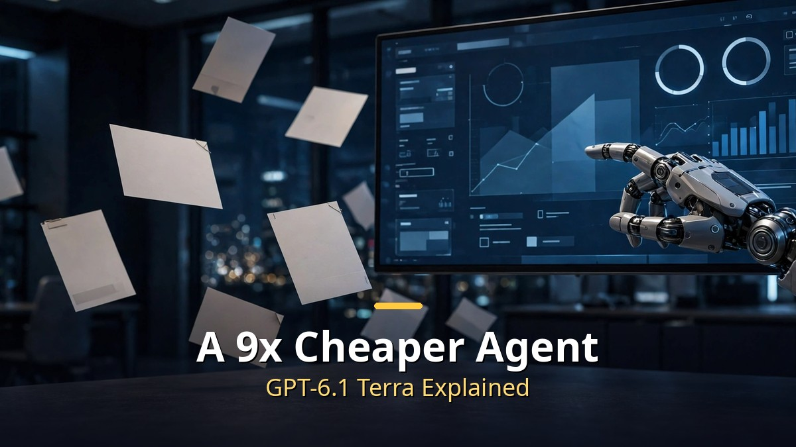
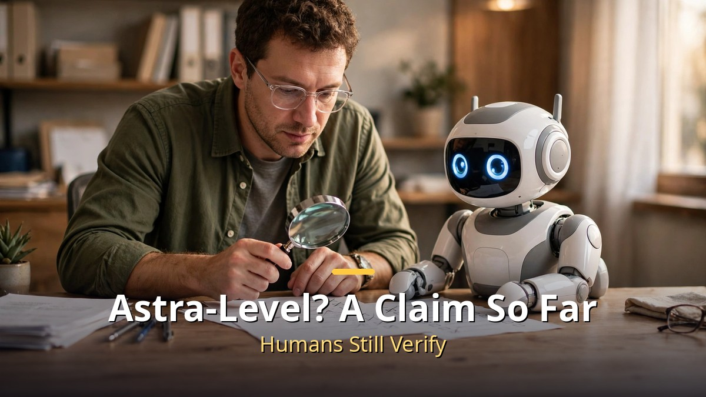

<!-- 본문 시작 -->

On October 26, OpenAI released a new model, GPT-6.1 Terra.
It costs $1 per million input tokens and $5 per million output tokens — about half the price of the higher-tier Sol.
Yet in OpenAI's own evaluation, it scored on par with the flagship Astra.
How far can we trust the claim that cheap does not mean weak?

> **Key takeaway**
>
> Terra is not the smartest model. It is the model for running a lot, cheaply and quickly.
> It is built for computer-use work — seeing screens, clicking, and reading documents — at half the price of Sol, and OpenAI claims about one-ninth the cost per task of Astra.
> But those numbers come from OpenAI's own evaluation, and requests over 272,000 input tokens carry a surcharge.

---

## What kind of model is Terra?

Terra is a computer-use agent model.
It is aimed at reading what is on screen, clicking through desktop programs, filling out forms, turning technical drawings into 3D models, and watching video to create time-coded logs.
It is closer to an employee working at a screen than to a chatbot answering questions.

Developers call it gpt-6.1-terra in the API.
In ChatGPT Work and Codex, it became available to Plus, Pro, Enterprise, and Edu users from October 27.
It replaces the previous model, GPT-5.6 Terra.

Its context window is 1.05 million tokens, with up to 128,000 output tokens.
Its knowledge cutoff is June 1, 2026.
Reasoning effort can be adjusted from none to max, with medium as the default.

## How cheap is it, and where is the catch?

Here is the price list.
Input costs $1 per million tokens, cache reads $0.05, and output $5 per million tokens.
Compared with GPT-5.6 Terra ($2 input, $12 output), input is halved and output is cut by more than half.
Compared with Sol ($2 input, $10 output), it is half the price.

Converted to cost per task, the gap grows.
OpenAI says Terra scores about the same as Astra on an agent evaluation at one-tenth the price per token, for about a ninefold lower cost per task.
At maximum reasoning effort, it also claims more than 3x the token efficiency of Claude Opus 5.5.

| Model | Input (per million tokens) | Output (per million tokens) | Character |
|---|---|---|---|
| GPT-6.1 Terra | $1 | $5 | Computer use and visual work |
| GPT-6.1 Sol | $2 | $10 | Twice Terra's price |
| GPT-5.6 Terra | $2 | $12 | Terra's predecessor |
| Claude Opus 5.5 | $4 | $20 | Higher-tier comparison |

There is a catch.
If one request exceeds 272,000 input tokens, the whole request is billed at 2x input and cache rates and 1.5x output.
For jobs that feed in long documents whole, do not budget from the headline price alone.
Batch and Flex options for offline work are half price — another detail worth remembering.

## Is performance really Astra-level?

OpenAI's headline numbers are threefold.
First, on an agent evaluation, it scores 15 points above its predecessor at medium reasoning effort, at about one-third the cost.
Second, on Terminal-Bench 4.0, it reaches 50.3% at maximum effort, up sharply from its predecessor's 21.5%.
Third, on OSWorld 2.1, a desktop-use evaluation, it beats its predecessor's best score at medium effort while costing less per task.

But all of these numbers are OpenAI's own evaluations.
They are not independent reproductions under the same conditions, so "Astra-level" should be read as OpenAI's claim.
In fact, OpenAI itself recommends Sol or Astra for the hardest coding work.
Terra's true position is not the strongest model, but the model for running high-volume, repetitive work cheaply.

The error-rate improvement is also notable.
On an internal set of prompts designed to induce errors, the error rate at low reasoning effort fell from 53.6% for its predecessor to 16.7%, and reached 4.3% at maximum effort.
Still, that is not 0%.
For work where mistakes are not allowed, like documents and accounting, a human final check must stay in place.

The safety rating deserves attention too.
OpenAI classifies Terra at the Critical threshold for cybersecurity capability and says it applies the same safeguards as its more capable models.
As lower prices let anyone run it at volume, what to assign it and how far to allow it is the user's decision.

The real meaning of a cheap model is simple.
Agent work got cheaper per task — not that the responsibility for verification went away.
Whether to use Terra should be decided not by the price list, but by whether your job tolerates mistakes and whether a person can check it.

## Frequently asked questions

**Can I use Terra in ChatGPT?**
It is available in ChatGPT Work and Codex for Plus, Pro, Enterprise, and Edu users. Developers can call it as gpt-6.1-terra in the API.

**Is it really half the price of Sol?**
By standard pricing, yes: $1 versus $2 for input, $5 versus $10 for output. The surcharge for requests over 272,000 input tokens must be calculated separately.

**What jobs suit it best?**
High-volume, repetitive screen, document, and drawing work fits. For the hardest coding or complex reasoning, OpenAI points users to the higher-tier models.

## Further reading

[OpenAI Says AI Solved Three Hard Problems — But So Far, They Are Claims, Not Verdicts — the verification scope sorted by Lean proofs and peer review](https://aitechnotesen.blogspot.com/2026/10/openai-says-ai-solved-three-hard.html)
[The Electric State｜A Girl, a Robot, and a Road Trip Across 1990s America to Find Her Brother — TMDB 6.5, Rotten Tomatoes critics 14% versus audience 67%](https://aitechnotesen.blogspot.com/2026/10/the-electric-statea-girl-robot-and-road.html)
[Cassandra｜An AI Housekeeper Wakes Up After 50 Years — Rotten Tomatoes critics 100%, audience 71%, a German smart-home thriller](https://aitechnotesen.blogspot.com/2026/10/cassandrathe-house-ai-that-woke-up.html)

<!-- 본문 끝 -->

## 작업용 출처·이미지 정보 (업로드 제외)

- 자료 출처: 성공지식백과 '클로드 오퍼스보다 9배 싼 에이전트 끝판왕 GPT-6.1 테라 출시' (2026-10-27) / OpenAI GPT-6.1 공식 문서·가격표 웹 리서치 (2026-10-29 확인, 성능 수치는 오픈AI 자체 평가로 명시)
- 이미지: images/01-hero-en.jpg ~ 04-img3-en.jpg / 직접 제작 (AI 생성 + 영어 오버레이) / 사용권: 자작
