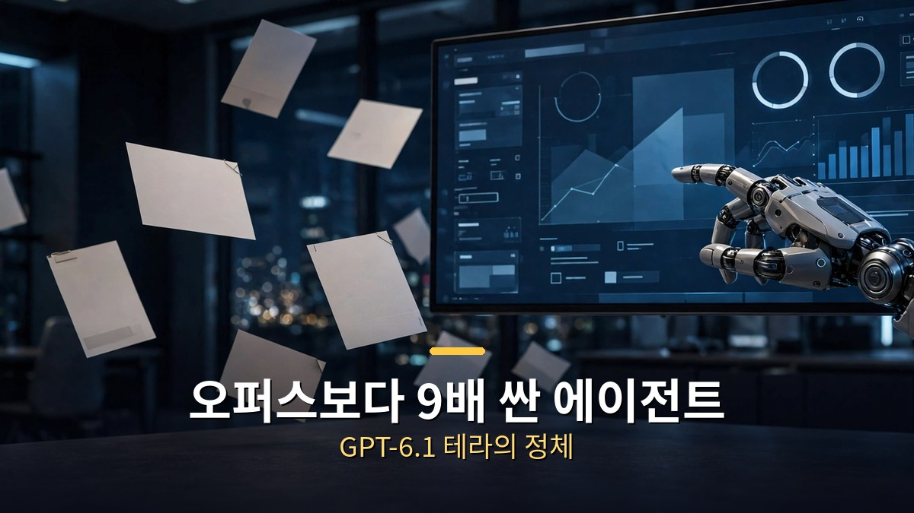
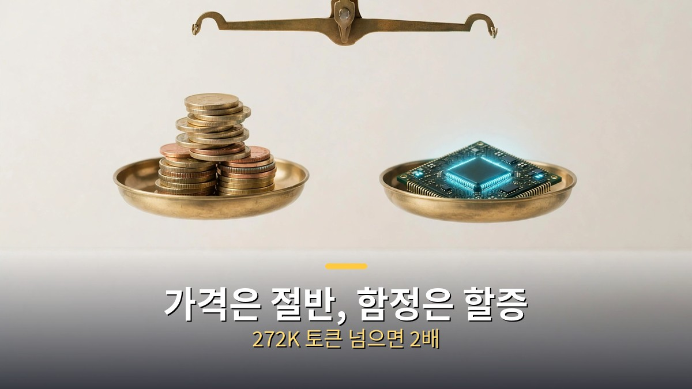

<!-- 본문 시작 -->

오픈AI가 10월 26일에 새 모델 GPT-6.1 테라를 내놨다.
가격은 100만 토큰당 입력 1달러, 출력 5달러로, 상위 모델 솔의 절반 수준이다.
그런데 오픈AI 자체 평가에서는 상위 모델 아스트라와 맞먹는 점수를 냈다고 한다.
싼데 약하지 않다는 말, 어디까지 믿을 수 있을까.

> **핵심 정리**
>
> 테라는 똑똑한 모델이 아니라, 싸고 빠르게 많이 돌리는 모델이다.
> 화면을 보고 클릭하고 서류를 읽는 컴퓨터 사용 업무에 맞춰졌고, 가격은 솔의 절반, 작업당 비용은 아스트라의 9분의 1 수준이라는 게 오픈AI의 주장이다.
> 단, 이 수치들은 오픈AI 자체 평가 기준이고, 27만 2천 토큰을 넘는 요청에는 할증이 붙는다는 조건이 함께 있다.

---

## 테라는 어떤 모델이야?

테라는 컴퓨터 사용 에이전트용 모델이다.
화면에 보이는 것을 읽고, 데스크톱 프로그램을 클릭하고, 서류를 채우고, 기술 도면을 3차원 모형으로 바꾸고, 영상을 보고 시간대별 기록을 만드는 일을 겨냥한다.
말로 답하는 챗봇보다, 화면 앞에서 일하는 직원에 가깝다.

모델 이름은 API에서 gpt-6.1-terra로 부른다.
챗GPT 워크와 코덱스에서는 플러스·프로·기업·교육 사용자부터 10월 27일에 제공되기 시작했다.
이전 모델인 GPT-5.6 테라를 대신하는 자리다.

문맥 길이는 105만 토큰, 한 번에 낼 수 있는 출력은 최대 12만 8천 토큰이다.
지식 기준일은 2026년 6월 1일이다.
추론 노력은 없음부터 최대까지 조절할 수 있고, 기본값은 중간이다.

## 가격은 얼마나 싸고, 어디서 함정이야?

가격표부터 정리한다.
입력 100만 토큰당 1달러, 캐시 읽기 0.05달러, 출력 100만 토큰당 5달러다.
이전 모델 GPT-5.6 테라(입력 2달러·출력 12달러)와 비교하면 입력은 절반, 출력은 절반을 넘게 내렸다.
상위 모델 솔(입력 2달러·출력 10달러)과 비교해도 절반 수준이다.

작업당 비용으로 바꾸면 차이가 더 커진다.
오픈AI는 에이전트 평가에서 테라가 아스트라와 비슷한 점수를 내면서 토큰당 가격은 10분의 1이라, 작업당 비용은 9분의 1 수준이라고 밝혔다.
최대 추론 노력에서는 클로드 오퍼스 5.5보다 토큰 효율이 3배를 넘었다는 주장도 함께 내놨다.

| 모델 | 입력(100만 토큰) | 출력(100만 토큰) | 특징 |
|---|---|---|---|
| GPT-6.1 테라 | 1달러 | 5달러 | 컴퓨터 사용·시각 작업용 |
| GPT-6.1 솔 | 2달러 | 10달러 | 테라의 2배 가격 |
| GPT-5.6 테라 | 2달러 | 12달러 | 테라의 이전 모델 |
| 클로드 오퍼스 5.5 | 4달러 | 20달러 | 비교 대상 상위 모델 |

함정도 있다.
한 요청의 입력이 27만 2천 토큰을 넘으면, 그 요청 전체에 입력·캐시 2배, 출력 1.5배 할증이 붙는다.
긴 문서를 통째로 넣는 업무라면, 가격표 숫자만 보고 예산을 짜면 안 된다.
오프라인 작업용 배치·플렉스는 절반 가격이라는 단서도 함께 기억해야 한다.

## 성능은 정말 아스트라급일까?

오픈AI가 내세운 수치는 세 가지다.
첫째, 에이전트 평가에서 중간 추론 노력 기준으로 이전 모델보다 15점 높고, 비용은 3분의 1 수준이다.
둘째, 터미널 벤치 4.0에서는 최대 추론 노력 기준 50.3%로, 이전 모델의 21.5%에서 크게 올랐다.
셋째, 화면 조작 평가 OSWorld 2.1에서는 이전 모델의 최고 점수를 중간 노력으로 넘기면서 작업당 비용은 낮췄다.

다만 이 수치들은 모두 오픈AI 자체 평가다.
독립 기관이 같은 조건으로 재현한 결과가 아니므로, "아스트라급"이라는 말은 오픈AI의 주장으로 읽어야 한다.
실제로 오픈AI도 가장 어려운 코딩 작업에는 솔이나 아스트라를 쓰라고 안내한다.
테라는 최고 성능 모델이 아니라, 대량 반복 업무를 싸게 돌리는 모델이라는 위치가 정확하다.

오류율 개선도 눈에 띈다.
오류를 유도하는 내부 문항에서 낮은 추론 노력 기준 오류율이 이전 모델 53.6%에서 16.7%로 떨어졌고, 최대 노력에서는 4.3%까지 내려갔다.
그래도 0%가 아니라는 점이 중요하다.
서류·회계처럼 틀리면 안 되는 업무에서는, 사람이 마지막에 확인하는 단계를 빼면 안 된다.

안전 등급도 함께 봐야 한다.
오픈AI는 테라를 사이버보안 역량 기준 '중대' 등급으로 분류하고, 상위 모델과 같은 안전장치를 적용한다고 밝혔다.
값이 싸져서 누구나 대량으로 돌릴 수 있게 된 만큼, 무엇을 시키고 어디까지 허용할지는 쓰는 쪽이 정해야 한다.

싼 모델이 나왔다는 소식의 진짜 의미는 단순하다.
에이전트 업무의 단가가 낮아졌다는 것이지, 검증 책임까지 사라졌다는 뜻이 아니다.
테라를 쓸지 말지는 가격표가 아니라, 내 업무가 틀려도 되는 일인지, 사람이 확인할 수 있는 일인지로 정하는 게 맞다.

## 자주 묻는 질문

**테라는 챗GPT에서 쓸 수 있나요?**
챗GPT 워크와 코덱스에서 플러스·프로·기업·교육 사용자부터 제공된다. 개발자는 API에서 gpt-6.1-terra로 부를 수 있다.

**정말 솔보다 절반 가격인가요?**
표준 가격 기준으로는 그렇다. 입력 1달러 대 2달러, 출력 5달러 대 10달러다. 단, 27만 2천 토큰 초과 요청의 할증은 별도로 계산해야 한다.

**어떤 업무에 쓰면 좋나요?**
화면·서류·도면처럼 반복되는 대량 업무에 맞는다. 가장 어려운 코딩이나 복잡한 추론에는 상위 모델을 쓰라는 게 오픈AI의 안내다.

## 함께 읽으면 좋은 글

[OpenAI, AI가 푼 3대 난제 발표… 아직은 '주장'이다 — 린 증명과 동료 심사로 가려지는 검증 범위를 정리한 글](https://aitechnoteskr.tistory.com/50)
[일렉트릭 스테이트｜로봇과 함께 동생을 찾아 떠난 소녀의 1990년대 로드무비 — TMDB 6.5, 로튼토마토 비평가 14% 대 관객 67%의 온도차](https://aitechnoteskr.tistory.com/51)
[카산드라｜이사 온 집의 AI가 50년 만에 깨어났다 — 로튼토마토 비평가 100%, 관객 71%의 독일 스마트홈 스릴러](https://aitechnoteskr.tistory.com/46)

<!-- 본문 끝 -->

## 작업용 출처·이미지 정보 (업로드 제외)

- 자료 출처: 성공지식백과 '클로드 오퍼스보다 9배 싼 에이전트 끝판왕 GPT-6.1 테라 출시' (2026-10-27) / OpenAI GPT-6.1 공식 문서·가격표 웹 리서치 (2026-10-29 확인, 성능 수치는 오픈AI 자체 평가로 명시)
- 이미지: images/01-hero.jpg ~ 04-img3.jpg / 직접 제작 (AI 생성 + 한글 오버레이) / 사용권: 자작
