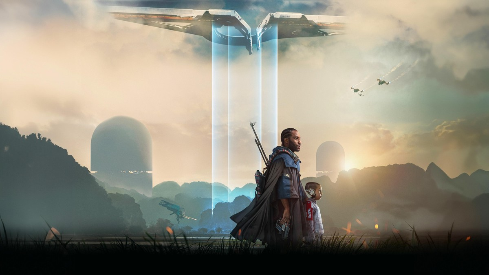
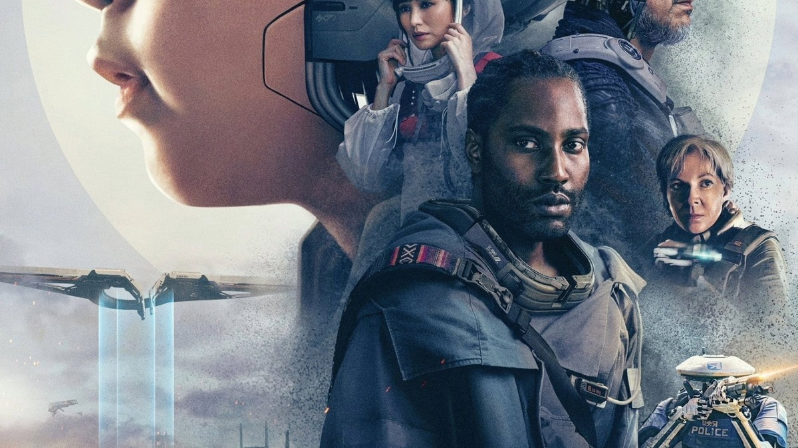
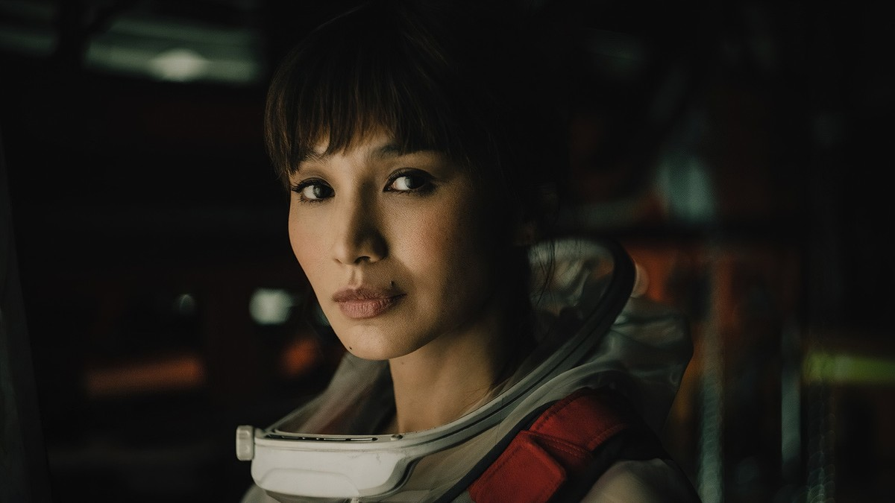
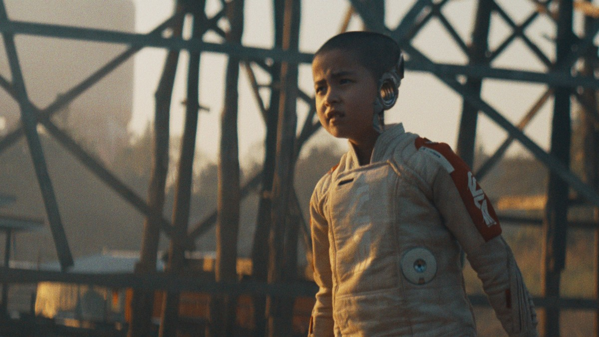
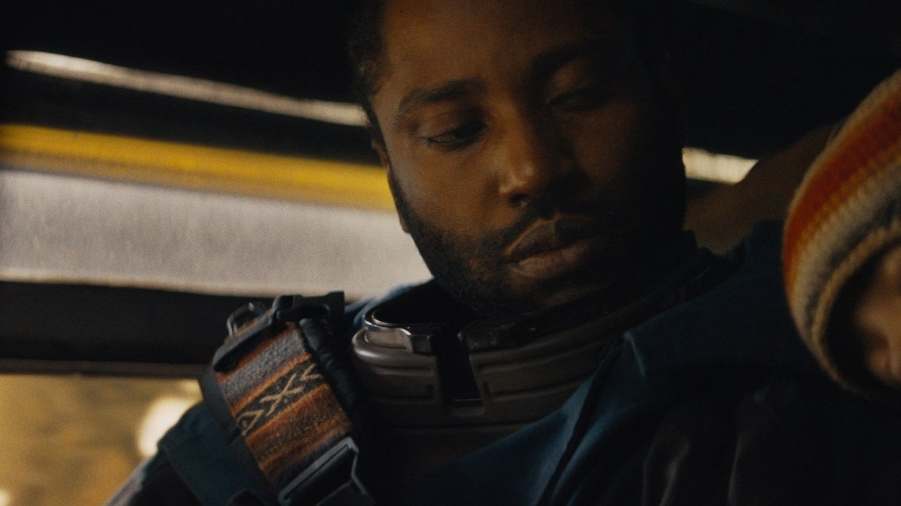
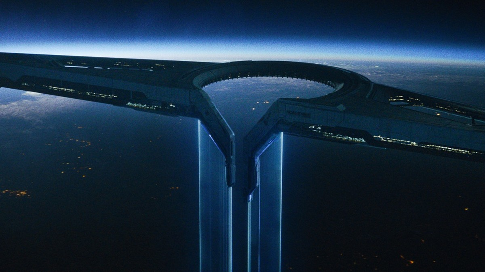

<!-- 본문 시작 -->

An AI built to protect humanity detonated a nuclear bomb over Los Angeles, and a war between humans and AI began.
Joshua, a former special forces agent grieving his missing wife, takes a mission to find the weapon threatening humanity and the Creator who made it.
But the weapon turns out to be an AI in the form of a child.
Put simply, The Creator pulls you in with spectacle first, then leaves a question behind.
It does not paint AI only as an enemy; it crashes a world that lives with AI into a world trying to erase it.

> **Key summary**
>
> The Creator follows Joshua and Alphie, an AI child marked as a weapon, through a war between humans and AI.
> The spectacle is huge, and the question is not simple.
> Should AI be treated as an enemy to eliminate, or as a being to live with? The film hands that question to the audience instead of answering it.

---

## What kind of film is it?

The Korean poster. Joshua and Alphie at the center of a war between humans and AI.

| Item | Detail |
|---|---|
| Title | The Creator (2023) |
| Director | Gareth Edwards (Rogue One) |
| Screenplay | Gareth Edwards, Chris Weitz |
| Cast | John David Washington (Joshua), Gemma Chan (Maya), Ken Watanabe (Harun), Madeleine Yuna Voyles (Alphie), Allison Janney |
| Runtime | 134 minutes (TMDB lists 2h 14m) |
| Korea rating | 12 (TMDB releases: theatrical 2023-10-03, digital 2023-12-27) |
| TMDB member score | 70% (around 7.0 out of 10) |
| Where to watch in Korea (TMDB Korea page, checked 2026-10-29) | Streaming: Netflix, Watcha / Purchase: Wavve HD ₩7,150 |

The official synopsis covers this much.
After the detonation, war breaks out, and Joshua, searching for a trace of his missing wife, heads into enemy territory to find the Creator.
The point where the weapon turns out to be an AI child is where the official outline stops.
What happens after that, including the ending, is not covered here.
Above it all floats NOMAD, the human side's orbital platform, showing the war's scale at a glance.

The scale of production is worth noting too.
The budget was reported at around $80 million, and worldwide box office at around $104 million.
That is modest for a blockbuster, yet the screen feels much bigger.
That gap comes from how the film was made.

## How does it portray AI?

Joshua and Alphie walking beneath the NOMAD ship. They look like companions, not hunter and target, and that distance is where the film starts.

The AI in this film is not one kind.
There are human-looking simulants, robots with visible machinery on their arms and heads, and Alphie, a child.
The premise is a world where AI already lives inside society.
One side bans AI and tries to erase it; New Asia lives alongside it.
So the cause of the war is drawn less as technology itself and more as a clash over how to treat AI.

A close-up of Alphie. The machinery beside her ear quietly shows that this child is not human.

Alphie is called a weapon, but on screen she looks like a child.
She is afraid, she follows people, she sleeps.
That is why Joshua wavers between his mission and the child in front of him.
The audience wavers too.
Is it right to treat this child as a weapon, or right to protect her?

Harun (Ken Watanabe) in profile. The machinery behind his head shows a world where the line between human and AI has already blurred.

Characters like Harun, played by Ken Watanabe, blur that line further.
A human face joined to machinery shows how hard it is to split humans and AI cleanly.
The director has said in interviews that he hoped the film would also read as a story about prejudice.
The way people divide over an AI being reads a lot like real-world prejudice.

## Why did opinions split?

A close-up of Maya (Gemma Chan). The missing wife gives Joshua's journey a personal reason.

The split comes down to a gap between spectacle and story.
At release, foreign tallies put the Rotten Tomatoes critics score around 74% and Metacritic around 65–67.
Critics tended to point at story weaknesses, while audiences tended to praise the world-building and design.
What you expect from the film changes how it lands.

A night shoot on a beach in Thailand. The director chose a small camera and fast on-location shooting over giant rigs.

The way it was made is another draw.
Instead of big cranes and lighting rigs, the director picked up a small camera and shot improvisationally, documentary-style.
He filmed in real places, from a beach in Thailand to a particle accelerator, and the robot designs drew on 1980s–90s product design and insect heads.
That is why the future on screen feels both futuristic and worn, something you could touch.

Joshua holding a sleeping Alphie in a vehicle. A quiet pause in the middle of a war film.

A pre-watch checklist looks like this.
First, the Korea rating is 12, with war and combat scenes.
Second, do not look up the ending in advance. The setup up to the midpoint already raises enough questions.
Third, a bigger screen helps. The NOMAD ship and the New Asia landscapes come alive at scale.
Fourth, streaming lineups change, so check each service again before watching.

The NOMAD ship above Earth. A symbol of the human side, and a single image of the war's scale.

To sum up, The Creator is entertainment built on AI, and at the same time a question about how we treat AI.
If the premise clicks, you sink into the world; if the story gaps bother you, disappointment follows.
Either way, it works as a starting point for imagining a world shared with AI.

## Frequently asked questions

**Where can I watch it?**
As of the TMDB Korea page on 2026-10-29, streaming is on Netflix and Watcha, and purchase is on Wavve (HD ₩7,150). Lineups change, so check each service before watching.

**Can I watch it with children?**
The Korea rating is 12. With war and combat scenes, it fits teenagers and older better than young children.

**Should I avoid spoilers?**
This post covers only up to the midpoint setup in the official synopsis. The ending and twists are not included, so watching fresh is the better choice.

## Further reading

[The Electric State｜A Girl, a Robot, and a Road Trip Across 1990s America to Find Her Brother — TMDB 6.5, critics 14% vs audience 67%](https://aitechnotesen.blogspot.com/2026/10/the-electric-statea-girl-robot-and-road.html)
[OpenAI Says AI Solved Three Hard Problems — But So Far, They Are Claims, Not Verdicts — Lean proofs and peer review draw the verification line](https://aitechnotesen.blogspot.com/2026/10/openai-says-ai-solved-three-hard.html)
[Cassandra｜The House AI That Woke Up After 50 Years — Rotten Tomatoes critics 100%, audience 71% German smart-home thriller](https://aitechnotesen.blogspot.com/2026/10/cassandrathe-house-ai-that-woke-up.html)

<!-- 본문 끝 -->

## 작업용 출처·이미지 정보 (업로드 제외)

- 자료 출처: TMDB 영화 670292 페이지·개봉일·시청처(KR) (2026-10-29 확인) / 20th Century Studios 보도 스틸 (mamasgeeky 인터뷰 기사) / 로튼토마토·메타크리틱 개봉 당시 집계 보도
- 이미지: images/01-hero-en.jpg ~ 09-img7-en.jpg / TMDB 원본 + 보도 스틸, 1200x675 / 포스터는 중앙 크롭, 1639x586 보도 스틸 3장은 1200x675 크롭·확대이나 육안 품질 이상 없음
