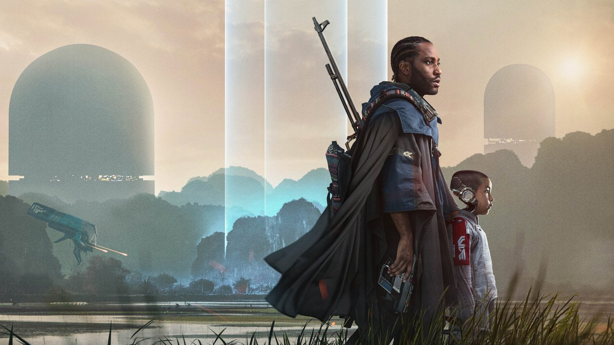
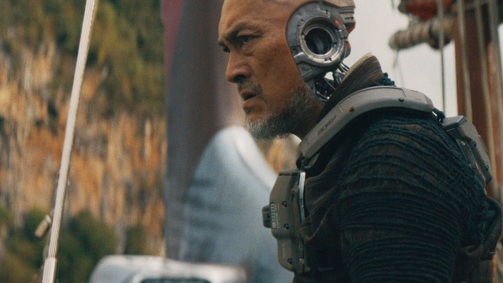
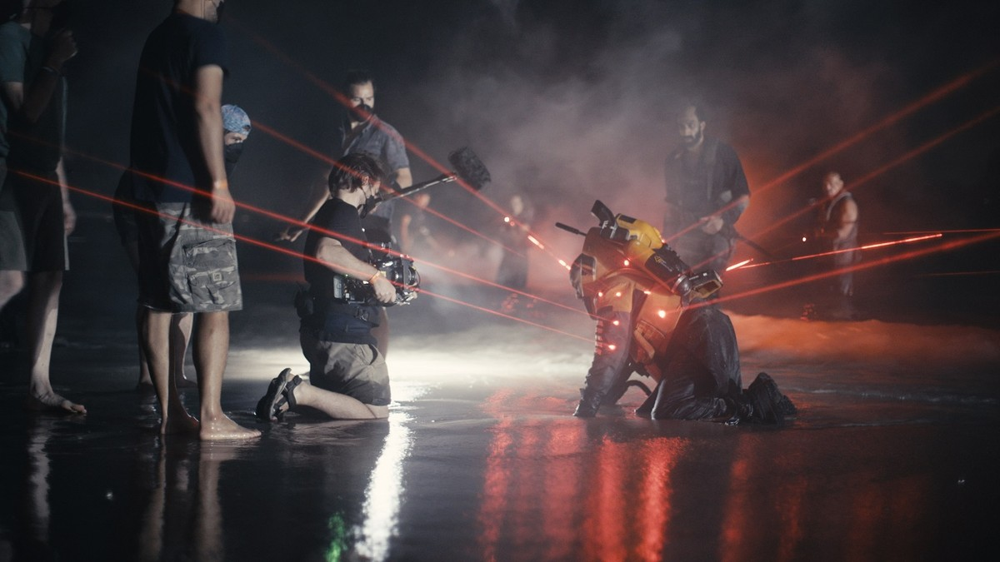

<!-- 본문 시작 -->

인류가 만든 AI가 LA에 핵폭탄을 터뜨린 뒤, 인간과 AI의 전쟁이 시작됐다.
전직 특수부대 요원 조슈아는 실종된 아내의 단서를 얻기 위해, 인류를 위협하는 무기와 그 무기를 만든 '창조자'를 찾으라는 임무를 받는다.
그런데 그 무기의 정체는 아이 모습의 AI 로봇이었다.
결론부터 말하면, 크리에이터는 볼거리로 먼저 끌고, 그다음에 질문을 남기는 SF다.
AI를 적으로만 그리지 않고, AI를 사람처럼 대하는 세계와 AI를 없애려는 세계를 맞부딪치게 만든다.

> **핵심 정리**
>
> 크리에이터는 인간과 AI의 전쟁을 배경으로, '무기'로 지목된 아이 모습의 AI 알피와 그를 지키려는 조슈아의 여정을 그린다.
> 볼거리는 거대하고, 질문은 단순하지 않다.
> AI를 없애야 할 적으로 볼 것인지, 함께 살아갈 존재로 볼 것인지, 영화는 답을 정해주지 않고 관객에게 넘긴다.

---

## 크리에이터는 어떤 영화야?

한국어 포스터. 인류와 AI의 전쟁 한가운데 선 조슈아와 알피가 작품의 중심이다.

| 항목 | 내용 |
|---|---|
| 제목 | 크리에이터 (The Creator, 2023) |
| 감독 | 개릿 에드워즈 (로그 원 연출) |
| 각본 | 개릿 에드워즈, 크리스 와이츠 |
| 출연 | 존 데이비드 워싱턴(조슈아), 제마 챈(마야), 와타나베 켄(하룬), 매들린 유나 보일스(알피), 앨리슨 재니 |
| 러닝타임 | 134분 (TMDB 2시간 14분 표기) |
| 국내 등급 | 12세 (TMDB 개봉일 페이지: 극장 2023-10-03, 디지털 2023-12-27) |
| TMDB 회원 점수 | 70% (10점 만점 기준 7.0점대) |
| 국내 시청처 (2026-10-29 TMDB 한국 페이지 확인) | 스트리밍: 넷플릭스, 왓챠 / 구매: 웨이브 HD 7,150원 |

공식 시놉시스의 범위는 이렇다.
인류를 지키기 위해 만들어진 AI가 LA에 핵폭탄을 터뜨린 뒤 전쟁이 시작되고, 실종된 아내를 그리워하는 전직 특수부대 요원 조슈아가 '창조자'를 찾으러 적진으로 향한다.
그가 파괴하라는 무기가 아이 모습의 AI라는 사실이 드러나는 지점까지가 공식 줄거리의 범위다.
그 뒤의 전개와 결말은 이 글에서 다루지 않는다.
하늘 위에는 인류 진영의 궤도 플랫폼 노매드가 떠 있어, 전쟁의 규모를 한눈에 보여준다.

제작 규모도 짚어둘 만하다.
제작비는 약 8,000만 달러, 전 세계 흥행은 약 1억 400만 달러 수준으로 보도됐다.
거대 블록버스터치고는 낮은 편인데, 화면의 밀도는 그보다 훨씬 크게 느껴진다.
이 간극이 이 영화의 제작 방식에서 나온다.

## AI는 어떻게 그려졌을까?

하늘 위 노매드 함선 아래를 걷는 조슈아와 알피. 적이 아니라 동행자처럼 보이는 두 사람의 거리감이 이 영화의 출발점이다.

이 영화의 AI는 한 종류가 아니다.
사람처럼 생긴 AI(시뮬런트), 팔·머리에 기계가 드러나는 로봇, 아이 모습의 알피까지, AI가 사회 안에 섞여 사는 세계가 전제다.
서쪽 진영은 AI를 금지하고 없애려 하고, 뉴아시아 쪽은 AI와 함께 산다.
그래서 전쟁의 원인은 기술 자체가 아니라, AI를 어떻게 대할 것인가에 대한 입장 차이로 그려진다.

알피의 클로즈업. 귀 옆에 드러난 기계 장치가 이 아이가 인간이 아니라는 사실을 조용히 보여준다.

알피는 '무기'라는 이름으로 불리지만, 화면에서는 아이로 보인다.
두려워하고, 사람을 따르고, 잠든다.
조슈아가 임무와 눈앞의 아이 사이에서 흔들리는 이유가 여기에 있다.
관객도 같은 흔들림을 겪게 된다.
이 아이를 무기로 처리하는 것이 옳은가, 아니면 지키는 것이 옳은가.

하룬(와타나베 켄)의 옆모습. 머리 뒤편의 기계 장치가 인간과 AI의 경계가 이미 흐려진 세계를 보여준다.

와타나베 켄이 연기한 하룬 같은 인물은 그 경계를 더 흐리게 만든다.
인간의 얼굴에 기계가 이어진 모습은, 인간과 AI를 깔끔하게 나누는 것이 얼마나 어려운지를 보여준다.
감독은 인터뷰에서 이 영화를 편견에 관한 이야기로도 읽히길 바란다고 밝힌 바 있다.
AI라는 존재를 두고 나누는 편이, 현실의 편견과 닮아 있다는 뜻으로 읽힌다.

## 왜 호불호가 갈렸을까?

마야(제마 챈)의 클로즈업. 실종된 아내라는 설정이 조슈아의 여정에 개인적인 이유를 더한다.

평가가 갈린 지점은 볼거리와 서사의 온도차다.
개봉 당시 외신 집계 기준 로튼토마토 비평가 점수는 74% 수준, 메타크리틱은 65~67점 수준으로 보도됐다.
비평 쪽은 서사의 아쉬움을, 관객 쪽은 세계관과 디자인의 볼거리를 주로 평가했다는 흐름이 있다.
무엇을 기대하고 보느냐에 따라 체감이 달라지는 작품이라는 뜻이다.

태국 해변에서의 야간 촬영 현장. 감독은 거대한 장비보다 작은 카메라로 현장에서 빠르게 찍는 방식을 택했다.

제작 방식은 이 영화의 또 다른 볼거리다.
감독은 큰 크레인과 조명을 세우는 대신, 소형 카메라를 들고 현장에서 즉흥적으로 찍는 다큐멘터리식 방식을 택했다.
태국의 해변과 입자 가속기 같은 실제 장소에서 찍었고, 로봇 디자인은 1980~90년대 제품 디자인과 곤충의 머리 형태에서 영감을 받았다고 전해진다.
그래서 화면은 미래이면서도 어딘가 낡고 손에 잡히는 느낌을 준다.

차 안에서 잠든 알피를 안은 조슈아. 전쟁 영화의 한복판에서 잠시 멈춘 듯한 장면이다.

시청 전 체크리스트는 이렇다.
첫째, 전쟁·전투 장면이 있어 국내 등급은 12세다.
둘째, 결말을 미리 찾아보지 않는 편이 좋다. 중반까지의 설정만으로도 충분히 질문이 생긴다.
셋째, 큰 화면이 유리하다. 노매드 함선과 뉴아시아의 풍경은 화면이 클수록 살아난다.
넷째, 시청처는 수시로 바뀌니 보기 전에 각 서비스에서 다시 확인한다.

지구 궤도 위의 노매드 함선. 인류 진영의 상징이자, 전쟁의 규모를 한눈에 보여주는 장면이다.

마지막으로 정리하면, 크리에이터는 AI를 소재로 쓴 오락 영화이면서, AI를 대하는 태도에 대한 질문을 던지는 영화다.
설정이 마음에 들면 세계관에 푹 빠지게 되고, 서사의 빈틈이 눈에 띄면 아쉬움이 남는다.
어느 쪽이든, AI와 함께 사는 세상을 상상하는 출발점으로는 충분한 작품이다.

## 자주 묻는 질문

**어디서 볼 수 있나요?**
2026-10-29 TMDB 한국 페이지 기준 스트리밍은 넷플릭스와 왓챠, 구매는 웨이브(HD 7,150원)에서 확인됐다. 서비스 편성은 바뀔 수 있으니 시청 전에 각 서비스에서 다시 확인한다.

**아이와 함께 봐도 되나요?**
국내 등급은 12세다. 전쟁과 전투 장면이 있어 어린아이보다는 청소년 이상과 함께 보는 편이 맞다.

**결말을 모르고 봐야 하나요?**
이 글은 공식 시놉시스 범위인 중반 설정까지만 다룬다. 결말과 반전은 적지 않았으니, 미리 찾아보지 않고 보는 편이 좋다.

## 함께 읽으면 좋은 글

[일렉트릭 스테이트｜로봇과 함께 동생을 찾아 떠난 소녀의 1990년대 로드무비 — TMDB 6.5, 로튼토마토 비평가 14% 대 관객 67%의 온도차](https://aitechnoteskr.tistory.com/51)
[OpenAI, AI가 푼 3대 난제 발표… 아직은 '주장'이다 — 린 증명과 동료 심사로 가려지는 검증 범위를 정리한 글](https://aitechnoteskr.tistory.com/50)
[어도비 7종 무료로 다시 만든 AI｜포토크래프트와 REA의 충격 — 어도비 7종을 AI로 무료 복제한 사례와 저작권 논쟁](https://aitechnoteskr.tistory.com/43)

<!-- 본문 끝 -->

## 작업용 출처·이미지 정보 (업로드 제외)

- 자료 출처: TMDB 영화 670292 페이지·개봉일·시청처(KR) (2026-10-29 확인) / 20th Century Studios 보도 스틸 (mamasgeeky 인터뷰 기사) / 로튼토마토·메타크리틱 개봉 당시 집계 보도
- 이미지: images/01-hero.jpg ~ 09-img7.jpg / TMDB 원본 + 보도 스틸, 1200x675 / 포스터는 중앙 크롭, 1639x586 보도 스틸 3장은 1200x675 크롭·확대이나 육안 품질 이상 없음
