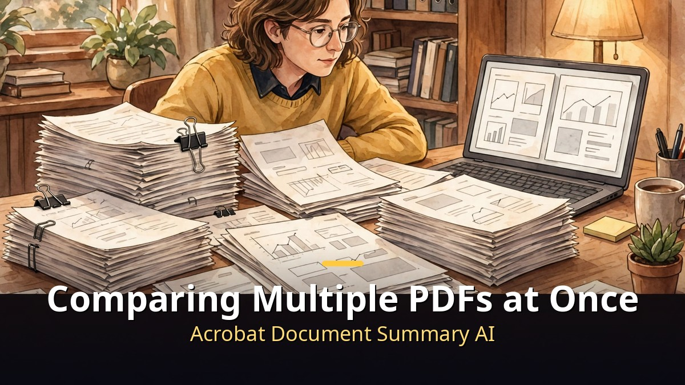
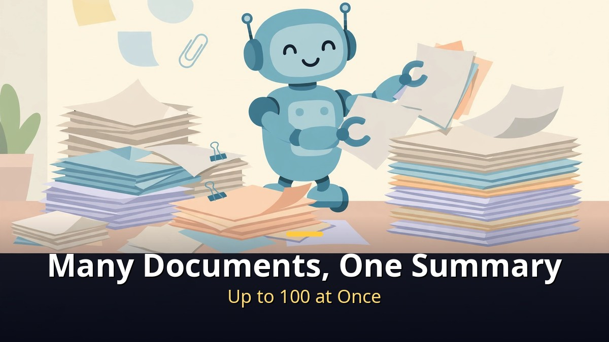
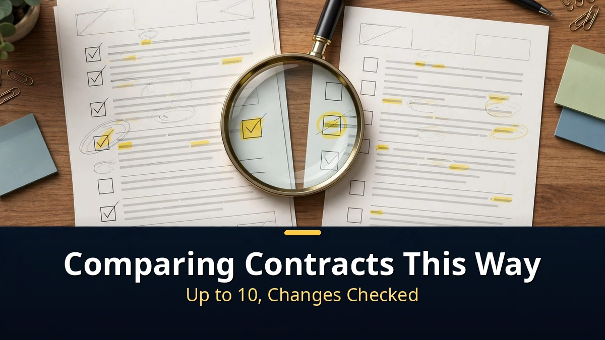
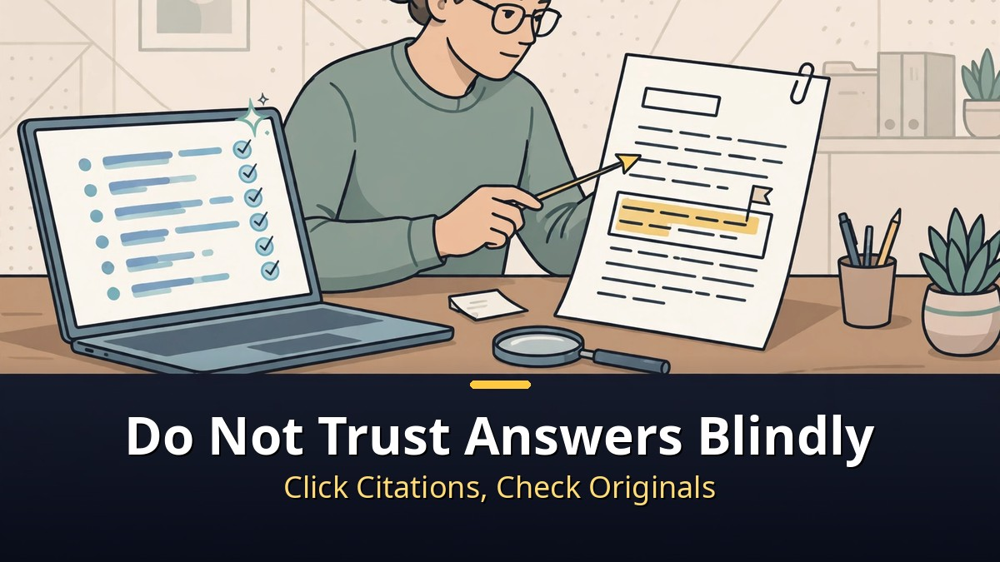

<!-- 본문 시작 -->

Contracts, reports, papers.
Open them one by one and you end up reading the same content three times.

Acrobat's document summary AI summarizes and compares several documents at once.
The point is not to read less, but to narrow down exactly what needs checking.

> **Key takeaway**
>
> Summarizing and comparing multiple documents at once is what Acrobat AI does best.
> For contracts, it compares up to 10 documents for changes and inconsistencies, and shows citations to the original text for its answers.
> A summary is only a starting point. Before signing or paying, click the citation and check the original yourself.

## What changes when you summarize several documents at once?

When several documents are summarized together, you no longer read each file separately.

Acrobat AI Assistant creates an outline and section summaries when you open a document.
Its distinctive feature is analyzing multiple documents together, pulling out shared points, differences, and connections.
According to Adobe's official guidance, up to 100 documents can be analyzed at once.

This shines when material is scattered.
Meeting notes in several files, multiple versions of a report, survey results split across files.
Gathering only the key points from each file makes it much faster to grasp the whole picture.

But the wider the scope, the rougher the summary becomes.
With more files, it is harder to fit every detailed condition into the summary.
So use the overall summary to set direction, and re-check important numbers and conditions in the individual files.

When summarizing multiple documents, deciding your questions first makes the result much sharper.
"What is the shared conclusion?" or "Where do they disagree?" Set the comparison criteria first.
Asking only "summarize this" tends to leave polished sentences while the differences you actually need drop out.

## How should contract comparison be used?

Contract comparison is the most practical use of multi-document summary.

When Acrobat AI Assistant recognizes a document as a contract, it switches to a contract view.
It shows key dates and main terms at a glance, and suggests questions specific to each contract.
Scanned contracts can also be compared, with up to 10 contracts checked for changes and inconsistencies.

Three questions work well in practice.
First, "Summarize this contract's key dates and payment terms."
Second, "What changed compared with the previous version?"
Third, "Does any clause conflict with the other contracts?"

These questions matter because the most expensive mistake in contract review is a clause you never saw.
One changed sentence or one missing date can become a dispute later.
AI comparison reduces that risk, but it does not replace legal judgment.

So once you have a comparison result, the next steps are fixed.
Read the changed clauses in the original, and re-check amounts, dates, and termination conditions as numbers.
If a clause looks doubtful, open the citation location before passing it to a lawyer or legal team.

## Can you trust the answers as they are?

No, not as they are.
Acrobat AI Assistant's strength is showing a citation to the original text for each answer.

Clicking a citation jumps straight to that sentence in the original document.
The reason is clear.
A summary is a sentence the AI made, and the original is the real evidence.

So a good order is this.
First grasp the whole picture from the AI summary, then click citations and check just three key sentences in the original.
Before an irreversible decision such as signing, paying, or submitting, never skip this checking step.

Check the terms of use in advance too.
Whether AI Assistant is included can vary by plan.
Before using it, check whether your plan includes the feature or requires a separate subscription.
Adobe's business guidance states that business data is not used to train AI models, but for personal documents it is safer to re-check your own account settings and terms for how documents are stored and processed.

In short, Acrobat's document summary AI is not a tool for reading fewer documents.
It is a tool for narrowing down what to check.
Bundle several documents, compare contract changes, and verify through citations, and the fatigue of document work drops sharply.

## Frequently asked questions

**Q. Does it work with non-PDF files?**
A. Acrobat AI Assistant works on PDF documents. Convert other formats to PDF first.

**Q. Can scanned documents be compared?**
A. Contract comparison guidance says scanned documents can be included, up to 10 in total. If scan quality is low, recognition can be wrong, so check key clauses against the original image as well.

**Q. Can a summary be wrong?**
A. Yes, it can. That is why clicking the citation to check the original is essential. Re-check amounts, dates, and termination conditions as numbers.

## Further reading

[A 9x Cheaper Agent Than Opus｜GPT-6.1 Terra Is Cheap, but Not Weak — price, surcharge, and the limits of the claim](https://aitechnotesen.blogspot.com/2026/10/a-9x-cheaper-agent-than-opusgpt-61.html)
[The Creator｜In a War Against AI, a Soldier Meets a Child — the child-shaped AI called a weapon, and the journey to protect it](https://aitechnotesen.blogspot.com/2026/10/the-creatorin-war-against-ai-soldier.html)
[Running AI Free on Your Own Computer｜A Local AI Comparison by Device — what each device can actually run, and the hidden costs](https://aitechnotesen.blogspot.com/2026/10/running-ai-free-on-your-own-computera.html)

<!-- 본문 끝 -->

## 작업용 출처·이미지 정보 (업로드 제외)

- 자료 출처: 오후다섯씨 '애크로뱃 문서 요약 AI로 여러 문서와 PDF 한 번에 비교하는 법' (2026-10-29, 제목·주제 기준) / Adobe Acrobat AI Assistant 공식 안내 웹 리서치 (2026-10-30 확인: 최대 100개 문서 동시 분석, 계약서 최대 10개 대조, 인용 출처)
- 이미지: images/01-hero-en.jpg ~ 04-img3-en.jpg / 직접 제작 (AI 생성 + 영어 오버레이) / 사용권: 자작
