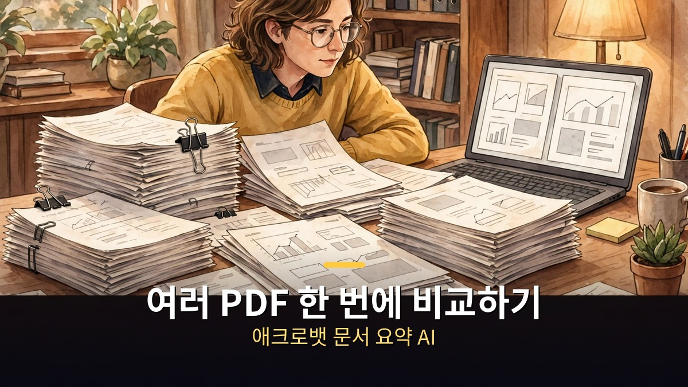
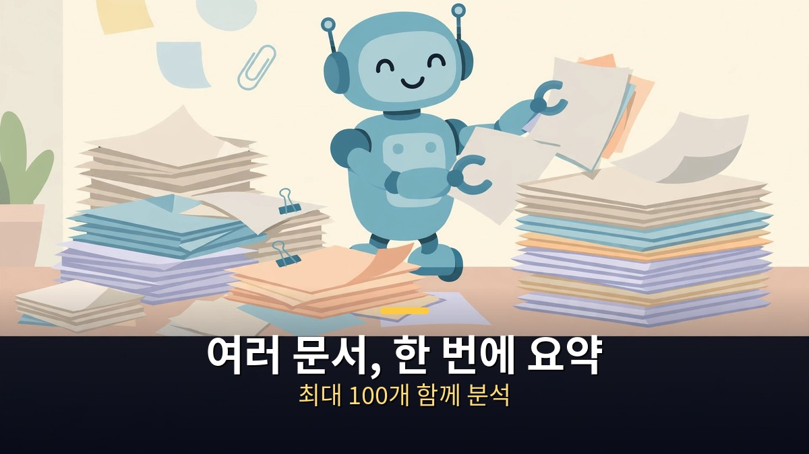
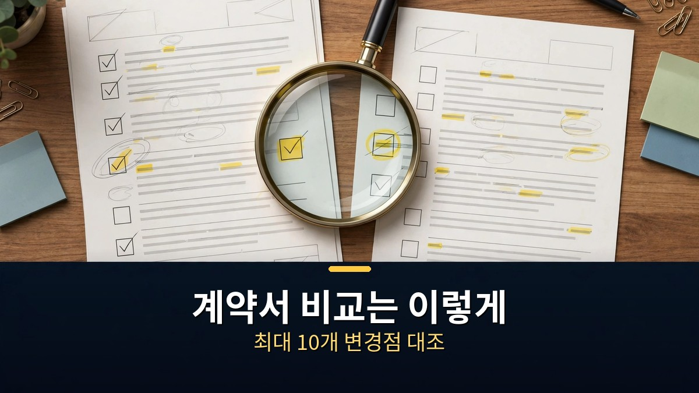
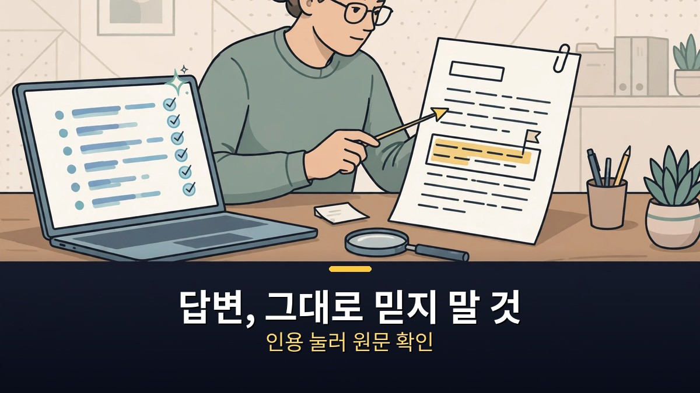

<!-- 본문 시작 -->

계약서, 보고서, 논문.
각각 따로 열어 읽다 보면 같은 내용을 세 번 읽게 된다.

애크로뱃의 문서 요약 AI는 여러 문서를 한 번에 묶어 요약하고 비교하는 기능이다.
핵심은 읽는 양을 줄이는 게 아니라, 확인해야 할 곳만 골라주는 것이다.

> **핵심 정리**
>
> 여러 문서를 한 번에 요약·비교하는 것이 애크로뱃 AI의 본업이다.
> 계약서는 최대 10개까지 변경점·불일치를 대조하고, 답변마다 원문 위치를 인용으로 보여준다.
> 다만 요약은 출발점일 뿐, 서명·결제 전에는 인용을 눌러 원문을 직접 확인해야 한다.

## 여러 문서를 한 번에 요약하면 뭐가 달라지나?

여러 문서를 한 번에 묶어 요약하면, 문서마다 따로 읽지 않아도 된다.

애크로뱃 AI 어시스턴트는 문서를 열면 개요와 구간별 요약을 만들어준다.
한 개가 아니라 여러 문서를 함께 분석해 공통점과 차이, 연결되는 내용을 뽑아주는 것이 특징이다.
공식 안내에 따르면 한 번에 최대 100개 문서까지 함께 분석할 수 있다.

이 방식이 빛나는 때는 자료가 흩어져 있을 때다.
예를 들어 회의 자료 여러 개, 보고서 여러 버전, 설문 결과 여러 파일이 따로 있을 때다.
각 파일의 핵심만 모으면 전체 흐름을 잡는 시간이 크게 줄어든다.

다만 범위가 넓어질수록 요약은 거칠어진다.
파일이 많아질수록, 각 파일의 세부 조건까지 요약에 다 담기 어렵다.
그래서 전체 요약은 방향을 잡는 용도로 쓰고, 중요한 숫자와 조건은 개별 파일에서 다시 확인하는 것이 안전하다.

여러 문서 요약을 쓸 때, 먼저 물어볼 질문을 정해두면 결과가 훨씬 또렷해진다.
"공통 결론은 뭐야", "서로 다른 부분은 어디야"처럼 비교 기준을 먼저 정하는 것이다.
기준 없이 "요약해줘"만 하면, 보기 좋은 문장만 남고 정작 필요한 차이는 빠지기 쉽다.

## 계약서 비교는 어떻게 쓰면 되나?

계약서 비교는 여러 문서 요약 중에서도 가장 실용적인 용도다.

애크로뱃 AI 어시스턴트는 문서가 계약서인 것을 인식하면 계약서용 화면으로 바꿔준다.
핵심 날짜, 주요 조건을 한 번에 보여주고, 계약서마다 다른 질문을 추천해준다.
스캔한 계약서도 비교 대상이 되며, 최대 10개 계약서까지 변경점과 불일치를 대조할 수 있다.

실무에서 바로 쓸 수 있는 질문은 세 가지다.
첫째, "이 계약의 핵심 날짜와 금액 조건을 정리해줘."
둘째, "이전 버전과 비교해 바뀐 조항은 어디야."
셋째, "이 조항이 다른 계약서와 충돌하는 부분은 있어."

이 질문들이 유용한 이유는, 계약서 검토에서 가장 비싼 실수가 '못 본 조항'이기 때문이다.
바뀐 문장 하나, 빠진 날짜 하나가 나중에 분쟁이 된다.
AI 비교는 그 실수를 줄이는 보조 수단이지, 법률 판단을 대신하지 않는다.

그래서 계약서 비교 결과를 받았다면, 다음 순서는 정해져 있다.
바뀐 조항의 원문을 직접 읽고, 금액·날짜·해지 조건 세 가지는 숫자로 다시 대조한다.
의심되는 조항이 있으면 변호사나 법무 담당자에게 넘기기 전, AI 답변의 인용 위치를 먼저 열어둔다.

## 답변을 그대로 믿어도 되나?

답변을 그대로 믿으면 안 된다.
애크로뱃 AI 어시스턴트는 답변마다 원문 위치를 인용으로 보여주는 것이 강점이다.

인용을 누르면 해당 문장이 있는 원문 위치로 바로 이동한다.
이 기능이 있는 이유는 분명하다.
요약은 AI가 만든 문장이고, 원문이 진짜 근거이기 때문이다.

따라서 쓰는 순서는 이렇게 잡는 것이 좋다.
먼저 AI 요약으로 전체를 파악하고, 그다음 인용을 눌러 핵심 문장 세 개만 원문에서 확인한다.
서명, 결제, 제출처럼 되돌리기 어려운 결정 앞에서는 이 확인 단계를 건너뛰지 않는다.

이용 조건도 미리 확인해야 한다.
AI 어시스턴트 기능의 포함 여부는 요금제에 따라 다를 수 있다.
쓰기 전에 본인 요금제에서 해당 기능이 포함되는지, 별도 구독이 필요한지 확인하는 것이 좋다.
기업용 안내에서는 업무 데이터를 AI 학습에 사용하지 않는다고 밝히고 있지만, 개인 문서의 보관·처리 방식은 본인 계정의 설정과 약관으로 다시 확인하는 편이 안전하다.

정리하면, 애크로뱃 문서 요약 AI는 읽을 문서를 줄여주는 도구가 아니라 확인할 곳을 좁혀주는 도구다.
여러 문서를 한 번에 묶고, 계약서 변경점을 대조하고, 인용으로 원문을 확인하는 순서만 지켜도 문서 작업의 피로가 크게 줄어든다.

## 자주 묻는 질문

**Q. PDF가 아니어도 되나요?**
A. 애크로뱃 AI 어시스턴트는 PDF 문서를 대상으로 동작한다. 다른 형식의 파일은 먼저 PDF로 변환한 뒤 사용하는 것이 좋다.

**Q. 스캔한 문서도 비교가 되나요?**
A. 계약서 비교 안내에 따르면 스캔 문서도 포함해 최대 10개까지 대조할 수 있다. 다만 스캔 품질이 낮으면 인식이 틀릴 수 있으니, 핵심 조항은 원본 이미지와 함께 확인한다.

**Q. 요약이 틀릴 수도 있나요?**
A. 있을 수 있다. 그래서 답변의 인용을 눌러 원문을 확인하는 단계가 필수다. 금액, 날짜, 해지 조건은 숫자로 직접 대조한다.

## 함께 읽으면 좋은 글

[메타 새 AI "뮤즈 원더" 공개｜오퍼스 5.5 턱밑까지 따라왔다 — 메타 자체 평가 59.1점과 외부 평가의 간극을 정리한 글](https://aitechnoteskr.tistory.com/60)
[크리에이터｜AI와의 전쟁, 그 한가운데서 아이를 만났다 — 무기라 불린 아이 모습의 AI와 그를 지키는 여정](https://aitechnoteskr.tistory.com/59)
[일렉트릭 스테이트｜로봇과 함께 동생을 찾아 떠난 소녀의 1990년대 로드무비 — 로봇이 일상이 된 세계의 소녀와 로봇의 여정](https://aitechnoteskr.tistory.com/51)

<!-- 본문 끝 -->

## 작업용 출처·이미지 정보 (업로드 제외)

- 자료 출처: 오후다섯씨 '애크로뱃 문서 요약 AI로 여러 문서와 PDF 한 번에 비교하는 법' (2026-10-29, 제목·주제 기준) / Adobe Acrobat AI Assistant 공식 안내 웹 리서치 (2026-10-30 확인: 최대 100개 문서 동시 분석, 계약서 최대 10개 대조, 인용 출처)
- 이미지: images/01-hero.jpg ~ 04-img3.jpg / 직접 제작 (AI 생성 + 한글 오버레이) / 사용권: 자작
